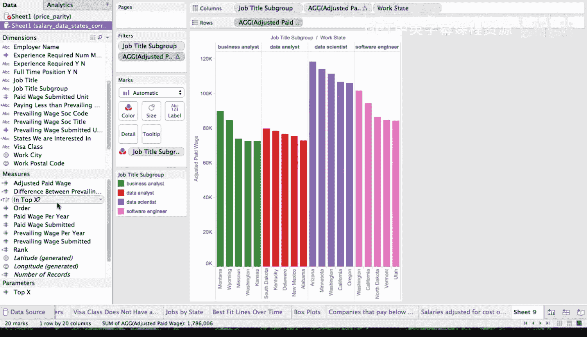
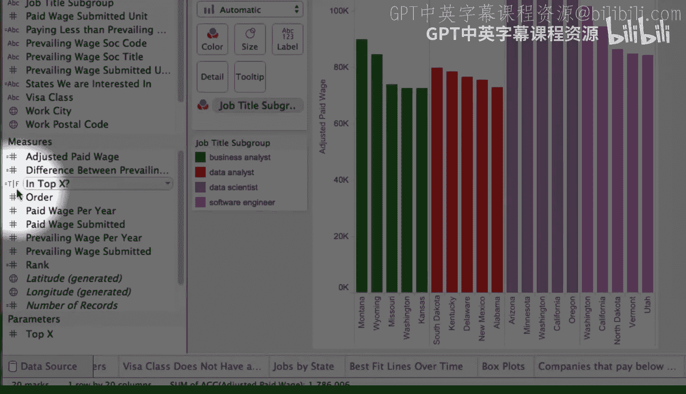
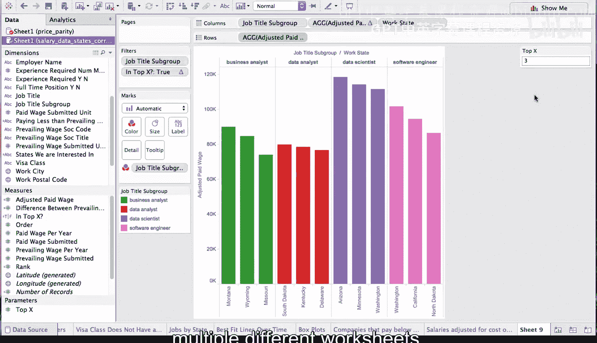

# 杜克大学《Excel 到 MySQL：商业分析（5课全）｜Excel to MySQL： Analytic Techniques for Business》中英 p110 35_04_02_使用参数定义顶尖州.zh_en -BV1mS421X7yw_p110-

Hey guys， in this video we're going to talk about one last feature of Tableau that you need to know about to use Tableau to its full potential That feature is called parameters Paraameters are basically placeholders for really anything you can think about Its a can be a placeholder for a string or number or a date。

What makes them important is that they are interactive， so they are there so that the user。

 which could be you or someone looking at your data or your dashboards can change them very quickly either by clicking on a dropdown or by writing something in or by clicking on them。

 What makes them different than filters is that they're global。

 So if you change a parameter in one worksheet， itll change in all the other worksheets as well。

 so that can make them very useful for making story points。

 The other thing that's nice about them is that you can use them in calculations。

 so that makes calculations even more powerful and dynamic than we thought before。In this video。

 we're going to use a parameter as an alternative to putting the rent calculation we made last time on the filter shelf。

 so we'll use the parameter to find how many states we're going to look at in every single job title subgroup。

To do that， I want you to go to your Tableau worksheet again and go to where we were before。

Our strategy for making the parameter and using it to define how many states we're going to see。

 it's going to be twofold， first we're going to make the parameter。

 and then we're going to make a calculation that compares the rank in each one of these items to the parameter。

 then we'll put that calculation on the filter shelf and that will be provide the same type of functionality as we see here。

So to make a parameter， just like anything else， you can either right click here in your variable pane or you go up to the analysis drop down。

 so let's right click right click here and go to create parameter。Let's call this parameter top X。

 because it's dynamic。 So we're going to use x to represent the fact that it's dynamic。Data type。

 you can choose a bunch of different options， we'll choose integer because that we're going to just use integers as our cutoffs and let's make the current value5 for right now。

Display format， you can choose a lot of different options， will choose automatic。

And we will allow all values right now。So， say， okay。

And you can see that our top X parameter is down here， and you can just like anything else。

 treat it just like any other measured or dimension。

So now we need to make the calculation that compares the top X to the rank that we made when we made this variable here。

Okay， now let's make our calculation that will compare our rank to our new parameter。 right click。

Make create calculated field。 And let's call this in。Top X。And we're going to compare our rank。

 which we made up heres for rank calculation。We're going to ask， is it less than。Our parameter。

And one thing to notice here is that our parameter is in purple。

 so just like we were talking about how certain types of calculations are in blue and the titles of individual variables are in orange。

 parameters are always in purple。The other thing that you should know is that this calculation is going to be create a logical calculation。

 So whenever this is true， it will output the word true。 When it's false。

 it will output the word false。 So when we filter， we will filter on either true or false。

 So go ahead and press， okay。And you can see over here our calculation and if you look at the little icon next to it。

 you'll see an equal sign and a TF， so that lets you know that it is a true false calculation。

Okay， so now the next thing we need to do is we need to be able to interact with our parameter。

 So much like the filters， you can right click and go to show parameter control。

And now you can see over here there's a box where you can type in exactly what value you want for the parameter。

Let's put our calculation over here， in filter。And let's press true so we're only going to look at states that have a rank that is less than the parameter。

Okay， so if we take our other。Our other calculation off。

 you see we don't quite see what we want to see。 Why is that？

Let's take our parameter back to the details of。And let's edit table calculation。

We forgot that we have to tell it how to compute， so we're going to compute again advance。

 we're going to skip those other options， we're going to put work state in addressing。

 we're going to use automatic， say okay。So the results are completed along the work state for each job in in the job title subgroup。

 Okay， and you can see that this is our formula。Okay。Press true。

We see what we expect to see with what exception perhaps， and that's that our parameter says five。

 but we only see four different states in each one of these subcategories。

 Why is that that's because our calculation said less than5。

 not less than are equal to5 so we can go back and change that calculation。In doex。

 let's go back to edit。Let's stay less than or equal to。Now， when we put this on the details shelf。

And we edit the table calculation， so that。It addresses work state。When we put it on the filter。

It will show five states for every job title subgroup。

 and we can now change this very quickly so if we put it to seven。

We'll give us the top seven states in each job title subgroup and if we change it to three。

It will change it to the top 3。So this can be very useful when you want to change the visualization across multiple different worksheets。

Great job。 In the last bunch of lessons， you have learned how to make all kinds of calculations。

 including some that are very complex and hard for many people to do。

 And you've learned how to use parameters。 You now are ready to make very dynamic and very interesting and powerful dashboards。

 That's what we'll do in the next lesson。😊。