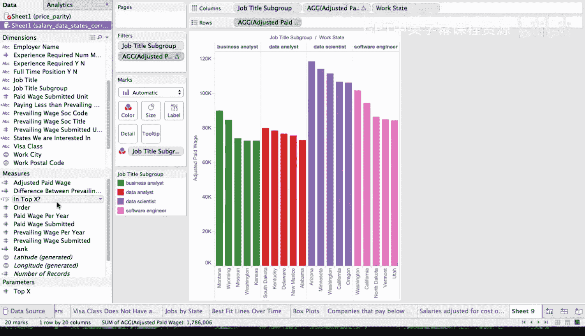
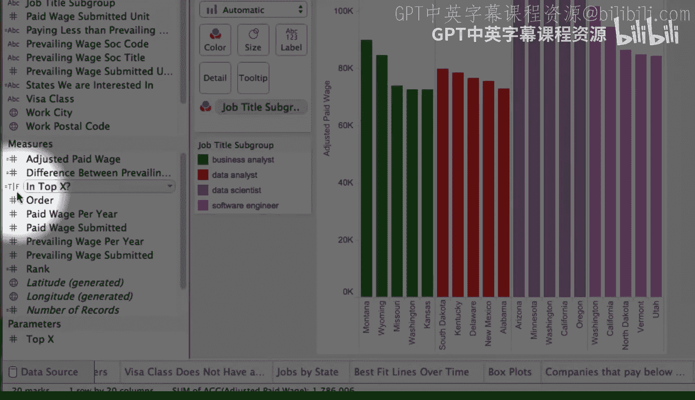
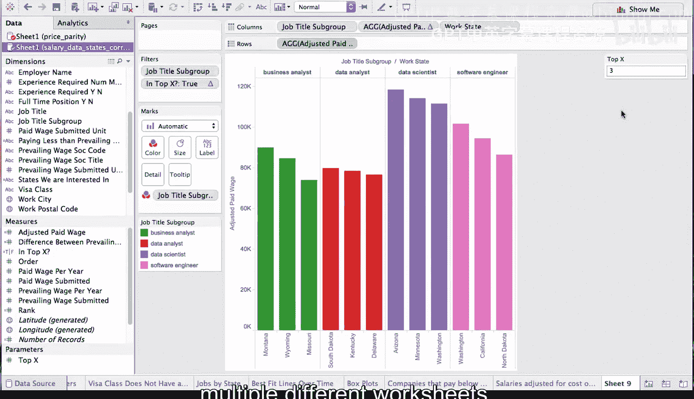

# Tableau商业分析：4.2：使用参数定义顶尖州

## 概述
在本节课程中，我们将学习Tableau中一个强大的功能——参数。参数是动态的占位符，允许用户交互式地改变视图。我们将通过创建一个参数来控制显示每个职位子组中排名前几的州，从而替代之前使用的静态筛选器。

---

## 参数简介与用途
上一节我们介绍了复杂的计算字段。本节中我们来看看参数。参数是Tableau中的一个核心功能，它是一个可以代表字符串、数字或日期的占位符。

参数的重要性在于其交互性。用户可以通过下拉菜单、输入框或点击来快速改变参数值。参数与筛选器的不同之处在于它是全局的。在一个工作表中更改参数，所有其他工作表中的该参数也会同步更新。这使得参数非常适合用于构建连贯的故事点。

另一个优点是参数可以用于计算中，这使得计算变得更加动态和强大。

## 创建参数
我们的策略分为两步：首先创建一个参数，然后创建一个计算字段，将每个项目的排名与该参数进行比较。最后，我们将这个计算字段放到筛选器架上，实现动态筛选功能。

以下是创建参数的步骤：
1.  在变量面板中右键点击，或从顶部菜单栏选择“分析”>“创建参数”。
2.  将参数命名为 **`top X`**，以体现其动态性。
3.  数据类型选择“整数”，因为我们使用整数作为分界点。
4.  将当前值设置为 **`5`**。
5.  显示格式选择“自动”，并允许所有值。
6.  点击“确定”。

创建后，参数会出现在变量面板底部，可以像度量或维度一样使用。

## 创建计算字段进行比较
现在我们需要创建一个计算字段，将我们之前创建的排名与新的参数进行比较。

以下是创建计算字段的步骤：
1.  右键点击，选择“创建计算字段”。
2.  将字段命名为 **`In Top X`**。
3.  在公式编辑器中输入：`[Rank Calculation] <= [top X]`
    *   注意：参数 **`[top X]`** 显示为紫色，这是参数的标识颜色。
    *   此计算是一个逻辑计算，结果为真时输出“True”，为假时输出“False”。
4.  点击“确定”。

创建后，该字段旁边会显示“=TF”图标，表明它是一个真/假计算。

## 应用参数与计算
接下来，我们需要能够与参数交互，并将计算字段应用到视图中。

以下是具体操作：
1.  右键点击参数 **`[top X]`**，选择“显示参数控件”。视图旁会出现一个输入框，用于动态更改参数值。
2.  将计算字段 **`[In Top X]`** 拖到“筛选器”架上。
3.  在筛选器对话框中，勾选“True”，这样视图将只显示排名小于或等于参数值的州。

## 配置表计算
应用筛选后，视图可能未按预期显示。这是因为我们之前创建的排名计算是一个表计算，需要正确配置其计算方式。

以下是配置步骤：
1.  右键点击“标记”卡中的 **`[Rank Calculation]`** 字段，选择“编辑表计算”。
2.  在“计算类型”下，选择“特定维度”。
3.  在“高级”选项中，将“工作州”字段添加到“寻址”列表中。
4.  计算依据选择“工作州”，并确保为每个“职位标题子组”进行计算。
5.  点击“确定”。

完成配置后，视图将正确显示每个职位子组中排名前X的州。例如，当参数设为5时，每个子组会显示排名前5的州。

## 动态交互验证
现在，我们可以通过参数控件动态改变显示的数量。

*   将参数值改为 **`7`**，视图会立即更新，显示每个子组中排名前7的州。
*   将参数值改为 **`3`**，视图会更新为显示排名前3的州。

这种全局联动特性使得参数在需要跨多个工作表统一改变可视化效果时非常有用。

---

## 总结
本节课中我们一起学习了Tableau参数的功能与应用。我们掌握了如何创建参数、如何构建基于参数的逻辑计算字段，以及如何将二者结合实现动态的全局筛选。通过使用参数，我们可以让仪表板变得更加灵活和交互性强，为深入的数据故事讲述奠定了基础。在接下来的课程中，我们将运用这些技能来创建动态而强大的仪表板。😊