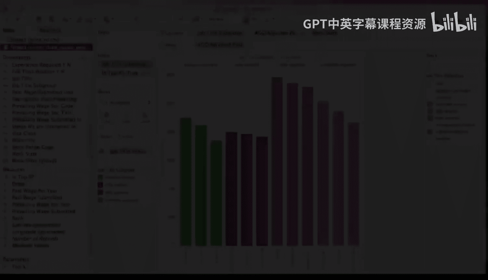
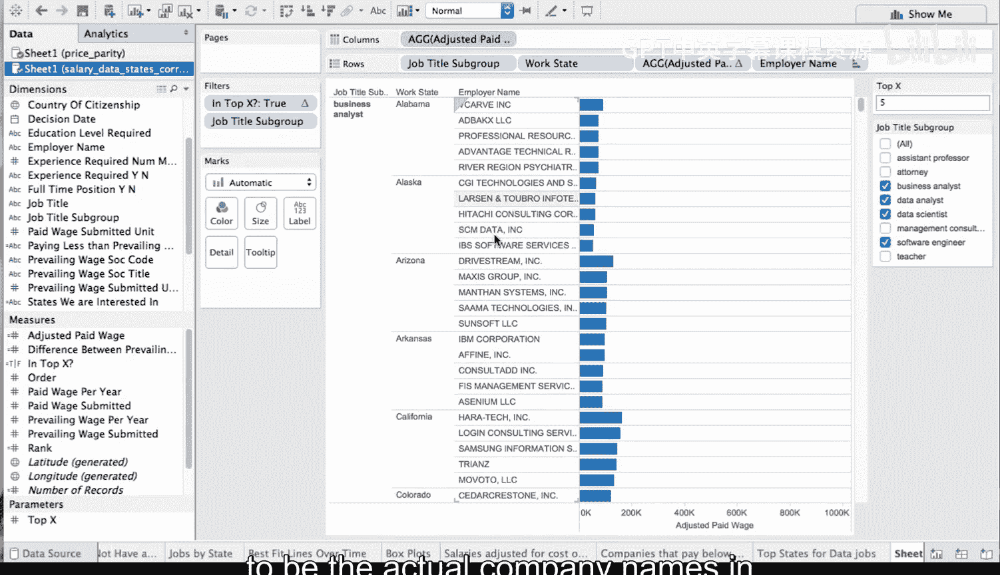

# 杜克大学《Excel 到 MySQL：商业分析（5课全）｜Excel to MySQL： Analytic Techniques for Business》中英 p111 36_04_01_计算各职业中调整后薪资最高的公司.zh_en -BV1mS421X7yw_p111-

In this lesson， we're going to talk about dashboards。

 Dashboards are a critical pieces of business intelligence and business analytics。

 They're usually used in one primary context。 That context is someone in your company coming to you and asking you for very specific information in a very specific format。

So your job， in that case is to give your customer exactly what they want and exactly the way they want it。

That's going to be a big part of your job， and so it's a very important skill set to have That skill set is knowing all the tips and tricks about how to make Tableau do exactly what you want and how to format things in exactly the way your customer wants it。

In this course， though， we aren't focused as much on how to help other people make decisions。

 we are focused more on how to help you as a data analyst make decisions and how to help you contribute to business decisions。

 so we're going to use dashboards for a different purpose in this course。In this course。

 dashboards have a much more limited role but they do have an important role。

 and that's primarily because it's the only place in Tableau where you can look at multiple graphs at once in one place。

Another reason they're useful though， is that in Tableau。

 you can use one of the results of one graph to filter the results of another graph。

 so that can help you figure out some of the nuances of your data as you're trying to figure out what the interpretation should be。

Another reason dashboards can be useful for data analytics and making decisions is if you're working on a data analytics team。

In that case， dashboards allow you to make a lot more annotations and have a lot more text boxes than worksheets do。

 So if you're trying to just update your team about what you've been doing。

 it can be a useful way to put everything in one place， put some notes down there。

 and so you can update everyone and everyone can get on the same page。In our lesson。

 we're going to use a dashboard for a very specific reason。

 We started this data analysis to help you figure out what companies you would want to apply to if you wanted to apply to get data related jobs。

To do that， then we're going to make a dashboard where the top of the dashboard is going to have the chart we made in a previous lesson。

 we're going to use that chart that shows us the states that have the highest median paid wage adjusted for cost of living in a given job subcategory。

The bottom of the dashboard is gonna show us。Exactly in that subcategory in each state。

What companies have the highest median paid wage， So this should help you figure out exactly what companies you want to apply for。

So to do that， the first thing we have to do is we have to make that one last graph we haven't made yet that shows us which companies have the highest median paid wage。

So let's go ahead and start with that now。

So go to your Tableau workbook。And bring up an empty sheet。So we're going to do something very。

 very similar to last time， except we're going to add in one more field which is going to be employer name。

 so I want you to take our adjusted paid wage and put it on rows。And in the columns。

 I want you to put job title subgroup。And same thing as last time just to make things a little easier in us。

 let's before we put on job state， let's take states we are interested in and put it in filters。Okay。

 and now I want you to put work date and columns。And now， this time。

 we're going to add employer name。Now， in a way， we're familiar with， if we try to sort。This graph。

It doesn't seem to sort within the state within a job title subgroup。

 it seems to sort in some way across the entire table， so now we know how to fix that。

 we know how to do that， the calculated field。So let's take our adjusted paid wage and let's bring it to detail。

And let's make our table calculation。Choose rank。Choose running along。Again。

 skip all of these options。 Go straight to advanced。And I want you to put employer name。

Over on the addressing side， job title subgroup and work stay Stay here。Automatic is fine， press OK。

Use descending again。 Press， O。Now we're going to make this into a discrete variable。

And we're going to put it in between work state and employer name this time。

And that's because it's ordering specifically， employer name。

OkayOnce yourquararian' had a chance to run， you'll see the rank up here now in order and you'll see that it starts for every state。

 which is exactly what we want。So now we want to make a parameter or use a parameter calculation just like we did last time。

Let's go ahead and look at our top 10 parameter。If we want to see what it looked like。

You can go to edit。And its current value right now is three， let's go ahead and put it to five。

And let's go back and review our in on top X calculation。

That is going to give us the rank of adjusted paid wage。

 which is still the variable we're using descending。

 and we're going to ask if it's less than or equal to our parameter so that should still work for us。

So， let's take。That calculation。 And let's put it on our detail。

And once it's set a chance to process， let's go ahead and。

Edit our calculation here and make sure that we change it from computing across table across to go into the advanced settings。

 employer name。Okay。So job title stays here。 work stay stays here。

 and employer name goes and addressings。 That's the one we're gonna order。So go ahead and press OK。

And press， okay。Once it's done， I want you to drag that calculation over into filters。Click true。

And now we should see only the top five。嗯。Employers who have the highest paid salaries for that specific job title subgroup。

 and let's put job title subgroup in our filter。So that we're looking at just data related jobs。嗯。

Let's make sure we have control。Of our parameter。Control of our filter。

Let's take the states we are interested in off。So that we're looking at all of the states。

And now let's do a little formatting。 Let's get rid of this header again。

So it looks a little prettier。Let's get rid of these grid lines。

And now because we have a longer text to read， let's change the orientation of our graph。

So that it's easier to read the。The actual company names in each state in each job title sub group。

Nice work。 Now we have everything we need to make our dashboard。

 Watch the next video to find out how to make that dashboard。😊。

