# 杜克大学《Excel 到 MySQL：商业分析（5课全）｜Excel to MySQL： Analytic Techniques for Business》中英 p112 37_04_02_设计仪表板以确定数据相关职位申请目标.zh_en -BV1mS421X7yw_p112-

In this video， we're going to combine all the things we've learned in this entire week to finally make that dashboard。

 So go ahead to your Tableau workbook。And this time， go down to where you were making new worksheets。

 so that's what this icon is and go to the one right next to it that says new dashboard and go ahead and click on that。

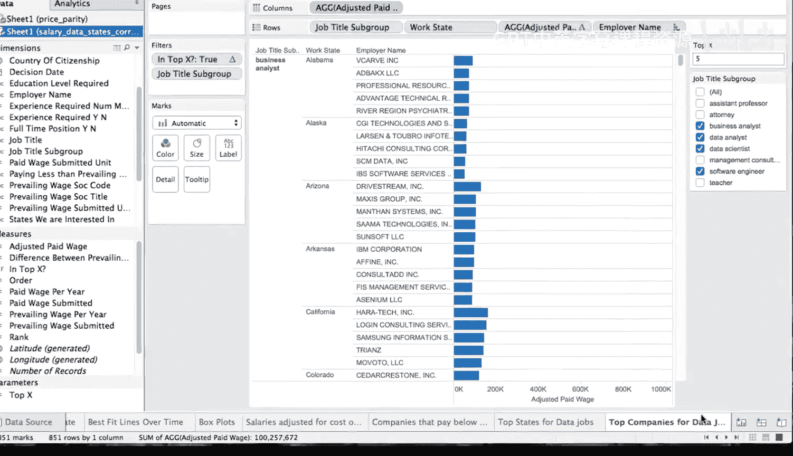

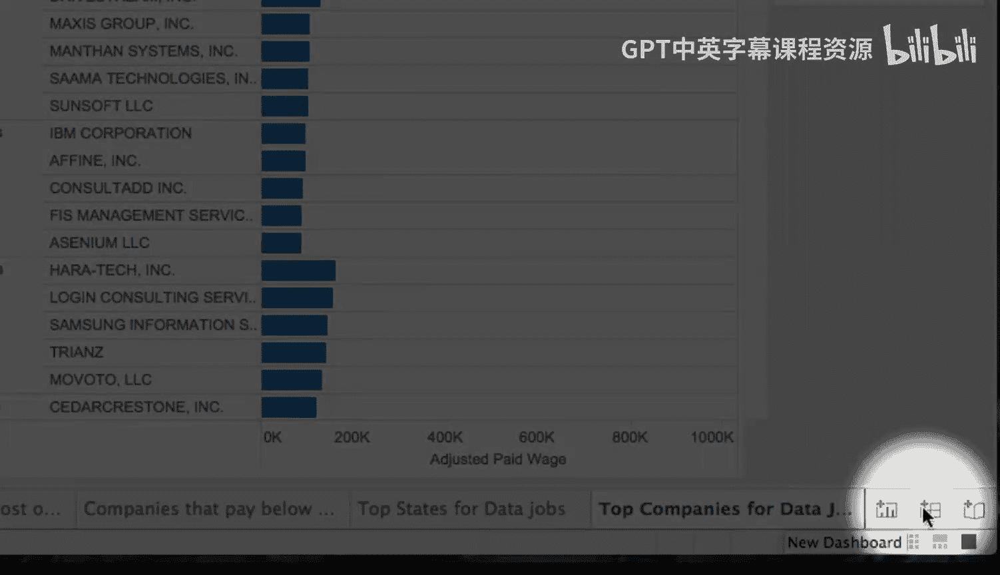

So this is what the dashboard workspace looks like and I want to orient you to a couple of things first of all。

 up here in the left is where all of our worksheets are so each one of these worksheets。

Is something we've made over the past couple of weeks together。

Here is where you can define what kind of containers you want to put in your workspace containers are kind of well they're containers。

 they define space for a given chart and if you put the containers in there then the charts will resize no matter what kind of data you put in there so even if the charts are getting bigger or smaller。

Tableau will resize those charts as appropriate for that specific container。

 We'll see what that looks like in just a second。Another thing that's important here is the size of the dashboard so you can define how big your dashboard is going to be this says desktop right now I'm going to go ahead and make it laptop。

 but you can see there are a lot of different options so you might want to make dashboards for iPads for example or for phones or for blogs or'm a very specific size we'll go ahead with laptop at least you know those options are there。

Okay， so we're going to choose what kind of containers we want。 We're going to look at two charts。

 and I think they're going to be best viewed if we have one that goes like this and the other that goes underneath it。

 So we're going to use these two vertical containers。 We're just going drag that into the workspace。

And the graph we're going to put on top is that one we made a couple videos ago where we show the top states for specific job title subcategories。

So I want you to go ahead and put that in the top。 so I just picked it up and I dragged it in。

 We're going to do the same thing with top companies。 go ahead and drag it。Underneath。

 and now you see that Tableau automatically resized these two graphs。

So the first thing I want to show you is how you can change the size so if you click on one of your graphs。

 it'll give you all of these controls you can see this gray line or this gray box that goes around the chart if you use this one it lets you move the chart。

You can also use that it's filling up the container right now so I can't move it。

 but we can do that a little later， but I can change the height。

 so let's make it so it's about half the space and so this other graph takes up the other part。Okay。

 so the there are a couple things I want to show you。 first。

 I want to show you that our quick filter came up with these charts。 If I click on the on the the。

Quick filter。 You can see that it's right now it's only filtering this chart。

 It's not filtering this chart。We can change that by going to this little arrow here at the top of the box。

 click on that and say apply to worksheets and you can see that right now it says only to this worksheet I want you to oops click on selected worksheets。

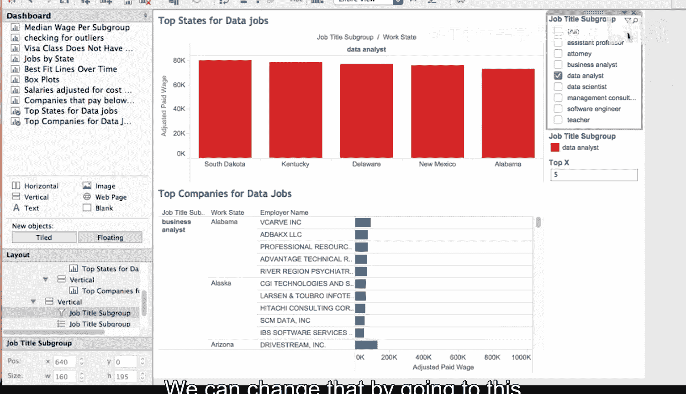

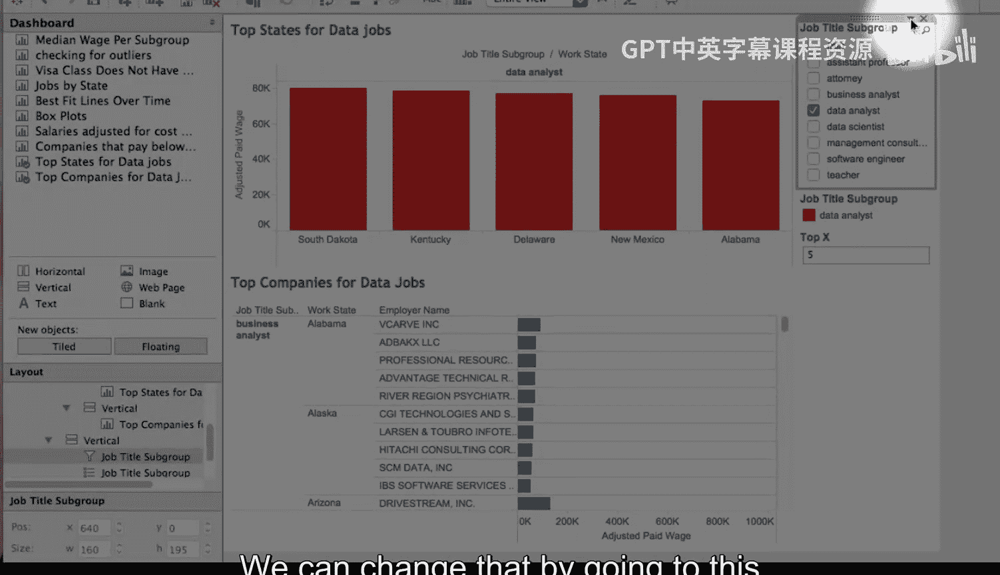

And now make sure you click on top companies for data jobs as well。

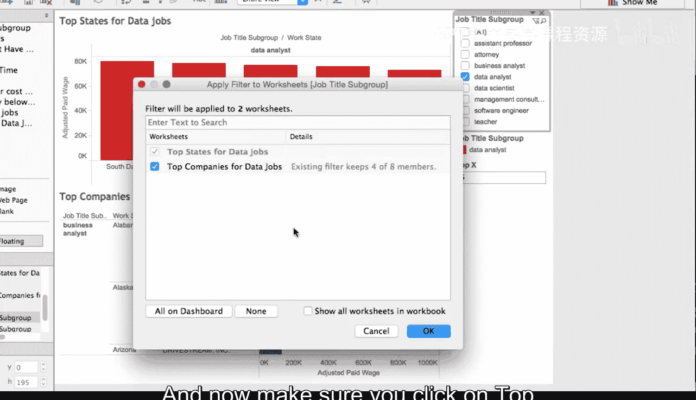

And say， okay。So now。

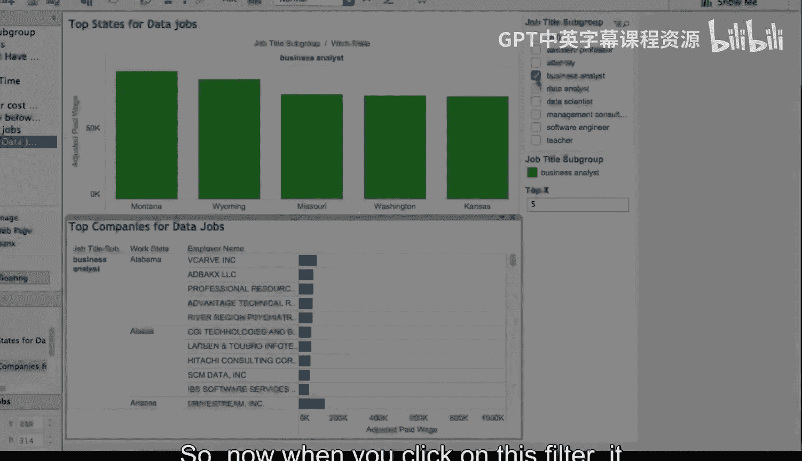

When you click on this filter， it filters both this graph and this graph。

 so you can see that data Ana is the only subcategory that's showing on this chart。

One thing you might see here is a lot of redundancy。

 We are showing a lot of the same titles over and over again。

 and that can be good to make you feel confident that you are seeing what you think you're seeing since these filters can happen in the background but one thing we don't need is yet another way to see that we are just looking at data analyst so right now this color legend is not helpful because we see it at the filter level and we also see it in our titles so to get rid of that we go to this chart because the legend is associated with this chart。

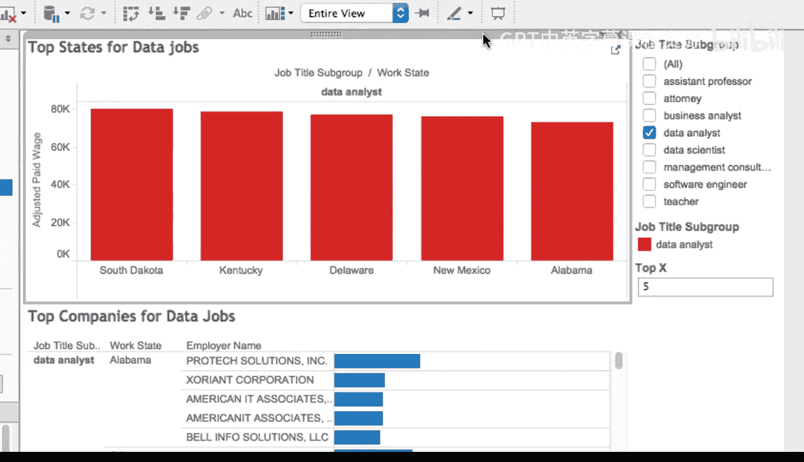

Click on this little arrow here。And this gives you all the options of things you can either add or take away from this chart or this view。

 If you go to legend， you'll see color legend is clicked。 So if you unclick that。

 the legend will go away and you can do the same thing。

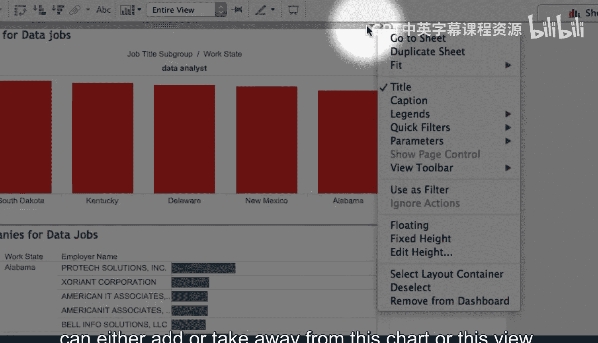

If you wanted to for titles， so you see titles clicked so you could unclick that you could add a caption。

 there are a lot of different options there that you can play with。Now。

 one of the things we want to do， probably the most important thing we want to do is we want to be able to click on one of these states and have that state filter what we're looking at in this view。

To do that， you have to go up to Dashboard and go to actions。

Right now there are no actions in there I want you to add an action and you can see that there are three different types of actions you can add one is filter。

 one is highlight and one is URL highlightlight will allow you to say when you click on one thing in one chart it will highlight something on another chart and URL will actually allow you to add in URLs or link to URLs We're going to use filter。

So when you click on filter， it brings up this this option box。 We're going to call it。Filter。State。

And the source sheet that we're going to use is the one that's top states。

 so we're going to unclick top companies， and I want it to implement that filter whenever you click on a data point from that graph so we're going to click on select you can also do it so that if you just hover your mouse over that data point it will show some people filter other data or you can give it a menu but I like select for this purpose and let's choose run on a single select only to make sure that we're only looking at one data point at the time。

The target sheet that we're interested in is going to be top top companies so I want you to take off top states for data jobs and we have a couple different options here for when you clear the selection you can either show all the values。

 exclude all the values or leave the filter on I don't like the leave the filter option because it's hard to know when that's a real filter or not or when it's just left over from before so I suggest you either show all values or exclude all values and why don't we exclude all the values。

Down here， we can choose either specific fields or all fields to filter on。

 in our case we're going to filter all fields。So go ahead and press， okay。

And now you can see that this is our action and press OK。And now。If you press on a state here。

It should filter your results here so that you only see the top companies for that state。

And you can play around， and you can see that。In a bunch of different states。

If we change our top x to say eight。That will give us eight states that we can look at。

You can see that it's filtering appropriately， you can change your job title subgroup。

And now when you look at the companies。It will adjust appropriately so that you're looking at business analyst instead of the subgroup we're looking at before and Montana。

One thing you might have noticed as I was clicking through these is that although our parameter is five。

 I don't always get five companies down here， The reason for that is if you remember our ranking was set up such that if different companies tied。

They would the ranking would all get put together and they would be lower rankings so when we only see two or three two reasons could be causing that one is that there could be a lot of ties and another could be that there aren't that many companies in that particular in that particular region of the country here's an example that'll show you how the ranking will。

Will end up leading to these weird results。 You can see here that there are actually six employer names。

 even though our parameter is5。 and that's because these guys are tied。 So this would be 12，3。

 and this is。This rank is all going to be four。A couple other things I could show you are how to format your filters。

 so instead of having a click each item type of filter you could have a single value drop down that would save you some space and just like when you're making charts before you can change the formatting on all of these titles。

All these headers， all of these axes， if you right click and left click you'll see a lot of the things you're used to seeing I don't want to go through that in the video now。

 but I definitely encourage you to explore these different options and see how clicking on them or changing them will lead to different types of views so that you can become more and more comfortable learning how to make exactly what you want。

Before I wrap up， there's one more thing I'd like to talk about。

 and that's that if you are actually going to use this dashboard to interpret your data and make decisions。

 there's one more piece of information I think is critical that we're not seeing and that's how many entries are going into each one of these。

Each one of these bars。 so there are a couple of ways you could handle that。

 but all of them would require you to go back to the worksheet that you actually you actually use to make this visualization so go back to top companies for data jobs。

And one thing you can do is you can choose number of records and you can put it on the tool tip。

Property。And change it from some。To to count。And so now whenever you hover over one of these points。

 you'll see that it'll tell you how many records went into it。

 so 16 different records went into the Netflix median。

But only two records went into the load dynamics median。 So now when we go back to our dashboard。

 you can see that when you hover over one of these bars。

 it tells you how many records are involved in each bar so that should tell you how much confidence you should have in whether these。

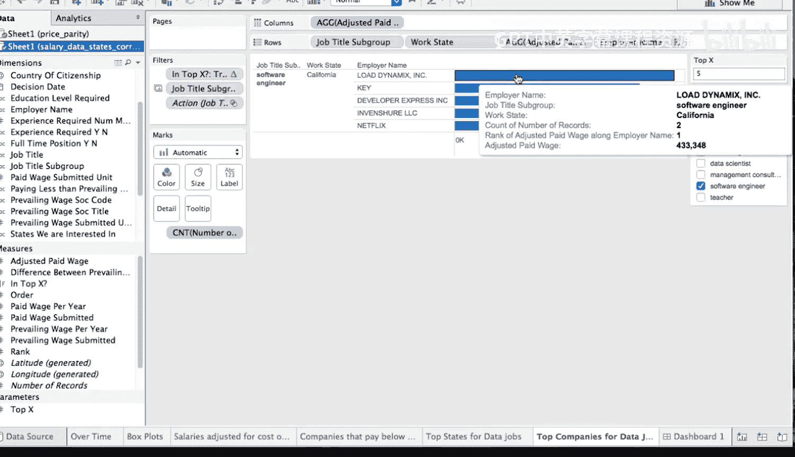

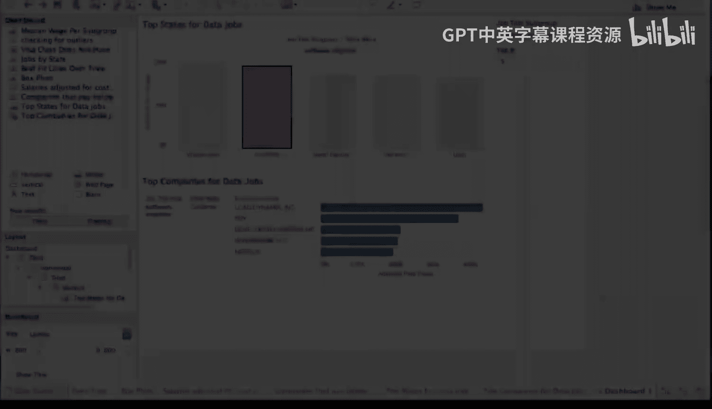

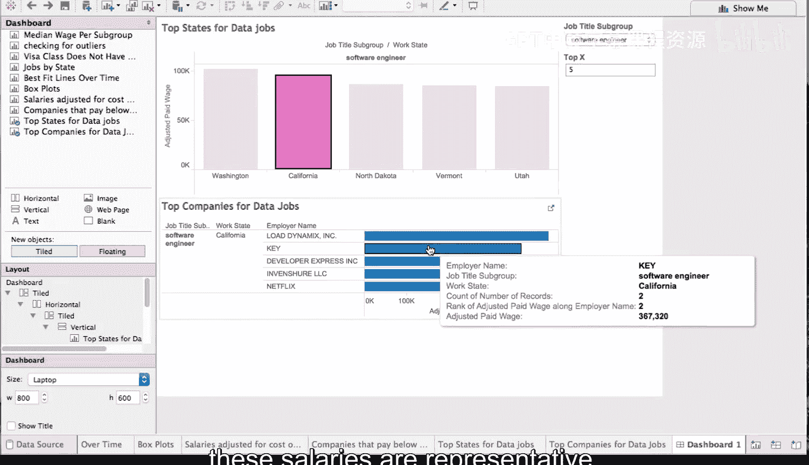

Whether these salaries are representative。Great job。 You've now made your first dashboard。

One thing you might want to take away from this exercise is that although dashboards are a lot of fun and they're very interactive and you got to click on a lot of things。

 they are great at giving a take home message。 And there are a couple of reasons for that。

 One is that there's usually a lot of information on dashboards。

 But the other reason is because even if you have lots of text boxes and arrows that tell people exactly what to do。

 There's no good way to control exactly where their eyes go at any given time。

 And one important piece of telling a story or giving a take home message is giving information in a logical sequence。

 And in order to do that， you have to be able to control what people are looking at。😊。

In the next video， we'll talk about one other mechanism Tableau provides that makes it a little bit easier to give that type of narrative walk through。

