# 杜克大学《Excel 到 MySQL：商业分析》：第5课：设计仪表板以确定数据相关职位申请目标

在本节课中，我们将综合运用本周所学的全部知识，最终创建一个交互式仪表板。我们将学习如何将多个工作表组合到一个仪表板中，设置交互式筛选器，并创建图表间的联动操作，从而构建一个用于探索数据相关职位申请目标的分析工具。

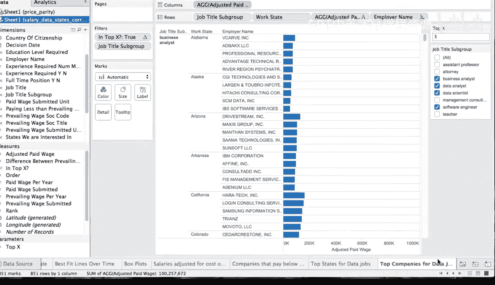

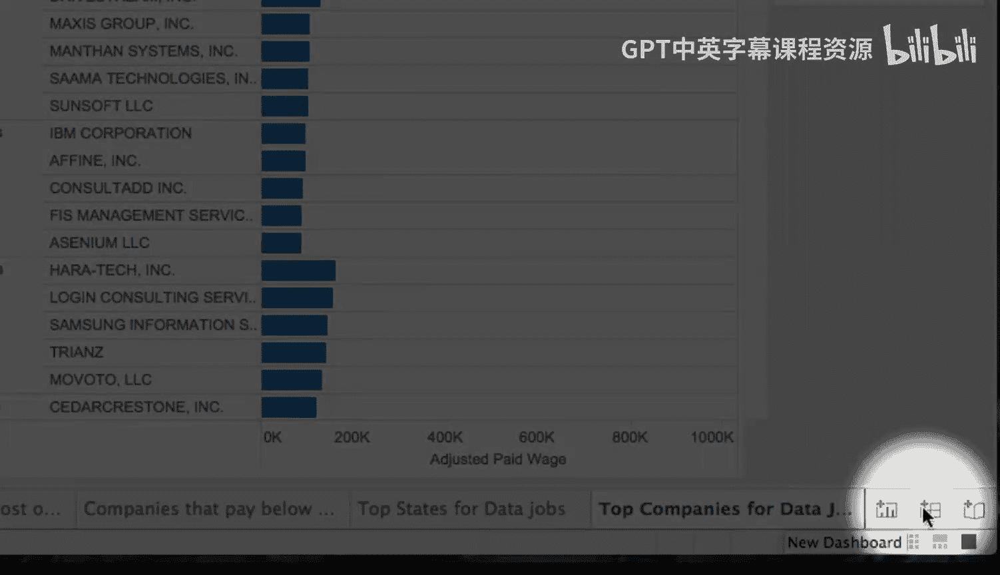

## 🛠️ 创建新仪表板

首先，打开你的 Tableau 工作簿。找到用于创建新工作表的图标，它旁边就是“新建仪表板”的图标，点击它。

这就是仪表板的工作区。首先，需要熟悉几个关键区域：
*   左侧列出了我们创建的所有工作表。
*   中间区域可以定义要放入工作区的“容器”。容器用于为特定图表定义空间。将图表放入容器后，无论数据如何变化，图表都会自动调整大小以适应容器。
*   仪表板大小可以自定义。当前设置为“桌面”，我们可以将其改为“笔记本电脑”尺寸。你还可以为 iPad、手机或博客创建特定尺寸的仪表板。

## 📊 添加图表与容器

我们将选择两个图表放入仪表板。一个图表放在上方，另一个放在下方，这样布局比较清晰。

因此，我们将使用两个垂直容器。只需将“垂直容器”拖拽到工作区即可。

我们要放在顶部的图表，是之前视频中创建的“特定职位子类别下的顶级州”工作表。将其拖拽到顶部的容器中。

接着，将“顶级公司”工作表拖拽到底部的容器中。现在，Tableau 已经自动调整了这两个图表的大小。

## 🔧 调整布局与筛选器

首先，可以调整图表大小。点击一个图表，会看到灰色边框和控制点。拖动边框可以移动图表（当前图表填满容器，暂时无法移动），拖动边缘可以调整高度。例如，我们可以调整上方图表的高度，为下方图表留出空间。

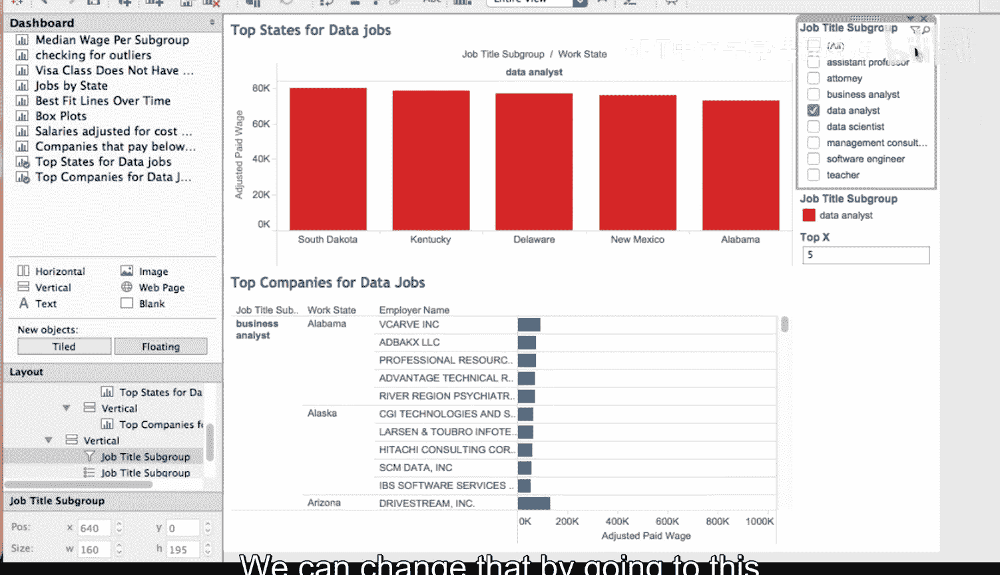

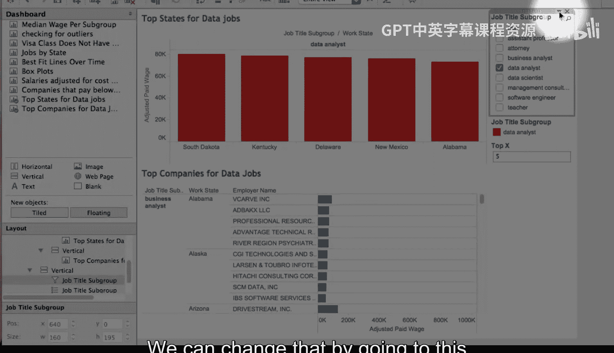

接下来，处理筛选器。我们的快速筛选器随图表一起出现在仪表板上。目前，点击筛选器（例如“Data Ana”）只会过滤上方的图表，不会影响下方的“顶级公司”图表。

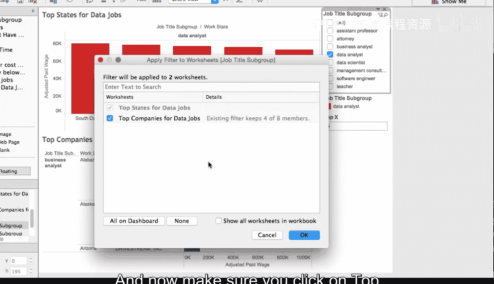

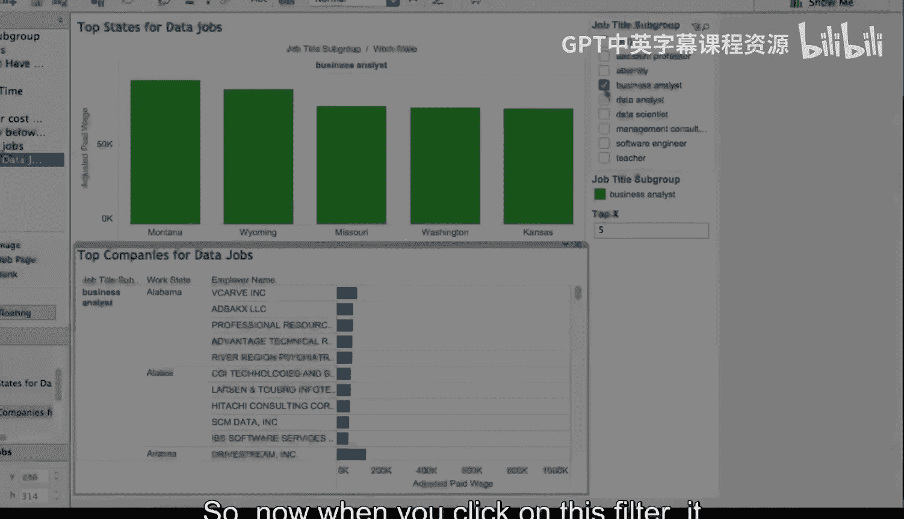

要改变这一点，点击筛选器框右上角的小箭头，选择“应用于工作表”。目前它只应用于当前工作表。我们需要选择“选定工作表”。

确保同时勾选“顶级公司”工作表，然后点击“确定”。

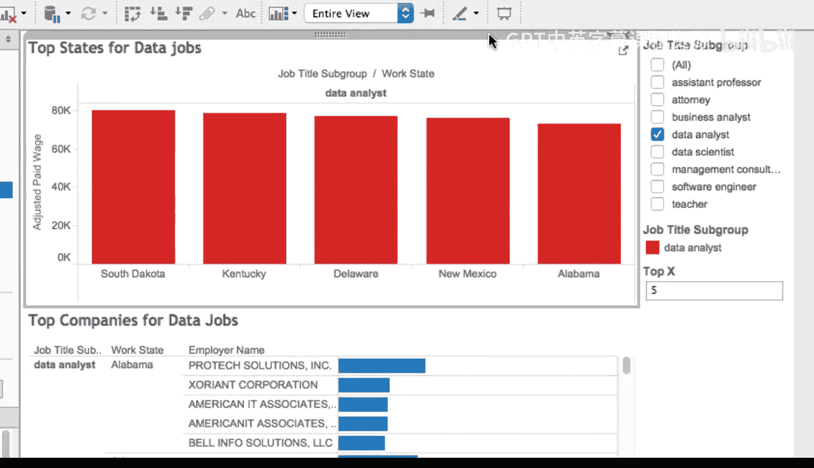

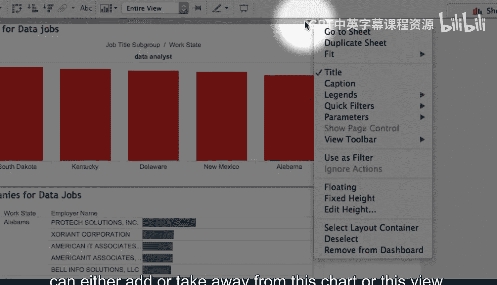

现在，当点击筛选器时，它会同时过滤上下两个图表。

你可能会注意到一些冗余信息。例如，颜色图例在当前场景下并不必要，因为筛选器和图表标题已经表明了筛选状态。

要移除图例，点击上方图表（因为图例属于它），找到图例右上角的小箭头，点击后选择“图例”，取消勾选“颜色图例”，图例就会消失。同样，你也可以在这里管理标题、添加说明等。

## 🔗 设置图表联动操作

现在，我们来实现一个关键功能：点击上方“顶级州”图表中的某个州，让下方“顶级公司”图表只显示该州的顶级公司。

这需要通过“操作”功能实现。点击顶部菜单的“仪表板”，选择“操作”。

目前没有定义任何操作。点击“添加操作”，选择“筛选器”操作。

在弹出的对话框中：
1.  命名操作，例如“筛选州”。
2.  “源工作表”选择“顶级州”，取消勾选“顶级公司”。
3.  触发方式选择“选择”（即点击数据点），并勾选“仅限单一选择”。
4.  “目标工作表”选择“顶级公司”，取消勾选“顶级州”。
5.  “清除选定内容时会”选项，建议选择“显示所有值”或“排除所有值”。这里选择“排除所有值”。
6.  筛选字段选择“所有字段”。

点击“确定”保存操作。

现在，当你点击上方图表中的某个州时，下方图表就会自动筛选，只显示该州的顶级公司。你可以尝试点击不同的州，并更改职位子类别筛选器，观察图表如何联动更新。

## 💡 理解数据与完善仪表板

在互动过程中，你可能会发现一个现象：尽管我们设置的参数是显示前5家公司，但下方图表有时显示的公司数量少于5家。

这通常有两个原因：
1.  存在并列排名。Tableau 的排名规则是，如果多家公司数值相同，它们会获得相同的排名，并占用后续排名位置。
2.  该地区可能没有足够多的公司。

例如，当参数设为5时，有时会看到6家公司，这是因为第4名有多家公司并列。

此外，你可以优化筛选器的显示形式，例如将其改为“单值（下拉列表）”以节省空间。你也可以像在普通工作表中一样，右键点击图表中的标题、坐标轴等元素，进行格式设置，如修改字体、颜色等。鼓励你探索这些选项，定制出符合需求的视图。

最后，还有一个关键信息对决策至关重要：每个柱状图背后有多少条数据记录作为支撑。这决定了我们对所显示薪资代表性的信心。

要添加这个信息，需要回到“顶级公司”工作表。将“数据窗格”中的“记录数”字段拖拽到“标记”卡中的“工具提示”属性上。确保其计算方式为“计数(不同)”。

现在，当你返回仪表板，将鼠标悬停在下方图表的任一柱子上时，工具提示会显示该柱子所依据的记录数量（例如，Netflix 的薪资中位数基于16条记录，而 Load Dynamics 仅基于2条记录）。这有助于你评估数据的可靠性。

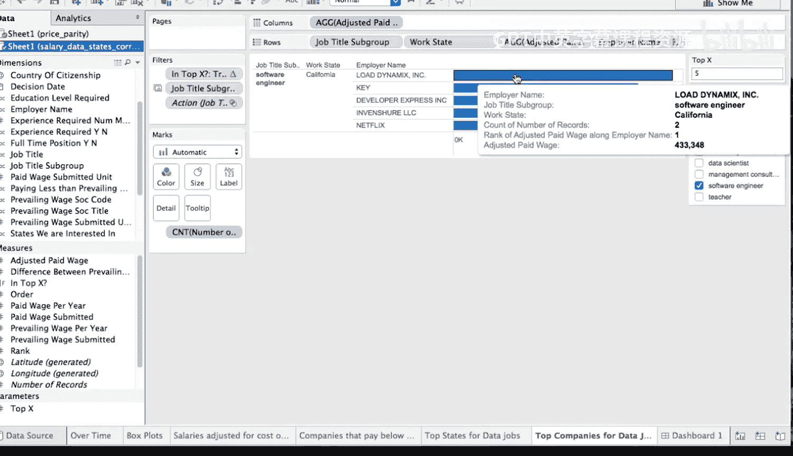
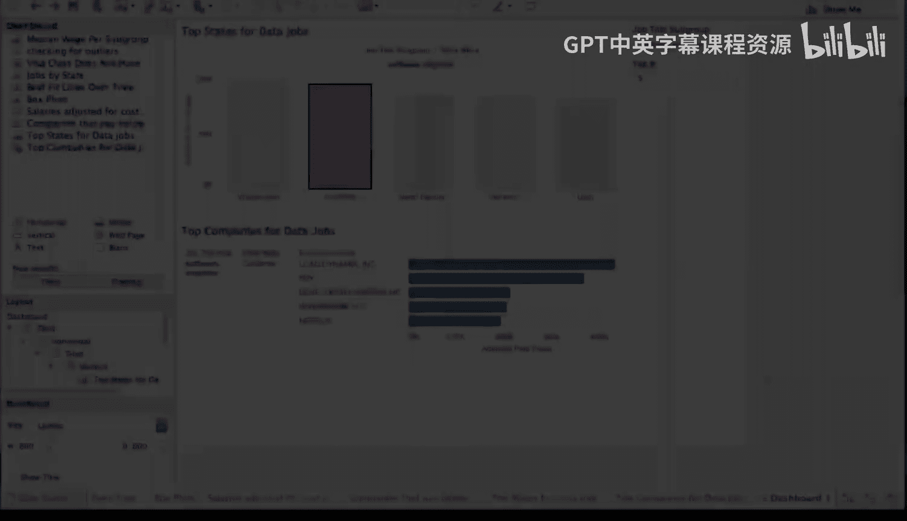
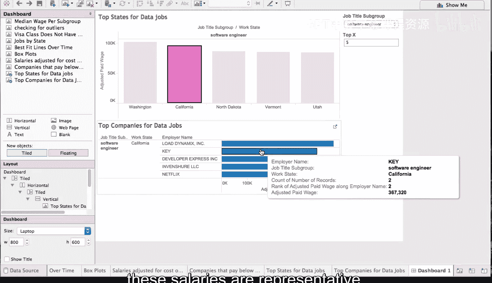

## 📝 总结与思考

恭喜！你已经成功创建了第一个 Tableau 仪表板。

通过本练习，我们可以认识到，仪表板虽然交互性强、富有趣味性，能有效传达核心信息，但它也存在一些讲述数据故事的局限性。主要原因在于：
1.  仪表板通常信息密集。
2.  即使用文本框和箭头引导，也难以精确控制观看者在每一时刻的视线焦点。

而讲述一个连贯的故事或传达明确的信息，往往需要以逻辑顺序呈现信息，这就要求对观众的注意力有更强的引导。

在下一个视频中，我们将探讨 Tableau 提供的另一种机制，它能更好地辅助我们实现这种叙事性的引导分析。