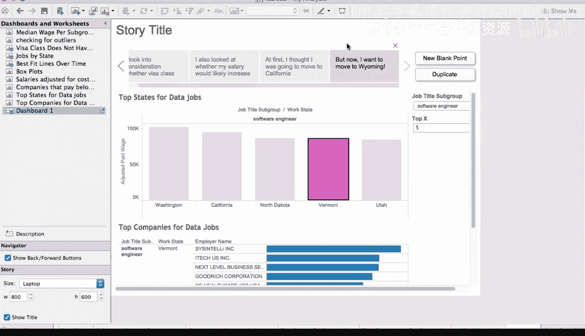
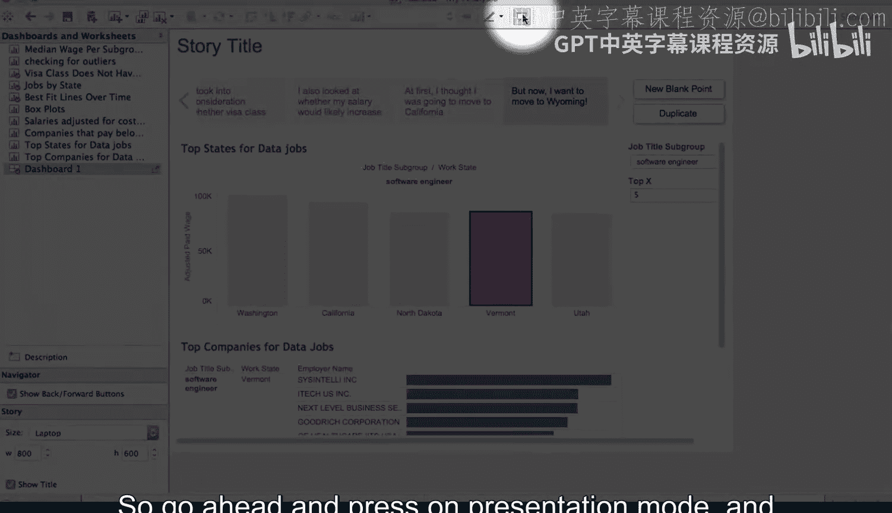
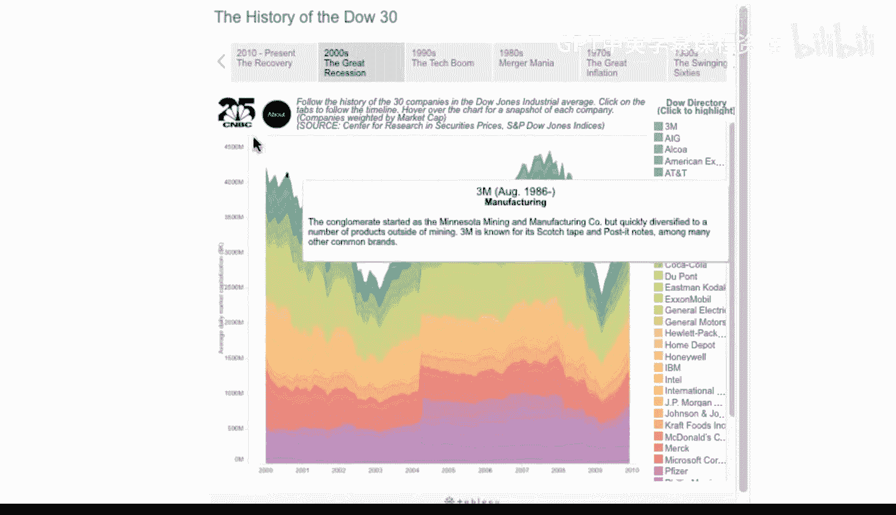

# 杜克大学《Excel 到 MySQL：商业分析（5课全）｜Excel to MySQL： Analytic Techniques for Business》中英 p113 38_04_03_Tableau中的可视化故事点.zh_en -BV1mS421X7yw_p113-

Hey guys， in this video， I'm going to introduce you to Tableau's stories。

Stories are basically a bunch of worksheets that are made up into a sequence that you design。

Each worksheet can have an entire dashboard on it， a separate visualization。

 or really whatever you want。 The main important part about stories。

 It's different than dashboards is that the stories are ordered in a logical sequence so that you can present the data to your audience in a sequence that makes it most likely that they will arrive at the same conclusion you did when they look at your data。

In this video， I'm not going to go into all the details。

 but how you would format every single part of a story point， much like in the dashboard video。

 there are lots of resources out there， and you can spend weeks and weeks and weeks learning how to get all the formatting perfect and learning all the bells and whistles。

 Instead of what I want to do is I want to give you an overview of how you get started using story points and show you how you could use story points for presentations to technical teams if you need them。

 At the end， I'll give you some inspiration for these stories or for making beautiful stories by showing you some of the story points have been published on the Web。

😊，Please go to your Tableau workbook。And go down to the corner。

 and instead of clicking new worksheet or new dashboard。

 click the icon all the way to the right that looks like a book， New storyory。When you click that。

 you'll see that the workspace looks very similar to the workspace we saw for dashboards。

 the thing that's missing are containers， but the thing that's the same are that up here on the left we see all of the different worksheets that we have in our workbook。

We also see that you can change the size of the story point or the story down here。

 just like before we can choose。A variety of different sizes。

 depending on how we intend on publishing it， we'll choose laptop this time。

So the way the story is going to work is that you're going to have one visualization per story point。

 If you want to have multiple visualizations， you're going to have to do it via a dashboard so you can drop a dashboard into a story point。

 but that's the only way that you could put multiple different worksheets together。

Once you've made a story point， you're going to label it and then you make another story point that comes right after it。

 so what you're going to end up with is a sequence of these captions each associated with its own story point。

So imagine that you wanted to share the results of your data analysis with either your partner or your friend to explain to them why you want to move to a certain place for a new job。

So your first story point might be。I took into consideration。嗯。Whether。Psa class。Would affect。

My salary。And then you could put your basic glass analysis here。Then you can make a new blank point。

 and you could say。I also looked。That whether my salary。Would likely increase。In the future。

Or something like that。 And then you can put your best fit lines over time。You could start by saying。

At first。I thought。I was going。全部。To California， say。And then you might put your jobs by state。

Visualization there。And in the last one you just say。But now。I want to move to。

 I' remember to try Wyoming。And so now you can put your dashboard。

Your entire dashboard in this story point and the important point to the see here is just like in your dashboard。

 you can make these story points interactive， so they will work in exactly the same way。

As they did when you were making dashboards， the difference between stories and dashboards is that whatever filters or interaction you do in this story point。

 it won't affect what happens in these other story points。

 So that makes it easier for people to be able to play around and for you still to be in control of the narrative。

This is also can be useful for presentations because if you're giving a presentation to a technical team。

 say they can ask you questions about the data and you can show them by actually clicking on different interactive parts of your visualization。

 But when they're done asking our questions， you can then go back and zoom back out to the big picture that you intended on showing them with your data story。

 So that's one of the main ways I think that story points are being used now。

As we'll talk about in the next couple of weeks。StoryPos can also just be useful for organizing your presentation that you're going to make when you say are going to give the results of your analysis to a C suiteite or to your bosses。

But we'll hear more about that in following weeks。So just like other aspects of Tau。

 you can always change the story titles。You can change the font color and the justification and all that kinds of stuff。

 so you should definitely explore that。The one thing you should know about is that you can add descriptions to each story point。

 So over here， you can click on this description box and double click it。

 And this will allow you to enter text boxes。 So you could say something like。Click。Data point。

AndClick on a state。To see what companies。Offer the best salaries。And then that gives you a text box。

That you can put and move wherever you want。And you can either float it。

 you can have it go underneath things。All of the typical kinds of formatting options。

So one thing that would be useful to show you is what it would look like if you're going to present this story。

 so go ahead and press on presentation mode。

And you can see now how it would look if you were giving this story to， say your data team。

You don't see all the borders on the outside。You you just see the data。

And you can still interact with it just as if you are working in Tableau itself。Hopefully。

 this gives you a flavor of what stories in Tableau can do for you。

 The main thing I'd like you to remember is something I mentioned before， but I'll reiterate again。

 This gives you a good way for figuring out what order of your data insights would be useful for communicating to people your conclusion of your data story。

😊，We'll hear more about that next week。 but this will be a good tool to keep in mind。To finish up。

 I thought I'd give you a little inspiration for how complicated and beautiful some of these data stories can be。

So these data stories were made with Tableaus data story。Functionality。

And they were published online。 So you can see this is one。

About the influence Russia has over different parts of Europe。

 And you can see that they have these text boxes that you saw how to make。

They have these different types of visualizations that have tool tips。Again。

 tool tips they have quite a lot of text in these， and almost all the storyboards I've seen published do have a lot of text。

And you can click on things and highlight them just like you wouldnt Tau。 Here's another example。

Here's another pretty one， this is a good example of something that again is way too much data for you to take in at once。

 but you can play around with it if you want to。And you can see the legends here try to give the story that the author is trying to convey。

 and this was actually published by CNBC。

One of the things I alluded to a couple times and that you might have noticed as I clicked through these story points that were published on the web is that although they are beautiful and really enjoyable to interact with。

It's pretty hard to figure out what the take home message of each individual visualization is。

 You usually have to read the full paragraph to figure out what they mean。

 when you might even have to do more than that。 you might have to click around and infer some of the story yourself。

So one of the reasons that's the case is because there's a lot of data on these graphs the other reason is because there's a lot of text and I mention this because next week we're going to learn some principles about how to make very clear take home messages from singular graphs on singular slides。

You'll see that many of the principles suggest doing the opposite of what you see on these beautiful story points and beautiful stories we see published on the Web。

 So I hope you're excited to learn more about that。

 because it' will make you a very powerful presenter in business settings。😊，But in the meantime。

 please enjoy these beautiful， beautiful story pointss that you can find on the web and we'll give you some more links with the course website so that you can see even more of them。

