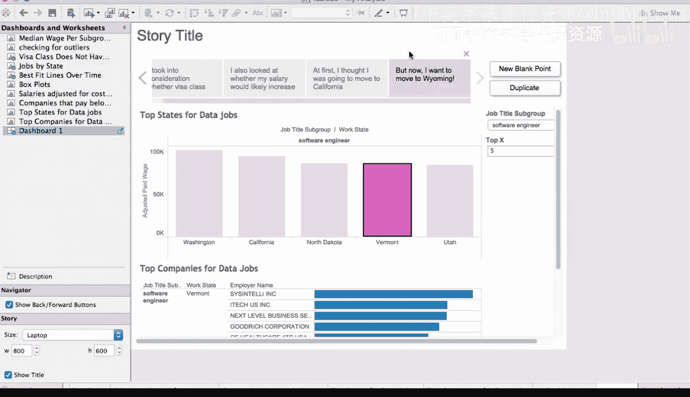
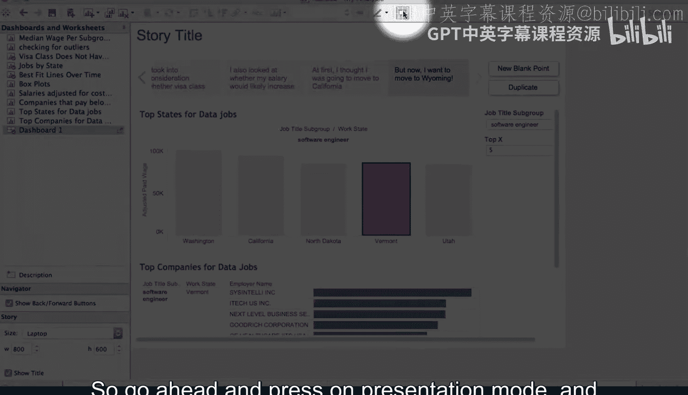
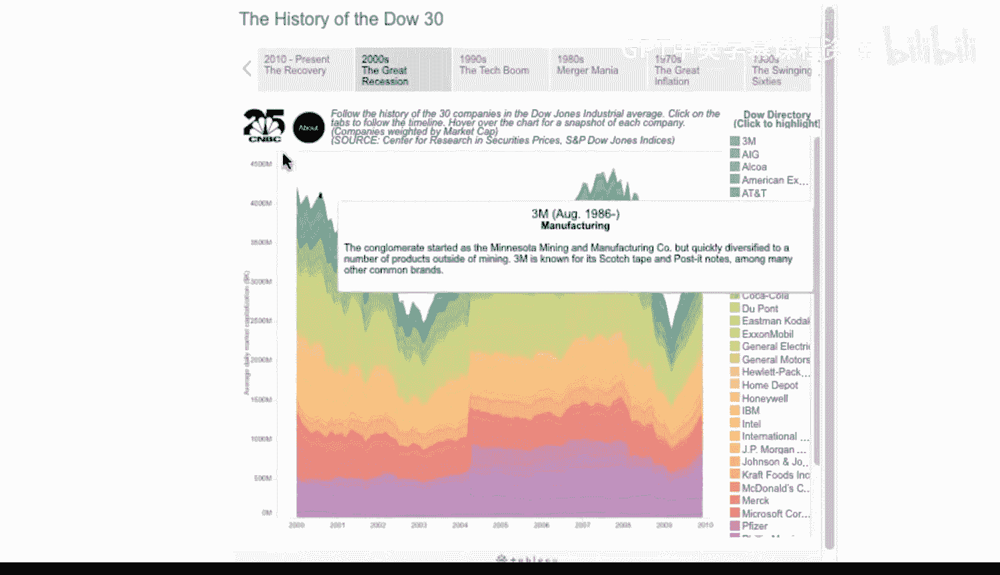

# Tableau 商业分析：第 4 章：Tableau 中的可视化故事点 📖

在本节课中，我们将要学习 Tableau 中的“故事”功能。故事功能允许你将多个工作表或仪表板按逻辑顺序组织起来，形成一个连贯的数据叙事，用于向观众展示你的分析过程和结论。

## 故事功能概述

上一节我们介绍了仪表板的创建，本节中我们来看看如何构建一个数据故事。Tableau 的故事功能与仪表板不同，其核心在于将可视化内容按你设计的逻辑顺序排列。这样，你可以引导观众按照你的思路理解数据，并最终得出与你一致的结论。

故事中的每个“故事点”可以包含一个完整的工作表、一个仪表板或任何你想要的单一可视化。关键在于，这些故事点是有序的，这使你能够以最有效的方式呈现数据。

## 创建你的第一个故事

以下是创建故事的基本步骤。

1.  打开你的 Tableau 工作簿。
2.  在工作簿左下角，找到并点击看起来像一本书的图标，即“新建故事”。
3.  点击后，你将进入故事工作区。其界面与仪表板工作区相似，但缺少容器。左侧会列出工作簿中的所有工作表。
4.  在下方，你可以像设置仪表板一样，选择故事点的尺寸（例如“笔记本电脑”尺寸），以适应不同的发布需求。

## 构建故事序列

故事的工作原理是：每个故事点对应一个可视化内容。如果你想在一个故事点中展示多个可视化，必须先将它们组合成一个仪表板，然后将该仪表板放入故事点。

构建故事序列的流程如下：
1.  创建第一个故事点，为其添加标题，并放入相应的可视化。
2.  点击“新建空白点”来添加下一个故事点，为其添加标题和可视化。
3.  重复此过程，最终你会得到一个由一系列带标题的故事点组成的序列。

例如，假设你想向朋友解释为何选择某个城市工作，你的故事序列可能是：
*   **故事点 1**：标题为“我考虑了专业对薪资的影响”，并放入相关的条形图分析。
*   **故事点 2**：标题为“我分析了薪资的未来增长趋势”，并放入带有最佳拟合线的时间序列图。
*   **故事点 3**：标题为“最初我考虑去加州”，并放入按州显示工作机会的地图。
*   **故事点 4**：标题为“但现在我决定尝试怀俄明州”，并放入包含多个视图的完整仪表板。

## 故事的交互性与演示

与仪表板类似，故事点中的可视化也可以是交互式的。观众可以点击、筛选或悬停以探索数据。

然而，故事与仪表板的一个重要区别是：**在一个故事点中进行的交互操作（如筛选）不会影响其他故事点**。这使你能够在保持叙事控制权的同时，允许观众进行探索。

这对于向技术团队做演示尤其有用。他们可以提问，你可以通过点击可视化的交互部分来实时展示数据；问答结束后，你可以轻松返回你预设的“大画面”故事线。

## 添加描述与格式化

你可以为每个故事点添加描述性文本，以提供更多背景或操作指引。

1.  在故事工作区，点击“描述”框并双击。
2.  输入你的文本，例如：“点击数据点以查看详细信息”或“点击州以查看提供最佳薪资的公司”。
3.  你可以像处理其他对象一样，移动、浮动或调整这个文本框的位置。

此外，你可以更改故事标题的字体、颜色和对齐方式等，进行全面的格式化。

## 演示模式

要预览故事的最终演示效果，可以点击进入“演示模式”。

在演示模式下，所有编辑边框和工具栏都会隐藏，只留下纯净的数据可视化界面。你仍然可以像在普通视图中一样与图表进行交互。这模拟了向观众实际展示时的场景。

## 优秀故事案例与启示

网络上有很多使用 Tableau 故事功能制作的精美、复杂的数据叙事案例。它们通常包含丰富的文本框、多种可视化类型以及详细的工具提示。

然而，这些公开的故事点也揭示了一个常见问题：由于图表上数据量庞大或文本过多，观众往往难以快速抓住每个可视化的核心信息。通常需要阅读整段文字甚至自行点击探索才能理解作者的意图。

这也引出了我们下一周将要学习的重点：如何为单个图表或幻灯片制作清晰、有力的核心信息传达。许多设计原则可能与这些精美案例的做法相反，但掌握它们将使你在商业演示中更具说服力。

## 课程总结

本节课中我们一起学习了 Tableau 故事功能的核心概念与应用。我们了解到，故事是一种将可视化内容按逻辑顺序组织，以引导观众理解数据结论的强大工具。你学会了如何创建故事点、构建叙事序列、添加交互与描述，并使用演示模式进行预览。最后，我们通过优秀案例获得了灵感，也认识到清晰传达核心信息的重要性。请将故事功能视为你数据沟通工具箱中的重要一员，并在实践中不断探索。