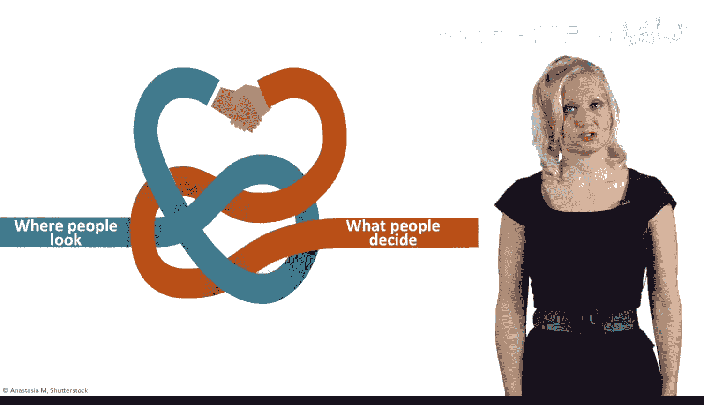
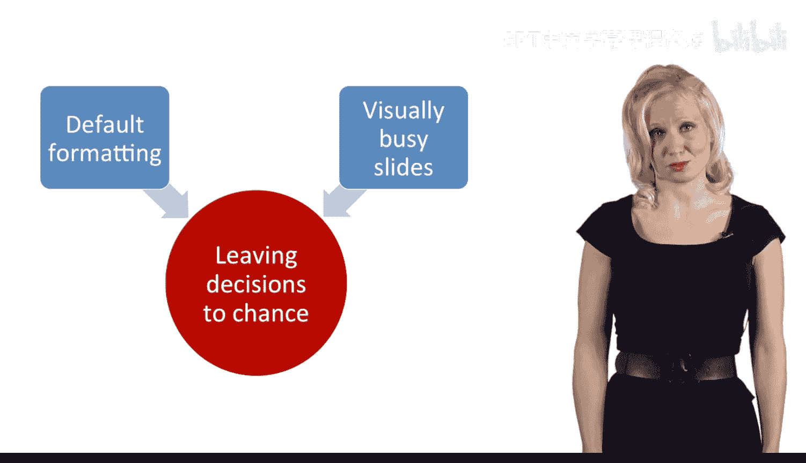

# 杜克大学《Excel 到 MySQL：商业分析（5课全）｜Excel to MySQL： Analytic Techniques for Business》中英 p114 39_05_01_运用可视化科学影响商业决策.zh_en -BV1mS421X7yw_p114-

The Association for Computing Machinery is the world's largest scientific and educational computing society。

 When it first started publishing notes and communications in 1959。

 the editorial board gave this as one of its reasons for starting the publication。😊。

If computer programming is to become an important part of computer research and development。

 a transition of programming from an art to a disciplined science must be affected。

Just since the late 1950s marked the beginning of computer science。

 I think that today we are at a similar beginning of what I believe will eventually be called the field of visualization science。

A lot of research has been done on how we interact with and learn from visualizations。

 and we are getting to the point that some of this knowledge can be regarded as fact。

That's why Tableau can feel justified in claiming that they have automated the best practices in visualization。

 Tableau is indeed very good at these practices， as we learned about over the past two weeks。😊。

This week， though， we are going to talk about one insight from the intersection of visualization science and decision science that hasn't been fully automated yet。

This insight is that where people look is tightly intertwined with what people decide。But simply。

 what you are going to decide influences where you look and where you look also influences your decisions。

There is now a growing scientific literature that shows us that where you look in a complicated visual scene。

 or even when reading text will affect not only practical things like what you buy。

 but will also affect more abstract judgments， like what you think is morally wrong。

Although every business presentation will be different and you can't guarantee the relationship between looking and decision making will be the same in every scenario。

 What this means for us in our business presentations is that if we want to affect people's decisions about what we are presenting。

 we should influence where they look。

One of the best ways to do that is to direct their visual attention。 In fact。

 the concepts of attention in eye gaze are often used interchangeably。

We don't just want to keep our audience interested。

 we actually want to physically guide their eyes so that they are looking at the things we intend to use to influence their decisions。

😊，We are going to go over some tricks this week for what you can do to your graphs to draw people's eyes to where you want them to be。

There are at least two overarching actionable insights I hope you will take away from the next set of videos and exercises。

The first is that if you just use the default formatting on your graphs or your presentation is filled with visually busy slides。

 you will be giving up your power to direct your audience's attention and gaze。As a consequence。

 you would be leaving your audience decision making process about what you are presenting mostly to chance。

What a huge shame that would be after all the work you put into your wonderful analysis project。

The second insight is that visual contrast is one of the best ways to attract people's gaze to data related images。

 it is therefore also one of your best tools for affecting people's decisions。

Before we can get to the point where we are making data related images， first。

 we need to figure out what story or data tell， so that's what we're going to start with this week。

After we settled on a compelling， logically rigorous data story。

 we'll talk about how to choose the best data visualizations to persuade people of that story。

We'll follow it up with a set of tools and concepts you can use to optimize your visualizations and your presentation style。

 By the end， you will be a master at using visualizations to get people to agree with your data driven business recommendation。

