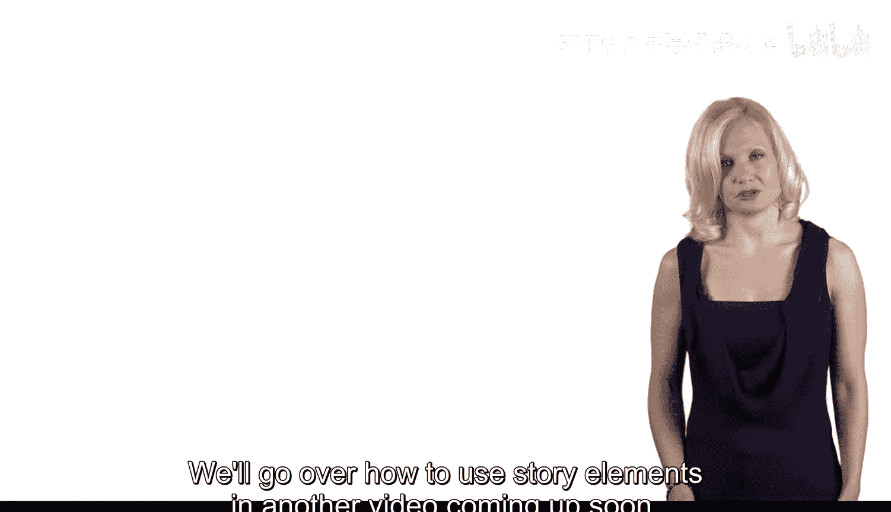
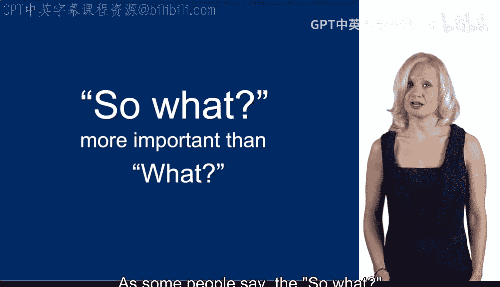
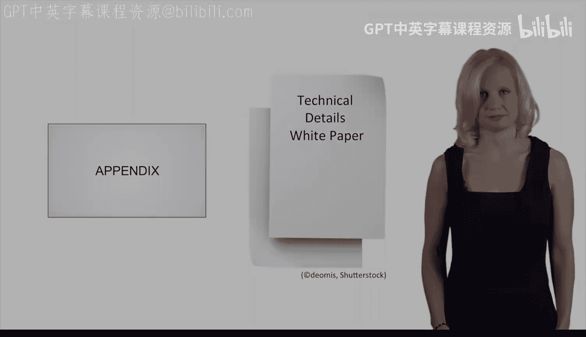
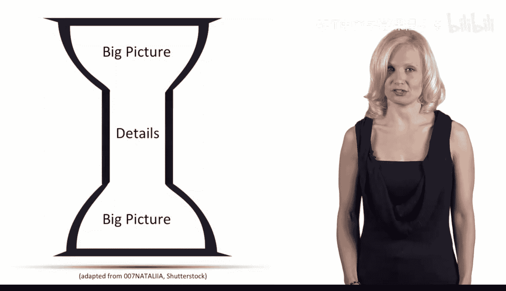

# 杜克大学《Excel 到 MySQL：商业分析（5课全）｜Excel to MySQL： Analytic Techniques for Business》中英 p115 40_05_01_故事板沙漏模型.zh_en -BV1mS421X7yw_p115-

。You've finished your data analysis and there's a date on the calendar to present your data story and recommendation。

 How do you start getting that presentation into shape？

Many jump right in and immediately start making slides because on its face。

 that can seem like the most productive thing to do。However。

 just like jumping into a data analysis without a plan。

 I suspect you'll find it surprisingly inefficient to start making slides before you have a plan for your presentation。

 In the end， you will prevent yourself a lot of wasteted time if you plan your presentation before you start your slide making。

To help you learn how to do that in this video， we are going to talk about the big picture about how to structure a business presentation。

 That will give you a framework to think about when we talk about how to use a process called storyboarding to plan each scene in your presentation in a later video。

The overarching structure of your presentation should be an hourglas with a long stem。

It's an hourglass because you will start your presentation with a big picture。

 narrow into some details， and then come back out again to the big picture at the end of your presentation。

Many people forget this last step of coming back out to the big picture again。

 but it is very important because the first and less things you say are the things your audience is most likely to remember and are the things that are most likely to leave a lasting impression。

The hourglass model takes advantage of this by surrounding the data show with motivating context instead of just introducing it with motivating context。

Here are some more details about how the hourglass model would work。

The big picture you will start off with is why your audience should care about the business problem you are about to solve。

Your job during the first 30 to 60 seconds of your presentation is to make the audience feel very invested in solving that particular problem。

A powerful way to do that is to use the compelling story elements we talked about at the beginning of the course。

 Those elements are devices like quotes， dramatic pictures or actual stories about someone involved in the problem that drop people in by eliciting emotion and motivation。

😊，Some people also call these emotional hooks。Since time is money and business。

 you've got less than a minute to convey the emotional side of your business problem。

 and story elements are a good way to do that efficiently。

We'll go over how to use story elements in another video coming up soon。 For now。

 I want you to remember that motivating your audience to listen to you is the very first thing you have to do。

 And in some ways， it is also the most critical。 As some people say。

 the so what is more important than the what。

As soon as you have stirred up your audience's emotions。

 the very next thing you are going to do is to present to them your recommendation and a smart format for how you are going to solve the business problem they are now very emotionally invested in。

Just like when you make smart objectives， you're going to tell them how to solve that problem in a way that is specific。

 measurable， attainable， relevant and time bound。In business。

 your take home message needs to come very early in your presentation because people want to know that their time with you is going to be well spent as soon as they enter the room。

So even though some types of storytelling， like TedD Talks or keynote speeches can benefit from working your way up to the main point slowly and with a lot of color in a business presentation。

 you should state your specific recommendations within the first minute or so of talking。

After you've given your smart recommendation， you will succinctly summarize the main points you are going to use to support your recommendation。

 If your company requires agendas in your presentation， this is where that agenda slide would go。

Then， as soon as your points has been summarized or your agenda has been laid out。

 you're ready for the stem of your hourglas。This is where you will go through the evidence you thoughtfully organized during your storyboarding process。

 point by point。After you've wowed your audience with your evidence。

 there will be three parts to your conclusion， which is at the bottom of the hourglas。

Begin your conclusion by succinctly linking together one more time。

 how your data point support your smart recommendation。

Then transition to stepping back out to the big picture again by clearly stating the strong benefits that will result if your recommendation is followed。

Last， reenergize the audience's enthusiasm and motivation by using story elements again， preferably。

 including some that pair up with or link up to the story elements used at the beginning。

Do your best to use a story element that leaves your audience with a strong， positive emotion。

One thing you might be wondering at this point is when do I tell the audience about how I would address all the possible challenges to my recommendation？

You should definitely， definitely be prepared to answer how you would address potential pitfalls。

 as well as be prepared to articulate what assumptions you made when designing your recommendation。

But I suggest that if you need slides to explain how you would address these。

 have these slides ready in an appendix at the end of the presentation that you can talk about during the discussion。

I will leave those slides out of the main presentation so they don't distract from the flow of your data story unless you know that your specific audience will want that information up front。

As another suggestion， I would prepare detailed technical information in a written handout rather than slides。

 Some slides are not a good vehicle for conveying water to maximum information。When possible。

 wait to hand these out until after the main presentation is over。

 If you hand them out before you start your presentation。

 your audience's attention will be divided between listening to you。

 looking at your slides and reading the handout。 And as a consequence。

 their ability to retain information from any one of those modalities is likely to be reduced。

That concludes what you need to know about the hourglass structure we are headed towards when we are planning out a presentation。

 Now， how do we get there。

And the next few videos， we'll find out。