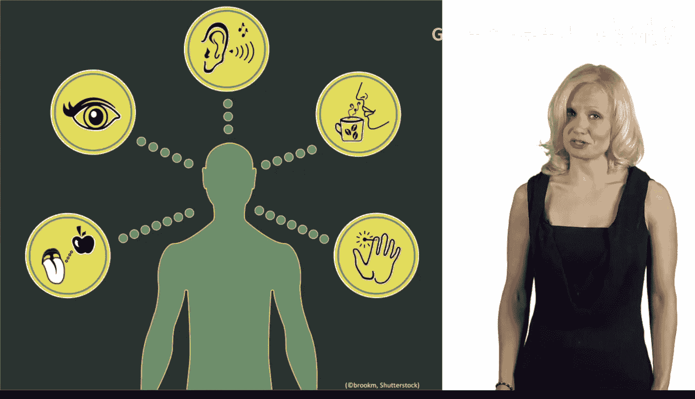
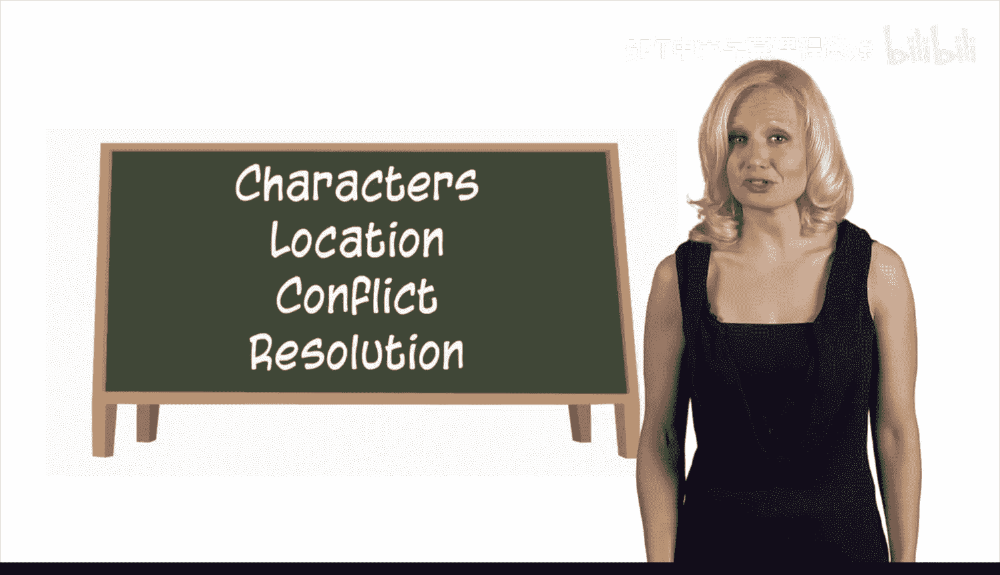
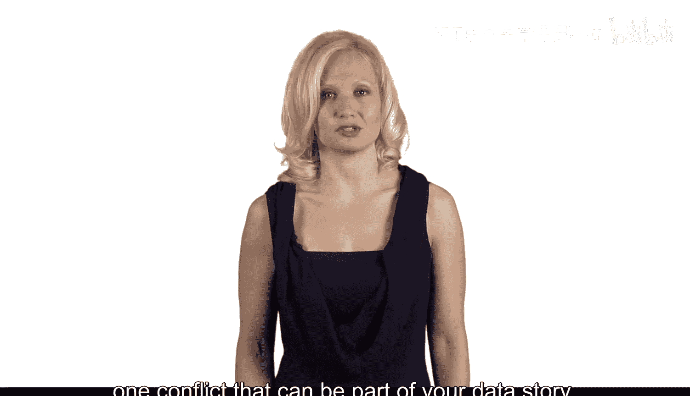

# 杜克大学《Excel 到 MySQL：商业分析（5课全）｜Excel to MySQL： Analytic Techniques for Business》中英 p116 41_05_02_让数据故事生动呈现.zh_en -BV1mS421X7yw_p116-

。In this video， we are going to talk about how to use story elements to get your audience emotionally invested in the business problem you're going to tell them how to solve。

You will usually use these story elements at the beginning and end of a presentation。

 but you can use them and refer back to them throughout a presentation as well。

Before we start talking about story elements， though。

 I want to take a moment to reflect together on your own story context and why you are taking this course with me。

You are taking this course because you wanted to learn how to use tableableau and visualizations to solve business problems。

 solvinglving business problems。 That's a really big deal。 You should be really proud of yourselves。

😊，I want you to recall that feeling of pride when you were making presentations after a long slog of data analysis。

 Remember why you agree to take on the data analysis project in the first place。

 You are about to tell your audience how to solve a problem that is impacting the company and as a consequence is also affecting their lives。

 How cool is that。 Very few people are in a position where they can do that。😊。

And so when you open and close your presentation， bring that pride and enthusiasm into the room with you。

Use the story elements at the beginning and end of your presentation for yourself。

 as much as for your audience。 It's amazing how much impact you can have when you enter a close experience in an emotional way。

😊。

With that said， how exactly do you elicit emotion？The best way to elicit emotion in either yourself or your audience is through sensory experiences。

 especially through visuals， sound and physical feelings。 That's what stories are meant to do。

 They are meant to create experiences， even if those experiences are only for a couple seconds。😊。

The critical pieces of a story are called story elements。

 The most useful ones for our purposes are characters， location or setting， conflict and resolution。

The more of these elements you can somehow include in your business presentations。

 the more your presentation will feel like a story。

 and the more likely you will be to engage your audience emotionally。

Thinking about characters or settings may initially seem strange in the context of doing a data analysis。

 But remember that the entire context of your project is based on the fact that at least one person in your business and usually many people is having a problem that is affecting them enough that they are willing to pay to have it solved。

So before you even start your project， you already know at least one character and one conflict that could be part of your data story。

 and usually there are many characters and many conflicts related to your story， including yourself。

Stories can feature individual characters or groups of characters。

 Sometimes you can even create a story where the main character isn' in a person。

 but rather a thing like a manufacturing plant or a corrupted data set。

One effective way to draw your audience in is to describe the experience of a character related to your problem or a location related to your problem。

 using details that make your audience actually picture the person or place in their mind。

Another particular powerful method is to tell a story about your own personal experience。

Let me give you an example of what that might sound like。

Imagine you work for a company that makes a new kind of wireless cell phone charger。

 Your job is to recommend how the company should allocate their marketing budget for the next year。

Your data analysis indicates the company should target their marketing efforts within each type of marketing channel to specific age groups。

 If they do so， their return on investment will increase significantly。

So this might be how you could open your presentation。

I'd like to tell you about my dinner at my parents' house this weekend。 It was a delicious dinner。

 My dad made his killer pot roast， and even my kids loved it。😊，After dinner， though。

 everything went downhill。 I tried everything I could to get my family to spend some quality time together。

 I asked about sports。 I asked my parents about when they were kids， I brought out the board games。

 as usual， nothing worked。😊，Finally， in desperation， I yelled。

 why won't you guys even pretend you want to hang out together。

My daughter wrapped up from the couch where she was engrossed in her and her iPhone， of course。

 and said， mom， it's not that we don't want to hang out together。 We're just chilling out。

 I want to see what people are up to on Facebook。Then my mom turned away from the weekly papers she was reading and said。

y， sunnyny。the grocery store down the road is having a sale this week， want to see。At first。

 my jaw dropped out of exasperation。But then I suddenly realized they had a point。

In the next 20 minutes， I'm going to show you how our marketing campaign can benefit from the same lesson I learned at my family dinner last weekend。

 just as my investment in weekend dinners has vastly improved since I started interacting with my 22 year old through social media on her phone and my 76 year old mother cutting out coupons in a weekly paper。

 our return on marketing investment will improve when we begin interacting with our different ages of customers through the environments and physical things they enjoy interacting with most。

Then you can introduce your smart recommendation and your agenda。In this intro。

 I use my own personal experience to introduce characters in a location。

 describescribe a conflict and provide a resolution。

 The small but complete story gives a sense of direction and a sense of satisfaction。😊。

I want my audience to feel like if they go in a similar direction in our data story。

 as I did in my own personal story， they will end up with a similar sense of satisfaction。

The idea is that sense of motion will motivate the audience through the entire length of what I have to tell them。

Now， if you aren't comfortable using personal experiences to elicit emotion or you don't have enough time to tell a full story。

 there are other devices you can use these emotional hooks as well。

You could use imagery by showing a picture of a teenager and a grandmother sitting on the couch with a teenager engrossed her phone。

 and the grandmother happily cutting out coupons。Unfortunately。

 I couldn't find an example of a picture like this for you， but you could take the picture yourself。

Then you could open your presentation by saying something like。

This picture illustrates something we all know。 People of different ages like doing things very differently。

 In the next 20 minutes， I'm going to show you how incorporating this concept into our marketing strategy will improve our return on investment by 12%。

You can also use objects， quotations or startling facts for other types of business problems。

 You could bring in a piece of faulty equipment that is causing problems in a company factory。

 You could read out loud an actual customer service request that exemplifies the problem your recommendation tries to solve。

Or you can open with the dramatic statistic。Another way to engage your audience is to engage an actual conversation with them。

 You would do this by opening a presentation with questions。

 You could ask something like if your parents or anyone you know over the age of 75 had a choice between reading a piece of physical mail or reading a blog on their phone。

 How many of them do you think would choose reading a blog on their phone。

Then you could follow up with how many of your children are family members under the age of 25 do you think would choose the internet phone option？

Since more people will raise their hand in response to the question about 25 year olds reading blogs on a phone than will raise their hands in response to the question of about 75 year olds reading blogs on their phone。

 you can then follow up with a statement about how survey statistics are consistent with the mini poll you just did together and you are going to use that information to improve your marketing strategy。

Whatever story element of strategy you use， try to find something that is really motivating to you。

 because if you are moved， your audience will be moved to。 Just remember。

 you've only got about 30 to 60 seconds at the beginning of a presentation to captivate your audience。

 So whatever you decide to use to try try to draw them in， it's got to be relatively quick。

Before I wrap up， here are a couple more tricks for how to use story elements， passages。

 or vignettes in your presentations to engage your audience。

If instead of starting at the very beginning of a presentation。

 you start in the middle so that the character is already in the midst of an action。

 it can create a sense of momentum and expectation for what will come next。

 which can sometimes be an effective way to lead into your business recommendation。Whenever possible。

 describe your characters and give them texture。 Say things like Joyce is one of our loyal vitamin customers from Akron。

 Ohio。 She's 42， speaks French， and all her friends say they are jealous for perpetual energy and optimistic outlook on life。

😊，Keep your description short， but use specific details。 they add credibility and improve belief。

Whenever possible， use positive message stories rather than negative message stories。

 If an opening story segment is successful at eliciting a negative emotion， such as fear or disgust。

 those negative feelings can linger。Psychology experiments suggests your audience might misinterpret those lingering negative feelings as disapproval of your logical arguments。

 rather than them just being left over from the story passage you opened your stock with。

When using pictures， use very high quality pictures and try to make them full screen。 In addition。

 use pictures that either have people looking directly at you or that present the audience with a view as if they themselves are actually there。

High resolution， looking directly at another person's face and dramatic geometric perspective are very effective at a listing motion and making what you are saying feel physically real。

There is no formula that can guarantee a certain story， element。

 passage or mechanism will elicit the exact devo you want in every audience member。

 but what I've told you in this video are some good guidelines。

Whenever you feel at a loss for how to convey the significance of your data story。

 Think hard about what motivated you to get through all the analysis you did。

 Think about what got you excited， What got you worried， what was hard。

Think about all the stakeholders who are impacted by the problem you've been asked to solve。

 what their lives are like as a consequence of that problem and how their lives will be easier now。

As soon as you start to feel your heart rate change or start to get a vivid image in your head。

 you'll know what emotional context you use to open and close your presentation。

