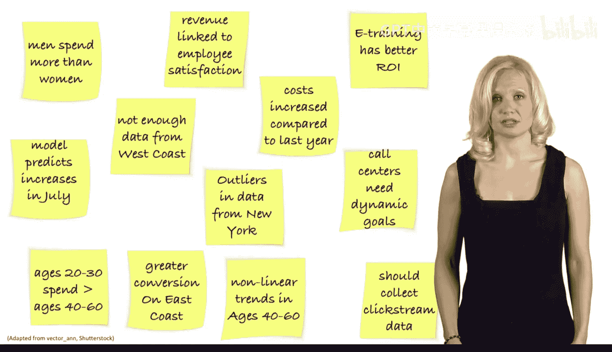
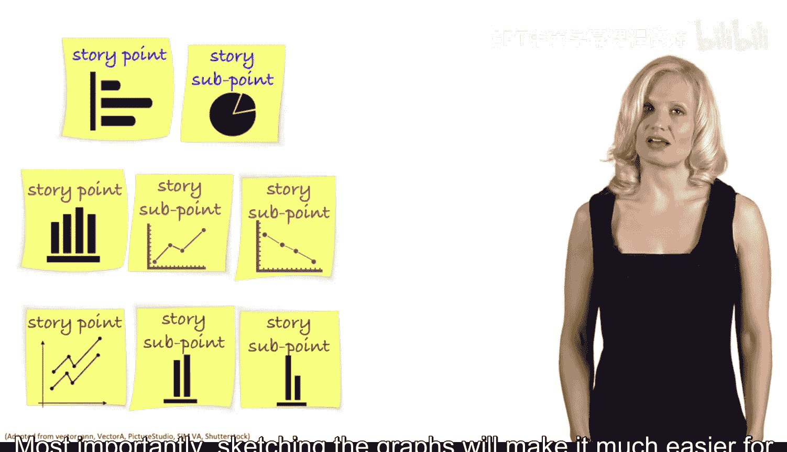

# 杜克大学《Excel 到 MySQL：商业分析（5课全）｜Excel to MySQL： Analytic Techniques for Business》中英 p117 42_05_03_故事板化您的演示.zh_en -BV1mS421X7yw_p117-

。We've talked about the overall structure of your presentation and how your emotional hooks and smart recommendations will serve us the context surrounding your data。

In this video， I want to talk about how to figure out the specific order of the slides in your presentation as a whole。

 including the slides dedicated to your data when you are in the stem part of your presentation hourlas。

You will fail this out by storyboarding。Storyboarding is the process of identifying the key scenes in your process or story and putting them in a logical order that conveys your message compellingly。

Storyboarding is basically a way of having a plan for your presentation that you can articulate and communicate with others so that you can get feedback and work in the presentation together。

The reasons storyboard are that first， it forces you to clarify the logic of your hypotheses and assertions。

Second， it illustrates gaps in your logic。Third， it provides mechanism for collaborating and receiving feedback and working with a team。

 And fourth， it streamlines the slide preparation process and prevents unnecessary work。In addition。

 more and more companies are asking for analysts to make multiple simultaneous storyboards tailored to different groups within the company。

 rather than singular dashboards made for the entire company。

 So making storyboards for your own presentations will help you gain intuition for what customers might want in their corporate storyboards。

The steps of storyboarding a presentation at the end of a data project have many similarities to the steps you use to work through your analysis plan at the beginning of a data project。

 However， there are some differences， because this time。

 you are really trying to narrow in on the minimum number of scenes necessary to convey your data story。

 rather than include the scene any scene that might be important。In addition， this time。

 you need to think about what kinds of visualizations will communicate information in each scene。

 rather than what kinds of visualizations will help you analyze vast amounts of information。Further。

 a critical aspect of your presentation storyboard will be the precise order in which you organize your scenes and how you link them together for your audience。

 This order might be very different than the order in which you actually completed your analysis。

Still， the physical process of storyboarding will require you to get out those posts。

 index cards or computer program you use to make the analysis plan at the beginning of your project。

 You can use any of these methods， But for the sake of simplicity， for the rest of this video。

 I will describe the process as if you are using posts。

The storyboarding process starts with you brainstorming and writing down every single insight you discovered during your analysis that you think was important for helping you arrive at your conclusion and business recommendation。

Each insight needs to go on its own post it index card or on its own box in your software program。

Each point or detail in a post it should be considered a story point that will eventually get its own graph and its own slide。

Each story point should be able to be summarized in one sentence。 If it takes more than that。

 it's too complicated and should be broken down into separate story points。

Once you've gotten everything written down， you need to ruthlessly whittle down your story points until you have only the ones that are absolutely critical for justifying your recommendation for a business process change。

As a rule of thumb， you should try to have no more than three main story points。

 and each of those main story points should have no more than three sub points。

3 items is about the limit of complexity most people can handle in one sitting。

 So each point you add over that needs to add so much value that it will be able to overcome the lack of attention your audience is likely to exhibit。

Be warned， this snaarrowing down step is deceptively difficult。

 which illustrates how difficult it is to make a streamlined presentation in the first place and why it takes data team so long to make them。

It is also where you will get the most bang for your buck though。

 so it's worth giving it considerable energy and attention。

Once you have your story points whittled down， the next step will be to organize them according to the order which you are planning on telling them。

The order should reflect what you believe is the most compelling。

 logical argument you can give to support your recommendation。

 not the order in which you actually did the analysis。 Remember。

 this is the presentation about what they should do。

 not a presentation about what you did over the past 6 to 12 months。

Here are a few guidelines you can use to help you figure out your storyPoin order。

If your recommendation is not going to be very controversial。

 I suggest starting with your strongest story point first so that you can get your audiences buy in as quickly as possible。

 and therefore also prevent your audience from losing confidence in your story。

I realized that might sound counterintuitive。 Don't movies， for example。

 usually wait until the end for the climax。 Yes， they do。

 but the art of persuasion isn't the same as the art of entertainment。

 even though they sometimes overlap。That said， if your business recommendation is going to be controversial。

 I suggest you use a different strategy。In this type of scenario。

 start with your least controversial point first。The psychology literature tells us that people are more likely to be persuaded by an argument if you get them into a general feeling of agreement first。

 So by starting with their least controversial point， you will get your audience used to saying yes。

 before you hit them with something they might want to say no to。This next point might seem simple。

 but you'd be amazed how often people don't follow this guideline。

Make sure you show the data necessary for being convinced by an argument。

 either before or at the same time as making the argument。

 If the data necessary for being convinced by a story point。

 piggybacks off of some other data from another story point。 put the story points in order。

 Don't go backwards。Your audience will not reserve their judgment about your argument until you eventually show them the relevant data。

 Instead， they will just get annoyed with you for making them work so hard to figure out what you are trying to persuade them of。

 which in turn will make them more reluctant to agree with any part of your argument。

Once you have the order of your story points， you need to draw a quick sketch in the post of what kind of visualization will convey each story point best。

This is a good point in the process to remind yourself the primary context surrounding your presentation is your audience。

When you write down your story pointss， make sure they're at the appropriate level of detail for your audience。

Most non analysts don't want to know about the parameters in your models， your confidence intervals。

 or pretty much any of the details you've had to worry about over the past couple of months。

As I suggested before， put those details in a handout to keep them out of the story pointss in your presentation。

Sketching the graphs for each slide will help you make sure you don't spend lots of time formatting different graphs you aren't going to use。

 it will also help you pick up visual themes that you can use to give your presentation a more unified appearance。

Most importantly， sketching the graphs will make it much easier for other people to look at your storyboard and know what you are imagining。

This brings me to the final step of storyboarding， which is to share your storyboard with as many people as you can before you present to the people who will ultimately decide the verdict of your recommendation。

In particular， you want to ask other people to check the logic of your argument and make sure it is sound。

 I call this stress testing your story。 That's what we will learn to do in the next lesson。

