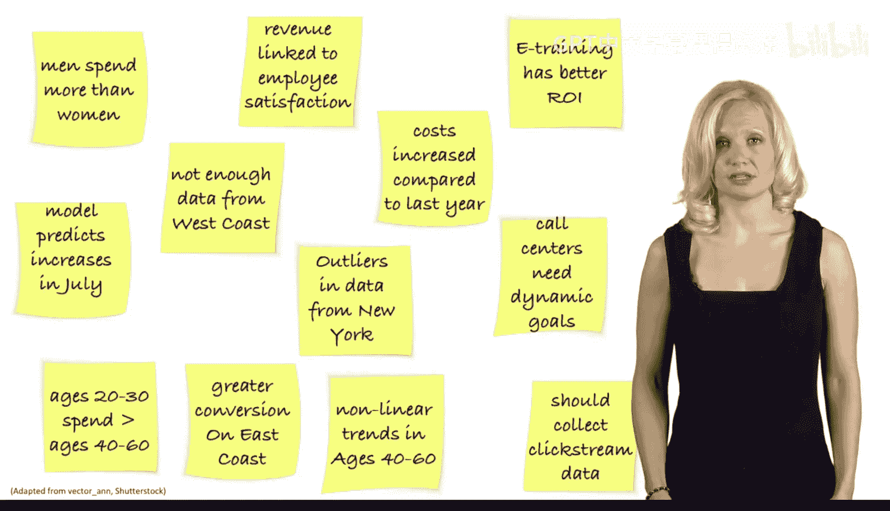
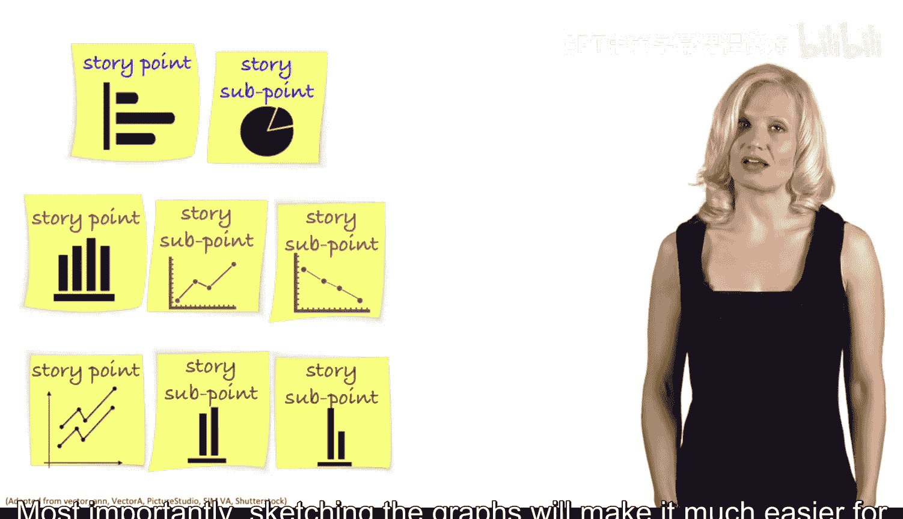

# 商业分析：05：故事板化您的演示 📊

在本节课中，我们将学习如何通过“故事板”来规划和优化演示文稿的结构与顺序。我们将了解故事板的作用、创建步骤以及关键原则，确保您的数据故事能够清晰、有力且逻辑连贯地传达给观众。

---

我们已经讨论了演示文稿的整体结构，以及情感钩子和明智建议如何为您的数据提供背景。

在本视频中，我们将探讨如何确定演示文稿中幻灯片的特定顺序，包括在演示核心部分专门用于展示数据的幻灯片。

您将通过故事板来完成这项工作。故事板是识别您流程或故事中关键场景，并将其按逻辑顺序排列，以引人入胜地传达信息的过程。

故事板本质上是一种为演示制定计划的方法，您可以清晰地表达并与他人沟通，从而获得反馈并协同完善演示。

使用故事板的原因如下：首先，它迫使您理清假设和主张的逻辑。其次，它能揭示逻辑中的漏洞。第三，它提供了协作、接收反馈和团队合作的机制。第四，它简化了幻灯片准备过程，避免了不必要的工作。

此外，越来越多的公司要求分析师为公司的不同群体制作多个并行的故事板，而不是为整个公司制作单一的仪表板。因此，为您自己的演示制作故事板，将有助于您理解客户在公司故事板中可能想要什么。

在数据项目结束时，为演示制作故事板的步骤，与您在项目开始时制定分析计划的步骤有许多相似之处。然而，也存在一些差异，因为这次您真正要做的是精简到传达数据故事所需的最少场景数量，而不是包含任何可能重要的场景。

此外，这次您需要考虑的是，在每一个场景中，哪种可视化方式能最好地传达信息，而不是哪种可视化方式能帮助您分析海量信息。

更重要的是，演示故事板的一个关键方面是您组织场景的精确顺序，以及如何为观众将它们串联起来。这个顺序可能与您实际完成分析的顺序大不相同。

尽管如此，故事板的具体过程仍然需要您拿出便利贴、索引卡或您在项目开始时用于制定分析计划的计算机程序。您可以使用其中任何一种方法。但为了简单起见，在本视频的其余部分，我将假设您在使用便利贴来描述这个过程。

---

故事板过程始于头脑风暴，写下您在分析过程中发现的、对您得出结论和提出商业建议至关重要的每一个见解。

每个见解都需要写在单独的便利贴、索引卡或软件程序的独立方框中。便利贴上的每个要点或细节都应被视为一个“故事点”，最终将拥有自己的图表和自己的幻灯片。

每个故事点应该能够用一句话来概括。如果需要更多句子，那就太复杂了，应该分解成单独的故事点。

一旦您把所有内容都写下来，就需要无情地削减您的故事点，直到只剩下那些对于证明您提出的业务流程变更建议绝对至关重要的部分。

根据经验，您应该尝试拥有不超过三个主要故事点，并且每个主要故事点不应超过三个子点。三个项目大约是大多数人一次性能处理的复杂度的极限。因此，您添加的每一个超出此限的点，都必须能带来足够大的价值，以克服观众可能表现出的注意力不足。

请注意，这个精简步骤看似简单实则困难，这说明了制作一个简洁的演示文稿本身有多难，以及为什么数据团队需要花费很长时间来制作它们。然而，这也是您能获得最大回报的地方，因此值得投入相当的精力和注意力。

一旦您精简了故事点，下一步就是根据您计划讲述它们的顺序来组织它们。这个顺序应该反映您认为最能支持您建议的、最具说服力的逻辑论证，而不是您实际进行分析的顺序。请记住，这是一个关于“他们应该做什么”的演示，而不是关于“您在过去的6到12个月里做了什么”的演示。

以下是几个可以帮助您确定故事点顺序的指导原则：

如果您的建议不会引起很大争议，我建议首先展示您最有力的故事点，以便尽快获得观众的认同，从而防止观众对您的故事失去信心。

我意识到这可能听起来有违直觉。例如，电影通常不是等到最后才出现高潮吗？是的，它们是这样。但说服的艺术与娱乐的艺术并不相同，尽管它们有时会重叠。

也就是说，如果您的商业建议会引起争议，我建议您采用不同的策略。在这种类型的场景中，首先从您最不具争议性的观点开始。心理学文献告诉我们，如果您能让人们首先产生一种普遍的认同感，他们就更有可能被一个论点说服。因此，从最不具争议性的观点开始，您会让您的观众习惯于说“是”，然后再向他们提出他们可能想说“不”的内容。

下一点可能看起来很简单，但您会惊讶于人们不遵循这一指导原则的频率有多高。

确保您在提出论点之前或同时，展示说服该论点所必需的数据。如果某个故事点所需的说服数据依赖于另一个故事点的数据，请按顺序排列这些故事点。不要倒序展示。您的观众不会在您最终展示相关数据之前，保留对您论点的判断。相反，他们会因为您让他们如此费力地去理解您试图说服他们什么而感到恼火，这反过来会使他们更不愿意同意您论点的任何部分。

一旦确定了故事点的顺序，您需要在便利贴上快速勾勒出最能传达每个故事点的可视化图表类型。

这是过程中一个很好的节点，提醒自己演示的主要背景是您的观众。当您写下故事点时，请确保其详细程度适合您的观众。大多数非分析师不想了解您模型中的参数、置信区间，或者您在过去的几个月里不得不担心的几乎所有细节。正如我之前建议的，将这些细节放在讲义中，使其不出现在演示的故事点里。

为每张幻灯片勾勒图表将帮助您确保不会花费大量时间格式化那些您不会使用的不同图表，它还将帮助您发现视觉主题，使您的演示具有更统一的外观。最重要的是，勾勒图表将使其他人更容易查看您的故事板，并了解您的设想。

这引出了故事板的最后一步，即在向最终决定您建议结果的人演示之前，尽可能多地将您的故事板分享给其他人。特别是，您需要请其他人检查您论证的逻辑，并确保其是合理的。我称之为“压力测试您的故事”。这将是我们在下一课中要学习的内容。

---

在本节课中，我们一起学习了如何通过故事板来规划和优化演示。我们了解了故事板的定义、作用、创建步骤（包括头脑风暴、无情精简、逻辑排序、可视化草图和分享反馈），以及针对不同争议程度的建议排序策略。掌握故事板技巧，能帮助您构建逻辑清晰、重点突出且极具说服力的数据演示。