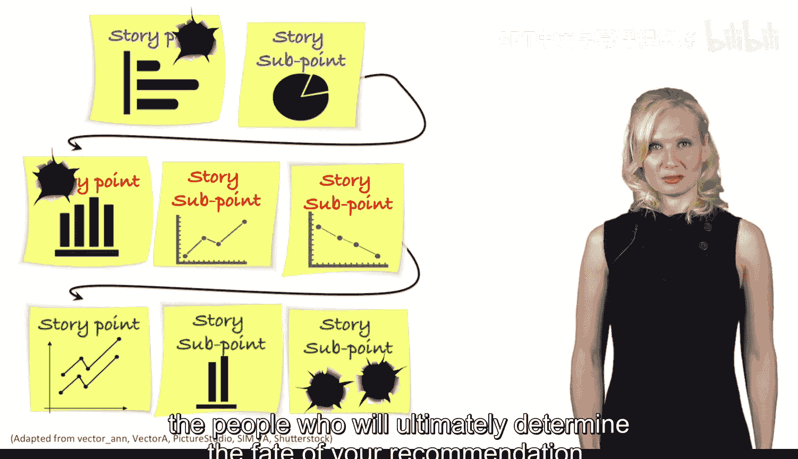
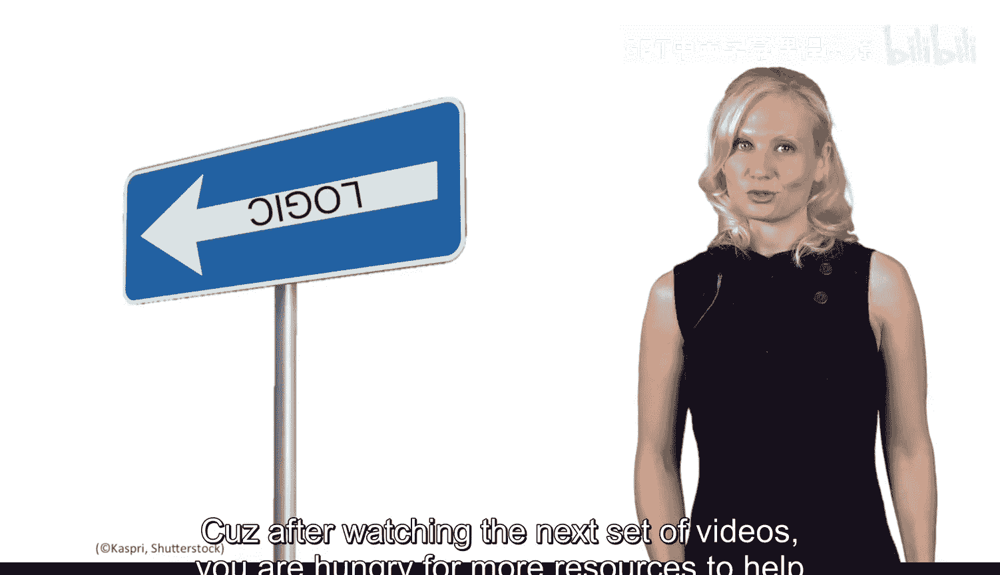

# 杜克大学《Excel 到 MySQL：商业分析（5课全）｜Excel to MySQL： Analytic Techniques for Business》中英 p118 43_05_01_最佳压力测试者来自团队.zh_en -BV1mS421X7yw_p118-

Once you have the logic of your story laid out， it's time to do everything you can to rip it apart。

 find any mistakes you' have made and make it better。

Your goal during this step should be to identify all the possible holes in the logic of your argument or in the assumptions you made about the context of motivation you are using to frame that argument so that the data store would be perfectly polished by the time you present it to the people who will ultimately determine the fate of your recommendation。

In business context， this is a step you should do with your team。Here's Lindsey Penttingil。

 data scientist from Airbnb， talking about how she askeds for feedback from her team when she has a data story。

You know， I'm a data scientist on a team of engineers and a PM。

 I always just like to send out my team like，Hey guys， I took a look at this。

And here's what I'm thinking and you know there are people on the team who know our product better than I do who could say you know what like sanity check that's crazy and that's immensely helpful I could have someone else who says。

 oh， that's great， could you also look at this I might have a certain set of skills but someone else may have a separate set of skills that is immensely valuable to the way that I approach a question。

I suggest that you try to get feedback about your storyboard from everyone you can。

 Try to get feedback from other people in your data analytics team。

 but also from your stakeholders so that they can tell you if your assumptions are way off base or your recommendations aren't relevant。

You might be nervous to do this at first， but data analysis teams work together。

 and everyone can improve， and everybody can make mistakes。 When groups work together。

 the outcomes are almost always better than when one person works alone。

Let's hear what Elleana Gray Wall， a manager on the data science team from Airbnb。

 has to say about getting feedback and making mistakes。

So there are so many times we have gotten things wrong so I have many examples of that that said I think a really important culture to have on any team is the culture of bringing forward any errors and that being celebrated that we understand that everyone will make mistakes and the most important thing is actually to say when you have realize that you've made a mistake so that we can correct it so I think the biggest problems that companies will have is when someone's made a mistake and they're either too afraid or worried to bring it forward and so that's definitely a huge part of our culture。

Obviously， every analysis situation will be different。

 but the next set of videos will go over some common logical fallacies that get people into trouble。

 Make sure to look out for them in your own data stories。

 And when you are trying to help somebody else with his or her data story。

 If after watching the next set of videos， you are hungry for more resources to help you get really good at identifying inconsistencies and logical arguments。

 I recommend that you consider buying a book or taking a class in logic and reasoning。

There are even some great classes about logic and reasoning here in Coursera。

Learning about logic in general will be very helpful for learning how to structure and interpret your data analyses。

 will also make you more confident in your ability to construct bulletproof arguments and identify when and how an argument is weak。

If you can find the time to take a course or read a textbook about making logical arguments。

 I'm confident that you won't regret it。In the meantime。

 the next few videos will get you started learning how to identify the most common logical fallacies found in data analytics。

