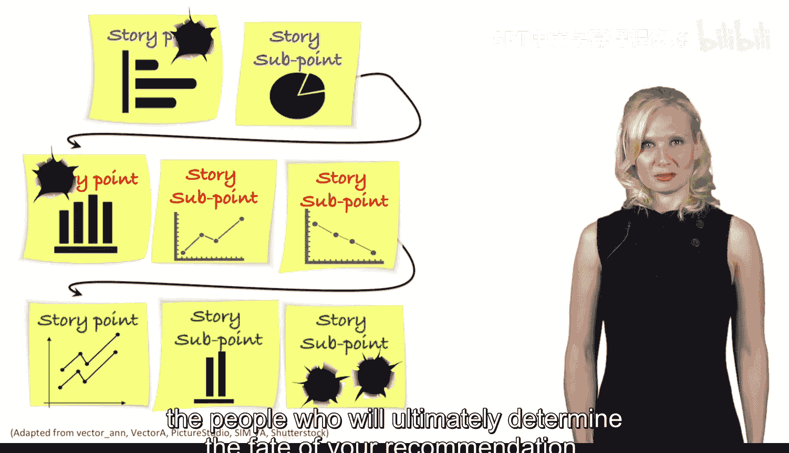

# 商业数据分析：5.1：寻找最佳压力测试者

## 概述
在本节课中，我们将学习如何通过团队协作来检验和完善你的数据分析故事。核心目标是找出逻辑和假设中的所有潜在漏洞，确保你的数据故事在呈现给决策者时是坚实可靠的。

当你已经梳理好数据故事的逻辑框架后，下一步就是尽一切可能去“拆解”它。

你需要找出所有可能存在的错误，并加以改进。

在此步骤中，你的目标应是识别出论证逻辑中的所有潜在漏洞，或是你在构建论证时所依赖的背景与动机假设中的问题。这样，你的数据故事在最终呈现给那些决定你建议命运的人时，才能做到完美无瑕。

## 团队协作的重要性
在商业环境中，这一步应与你的团队共同完成。以下是来自Airbnb的数据科学家Lindsey Penttingil的分享，她讲述了在构建数据故事时如何向团队寻求反馈。

我是团队中唯一的数据科学家，团队里还有工程师和产品经理。

我总是喜欢把初步想法发给团队，比如：“嘿，各位，我研究了一下这个问题，这是我的初步想法。”团队中有人比我更了解我们的产品，他们可能会说：“等等，这个检查点太离谱了”，这对我帮助极大。也可能有其他人说：“哦，这个想法很棒，但你有没有考虑过这个方面？”我可能具备某些特定技能，但其他人拥有的不同技能集，对我处理问题的方式来说同样极具价值。

## 广泛寻求反馈
我建议你尽可能向所有人征求关于故事板的反馈。

不仅要向数据分析团队的其他成员寻求反馈，也要向利益相关者寻求反馈。他们可以告诉你，你的假设是否偏离了基础，或者你的建议是否不切实际。

一开始你可能会对此感到紧张，但数据分析团队是协同工作的。

每个人都可以进步，每个人也都会犯错。当团队协作时，成果几乎总是优于单打独斗。

让我们听听Airbnb数据科学团队经理Elleana Gray Wall对于获取反馈和犯错的看法。

我们犯错的次数太多了，我有很多这样的例子。但我想说的是，在任何团队中，建立一种“主动报告错误并为此感到庆幸”的文化非常重要。我们要理解每个人都会犯错，而最重要的事情实际上是当你意识到自己犯错时，能够说出来，这样我们才能纠正它。我认为公司最大的问题往往出现在有人犯了错，却因为害怕或担心而不敢提出来。所以，这绝对是我们文化中非常重要的一部分。

## 识别常见逻辑谬误
显然，每次分析的具体情况都会不同。

但接下来的系列视频将介绍一些常见的、会让人陷入麻烦的逻辑谬误。请务必在你自己的数据故事中留意它们。

同时，当你在帮助他人完善其数据故事时，也要注意这些谬误。

如果在观看接下来的视频后，你渴望获得更多资源来帮助你熟练掌握识别论证不一致性和逻辑错误，我建议你考虑购买相关书籍或选修一门逻辑与推理课程。

## 深入学习逻辑与推理
甚至在Coursera平台上也有一些关于逻辑与推理的优秀课程。

学习逻辑知识总体上将非常有助于你学习如何构建和解读数据分析。

它也会让你更有信心去构建无懈可击的论证，并识别论证何时、为何是脆弱的。

如果你能找到时间学习一门关于构建逻辑论证的课程或阅读一本教科书，我相信你不会后悔。

与此同时，接下来的几个视频将带你入门，学习如何识别数据分析中最常见的逻辑谬误。

## 总结
本节课中，我们一起学习了如何通过团队协作来“压力测试”你的数据故事。我们了解到，主动向团队成员和利益相关者寻求反馈至关重要，这能帮助你发现逻辑漏洞和错误假设。同时，我们也认识到建立一种不怕犯错、勇于纠错的文化的重要性。最后，我们预告了后续课程将深入探讨数据分析中常见的逻辑谬误，为构建更坚实的数据论证打下基础。