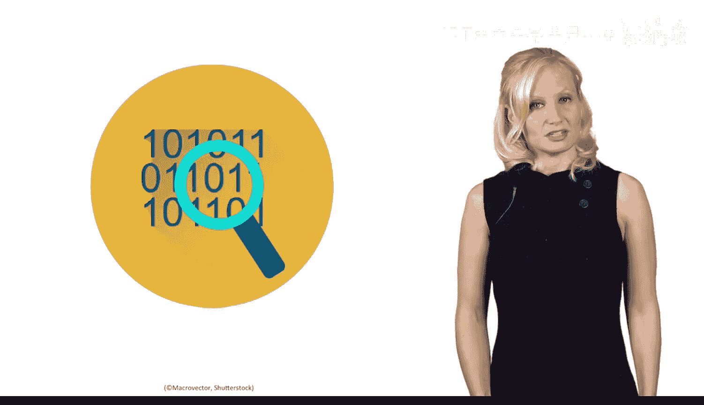
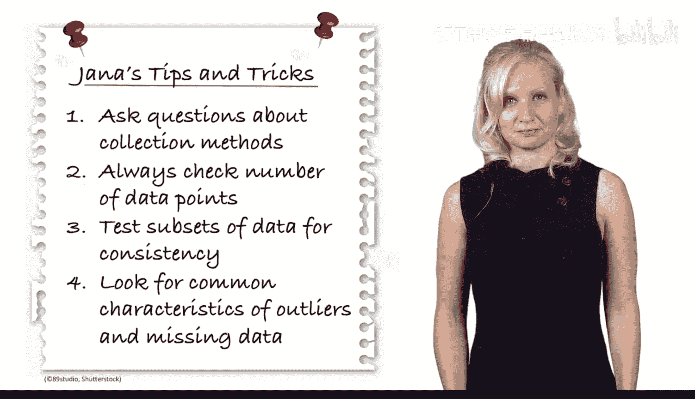

# 杜克大学《Excel 到 MySQL：商业分析（5课全）｜Excel to MySQL： Analytic Techniques for Business》中英 p119 44_05_02_过度泛化与样本偏差.zh_en -BV1mS421X7yw_p119-

。In this video， we are going to talk about how overgeneralization and sample bias can undermine the logic of your data stories。

Over generalization happens when you assume what you are seeing in your dataset set is what you would see if you looked at any other data set meant to assess the same information。

 despite the fact that your data is very small or sometimes a selected subset。

You will be especially tempted to commit the logical fallacy of overgeneization when the sample you are looking at in your data set is small or highly biased in our data analysis of data related jobs。

 for example， one of the first things you should be wondering is are data related salaries the same for US citizens as they are for non US citizens。

 After all， our salary information is highly biased and that it only reflect salaries offered to non US citizens。

 We can hypothesize and try to test whether these salaries will be the same offered to US citizens。

 but we shouldn't assume it， especially because there might be other factors related to US and non US job applicants that independently affect offered salaries。

 One such factor is gender。It turns out that there are many more skilled visas submitted for men than for women。

 This means that the median salary for women who are US citizens might look very different than the salaries we saw in our data sample。

It's tempting to think that if you just have a big enough data set。

 you should be able to overcome most types of sampling bias。 Unfortunately， as anybody who analyzes。

 smartphone data will tell you， large sample sizes can't completely save you from bias either。

Some of the biggest data sets people analyze these days come from smartphone data。 However。

 smartphones are disproportionately owned by wealthier and younger people。

 That means that any time you use smartphone data， the information you learn will be biased towards younger and wealthier groups。

 If you aren't aware of this and can lead to poor decisions and inaccurate predictions。

 as some real life examples， many groups try to analyze Twitter data around the time of Hurricane Katrina and Hurricane Sandy to determine whether it would be possible to analyze tweets to get real time updates about a disaster zone during natural crises。

 It was found that models based purely on tweets will not reflect the on the lag around realities following disasters。

 because what are called data shadows or lack of data from areas with lower average socioeconomic status。

Similar data shadows cause problems when the city of Boston used accelerometer data in combination with GPS data from smartphones to identify potholes。

 The program initially did really well at identifying potholes in high income areas。

 but missed a lot of potholes in lower income areas。Of course。

 one of the most difficult aspects of overgeneralization is that it can take a lot of detective work to figure out that your sample is biased in the first place。

 Often， teams don't start digging into the details But where they their dataset set came from until their predictions start to fail。

Here's Ela Gray Wall again， manager in the data science team from Airbnb。

 telling us about an example of this happening with Airbnb's type of data and sharing our thoughts about how to catch mistakes caused by overgeneralization。

You know， often the mistakes are not necessarily analytical mistakes。

 but there are cases where the data was behaving in a way that wasn't actually。

the way you assumed it to behave and so we have many cases like that where you know you think oh okay。

 we're looking at this table of data that has all of the listings in San Francisco all the homes on Airbnb in San Francisco and then we realized that actually you know this is a subset of all the listings and so our conclusions are not what we had originally thought and that happens quite often and so I think being kind of single-mindedly paranoid about your data quality is actually one of the biggest ways that you can prevent mistakes。

I kind of think about it as developing a data intuition like there's this kind of sense that you have that like something's not quite right and that comes with experience for sure where you get really familiar with the data that you're looking at and you can say wait like I know that on average the percentage is this why is it different in my table something is wrong and that's definitely very important for helping to prevent mistakes？

Another way over generalization can get you into trouble is when you have a lot of missing data in your dataset。

Often， you'll find that there are rows in your data that have entries in some columns。

 but not in all the columns。 A common way to deal with that is to completely take those rows out of your data set whenever you do analyses that require entries in the columns with missing data。

 Then you move forward with your analysis as if you never knew the data was missing。

Sometimes that's okay。 But other times， the missing data all comes from the same group。

 perhaps because there's something wrong with how data is collected from Android phones， for example。

 So all the data from Android phone users is missing。When this is the case。

 removing the missing data from the data set you are analyzing will systematically bias your sample。

 As a consequence， the results you get might be different than if you had a more representative sample。

Here are some tips to help you avoid falling into the overgeneralization trap。First， always。

 always ask a lot of questions about how your data was collected。

 Listen for hints about how the collection methods might have biased your data and look for ways to test the data you have for bias towards specific demographic groups。

Second， always check how many data points you have in all the groups you are looking at。

 If you don't have many data points from a specific group， subcatego or time point。

 don't put much weight on the effects you see there。Third， if you do have a lot of data。

 split your full data set into 3 to5 random subsets。

 See if you observe the same effects in each one as you see in the group as a whole。 If not。

 take caution when interpreting the results from the group as a whole。

 It's likely that the effect is either due to chance。

 Is't that large or is only found a certain subset of your data that you should track down and characterize。

Fourth， before removing outliers arose with some missing data from your analysis。

 always examine whether there are any characteristics that seem common and or unique to those outliers a rows。

 If so， you will likely want to try to collect more data with those characteristics to fill in what you will then exclude。

AtThe very least， you will want to be aware how you are biasing your results when you remove those entries from your data。

