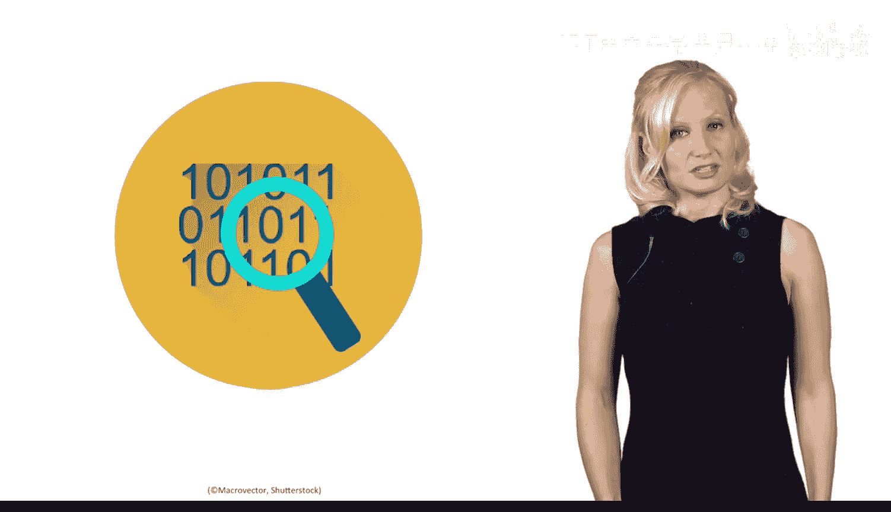
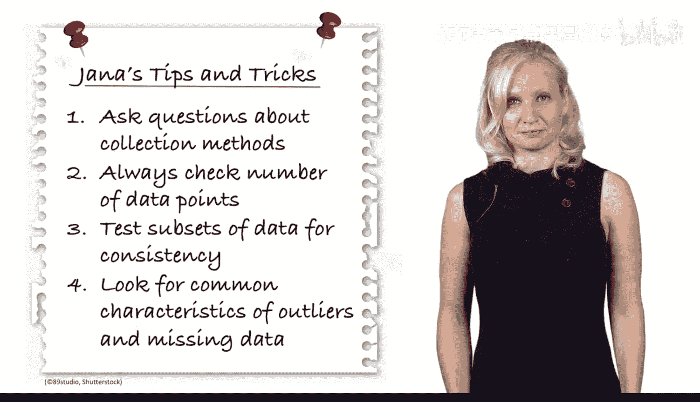

# 商业分析：5.2：过度泛化与样本偏差 🧐

在本节中，我们将探讨数据分析中两个常见的逻辑陷阱：**过度泛化**与**样本偏差**。它们会如何削弱你数据故事的说服力，以及如何识别并避免它们。

## 过度泛化

上一节我们讨论了数据故事的重要性，本节中我们来看看一个会破坏故事逻辑的常见问题：过度泛化。

过度泛化发生在你假设自己数据集中看到的情况，会与任何其他旨在评估相同信息的数据集中看到的情况完全一致时，**尽管**你的数据量可能非常小，或者有时是一个经过筛选的子集。

当数据集中观察的样本量很小或存在高度偏差时，你尤其容易犯过度泛化的逻辑谬误。在我们对数据相关工作的分析中，例如，你首先应该思考的问题之一是：数据相关工作的薪资对美国公民和非美国公民是否相同？毕竟，我们的薪资信息存在高度偏差，因为它只反映了提供给非美国公民的薪资。我们可以假设并尝试测试这些薪资是否与美国公民的薪资相同，但我们不应直接假定它，特别是因为可能还有其他与美国和非美国求职者相关的因素，会独立地影响提供的薪资。其中一个因素是性别。事实证明，为男性提交的技术工作签证数量远多于女性。这意味着美国公民女性的薪资中位数，可能与我们数据样本中看到的薪资情况大不相同。

## 大样本的局限性

你可能会认为，只要拥有足够大的数据集，就应该能够克服大多数类型的抽样偏差。不幸的是，任何分析过智能手机数据的人都会告诉你，大样本量也无法完全让你免受偏差的影响。

如今人们分析的一些最大数据集来自智能手机数据。然而，智能手机在较富裕和较年轻的人群中拥有率不成比例地高。这意味着，每当你使用智能手机数据时，你获得的信息都会偏向于年轻和富裕的群体。如果你没有意识到这一点，就可能导致糟糕的决策和不准确的预测。

以下是一些现实生活中的例子：
*   许多团体曾尝试分析卡特里娜飓风和桑迪飓风期间的推特数据，以确定是否有可能通过分析推文来获取自然灾害期间灾区的实时更新。结果发现，纯粹基于推文的模型无法反映灾后现实的滞后情况，因为存在所谓的“数据阴影”，即来自平均社会经济地位较低地区的数据缺失。
*   类似的数据阴影在波士顿市使用智能手机的加速度计数据结合GPS数据来识别路面坑洼时也造成了问题。该程序最初在识别高收入地区的坑洼方面做得很好，但在低收入地区却遗漏了很多坑洼。

当然，过度泛化最困难的方面之一是，要发现你的样本从一开始就存在偏差，可能需要大量的调查工作。通常，团队直到他们的预测开始失败时，才会开始深究他们的数据集究竟来自哪里。

## Airbnb的案例

以下是来自Airbnb数据科学团队的经理Ela Gray Wall的分享，她讲述了一个发生在Airbnb数据类型上的例子，并分享了关于如何发现由过度泛化引起的错误的看法。

> 通常，错误不一定是分析错误，但确实存在数据的行为方式与你假设的方式不同的情况。我们有很多这样的案例，比如你以为自己在看一张包含旧金山所有房源（Airbnb上所有在旧金山的房屋）的数据表，然后你意识到这实际上是所有房源的一个子集，因此我们的结论并非我们最初所想的那样。这种情况经常发生。所以我认为，对数据质量保持一种近乎偏执的警惕，实际上是防止错误的最大方法之一。
>
> 我将其视为培养一种数据直觉。就像你有一种感觉，觉得某些地方不太对劲，这肯定来自于经验。当你对你正在查看的数据非常熟悉时，你可以说：“等等，我知道平均百分比是这个，为什么在我的表中不一样？肯定有问题。”这对于帮助防止错误无疑非常重要。

## 缺失数据带来的偏差

过度泛化让你陷入麻烦的另一种情况是，你的数据集中有大量缺失数据。

通常，你会发现数据中的某些行在一些列有数据，但并非所有列都有。一个常见的处理方法是，在进行需要缺失数据列中条目的分析时，完全将这些行从数据集中移除。然后你继续进行你的分析，就好像你从未知道数据缺失过一样。

有时这没问题。但其他时候，缺失的数据可能都来自同一个群体，例如，可能是因为从安卓手机收集数据的方式出了问题，所以所有安卓手机用户的数据都缺失了。当出现这种情况时，从你正在分析的数据集中移除缺失数据，将会系统性地使你的样本产生偏差。因此，你得到的结果可能与拥有更具代表性样本时得到的结果不同。

## 如何避免过度泛化陷阱

以下是帮助你避免陷入过度泛化陷阱的一些建议。

首先，始终、始终对你的数据收集方式提出大量问题。留意收集方法可能如何使你的数据产生偏差的线索，并寻找方法来测试你所拥有的数据是否存在对特定人口群体的偏差。

其次，始终检查你所观察的所有群体中有多少个数据点。如果你从特定群体、子类别或时间点获得的数据点不多，就不要过分看重你在那里看到的效果。

第三，如果你确实拥有大量数据，将完整数据集随机分成3到5个子集。观察你在每个子集中看到的效果是否与在整个群体中看到的效果相同。如果不同，在解释整个群体的结果时要谨慎。很可能这种效果要么是由于偶然性，要么并不那么大，要么只在你应该追踪和描述的某个特定数据子集中发现。

第四，在从分析中移除异常值或具有某些缺失数据的行之前，始终检查这些异常值或行是否存在任何看似常见和/或独特的特征。如果存在，你可能需要尝试收集更多具有这些特征的数据来填补你将要排除的部分。至少，当你从数据中移除这些条目时，你需要意识到你正在如何使结果产生偏差。

## 总结

本节课中，我们一起学习了数据分析中的两个关键陷阱：**过度泛化**与**样本偏差**。我们了解到，即使是大样本也无法完全避免偏差，并且通过Airbnb等实际案例看到了这些问题的具体表现。最重要的是，我们掌握了一系列实用的检查方法，包括质疑数据来源、检查样本量、进行子集验证以及谨慎处理缺失数据，以帮助我们在未来的分析工作中构建更可靠、更具说服力的数据故事。