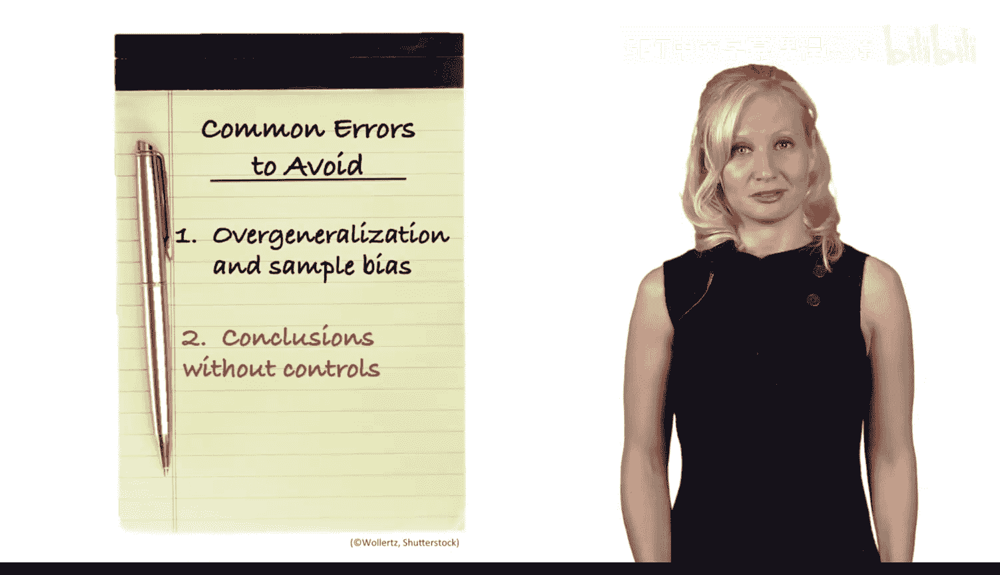

# 杜克大学《Excel 到 MySQL：商业分析（5课全）｜Excel to MySQL： Analytic Techniques for Business》中英 p120 45_05_03_因缺乏对照组导致的误读.zh_en -BV1mS421X7yw_p120-

Yeah。Imagine you are in a marketing team for an organic drink that has chia seeds in it。

 Your team spent a lot of money to send out a compelling email advertisement that is a coupon embedded in it。

 And you want to see if it worked。Your team member shows you this chart。Looking at the chart。

 do you think the email campaign was successful。This chart certainly makes it seem like the email campaign was successful。

 Look at how those sales numbers went up after the campaign。Okay， now。

 imagine I showed you this modified chart that also includes the sales of your competitors during the same time period。

 Your company was the only one that ran a promotion at that time。Looking at this chart。

 do you think the email campaign was successful？This shows a very different story。

 It looks like sales for all of your competitors went up， too。

 despite the fact that none of your competitors sent out an email advertisement。

This version of the chart suggests it's not very likely that your email campaign had anything to do with the increase in sales。

 When you dig into it a bit more， you find out that a famous celebrity who had lost a lot of weight。

 had an interview right around the same time as your email campaign。During the interview。

 he said the secret to his weight loss was drinking Chiya C drinks。 As a result of that interview。

 people started drinking Chiya C drinks of all kinds， not just yours。

You would have never known that if you hadn't included what we call controls in your analysis。

 which are comparisons that you think shouldn't have the result you are testing for。By the way。

 I do want to clarify that it is still possible that your email campaign was effective。

 This graph might show that your sales rose more than some of your competitors。 If that was the case。

 though， you would need to remember that your email campaign might only have worked because you were lucky enough to have sent it out the same time as the celebrity made the world want to go out and drink chieay drinks。

 You would not want to overgeneralize and assume that the same email campaign will give you the same bump in sales in other circumstances。

This JC drink example is fictional， but let's hear from Elleanor Gray Wall again。

 manager in the data science team from Airbnb， as she tells us about a real life example when controls helped Airbnb's analytics team。

It really is all about impact and I think one of the greatest things about working at AirrbnBeyond data science is you see how you can really shape the direction of the company with the data that you bring to the table so one really great example of this was when I first joined the company a couple years ago again as I mentioned we work very closely with our Ops teams and there were a lot of initiatives around the world emphasizing calling our hosts to help them to improve their listing as a way to help our host to be successful and at the time we weren't running this as an experiment。

 it was agents calling host and helping them but in maybe a little bit of an ad hoc manner and we would then look at the performance of the host after the phone call and compared to the host that didn't get a phone call to see how they had done but the people that were being called were actually a slightly different selection of people who may have been more prone to be successful to begin with。

And so what we did was we ended up launching that as an experiment where we withheld 10% of hosts who were not able to be called。

 and then we looked at the performance of the hosts in the treatment and the control group。

About six to eight months later to see how things went and one of the really surprising findings was that on average we actually did not see any increase in the performance of the treatment group compared to the control group and so this was a really important finding that helped us to then hone our efforts and change how we were thinking about this program。

And that would not have been possible if we hadn't had more rigorous data analysis that was not being done prior to that。

Here is what you should remember from this video。Always include carefully designed comparison groups that should not have the effect you are looking for in your analyses to make sure the effects you observe are due to the events you think they are due to。

If a key part of your data story does not have a control group， go run some control analyses。

 It's the only way to make sure you are interpreting your data correctly。

