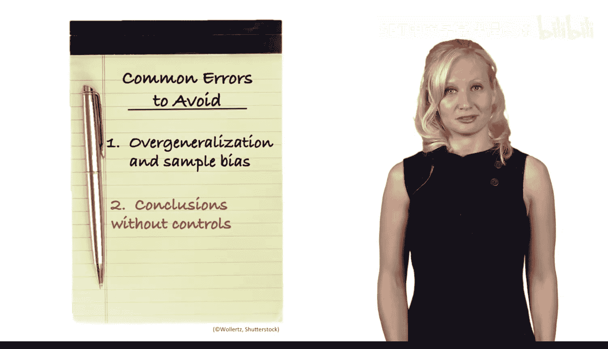

# 商业分析：05：因缺乏对照组导致的误读 📊

在本节课中，我们将学习数据分析中一个至关重要的概念：对照组。我们将通过一个虚构的营销案例和一个来自Airbnb的真实案例，理解为什么缺乏对照组会导致对数据的严重误读，并学习如何避免这种错误。

## 一个营销案例的误读

想象你在一家销售含有奇亚籽的有机饮料的市场团队中。你的团队花费了大量资金，发送了一封包含优惠券的、极具吸引力的电子邮件广告。你想评估这次广告活动是否有效。你的团队成员向你展示了下面这张图表。

观察这张图表，你认为这次邮件营销活动成功吗？这张图表似乎表明活动非常成功，因为活动后的销售额明显上升了。

现在，假设我给你看下面这张修改过的图表，它包含了在同一时间段内你竞争对手的销售数据。当时只有你的公司进行了促销活动。

观察这张图表，你认为这次邮件营销活动成功吗？这张图表讲述了一个截然不同的故事。看起来，尽管你的竞争对手没有发送任何电子邮件广告，但他们的销售额也上升了。

这个版本的图表表明，你的邮件营销活动很可能与销售额的增长无关。当你深入调查后，你发现一位成功减肥的名人，在你的邮件营销活动前后接受了一次采访。在采访中，他说他减肥的秘诀是喝奇亚籽饮料。结果，人们开始购买各种品牌的奇亚籽饮料，而不仅仅是你的品牌。

如果你在分析中没有包含我们称之为“对照组”的内容，你可能永远无法发现这一点。对照组是指那些你认为不应该产生你所测试效果的比较组。

需要澄清的是，你的邮件营销活动仍然可能是有效的。这张图表可能显示你的销售额比某些竞争对手增长得更多。如果是这种情况，你需要记住，你的邮件营销活动之所以有效，可能仅仅是因为你幸运地在名人采访的同一时间发送了邮件，而那次采访激发了人们购买奇亚籽饮料的欲望。你不能过度概括，并假设同样的邮件营销活动在其他情况下也会带来相同的销售增长。

## Airbnb的真实案例

这个奇亚籽饮料的例子是虚构的。现在，让我们再次听听Airbnb数据科学团队的经理埃莉诺·格雷·沃尔的分享，她将告诉我们一个对照组如何帮助Airbnb分析团队的真实案例。

“这确实关乎影响力。我认为在Airbnb数据科学部门工作最棒的一点是，你能看到自己带来的数据如何真正塑造公司的方向。一个很好的例子发生在我几年前刚加入公司时。正如我提到的，我们与运营团队紧密合作。当时全球有很多举措，强调给房东打电话，帮助他们改进房源信息，以此帮助他们获得成功。当时我们并没有将其作为一项实验来运行，而是由客服人员以有点临时的方式给房东打电话并提供帮助。然后，我们会查看房东在接到电话后的表现，并与未接到电话的房东进行比较。但问题在于，那些被选中的房东，本身可能就是更容易成功的人群。”

“因此，我们最终将其启动为一项实验。我们保留了10%的房东作为对照组，不给他们打电话。然后，我们比较了实验组（接到电话）和对照组（未接到电话）房东的表现。大约六到八个月后，我们查看结果。其中一个非常令人惊讶的发现是，平均而言，与对照组相比，实验组房东的表现实际上没有任何提升。这是一个非常重要的发现，它帮助我们集中精力，并改变了我们对这个项目的思考方式。如果没有之前没有进行的、更严谨的数据分析，这是不可能实现的。”

## 核心要点总结

本节课中，我们一起学习了对照组在数据分析中的关键作用。

以下是本视频的核心要点：
*   **始终包含精心设计的对照组**：在你的分析中，必须包含那些你认为不应该产生你所寻找效果的比较组。这是确保你观察到的效果确实源于你认为的原因的唯一方法。
*   **主动进行对照分析**：如果你的数据故事中缺少对照组，请立即去运行一些对照分析。这是确保你正确解读数据的唯一途径。

