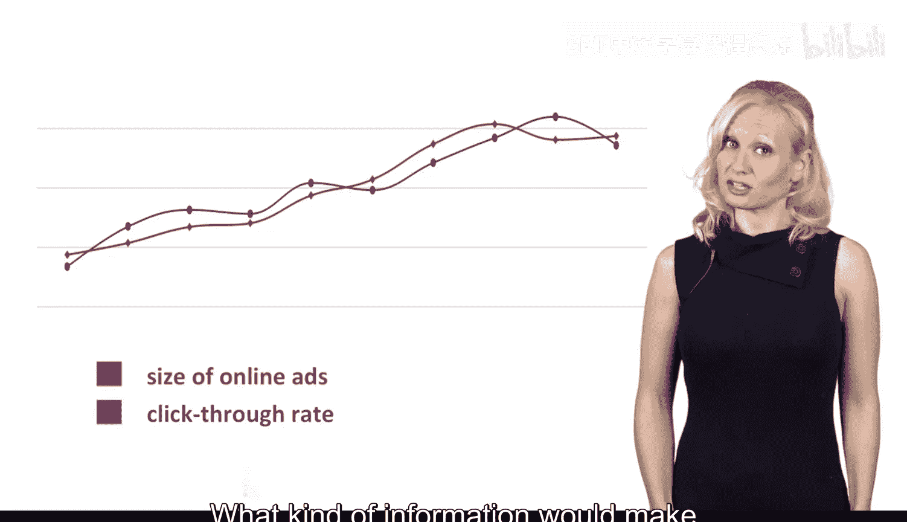

# 杜克大学《Excel 到 MySQL：商业分析（5课全）｜Excel to MySQL： Analytic Techniques for Business》中英 p121 46_05_04_相关性不等于因果性.zh_en -BV1mS421X7yw_p121-

If I should do a chart like this， and I said the blue line is the marketing budget and dollars and the red line is the amount of product purchased。

 how many of you would think increasing the amount of money dedicated to marketing leads to increases in customer purchasing。

Well， this is what the graph actually shows。 The blue line shows the number of movies Nicholas Cage was in per year。

 and the red line shows the number of people who died that year by falling into a pool。

 I'm not kidding about that。 I got this graph from W W W。 Tyler Vigan dot com。 a very funny website。

 I highly recommend that you check out to see other examples of bizarre things that seem to correlate。

😊，This graph was made from real data， though， From the centers of Disease Control and Prevention and the Internet movie database。

 I promise you， it's not made up。 You can go look it up and plot the numbers yourself。As you can see。

 it looks to our eye like there is a decent relationship between these two things over the years。

 Now， knowing that how many of you think that the number of movies Nicholas cages in per year causes increases in pool drownings or that the number of pool drownings per year increases the number of movies Nicholas C agree to star in。

I'm going to hypothesize that some of you are willing to guess that the amount of money invested in marketing does indeed cause customers to purchase more。

However， despite the fact that I showed you the exact same data in both graphs I ask you to evaluate。

 I hypothesized that many fewer of you were willing to say that Nicholas Cage movies caused pool drownings or that pool drownings caused Nicholas Cage to star more movies。

 And for the record， you are correct， If you said that Nicholas Cage movies do not cause pool drowns and that pool drownings do not cause Nicholas Cage to star more movies。

When the match between two sets of data is compelling and close， like these examples are。

 psychologically， it's very easy to tell yourself that one thing you are measuring is causing the other。

 It's also very easy for an audience to tell themselves the same thing。

 It can actually be quite difficult to prevent yourself from telling that cause of data story。

 However， as the Nicholas C pool drownings example shows us because it is so bizarre。

 as well as the rest of these real life examples that I've now shown with their true titles。

 just because two variables correlate or seem to be linked to one another。

 It does not mean that one causes the other。 Correlation does not equal causation。Before I continue。

 it might help to define some terms。Correlation refers to the phenomenon of two things。

 having a tendency to vary together over multiple time points or multiple measurements。

The number of Nicholas Gage movies and number of pool drownings were correlated in our example。

Causation refers to the phenomenon of one thing happening as a result of the other thing。

 If I punched you and you got a black eye， we've brought enough scientific experiments to know that my punch caused your black eye。

 If I punched you again， you would get a black eye again。 And I would probably get a black eye， too。

 since you would probably punch me back。A coincidence is when purely by chance。

 two things happen at the same time。A spurious relationship is when either due to chance or due to an unmeasured variable。

 but not by direct causality， Two things corly。Let me explain what I mean by an unmeasur variable。

The coincidence or spurious relationship we observed on a graph earlier might be due to a variable we didn't pay any attention to。

 summer activities。Nicholas Cage tends to be in blockbuster movies that are released during the summer。

 especially summers with big events。 In addition， people go into the pool primarily during the summer and more pool parties might occur during summers with big events。

 So the reason Nicholas cage movies and pool drownings might be so correlated is because they are both related to the unmeasured variable summer time。

 I don't know if that's the case。 but it's a good hypothesis that might explain the spurious relationship we see。

Now that we know what these terms are， let's return to why the issue of correlation。

 not equal in causation is dangerous for business analytics。

If the reason you are analyzing data is to determine what changes you should make in your business processes。

 you are intending to make changes that will cause improvements in your business processes。

 The changes you recommend are due to graphs that only show correlation， but do not show causation。

 Your recommendations might not work or even worse。

 They could cause decreases of business performance。

 Let's look at a business example that makes this very clear。

Imagine you run an analysis that finds that the number of Internet security breaches companies have correlates with the number of engineers companies have in their Internet security department。

 This surprises you and goes against your intuition。 So like a good analyst。

 you find another data set with another set of companies and see if you can replicate the effect。

 You do。Based on this data， you might then infer that having a greater number of engineers in your Internet security department causes more security breaches。

 As a consequence， you then recommend that your company reduce its number of engineers。

If you did this， however， your recommendation would have catastrophic consequences。 Of course。

 your company would probably end up with an even greater number of security breaches。

 The reason why is that having a greater number of security breaches caused executives in your company to seek help from engineers。

 not the reverse。 The increased numbers of engineers might not have solved the security breach problem。

 But if you fire all your engineers， you'll have no chance of solving the security problem。Now。

 since most of us know that it will be impossible to fight into Internet security breaches if you don't do something to protect your Internet system。

 this would have been a logical mistake that was very easy to identify。

But what if I replaced the labels on this chart with labels depicting the number of larger ads on a website and click through read。

Click through rates represent the percentage of users who click on an advertisement link when they see it。

So this graph shows us that the larger the add， the higher the click through rate。

I want you to imagine that you are a data analyst working on a marketing project。

 Really close your eyes and create a vision of what that would look and feel like。

 You were new to the job。 You really want to impress your boss。

 You spent the past few days getting and cleaning your data。

 And you finally get the data into tableableau And in a couple seconds， you see this graph。

 I want you to really think about this。 If you were in that situation and you saw this graph。

 Would you be tempted to assume larger ads caused higher click through rates。

 And would you be tempted to jump to the conclusion that the company should invest their money in larger ads。

 If so， you are now getting a flavor of why misinterpreting correlation is so common in business。

 but also so dangerous。 I know these conclusions sounded tempting， but the data on this graph。

 do not support a causal relationship any more than they did when we are looking at the number of security engineers and security breaches。

 recommending that the business invest in larger ads without any further information would be a risky financial recommendation to make。

What kind of information would make that recommendation less risky。

 Watchch the next video to find out。

