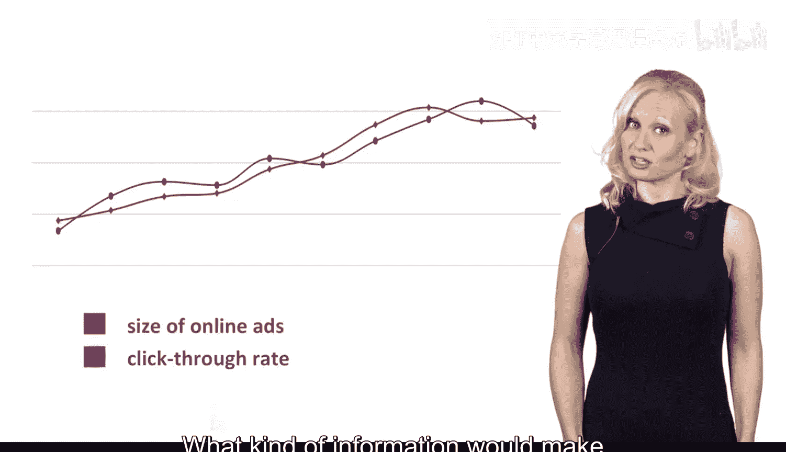

# Excel 到 MySQL：商业分析：5.4：相关性不等于因果性 🔍

在本节课中，我们将要学习数据分析中一个至关重要的概念：相关性不等于因果性。我们将通过生动的例子来理解为什么仅凭数据间的关联就推断因果关系是危险的，并学习如何避免这种常见的逻辑陷阱。

## 概述

数据分析的核心目标之一是发现规律并指导决策。然而，一个常见的错误是将数据中观察到的“相关性”直接等同于“因果性”。本节课将通过一系列真实且有趣的案例，阐明这两个概念的区别，并解释为什么在商业分析中混淆它们可能导致严重的决策失误。

## 核心概念解析

在深入探讨之前，让我们先明确几个关键术语的定义。

*   **相关性**：指的是两个或多个变量在多次测量或时间点上倾向于一同变化的**现象**。其数学表达通常使用相关系数 `r`，其值介于 -1 到 1 之间。
*   **因果性**：指的是一个事件（因）直接导致另一个事件（果）发生的**关系**。例如，代码 `if (punch) { blackEye = true; }` 模拟了“击打导致黑眼圈”的因果关系。
*   **巧合**：指纯粹由于**偶然**，两件事同时发生。
*   **虚假关系**：指两个变量由于**偶然**或某个**未测量的变量**而表现出相关性，但彼此之间并无直接的因果关系。

## 一个引人深思的例子

上一节我们定义了核心概念，本节中我们来看看一个生动的例子，它完美展示了相关性与因果性的区别。

请看下图。如果我说蓝线代表市场营销预算（美元），红线代表产品购买量，你们中有多少人会认为增加营销投入会导致客户购买量上升？

然而，这张图实际显示的是：蓝线是尼古拉斯·凯奇每年参演的电影数量，红线是每年因跌入泳池而死亡的人数。这不是玩笑，数据来自美国疾病控制与预防中心和互联网电影数据库，是真实数据。

如图所示，多年来这两条线似乎存在明显的关联。现在，知道了真相，你们中有多少人还认为尼古拉斯·凯奇的电影数量导致了泳池溺亡人数增加，或者反之？

我推测，对于第一张图（营销预算与购买量），不少人愿意相信存在因果关系。但对于第二张图（电影与溺亡），愿意相信的人就少得多。你们的直觉是正确的：尼古拉斯·凯奇的电影并不导致溺亡，溺亡也不导致他出演更多电影。

当两组数据的匹配度很高时，从心理上很容易认为你测量的一个事物导致了另一个。观众也容易产生同样的联想。然而，正如这个古怪的例子所示，仅仅因为两个变量相关或看似关联，**绝不意味着一个导致了另一个**。相关性不等于因果性。

## 虚假关系的可能原因

那么，如何解释尼古拉斯·凯奇电影与泳池溺亡之间的这种强相关性呢？这很可能是一种“虚假关系”，由某个“未测量的变量”导致。

以下是可能的解释：

*   **未测量变量：夏季活动**。尼古拉斯·凯奇常出演在夏季上映的大片，尤其是在有大型活动的夏季。同时，人们主要在夏季去泳池，有大型活动的夏季可能举办更多泳池派对。
*   **结论**：因此，电影数量和溺亡数量高度相关，可能是因为它们都共同关联于“夏季”这个未在图中直接测量的变量。这只是一个假设，但它很好地解释了为何我们看到了虚假的相关性。

## 商业分析中的危险

现在我们明白了这些术语，让我们回到为什么“相关性不等于因果性”这个问题对商业分析如此危险。

如果你分析数据的目的是决定如何改进业务流程，那么你意图做出的改变应该是能**导致**业务提升的。如果你的建议仅基于显示**相关性**而非**因果性**的图表，那么你的建议可能无效，甚至更糟，可能导致业务表现下降。

让我们看一个清晰的商业案例。

假设你通过分析发现，公司的网络安全漏洞数量与其网络安全部门的工程师数量呈正相关。这出乎你的意料。于是，作为一名优秀的分析师，你找了另一组公司数据来验证，并复现了这一结果。

基于此数据，你可能会推断：拥有更多网络安全工程师**导致**了更多的安全漏洞。因此，你建议公司裁减工程师。

然而，如果你这样做，后果将是灾难性的。公司很可能会遭遇更多的安全漏洞。因为真实情况是：安全漏洞增多**导致**公司高管寻求工程师的帮助，而不是反过来。工程师数量的增加可能未能完全解决问题，但如果你解雇所有工程师，你将毫无机会解决安全问题。

## 一个更微妙的营销案例

既然大多数人都知道，如果不采取保护措施，就无法应对网络安全漏洞，上面的逻辑错误相对容易识别。

但如果我把图表标签换成“网站上的广告尺寸”和“点击率”呢？点击率指的是看到广告链接的用户中点击它的百分比。

这张图显示，广告尺寸越大，点击率越高。请想象你是一名负责营销项目的数据分析师，刚入职，非常想给老板留下好印象。经过几天数据收集和清洗，你终于在 Tableau 中看到了这张图。

认真思考一下：在这种情况下，你是否会倾向于认为“更大的广告**导致**了更高的点击率”？你是否会急于得出结论，认为公司应该投资更大的广告？

如果是，那么你现在就能体会到，为何误解相关性在商业中如此普遍却又如此危险。这个结论听起来诱人，但图表上的数据**并不比**安全工程师与安全漏洞的例子更能支持因果关系。在没有进一步信息的情况下，建议企业投资更大的广告，将是一个风险很高的财务建议。

## 总结

本节课中，我们一起学习了数据分析的基石原则：**相关性不等于因果性**。我们通过尼古拉斯·凯奇电影与泳池溺亡的古怪关联，理解了相关性与因果性的本质区别。随后，我们探讨了这种混淆在商业决策中的巨大风险，无论是网络安全还是营销投入的案例都表明，基于虚假关系做出因果推断可能导致严重的负面后果。

那么，什么样的信息能让“投资更大广告”的建议风险降低呢？我们将在下一个视频中寻找答案。

