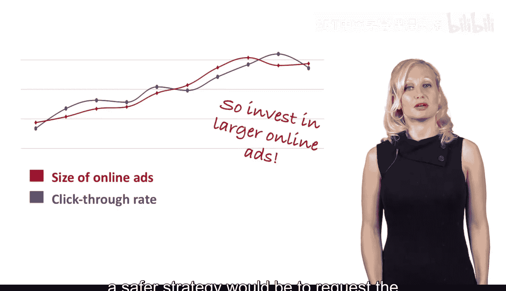
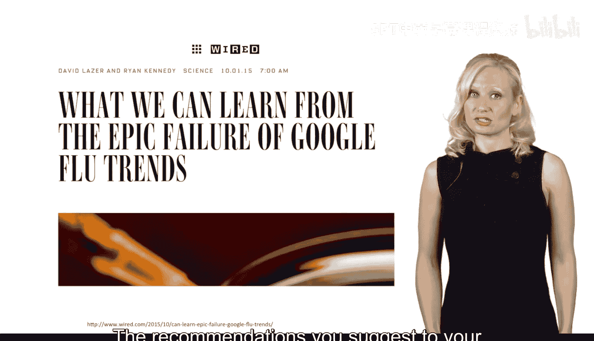

# 杜克大学《Excel 到 MySQL：商业分析（5课全）｜Excel to MySQL： Analytic Techniques for Business》中英 p122 47_05_05_相关性如何影响商业决策.zh_en -BV1mS421X7yw_p122-

We've talked about how misinterpreting correlation as causation is dangerous for business analytics。

 In this video， we are going to talk about what to do when you need to make a business decision based on a correlation。

You will often have to either make a decision or give advice based on correlations。

 The way to handle these situations is to weigh the benefits you gain if the correlation is causal with the cost of the recommendation you want to make and the cost of making a poor decision。

If there is't much to lose， it's reasonable to make a business recommendation based on hoping a correlation represents a causal relationship。

 On the other hand， if your business recommendation will cost a lot of money or getting it wrong could cause a lot of damage to people。

 the business or its reputation， Then you should require more certainty about the likely outcome of your recommendation than correlation on its own can give you。

In these cases， look for ways to test your recommendation in small scale pilot scenarios where the stakes are lower before you make a recommendation to implement a full scale change。

 An important corollary here is that even if your executives are so persuaded by your correlation。

 you show them in a graph that they want to jump into a full scale change you should take the responsibility to temper their expectations and suggest a step by strategy instead that will minimize risk and make sure you make the most successful business changes。

 Here are some things you can do to minimize risk in these situations。

 in the perfect world you would determine whether any correlation you see is due to a true causal relationship。

😊，The only way to find out if one thing causes another is to use a scientific method and run a test or experiment where you change the variable you think is causing the effect you want and hold all other things constant。

Such a test can be very challenging to run because it's almost impossible to control every variable in the world in order to keep a constant across an experiment。

 but you could try。 and that's the idea behind A B testing。During A B test。

 you give two different versions of a website dissimilar。

 but separate groups of web visitors at the exact same time。

Then you analyze the results to determine which version of the website performs better。

Let's recall our example from a previous video about larger ads and click through rates。

 Since clickthrough rates seemed to correlate strongly with the size of the ads。 Remember。

 we were tempted to jump to the conclusion that the company should invest a lot of money in larger ads。

 However， especially because ads can cost a lot of money。

 a safer strategy would be to request the time and money to run some A B tests。 If we did that。

 we might find that using larger ads does not increase click through rates。 Instead。

 what was happening in our first sample of data was that all the larger ads were being put at the top of the webp page。

 whereas the smaller ads were all being put further down on the webp page so customers had to scroll to see them。

As a consequence， yes， larger ads correlated with higher click through rates。

 But that was a spurious correlation due to the fact that larger ads were always placed at the top of the screen。

 Our test showed us that where ads were located on the screen was the true factor that influenced click through rates。

 not ad size。 As a consequence， recommending that our company invest in larger ads could have ended up in a big waste of money。

 If those larger ads ended up at the bottom of the website page。

Tests are definitely the best way to understand the nature of the relationship between two variables。

 but they aren't always possible to implement because sometimes they are too difficult or too expensive to run。

When you can't run a test， here are a couple more things you can do as a data analyst to help you assess how much confidence you should have in the correlation you see。

First， every time you see a correlation between two entities related to a business recommendation you want to make。

 get in the habit of questioning whether there is some other third or fourth or fifth variable that can explain the relationship you see。

Then look for data that allows you to test whether that third or fourth or fifth variable is a better measure of the phenomenon you are interested in。

Next， examine whether the correlation you are basing your business recommendation on exists in other contexts or data sets。

 The more you can replicate the effect， the less likely the first correlation you saw was due to random chance。

The next tip is to try to come up with different but complementary angles to assess the causal relationship you are hypothesizing about。

 For example， if your hypothesis was that more security engineers causes more security breaches。

 do you see decreases in security breaches when security engineers are fired。 In addition。

 if the number of security engineers causes more security breaches。

 increases in security breaches should happen after more security engineers are hired。

 not before they are hired。Does your data give you enough resolution to address that question。

 if not， try to get data that does have high enough time resolution。

There are a couple more things I want to say but the correlation does not equal causation issue before we move on to the next video。

The first thing is that you should know that the likelihood that you will get into trouble。

 inferring causation from correlation increases as the size of your dataset sets increase。

 The more data you have， the more opportunity you will have to find coincidental relationships that just happen by chance。

The second thing you should know is that your likelihood for getting into trouble increases as the complexity of your data sets increases as well。

 when many variables are highly related， you can get some strange effects。

 where sometimes the variable you are interested in correlates with an increase in the metric you care about。

 But other times， the same variable correlates with the decrease in the variable you care about。

These seemingly contradictory effects are due to what's happening with the other variables you may or may not be measuring。

I've seen these types of effects a lot in my own research， and you are likely to see them as well。

I don't want to go into the statistical details of why this happens。

 but I do want you to remember that the bigger and more complex your data set。

 the more wary should be of investing a lot of capital in a single correlation。That said。

 two situations in which you don't care as much of correlation represents causation is when you are trying to measure a phenomenon that you don't have a reliable way to measure directly。

 or when you are trying to simply predict how likely something is to happen。

If a correlation between two variables is consistent and reliable。

 one variable can be used to both measure and predict the other， even if one doesn't cause the other。

The problem is that if you don't know why one variable is correlating with another。

 it's hard to anticipate when they will stop correlating with each other。

 That's what happened to Google。In 2009， Google published a paper in the Scific journal Nature claiming that they could。

 and I quote，ac estimate the current level of weekly influenza activity in each region of the United States with a reporting lag of about one day。

The logic behind this study was that people with the flu often go online to find out how to treat it。

 So if Google could identify search terms that were likely correlated with having with flu。

 they would be able to use Google searches to measure how many people have the flu right now and perhaps predict if an outbreak isn't likely to happen in the near future。

Well， the Google algorithm based on the correlation between search terms and having the flu started out pretty darn good。

 They could report the amount of the flu people had in a geographic location with about 90% accuracy。

Then the algorithm kind of fell apart。 This happened because the search terms and their algorithms stopped correlating so strongly with people。

 actually having the flu。For a long time， nobody noticed in 2009。

 the world was hit with the 2009 Swwine flu pandemic， and Google flu totally missed it。

But eventually， people did notice， according to a paper published in the journal Science。

 Google F was wrong for  a00 out of 1008 weeks between August 2011 and 2014。Now。

 Google has stopped publishing flu predictions altogether and has passed along the resources of its project to academic and federal institutions who specialize in infectious disease research。

The lesson here isn't that we shouldn't try to harness the predictive or measuring power of correlations。

 but rather， that is very important to recognize the implication of the fact that correlation is not causation。

To emphasize this concept again， when you don't know why two phenomena are correlated。

 you won't know how to predict when their correlation might change。

 So if a business is going to strongly invest in a correlational phenomenon。

 they don't understand the cause of。 they need to also be prepared to invest in the infrastructure necessary to continuously monitor that co correlation and to make the adjustments。

 if necessary。The recommendations you suggest to your stakeholders should reflect these principles。

To conclude this lesson， here's how I want you to think about data and business context in general and about correlations between variables and business context in particular。

In most cases， data is meant to inform human decision making， not replace it。

 So you should think of data as a resource to increase the number of good decisions made and decrease the uncertainty associated with those decisions in the case of observed correlations。

 think of correlations as a good way to generate hypotheses about what your company should do to improve。

 whenever possible， design your business strategy and recommendations to incorporate tests of those hypotheses before you recommend investments that require a lot of capital。

If tests are not possible， make sure you and your clients understand the possible risks associated with assuming causal relationships and correlations。

 Even when you are using correlations to make predictions or to measure something else。

 you can't measure directly。 You need to keep tabs and whether the correlations you are using remain stable when you don't know why one variable is related to another。

 you aren't going to be able to predict when that relationship between those variables is going to change。

 And if you miss a change， it could cost you and your business a lot of money。

Make sure your data stories and your business recommendations have proper respect for the concept that correlation does not equal causation。

