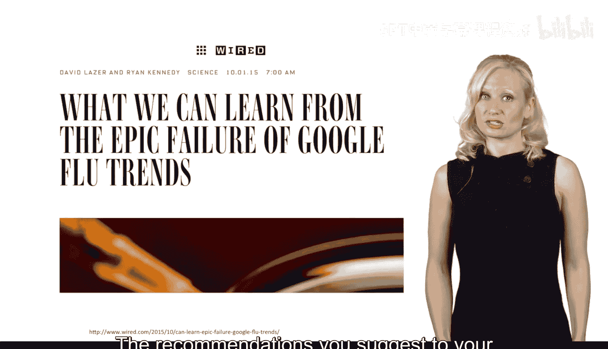

# 商业分析：5.5：相关性如何影响商业决策 📊

在本节课中，我们将探讨如何基于相关性做出商业决策。我们将学习如何权衡风险与收益，并了解在无法确定因果关系时，如何通过测试和谨慎分析来降低决策风险。

---

我们已经讨论过，将相关性误解为因果关系对商业分析是危险的。本节中，我们将探讨当你需要基于相关性做出商业决策时，应该怎么做。

你经常需要基于相关性做出决策或提供建议。处理这些情况的方法是：权衡如果相关性是因果关系时你能获得的收益，与你所提建议的成本以及做出错误决策的代价。

如果损失风险不大，基于“希望相关性代表因果关系”来提出商业建议是合理的。另一方面，如果你的商业建议需要投入大量资金，或者出错可能对公司、人员或声誉造成重大损害，那么你就需要比单纯的相关性分析提供更高的确定性。

在这些情况下，你应该寻找方法，在风险较低的小规模试点场景中测试你的建议，然后再建议进行全面变革。一个重要的推论是，即使你的高管被图表展示的相关性说服，想要立即进行全面变革，你也有责任缓和他们的期望，并建议采取分步实施的策略，以最小化风险并确保商业变革的成功。

以下是你可以采取的一些措施，以在这些情况下最小化风险。

---

在理想情况下，你会确定你所看到的任何相关性是否源于真实的因果关系。😊

要确定一件事是否导致另一件事，唯一的方法是使用科学方法进行测试或实验，即改变你认为导致效应的变量，并保持其他所有条件不变。

这样的测试可能非常具有挑战性，因为几乎不可能控制世界上的每一个变量以保持实验条件恒定，但你可以尝试。这就是A/B测试背后的理念。

在A/B测试中，你在完全相同的时间，向不同但独立的访客群体展示网站的两个不同版本。然后分析结果，以确定哪个版本的网站表现更好。

让我们回顾之前视频中关于广告尺寸和点击率的例子。由于点击率似乎与广告尺寸高度相关，我们曾倾向于直接得出结论：公司应该投资大尺寸广告。然而，特别是考虑到广告成本可能很高，一个更安全的策略是申请时间和资金来进行一些A/B测试。

如果我们这样做，可能会发现使用更大的广告并不会提高点击率。相反，在我们最初的样本数据中，所有大尺寸广告都被放在了网页顶部，而小尺寸广告则被放在网页更靠下的位置，客户需要滚动才能看到。

因此，是的，大尺寸广告与更高的点击率相关。但这是一种虚假相关，因为大尺寸广告总是被放置在屏幕顶部。我们的测试表明，影响点击率的真正因素是广告在屏幕上的位置，而不是广告尺寸。因此，如果建议公司投资大尺寸广告，而这些广告最终被放在网页底部，可能会导致巨大的资金浪费。

测试无疑是理解两个变量之间关系本质的最佳方式，但并非总能实施，因为有时测试过于困难或昂贵。

当你无法进行测试时，作为一名数据分析师，你还可以做以下几件事来帮助你评估对所看到的相关性应抱有多大信心。

首先，每当你看到两个实体之间存在相关性，并想据此提出商业建议时，要养成习惯，质疑是否存在其他第三、第四或第五个变量可以解释你所看到的关系。然后，寻找数据来测试这些变量是否是你感兴趣现象的更好衡量指标。

其次，检查你商业建议所依据的相关性是否存在于其他背景或数据集中。你能复现该效应的次数越多，最初看到的相关性源于随机偶然的可能性就越小。

下一个建议是尝试从不同但互补的角度来评估你假设的因果关系。例如，如果你的假设是“更多的安全工程师会导致更多的安全漏洞”，那么当安全工程师被解雇时，你是否看到安全漏洞减少？此外，如果安全工程师的数量导致更多安全漏洞，那么安全漏洞的增加应该发生在雇佣更多安全工程师之后，而不是之前。你的数据是否有足够的分辨率来回答这个问题？如果没有，尝试获取具有足够高时间分辨率的数据。

在我们进入下一个视频之前，关于“相关性不等于因果关系”这个问题，还有几点需要说明。

第一点，你应该知道，随着数据集规模的增大，你因从相关性推断因果关系而陷入麻烦的可能性也会增加。你拥有的数据越多，就越有机会发现仅仅是偶然发生的巧合关系。

第二点，随着数据集复杂性的增加，你陷入麻烦的可能性也会增加。当许多变量高度相关时，你可能会得到一些奇怪的效果：有时你感兴趣的变量与你关心的指标增加相关，但其他时候，同一个变量又与你关心的指标减少相关。这些看似矛盾的效果是由于其他你可能测量或未测量的变量所导致的。

我在自己的研究中经常看到这类效应，你也可能会遇到。我不想深入探讨发生这种情况的统计细节，但希望你记住：你的数据集越大、越复杂，你就应该越警惕对单一相关性投入大量资金。

话虽如此，有两种情况你不那么关心相关性是否代表因果关系：一是当你试图测量一个没有可靠直接测量方法的现象时；二是当你只是试图简单地预测某事发生的可能性时。

如果两个变量之间的相关性是持续且可靠的，那么一个变量可以用来测量和预测另一个变量，即使一个并不导致另一个。问题在于，如果你不知道一个变量为何与另一个变量相关，就很难预测它们何时会停止相关。这正是谷歌遇到的情况。

2009年，谷歌在《自然》杂志上发表论文，声称他们可以“以大约一天的报告延迟，估计美国每个地区每周流感活动的当前水平”。这项研究背后的逻辑是，流感患者经常上网查找治疗方法。因此，如果谷歌能识别出可能与患有流感相关的搜索词，他们就能利用谷歌搜索来测量当前有多少人患有流感，并可能预测近期是否可能爆发疫情。

起初，基于搜索词与流感相关性的谷歌算法表现得相当不错。他们能以约90%的准确率报告某个地理区域的流感人数。但后来这个算法失效了。这是因为搜索词及其算法不再与人们实际患有流感强烈相关。很长一段时间里，没有人注意到。2009年，世界遭遇了猪流感大流行，而谷歌流感趋势完全错过了它。

最终，人们还是注意到了。根据《科学》杂志上发表的一篇论文，在2011年8月至2014年期间，谷歌流感趋势在1008周中有100周是错误的。现在，谷歌已完全停止发布流感预测，并将其项目资源移交给了专门从事传染病研究的学术和联邦机构。

这里的教训不是我们不应该尝试利用相关性的预测或测量能力，而是要认识到“相关性不等于因果关系”这一事实的含义非常重要。

再次强调这个概念：当你不知道两个现象为何相关时，你就无法预测它们何时可能改变相关性。因此，如果一个企业要大力投资于一个他们不理解其成因的相关性现象，他们也需要准备好投资必要的基础设施，以持续监控这种相关性，并在必要时进行调整。你向利益相关者提出的建议应反映这些原则。

---

总结本节课，以下是我希望你如何思考数据与商业背景（特别是变量间的相关性与商业背景）的方式。

在大多数情况下，数据旨在为人类决策提供信息，而非取代它。因此，你应该将数据视为一种资源，用以增加正确决策的数量，并减少这些决策的不确定性。对于观察到的相关性，应将其视为生成关于公司应如何改进的假设的好方法。只要可能，在设计商业战略和建议时，应纳入对这些假设的测试，然后再建议需要大量资本的投资。

如果无法进行测试，请确保你和你的客户理解假设因果关系和相关性可能带来的风险。即使你使用相关性进行预测或测量无法直接测量的东西，你也需要密切关注你所使用的相关性是否保持稳定。当你不知道一个变量为何与另一个变量相关时，你将无法预测它们之间的关系何时会改变。如果你错过了这种变化，可能会给你和你的公司带来巨大的经济损失。

确保你的数据故事和商业建议能恰当地尊重“相关性不等于因果关系”这一概念。

---

本节课中，我们一起学习了如何基于相关性做出商业决策。我们探讨了权衡风险与收益的重要性，介绍了A/B测试等验证方法，并强调了在无法确定因果关系时应保持谨慎。记住，数据是辅助决策的工具，理解“相关性不等于因果关系”是避免重大商业失误的关键。