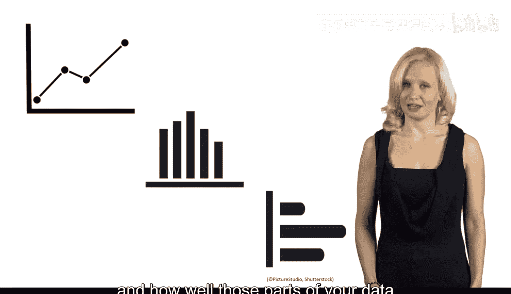
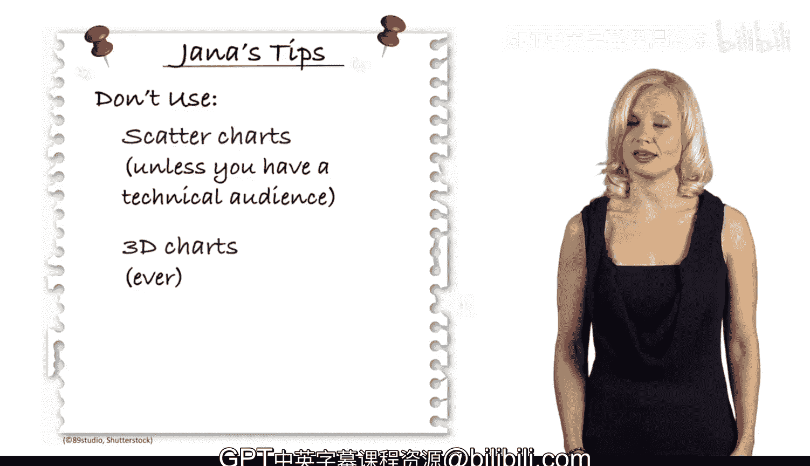

# 杜克大学《Excel 到 MySQL：商业分析（5课全）｜Excel to MySQL： Analytic Techniques for Business》中英 p123 48_05_01_为故事点选择可视化图表.zh_en -BV1mS421X7yw_p123-

。In the past few videos， we've learned how to storyboard presentations and stress test logical arguments。

Now it's time to make those precious presentation slides。

This is the time in the data project where you have to commit to what visualizations you are going to use to convey the importance of all your hard work。

I know some of you have seen beautiful graphs like this。Or this。These graphs are captivating。

 So you're probably very eager to use them。 And I agree these visualizations are beautiful and very interesting。

 However， they are generally better for the printed form where they can be studied and explored than they are for slides and presentations。

 because they are very complicated and full of too much information to process quickly。😊。

You might be surprised to hear me say this。 but when you are giving business presentations。

 bar charts or line charts will almost always be a good way and maybe even the best way to communicate the implications of your analysis。

 This is even true， maybe even more true when you are running very complicated statistical models。

I suggest using bar charts and line charts as your defaults and only considering other types when you have had some more time to dig into the details of visualization science。

 or when you are using the visualization for some other purpose。

 like for an infographic or magazine article。I know that might seem disappointing to some of you。

 but remember， the number one purpose of your data visualizations in this type of business context is to convey the most critical parts of your data。

 that precious， precious data you've been spending all these months and the years working on and how well those parts of your data support what you are recommending。

Leave the keeping things interesting part to the way you motivate your presentation with story elements。

 the actual content of what you are telling your audience and how you format your non-da slides。

 Don't try to get too creative about the type of graph you are going to use。

 The more people have to work to understand what your graphs say。

 the less energy they will have to dedicate to the actual content you are showing them。

 and the more likely they are to be paying attention to the format of the graph。

 rather than what you want them to be paying attention to。As we know， when you do that。

 you give up leverage over their decision making process， so stick to bar and line graphs。

In the next few videos， we'll go over some concepts that will give you an idea of why using other kinds of graphs can be risky and might not be a risk you want to take when so much is on the line at the end of your data analysis project。

We'll return back to this video again before the end of the course to integrate everything we learned and see how it results in use bar charts and line charts as your default。

In the meantime， let's make sure we are all on the same page about why and when you should use bar versus lime charts。

 I will also briefly talk about pie charts and tell you about some charts you definitely should not use。

Bar chart should be used for comparing measures from different groups or categories。

 things like salaries of different job sub categoriesgories。

Bar charts are appropriate for most situations where you want to show aggregated rather than raw data。

 and I would argue that in business presentations with general non technical audiences。

 you most always want to be showing aggregated data。

Line charts are best for looking at how values and categories vary over time。

 like when we were investigating whether subcategories of data related salaries change over time。

You can also use line charts to show values along another type of variable。

 but make sure the variable has an ordered structure to it that is sequential and that has the same amount of space between them。

 something like income broken up to bins of $10，000。

 years of education or a number of books sold in increments of 1000。

One danger with line charts is that our eyes naturally follow the lines in the chart and interpret them as if the points in the line have some kind of direct ordered relationship。

 So when the points don't have an obvious sequential relationship。

 it takes longer for us to understand what the chart is showing。

 And there is actually a good chance we will misinterpret the point the graph is trying to make。

For example， if we made a line graph of this information。

 the most natural interpretation would be that we were supposed to understand that there was some type of geographical effect because the cities are on the X axis。

 But then we would be confused why the parts of the country were organized as they were。

The order would seem arbitrary， and our attention would be directed towards trying to figure that out。

 rather than being directed towards the difference between January and February or even the differences between the different parts of the country。

So now， instead， imagine you format the chart as a bar chart like this。With this chart。

 your eye is immediately trying to compare the different categories rather than trying to link the categories together。

So remember， line charts should be made into bar charts when the ticks on the X axis don't have a specific inherent sequential order。

A third type of chart you might occasionally benefit from using in a business presentation is a pie chart。

 But let me warn you， the visualization， science and data science communities hate pie charts。

 I mean， really， really hate them。In the next couple of videos， you will learn why。

 and in the meantime， I want to put myself out there and disagree with the most vocal people in the visualization community。

I think pipe charts can be useful when one， you are trying to communicate categories that add up to 100%。

 and two， you're going to highlight no more than four categories and preferably no more than two categories。

The main issue that people are worried about is that your eye can't detect small differences in spatial area。

 So pie charts will never convey specific or detailed information well。

 but I believe they can convey general patterns well， especially patterns about percentages。

 There'll be more about this later。A fourth type of chart you can use are scatter plots。

 which show the relationship between two variables， particularly continuous variables。

Scattered plots are usually used to show raw data， although it's possible to use them to show aggregated data as well。

 as we did when we plotted best fit lines for the job salaries over time in the last module。

I love scatter bots。 They're one of my favorite ways to analyze my data because I really like seeing all my data at the same time。

😊，But I find scatter plots to be way too confusing and overwhelming for non technical audiences。

Use them when you are discussing things with your technical team or people who have a statistics background。

 But I suggest leaving them out of your business presentations that have non technicalchnical audiences。

 Instead， summarize the interpretation of the scatter plot with a visual like this that conveys the relationship。

 but don't show the data underlying it。Another type of chart you should leave out of most of your business presentations are pretty much any kind of 3D chart。

Want to see why？Please tell me the values of bars， A， C， and E in this chart。

Now tell me the value of bars， A， C， and E in this chart。Believe it or not。

 these charts represent the same data， 3D charts severely distort the representation of the data and make it really difficult to interpret。

Here's another example。Is item A the same percentage。

 a larger percentage or a smaller percentage of the total than item C in this graph？Now try again。

Again， these charts plotted the same data， but a 3D pie chart distorted the representation so much that many of us would misinterpret it。

Part of the reason this happens is that the third dimension in these graphs doesn't mean anything。

 It's just there to make the plots look more visually interesting。

If you want to make your charts look more polished， feel free to use beveblling or shadow。

 but don't add another dimension or use those premade 3D charts unless you want to mislead your audience。

Tableau won't even let you make 3D charts in most cases。So in summary。

 the three main kinds of charts you should be focusing on in your business presentation are bar charts for comparing categories。

 line charts for showing changes over time， and sometimes changes over another ordered category。

 and pie charts for conveying general information about percentages when you are going to highlight four or fewer categories。

Do not use scatter plotlos because these are for more technical audiences and don't use 3D plots ever。

