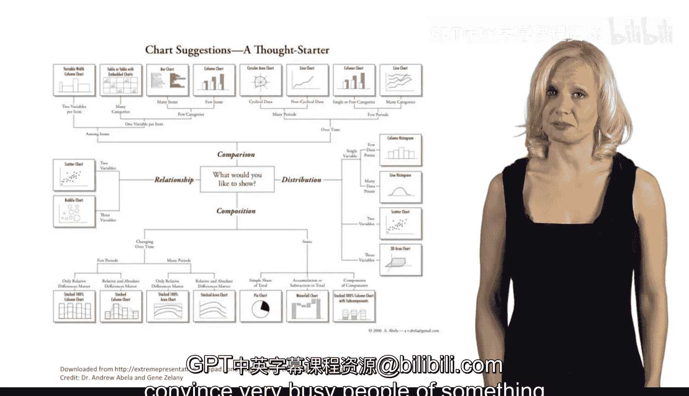

# 杜克大学《Excel 到 MySQL：商业分析（5课全）｜Excel to MySQL： Analytic Techniques for Business》中英 p124 49_05_02_视觉感知神经科学决定可视化成败.zh_en -BV1mS421X7yw_p124-

Yeah。I open this week's lessons talking about how one of the greatest tools you have to affect your audience's decision making process is the ability to affect what they will and will not look at。

Now that we know what kinds of charts we are likely to be working with。

 we are ready to talk about two powerful phenomena that will affect what your audience sees。

 visual perception and visual attention。We are going to talk about visual perception in this video。

Visual perception is what people are aware they see。To illustrate what I mean。

 Do these berries look ripe to you。If you were color blind， you would probably say no。

 the berries don't look ripe because what you would perceive or what you would be aware of would be an image like this。

If you didn't know you were colorblind， you wouldn't know that you were missing something important about the picture。

 and so you also wouldn't know that you were at risk for making four decisions about the picture。

Most of us aren't colorblind， but there are specific aspects of our visual environment that are difficult for all of us to perceive if we don't have help。

If we aren't aware of our specific types of blindness。

 we won't know when we're at risk for making poor decisions based on the things we see。Likewise。

 if the visualizations we present in our presentations use features most people are relatively blind to。

 the visualizations won't be effective。It turns out that humans have a very clear hierarchy in what kinds of differences they can perceive with precision。

This is a list derived from actual perception studies of possible visual comparisons we might need to make in life。

 ordered according to how accurate we are each one。

Accuracy in this case refers to how correct we are when we think the properties of two images are different by a certain amount。

This list tells us that we are very good at perceiving relative differences in position and length。

On the other hand， we are pretty blind to differences in volume or color。Give it a try yourself。

So now that you have seen the hierarchy of the types of things humans can visually perceive。

 we can return back to the idea of why line charts and bar charts are so effective and why other types of charts don't work very well。

Line charts and bar charts rely on position and length。

 two differences we are really good and accurate at perceiving。Py charts and bubble charts。

 the other hand， rely on area and volume comparisons。

 Two things we are not very accurate at comparing。 We are even worse at those comparisons when they are in3D。

What this means is that we are not going to be able to pull very detailed information out of pie or bubble charts or any type of area chart for that matter。

We can perceive very big differences， and those differences can be taken advantage of using other visual tricks we'll talk about in a later video。

 but since those differences need to be so big， they shouldn't be relied on to differentiate more than just a few groups。

 ideally to， and at maximum 4， unless the point of the visualization is to call attention to just one group。

The same will be true of color。So when I made the recommendation to stick with bar charts and line charts before。

 I wasn't just being a hater。Our eyes and brains literally don't have the ability to perceive many of the differences other charts rely on。

 So it is very risky to rely on these other types of charts to convey your most critical information。

Now that you've heard my strong opinion about this topic。

 I do feel it's my responsibility to share with you a well known decision tree about when you can use graphs other than bar and line graphs。

The link to this resource is included in the course materials。Use it at your own risk though。

 remember， many of the different types of graphs this resource suggests might be more appropriate for dashboards。

 infographics or websites when people have time to study the visualizations。

They may not be as appropriate for business presentations when you only have a short amount of time to convince very busy people of something that might cost them quite a lot of money。

