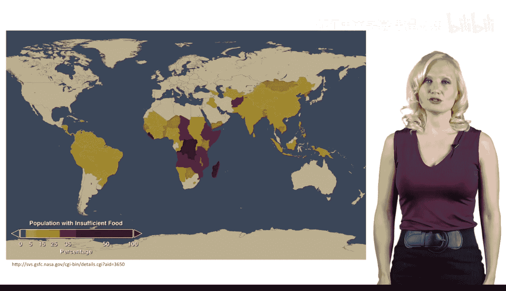
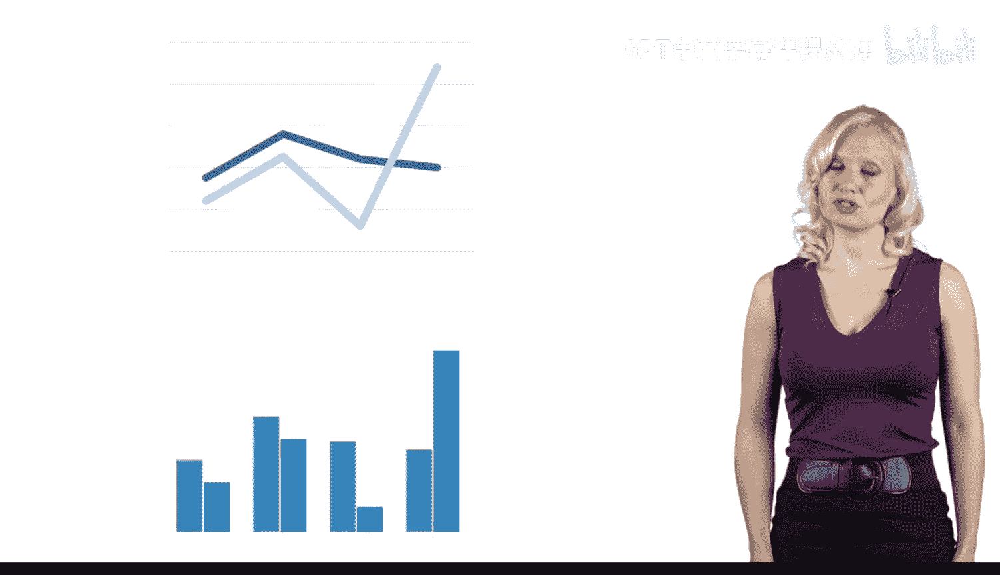
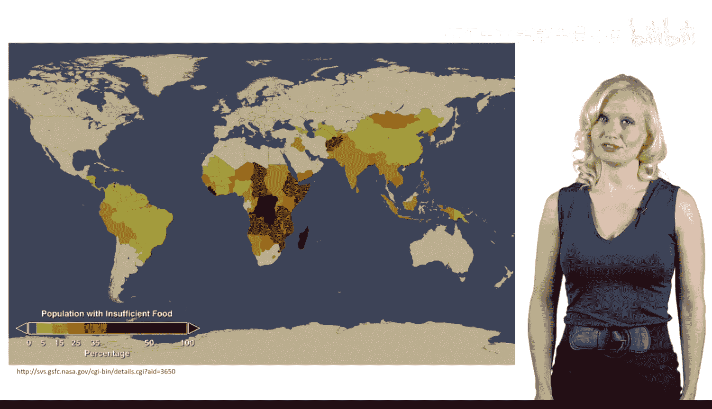
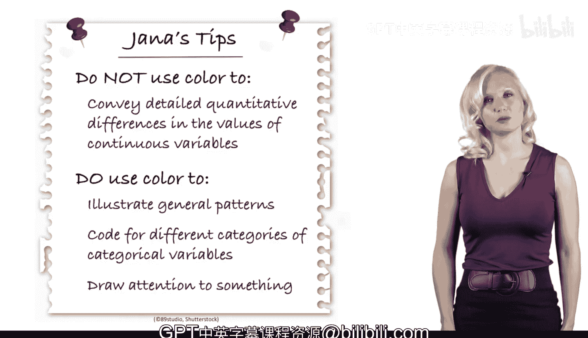

# 杜克大学《Excel 到 MySQL：商业分析（5课全）｜Excel to MySQL： Analytic Techniques for Business》中英 p125 50_05_03_色阶导致的误读.zh_en -BV1mS421X7yw_p125-

If you make a visualization that uses color to code for a variable。

 visualization programs will give you options to use different types of color bars to code for that variable。

 Some use color bars with rainbow colors like this visualization that depicts variations in gravity along the Earth's surface。

 Some use color bars with warm and hot colors like this visualization that depicts which populations of insufficient food。

 and yet， others use custom color bars， like this visualization that depicts billions of bytes of web traffic。

😊。

When you look at these graphs， you assume that what you should be paying attention to is change in color。

To be more specific， at least implicitly， you assume that one unit of physical distance along the scale of numbers indicated in the color bar should equal what you perceive as one unit of change in color。

 After all， that seems like the whole point of a color bar。

 Why would computer programs allow you to make graphs that code information by color if that wasn't the case。

Well， as crazy as this might sound， it turns out that's not true of many analytics or visualization programs。

 Most color bars are designed in such a way that one unit of numerical change does not equal one unit of top color change。

 especially because most color bars do not control for the intention grabbing qualities of luminance。

 which you can think of as brightness。😊，To illustrate this for you。

 I've taken the rainbow color bar we saw in the first picture and picked out two random boxes on the color bar that are of the exact same width。

Then I enlarge the color and the edges of the boxes so you can see what one unit of numerical change in the color bar looks like。

You can see clearly that we perceive one unit of numerical change to be bigger or have a bigger difference on the right part of the color bar than on the left side of the color bar。

 Whereas the edges of the box on the right side seem to look like different colors。

 yellowel and orange。 The edges of the box on the left side look almost like the same color of blue。

We can see the same problem with the custom color bar。

 whereas the edges of the box on the right side seem to look like different colors。

 yellowlow and almost orange。 The edges of the box on the left side look like almost the same color of purple。

What this means is that there is no clear mapping from the color differences you perceive with your eyes to the numerical differences the colors are supposed to represent。

Now， I've already told you in a previous video that we are pretty bad at accurately discriminating small differences of color in the first place。

 In addition to that， I've just showed you that one unit on most color bars does not equal what we would perceive as one unit of color difference。

 If you put these two phenomena together， you'll see that it is almost impossible for anybody to quickly discern accurate quantitative differences between typical color maps made by most software。

Nonetheless， color heat maps continue to be used and computer programs continue to employ color maps that mislead people。

For example， as we saw in one of the last modules， Tableau was pressured into allowing us to make a graph like this。

 even though our eyes and brains are not physically equipped to interpret this information well。

This is another example of how best practices are not the same as common practices。That said。

 I don't want you to think that colors are never useful in charts or graphs。

 Cols are useful for representing qualitative differences between groups when you are very confident your audience can perceive the differences in color。

 when the colors are perceived as very close to each other。 However。

 it is not a good idea to trust colors to represent your different groups well。 So in practice。

 that means there will be some upper limit to how many categories you can represent with color。

 because at some point， the colors will start looking too similar to each other。

Coollor maps themselves can be useful， too。 They are useful if you want to illustrate a qualitative pattern。

 but don't care if your audience can interpret specific numbers。

 A picture like this can be used effectively to illustrate that the continent of Africa has a much higher population with insufficient food than any other continent。

However， it cannot effectively be used to show exactly what level limits in insufficiency there is in any one country that would require a level of perceptual precision our eyes and brains simply do not have。

In summary， here is what I want you to take away from what I've showed you in this video。

 Do not try to convey detailed and nuanced information of continuous variables via color。

 Both you and your viewers are likely to interpret the graph incorrectly。 If for some reason。

 you'd find yourself having to use graded color bars to represent detailed information from a continuous variable。

 I suggest you use a gray scale that goes from black to white rather than a multicol scale。

 The black to white scales tend to have more even transitions than color scales do。

Although you shouldn't use color to represent detailed patterns。

 you can consider using color coding of continuous variables if you want to illustrate very general and obvious patterns。

 In addition， highly different colors can be used effectively to represent different categories within a categorical variable as long as you don't have too many categories。

The last way to effectively use color is to highlight something you want your audience to pay attention to。

 That's what we'll learn how to do in the next video。

