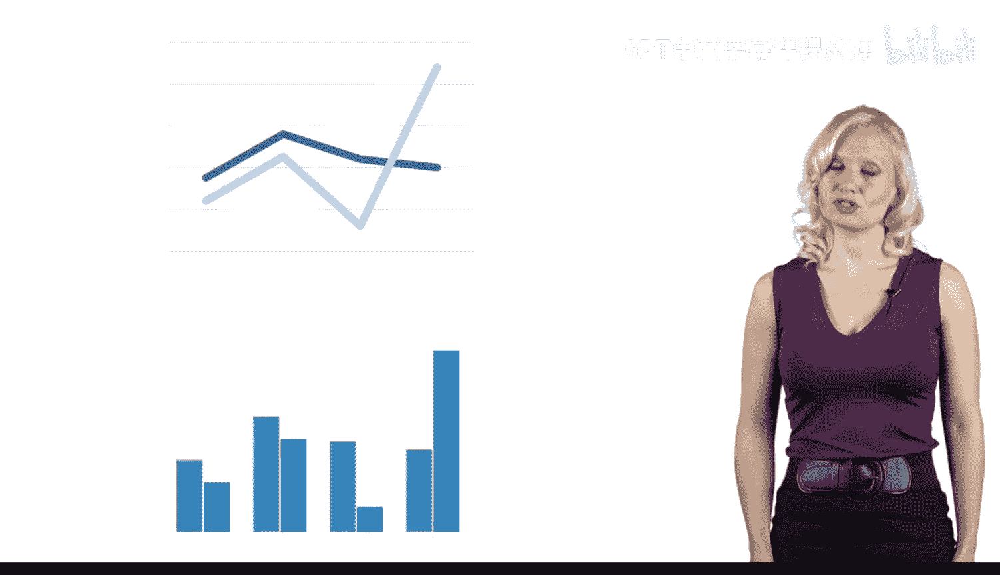
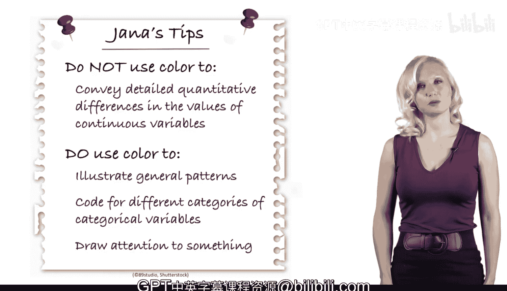

# 商业分析：05：色阶导致的误读

在本节课中，我们将要学习数据可视化中一个常见但容易被忽视的问题：色阶（Color Bar）如何导致信息误读。我们将探讨为什么许多软件默认的色阶设计并不符合人类的视觉感知，以及如何更有效地在图表中使用颜色。

---

上一节我们介绍了数据可视化的基本原则，本节中我们来看看一个具体的陷阱：色阶。

如果你制作了一个用颜色来编码变量的可视化图表，可视化程序通常会提供不同类型的色条（Color Bar）供你选择。

以下是常见的几种色条类型：
*   **彩虹色条**：例如这张描绘地球表面重力变化的地图。
*   **冷暖色条**：例如这张描绘粮食不足人口分布的地图。
*   **自定义色条**：例如这张描绘网络流量（十亿字节）的地图。

当你观察这些图表时，你会自然地认为应该关注颜色的变化。更具体地说，你至少会隐含地假设：色条上数字刻度的一个物理距离单位，应该等于你感知到的一个颜色变化单位。毕竟，这似乎是色条存在的全部意义。如果情况并非如此，计算机程序为什么允许你制作用颜色编码信息的图表呢？

然而，尽管听起来可能有些不可思议，但事实是，许多分析或可视化程序并非如此。大多数色条的设计方式导致了一个单位的数值变化，并不等于一个单位的感知颜色变化。这尤其因为大多数色条没有控制**亮度（Luminance）**的吸引注意力的特性，你可以将亮度理解为明亮程度。

为了向你说明这一点，我从第一张图的彩虹色条中选取了两个宽度完全相同的随机色块。然后我放大了色块的颜色和边缘，以便你能看清色条上一个单位的数值变化看起来是怎样的。

你可以清楚地看到，我们感知到的右侧色条上一个单位的数值变化（颜色差异），比左侧色条上的显得更大或差异更明显。右侧色块的边缘看起来像是不同的颜色（黄色和橙色），而左侧色块的边缘看起来几乎是同一种蓝色。

我们在自定义色条上也看到了同样的问题：右侧色块边缘看起来颜色不同（黄色和近乎橙色），而左侧色块边缘看起来几乎是同一种紫色。

这意味着，你眼睛感知到的颜色差异，与颜色本应代表的数值差异之间，并没有清晰的映射关系。

我在之前的视频中已经提到，我们人类本身就不擅长精确分辨微小的颜色差异。除此之外，我刚才还向你展示了，大多数色条上的一个单位，并不等于我们感知到的一个单位的颜色差异。如果将这两种现象结合起来，你会发现，几乎没有人能快速准确地分辨出大多数软件生成的典型色阶图之间的定量差异。

尽管如此，彩色热图仍在被广泛使用，计算机程序也继续采用那些会误导人的色阶。例如，正如我们在上一个模块中看到的，Tableau 迫于压力允许我们制作这样的图表，尽管我们的眼睛和大脑在生理上并不擅长很好地解读这类信息。这是“最佳实践”不等于“常见做法”的又一个例证。

话虽如此，我并不希望你认为颜色在图表中毫无用处。当你非常确信你的受众能够感知颜色差异时，颜色可以有效地表示不同组别之间的**定性差异**。然而，依赖颜色来很好地代表你的不同分组并不是一个好主意。因此，在实践中，这意味着你能用颜色表示的类别数量存在一个上限，因为超过某个点，颜色之间会开始看起来过于相似。

色阶图本身也可能有用。如果你只想说明一个**定性模式**，而不在乎受众是否能解读具体数字，那么色阶图是有用的。像下面这样的图片可以有效地说明非洲大陆粮食不足人口比例远高于其他大洲。

然而，它无法有效地显示任何一个国家粮食不足的具体水平，因为这需要我们的眼睛和大脑所不具备的感知精度。

---

本节课中我们一起学习了色阶在数据可视化中的潜在问题以及如何正确使用颜色。以下是本视频的核心要点总结：

*   **不要**试图通过颜色来传达连续变量的详细和细微信息。你和你的观众都很可能错误解读图表。
*   如果出于某种原因，你**必须**使用渐变色条来表示连续变量的详细信息，建议你使用从黑到白的**灰度色阶**，而不是多色色阶。黑白渐变往往比彩色渐变具有更均匀的过渡。
*   虽然不应使用颜色来表示详细模式，但如果你想说明非常**普遍和明显的模式**，可以考虑使用连续变量的颜色编码。
*   此外，只要类别数量不多，**高度不同的颜色**可以有效地表示分类变量中的不同类别。
*   有效使用颜色的最后一种方式是**突出显示**你希望受众注意的内容。这正是我们将在下一个视频中学习如何做的。