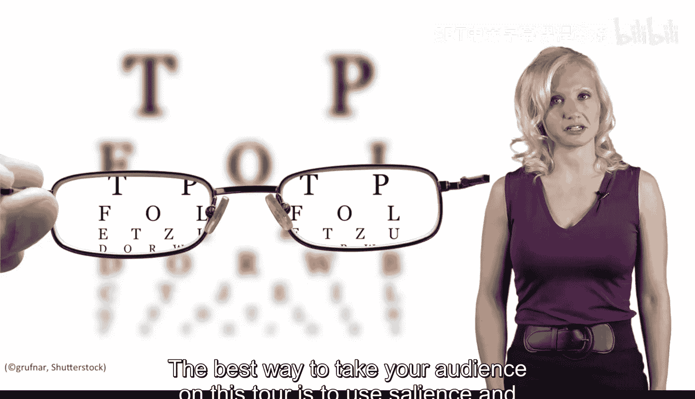

# 杜克大学《Excel 到 MySQL：商业分析（5课全）｜Excel to MySQL： Analytic Techniques for Business》中英 p126 51_05_04_视觉对比引导观众视线.zh_en -BV1mS421X7yw_p126-

Yeah。I open this week with the idea that the best way to control your audience's decision making process is to control their attention。

I also told you that one of the best way to influence people's attention is to influence what they look at。

In this video， we're going to talk about how to do that。When you yourself analyze your data。

 you look at all of it and you decide what parts it are important。In contrast。

 when you communicate your data story to your audience。

 meaning when you tell your audience why they should care about what you learned about from your net data analysis。

 you've already decided what parts are important and your goal is to only show your audience the data they need to make a decision about your recommendation。

That means that the best visualizations for data analysis or exploration are not usually the best visualizations to tell persuasive data stories。

Visualizations for data analysis should show as much data as possible。

 Visualizations for persuasion should show selected pieces of data and to direct your audience's eyes to the precise points of the data that support the arguments you are trying to persuade them of。

Designing your graphs to direct your audience's eyes takes some conscious effort。

 and it is not yet something that is automated by visualization software programs。

Our eyes are drawn to things that stand out in the environment。

 You will have to intentionally design and format the graphs you use in your presentations by hand to make sure the things that stand out in them are the things you want your audience to be paying attention to。

Let's talk about how to do that。Things in the environment that draw your attention are said to be salient。

 That means they stand out relative to their neighbors。 The human brain， while very impressive。

 can only handle a limited amount of information at a time。As a consequence， through revolution。

 our brains developed to focus on important things in the environment and filter out everything else。

In nature， the things that are most important are things that have to do with food， danger。

 appcreation， and those things are best identified through visual features like color， brightness。

 size， shape， and spatial orientation。So the things that catch our attention most are things that have features like these that are significantly different from the background。

 Let's see what I mean。How easy is it for you to find the small red ball in this sea of shapes。

What about now？Or now。Or now。If you were like most people。

 it would have been very difficult to find the small red ball in the first picture。

 but it would only take you a second or two to see it in the other pictures。

You were able to do that because in each of the other pictures。

 there was at least one the level feature that was completely different from its background。

In this one， the low level feature was size。In this one， the level feature was shaped。In this one。

 the little feature was color。When an object does not have at least one low level feature that is completely different from its background。

 it will be hard to see， and your eyes will tend to dart all around the entire picture rather than focus on one object。

Let's look at a real life example。When I show you this picture of people tailgating at the Kentucky Derby。

 where do your eyes look？Does it help if I tell you to find the man with a red shirt and the brown hair？

Probably not。So even when I give you those explicit instructions and you want to follow them。

 your eyes can't help but look at all the other things you see in the picture。

 especially the big blue tents that keep popping out to your eye。

This phenomenon is exactly what you want to avoid during your business presentations。

 because when you lose your audience's visual attention。

 you also lose control over their decision making process。

Let's see how this applies to our storypoint visualizations。

What do you think your eye would be drawn to if I showed you a picture like this。

Chances are just like in the picture of the Kentucky Derby。

 they would be drawn to nothing in particular， and they would either dart all around the graph or turn up to me in frustration because you have no idea what to look at As a consequence。

 It's also unlikely that this graph would communicate much information to you because you either wouldn't know what to pay attention to or you wouldn't pay attention to anything at all。

Let's see what happens if we take advantage of the principles of low level contrast to make new versions of this graph。

 Let's start by using color contrast。In this version。

 it's clear that there are two categories of things we should pay attention to， not 11。

 So the picture is much less overwhelming。That was a good step forward。Still。

 it's not clear which of those two categories you should care about， so let's try this version。Now。

 which one do I want you to pay attention to？In this one。

 your eye is immediately drawn to the orange1， which is the 1 I want you to look at。

 because it's the important one for my story。To make sure I can use the squint test。

When you squint your graph so that you can't read any of the text。

 do you still get what the graph is supposed to be telling you？When I squint to this graph。

 the main thing I see is the orange sticking out from the background of the slide， so as you can see。

 using color contrast can be a very effective way for communicating what is important to pay attention to。

If all pie charts look like this one， instead of having 11 different colored triangles of all kinds of different sizes。

 there wouldn't be so many pie chart haters on the internet。Now。

 I do want to make sure I clarify that what I just told you was that color contrast can be a very effective way of communicating what you should pay attention to。

 but I did not say that color is a good way for communicating detailed information。

 As I told you in an earlier video， our eyes cannot detect small differences in color。 However。

 our eyes can detect large differences in color。 This means color is useful for coding for categories。

 such as this is important， And this isn't important。

 But color is still a very poor way to convey small differences in quantitative information。

 especially if multiple colors are on the screen。I also want to give you one more expert tip。

The main colors in this chart I made are gray and orange， and the background is white。However。

 there is one more color on this chart that is affecting your attention。

 even if you aren't aware of it， that color is black。

 which is often the default borderline for charts。Believe it or not。

 even that little bit of color can affect how much contrast the orange color has compared to the rest of the scene。

 because the black contrast actually competes with the orange contrast。

 So if you really want to call attention to a certain area of a plot。

 it's good practice to take away the borders of the plot or at least make them the same color as the background of your slide。

Tableau does this by default， but especially older versions of programs like Excelcceller Matlab do not。

 So you will need to format the borders by hand in those programs to make them the same color as your background。

Okay， back to examples， let's look at one more。If you remember our data set from the Tableau Week。

 here's what happens when you put job title subgroup on both the column shelf and the color property。

Which job title subgroup do you think I want you to pay attention to？

I'm going to guess that you had no idea， but maybe you guessed the tallest one。

 or maybe you guessed purple one because the purple color is particularly bright。So， let's try again。

Now， which one do you think I want you to pay attention to？

Hopefully this time most of you chose the orange bar。

 which is the one I wanted you to pay attention to。

There are two things I would like you to take away from this example。First。

 this first bar chart was a good way to illustrate all of the information about job subgroups that you have。

It took advantage of the fact that our eyes are good at detecting differences in length。

 and color was used to signify categories， not quantitative information on a scale。

 So it was a good chart for analyzing your data in depth。Even so。

 it was still a poor chart for telling your data story because it didn't tell your audience what part of the data they need to pay attention to。

The second point I want you to notice is that when you looked at this graph。

 your attention might have been slightly divided between the orange bar and the tallest bar because they both contrasted with the rest of the graph in some way。

Keep an eye out for these situations because they are ripe for losing control of where your audience will look at。

If you have to use a graph in this format for some reason。

 make sure you call attention to the item that is most important for your story using the words you say to your audience。

In addition， consider whether your chart is truly the best way to describe your story。For example。

 if my storyline is that software engineers make intermediate level salaries。

 I'm probably in good shape by using this graph， although it would be better to show it with the bars ordered。

However， if my story line is that software engineers make really high salaries。

 my audience won't be able to help but wonder， well。

 they don't make really high salaries because there are three categories that make even more。

To prevent my chart from undermining my argument， I should either be showing different categories of my graph or reevaluating the logic of my story。

To summarize what we went over today， telling a data story requires different visualizations than analyzing data。

Data stories require you to give your audience an expertly crafted tour of your data that will make sure they see only the parts they need to see in order to make a decision about your recommendation。

Data stories also require that your audience will see the important parts of your data in an order that helps them evaluate the options clearly。

The best way to take your audience in this tour is to use salience and contrast in your data graphs to show them what they should pay attention to。

Make sure the visual salience of your data graphs line up with what's important with your data story。

