# 杜克大学《Excel 到 MySQL：商业分析（5课全）｜Excel to MySQL： Analytic Techniques for Business》中英 p127 52_05_01_通过幻灯片格式化传达数据故事.zh_en -BV1mS421X7yw_p127-

。Once you have your data charts， you still have to figure out how to format them and put them on a slide。

 I'm going to give you some pointers about how to do that in this video。

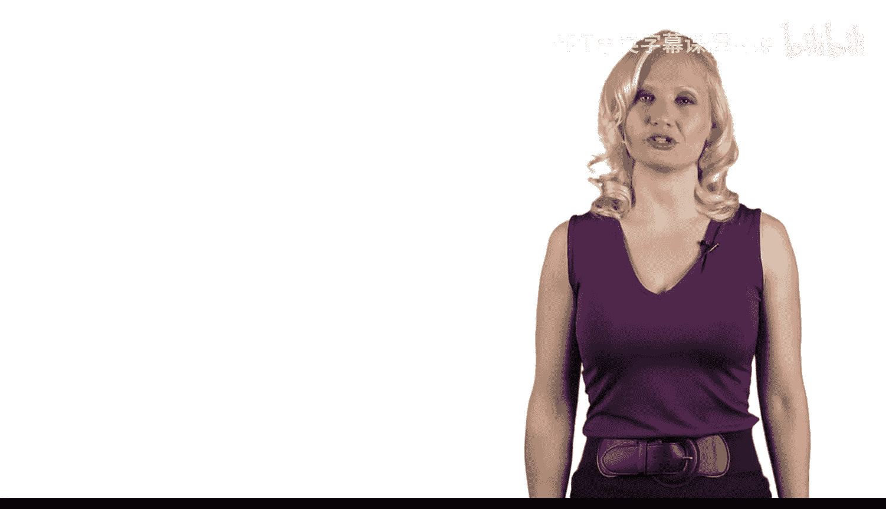

The first concept to focus on is maximizing the data ink ratio。

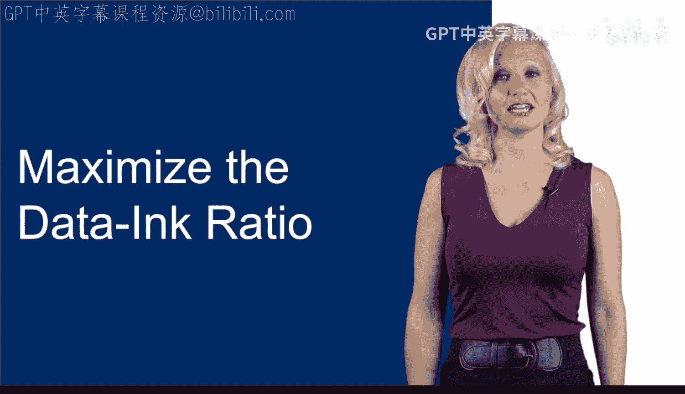

The term data ink ratio was coined by Edward Tft， a statistician and political scientist who became a well known pioneer in data visualization。

Maximize the data ink ratio basically means take out everything on the chart and everything on the slide that doesn't have a clear and unique purpose。

Data innc refers to the ink that represents the actual data in a graphic graphic in this case means whatever is in your data visualization。

 your charter graph， which we treat is the same thing in this course。

 plus the rest of the stuff on your slide that is meant to support and enhance your data visualization。

You can think of data ink as any ink in an image that can't be removed without also removing information。

Non data ink is accordingly the ink that does not represent data itself， but is used for scales。

 labels and edges。 It's pretty much everything else on a graphic。

So making the data in ratio as high as possible means making as much ink on the page as possible represent the data rather than anything else。

Let's see how we would do this， use an example of a slide you might see in a business presentation。

One thing you would do to get rid of non data ink is remove the grid lines and extra tick marks inary graphs。

 You would also remove any fancy designs in the background that aren't meant to convey anything specific。

If your company will allow it， I also recommend taking out any extra text that you can。

 including logos， slide numbers， and those symbols that are supposed to tell you how far along you are in your presentation。

I know that might sound like sacrilege to some of you who have been in the business world for a long time。

 But remember that theme I mentioned at the beginning of the course that current practice doesn't mean in best practice。

 This is the perfect example of that。Many people in traditional business settings say that it's important to let your audience know exactly where you are in a presentation。

 However， I argue that if your audience is focusing on that。

 they won't be focusing on the data or arguments you are trying to present as much as you want them to be。

 That said， expectations are important。 So if everybody in your company expects you to have slide numbers and all that stuff go ahead and include them。

 Just know that the trade off will be that you are likely giving up some of your power of your audience's decision making process。

 The record， this is an arena where I believe it's worth it to try to influence your company's culture so that people are more open to the improved communication that comes with clear and cluttered slides。

As you work on maximizing your data in ratio， don't be scared of white or empty space。

 It makes your data chart stand out even more and make sure your audience's eyes are focused on what you want them to be focused on。

The more things the audience has to look at， the more likely their eyes will be to wander。

 This concept is so important that the visual design world makes it a practice to actively protect blank space and graphics。

 I heard one designer say without space， you don't have design。 You have visual noise。

 So rest assured， when you are trying to communicate concrete information。 space is a good thing。😊。

People are less likely to complain about too much space than they are about too little。

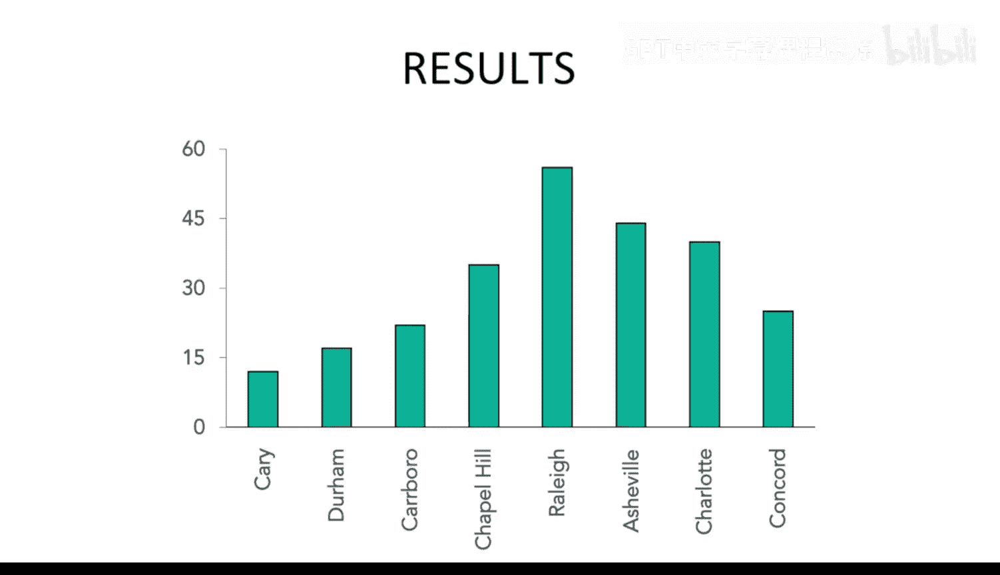

The second concept to focus on when making your slides is what I call understanding at a glance。

Your goal should be for your audience to understand the point of your slide with as little eye movement and as little reading as possible。

 Make it easy for them to understand what you are trying to convey。

 Don't make them do mental math or have to expend a lot of effort to understand your data。

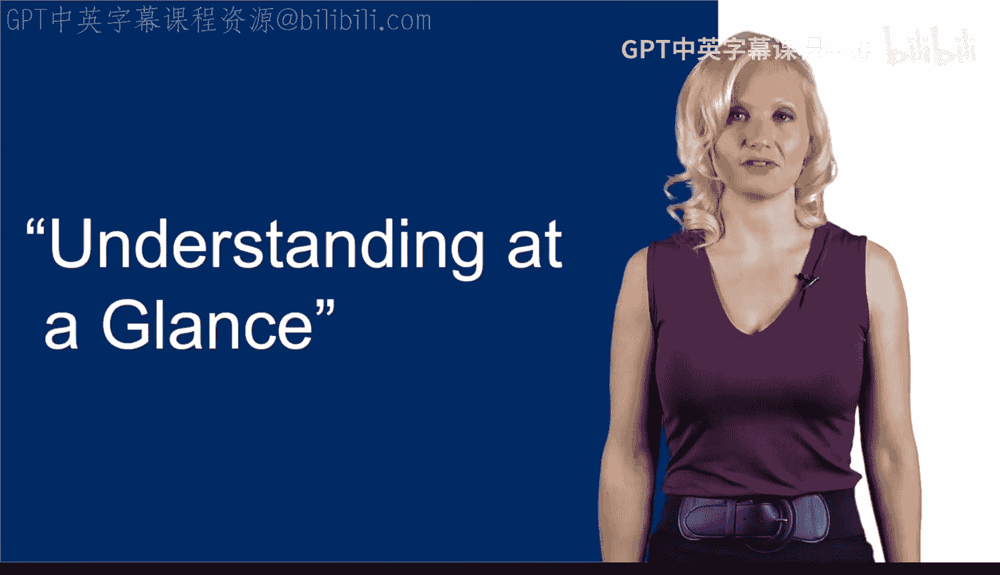

One of the most important issues in that regard is always， always。

 always label non obvious axes in your graphs。 This is really an important point。

 If you forget to label your axes， nobody will have any idea what your graph is about。

Use full words unless abbreviations are extremely common。

 like K for thousand00 or SEC for second are okay， and include units。In our example。

 cases sold this month is critical to include， but the label store location would be optional。

Depending on what else you have shown in the other slides。

 the city names might be enough to convey the information you care about and the label store location might be redundant。

Another way to reduce the amount of work the audience has to do is， whenever possible。

 label directly on the chart instead of using a legend。

 it will require less eye movement and work to understand if you don't have to go back and forth between the data and the legend or the data in the bottom of the graph。

As an added bonus， getting rid of legends will increase the data ink ratio of your visualization。

When including these labels， similar to the tip I gave you before about the line surrounding the individual pieces of its graph。

Try to use the background color of your slide for your labels。

 Notice I use the background color for both the labels and the line surrounding the boxes here。Again。

 this increases the data in ratio of your graph and reduces the amount of extra color contrast that will pull attention away from the data themselves。

Also， note that horizontal labels are easier to read than vertical labels。 So whenever possible。

 use horizontal orientations for your axes， as well as your data labels。

 This might mean you have to flip the orientation of your bar graph so that the bars and labels lie flat。

 Remember， there is a button that will do this for you in tableableau。

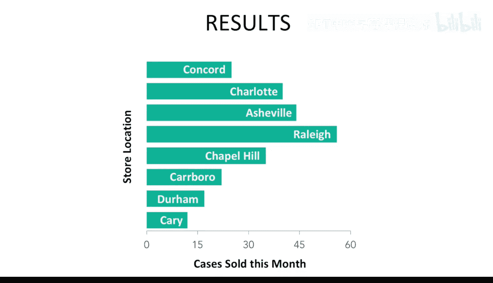

One final set of notes about making slides readable has to do with what font you should use for the text that does have to stay on the screen。

 You would never believe how much effort， blogs and websites are dedicated to what font you should use for your presentation。

I'll give you my quick summary opinion。

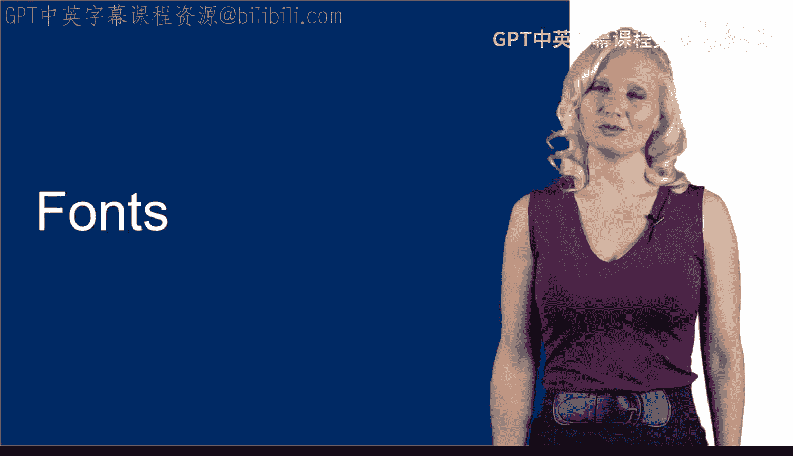

Sarif fonts are those fonts that have those little curly cute looking like things at the edges。

 The most famous one is Times New Roman。 Two others are Baoni and Garrimont。

Those curly cute things make the font easier to read up close because they help guide your eye on a line of text。

 so I recommend using ser fonts for any written materials or handouts。

The downside of those curlys is that they look fuzzy if you don't have high enough resolution in your field of view。

Since screen resolution can often be an issue in presentations。

 especially if people are sitting far away from the screen。

 it is common practice to use s serif fonts for presentations or anything you want to post on their web。

These are fonts that don't have those little details at the edges of the letters。

 Some common ones are helbetica， calibre and aiel。No matter what font you use。

 make sure your text is readable from the back of the room。

I find that this is one of the things Tableau does not automate that well。

 probably because its defaults are set up more for dashboards and for presentations。

Your text won't be useful if it isn't readable， so make bigger。

Many people suggest that the minimum size you should use is 30 points。

 A more humorous version of that advice comes from Guy Kawasaki。

 a Silicon Valley marketing executive and author of well known entrepreneurship books。

 He says a good rule of thumb for font size is divide the oldest investors' age by 2 and use that font size。

You might have to do slightly smaller font than that and graphs that a necessity。

 but I would suggest using fewer labels rather than smaller fonts when possible。

Whenever you finish the presentation， put your slides in sortda mode and reduce their size to 66%。

 If you can't read them well at that size， your font is probably too small for your audience to read from the back of the room。

As a general rule of thumb， if you were worried that your font is too small。

 and it's definitely too small。By the way， if using 30 point font means your text will no longer fit on one page。

 it was probably too much text to have on one slide in the first place。

Following this advice often means you end up getting rid of bullet points。 Instead。

 each bullet point， if it's true that you absolutely need it。

 will end up in its own slide with its own visualization。

 which is what would be my advice to do anyway。

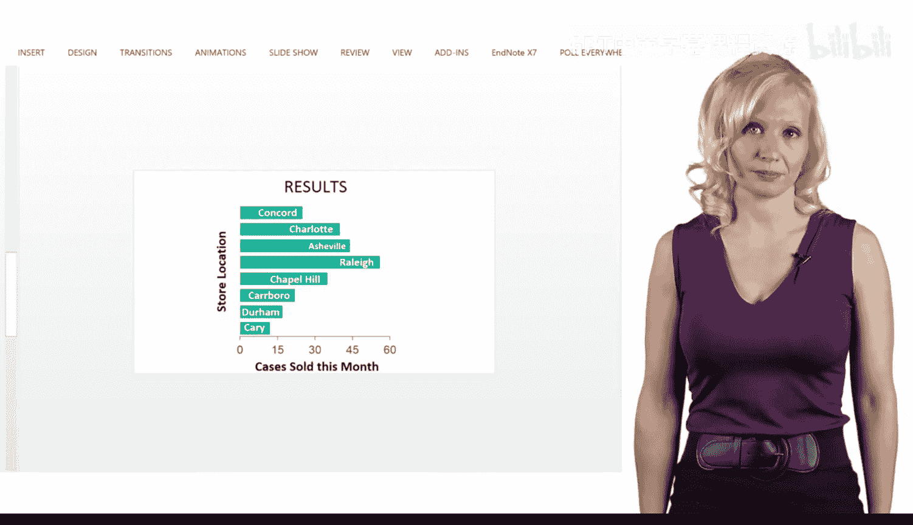

Let's talk a little bit more about how you make sure your audience doesn't have to do visual math。

As we've discussed in previous videos， this means don't use graphs that make your audience infer specific numbers or close comparisons from items that are coded by size。

 angle， or color。Another important point， separate from the types of graphs themselves。

 is to make sure all your axes have similar scales。

Try to use the same limits for your axes across your entire presentation。

If you are asked to make a plot with two y axes such as this one。

 where the two measurements have completely different types of units that can't easily be put on the same scale。

 either transform the two variables to a common scale such as a percentage so that they can be plotted on a single graph simply or separate the measurements into two separate graphs that are easy to compare。

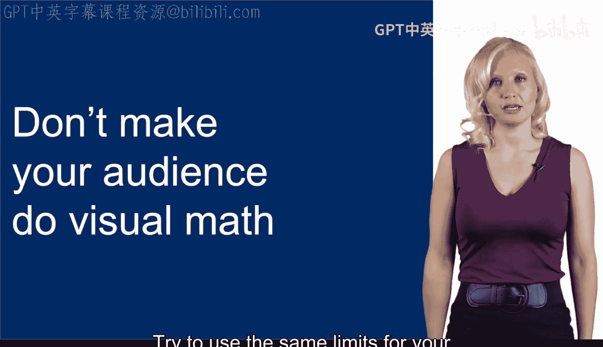

Another thing you might not have encountered before is that although you should take off as many lines from your graph as possible。

 especially black lines， it can sometimes be useful to use white grid lines to make it easier to see exactly how tall a bar is on a line graph。

I've shown you some examples here。This gives your audience visual guide posts so that it's easy to determine the value of individual data points。

 especially when they're very large。It's one final thing to consider when formatting your slides。

 if you are going to use slide titles， which I would argue are optional。

 make each title give the takeco message of that slide。

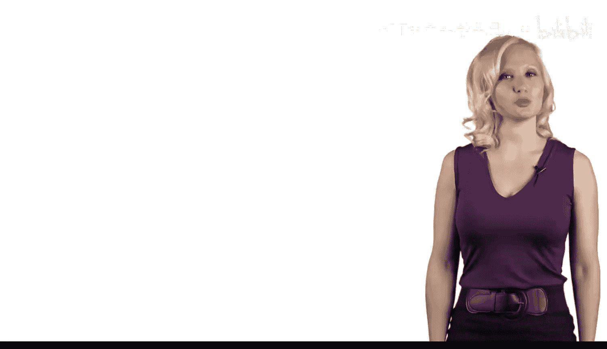

Slide titles shouldn't be there unless they add extra information。

 tiitling of slides with something like supporting points or discussion competes with what you want your audience to be focused on。

 which is your argument。

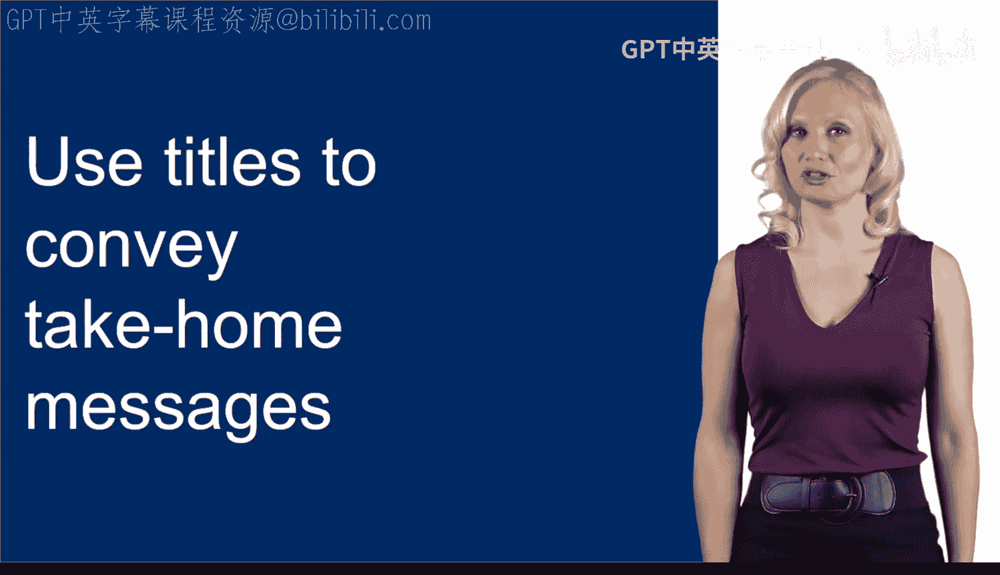

These types of titles do provide some information， but it's information about a different story than the one you are telling。

 It's information about that how long am I going to be in this room story。

 rather than the this is why you should follow my recommendation story。

 So if you're going to use slide titles， which is a point of debate in the visualization community。

 use titles that state very succinctly the take home message of the slide。To finish up。

 let's look at the business slide we started with。

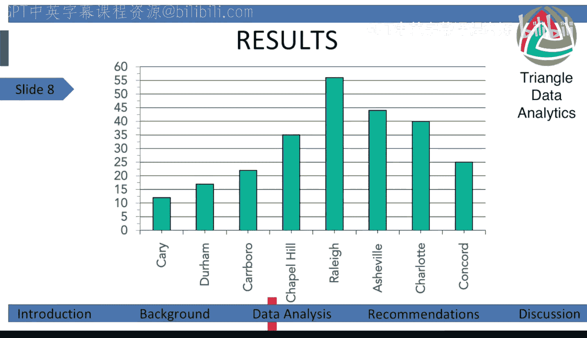

Now let's look at the slide we ended up with。Which one do you think conveys a takeco message of this data more effectively？

