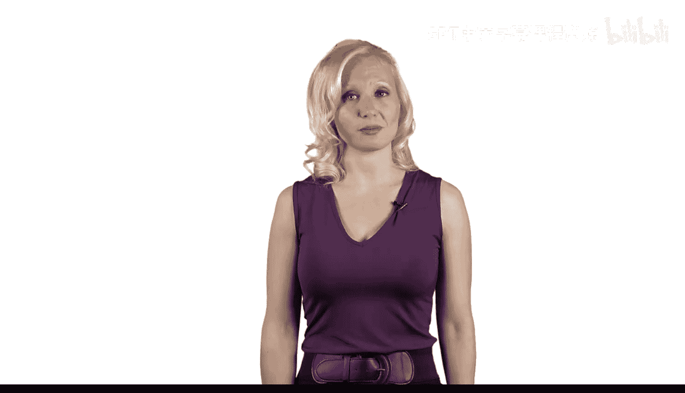
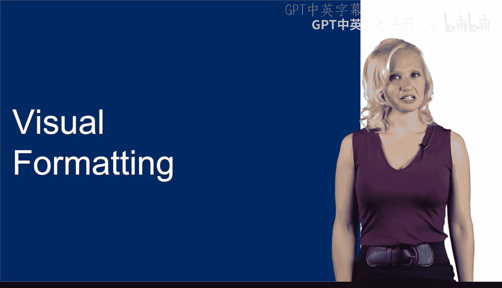
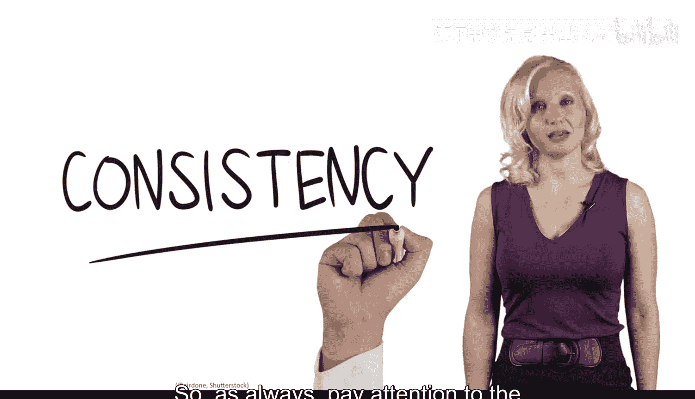
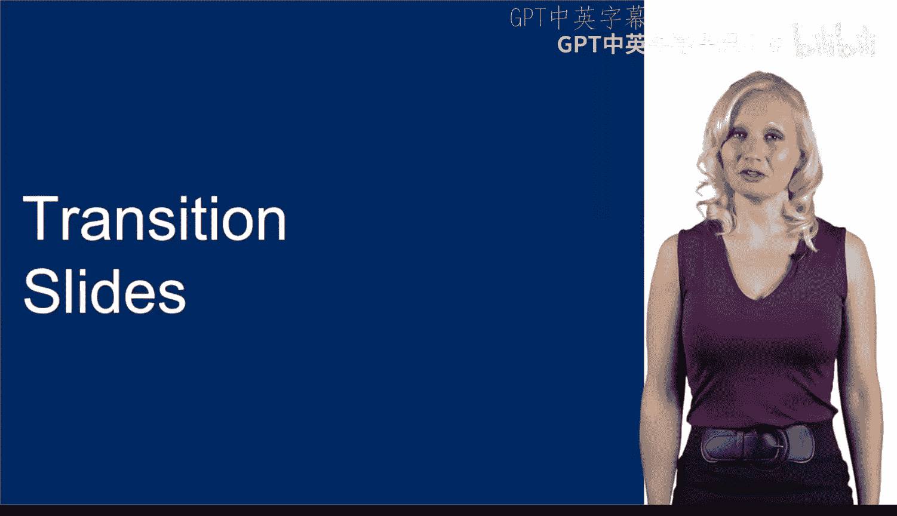
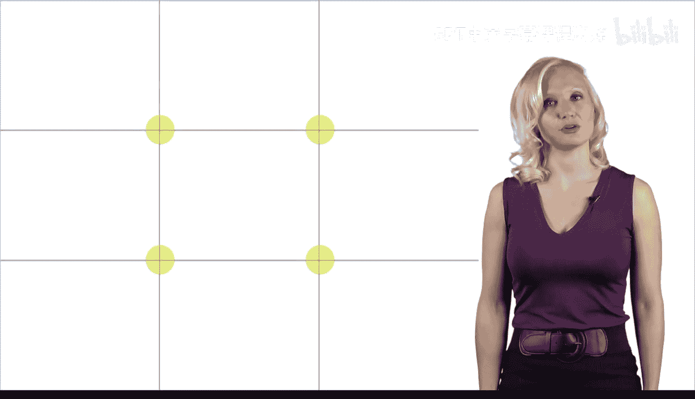
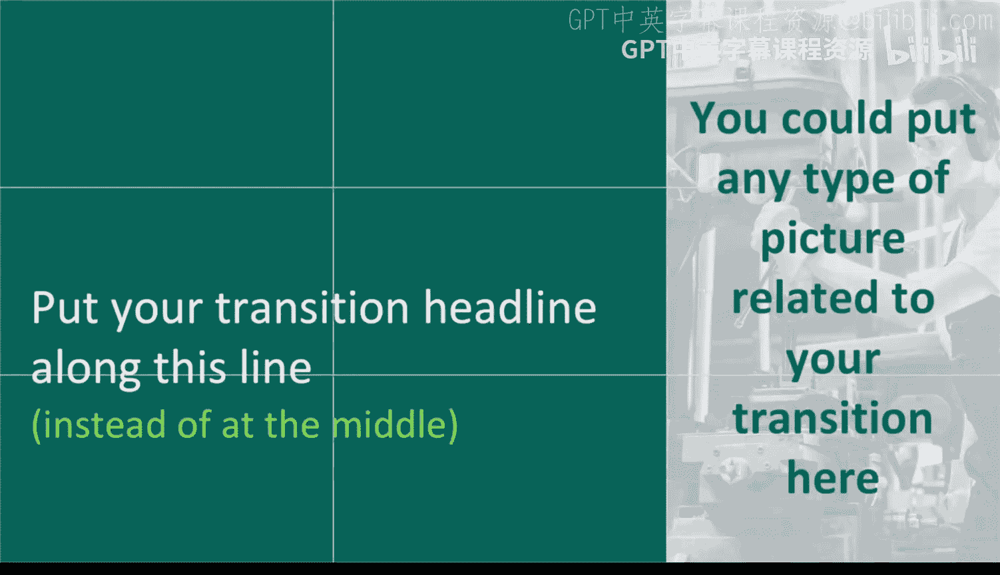
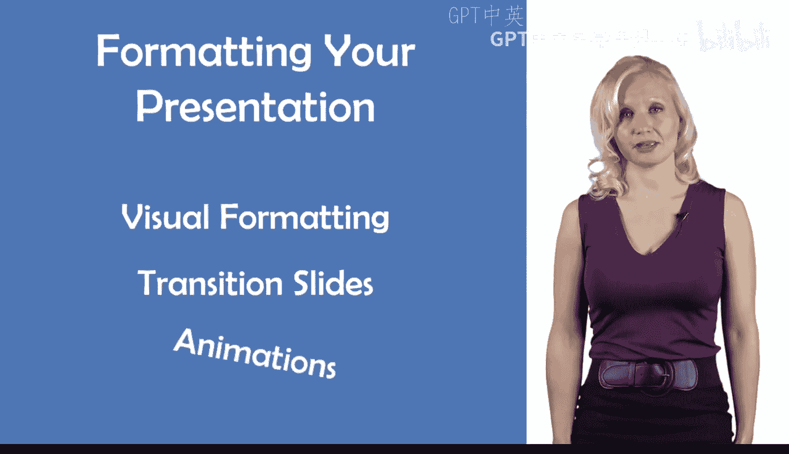
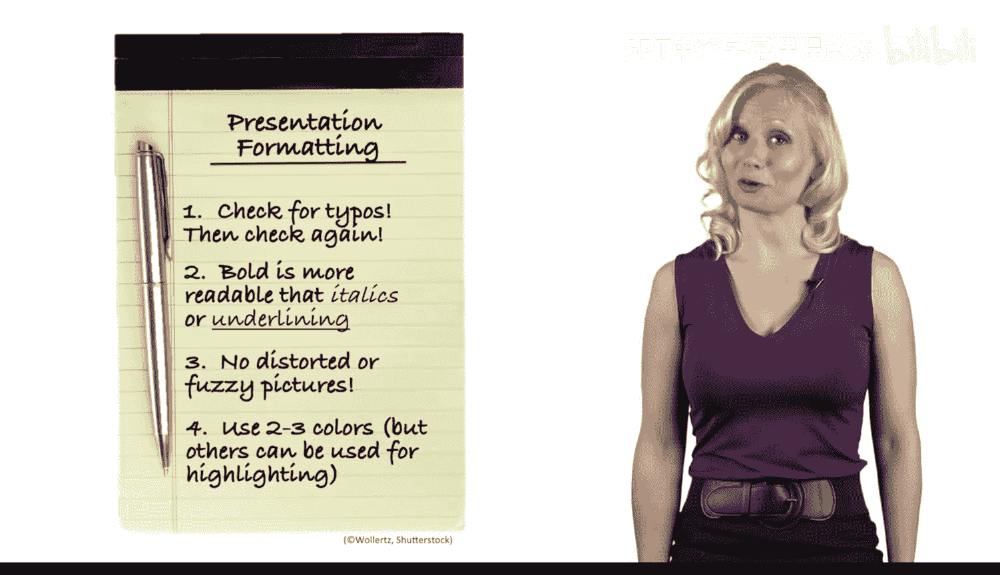

# 杜克大学《Excel 到 MySQL：商业分析（5课全）｜Excel to MySQL： Analytic Techniques for Business》中英 p128 53_05_02_通过演示文稿格式化传达数据故事.zh_en -BV1mS421X7yw_p128-

。Earlier， we talked about how to format your individual graphs and slides In this video。

 we're going to talk about how to format your presentation。

 which provides the context and glue for those graphs and slides。 We'll talk about visual formatting。

 transitions， animations， and some general best practices。

Let's start with visual formatting。

Consistent with our storytelling theme， we want our presentation to feel like a cohesive story。

 in order to feel cohesive， it needs to look cohesive。

That means you should aim to use consistent formatting throughout your presentation。

 including everything from slide background to fonts to general Col scheme。

 except when you purposely use a different presentation style for dramatic effect。

It is true that sometimes too much consistency can be a bit boring。

If you want to liven up your presentation， you can try things like you using one background or font for the main points of your presentation and another background color or font for the transition slides or summary slides。

 Just make sure you are using different formats sparingly and purposefully。

 rather than because you are having fun trying out different PowerPoint options。Also。

 remember that some business cultures are not open to new types of presentation and will not view dramatic transition or title slides favorably。

 So as always， pay attention to the culture you are in and make sure to balance your ideal presentation vision with what your stakeholders expect。

Now， let's turn to the topic of transition slides。 There's something known as a 10 minute rule that unfortunately。

 we coursesra instructors break kind of often。

That rule says that people generally only stay intensively involved in learning experiences for about 10 minutes。

 After that， they' start to tune out。To the extent that's true。

 it's a good idea to build what I call soft breaks into your presentation。During these soft breaks。

 you will either summarize what you just went over。

 provide something visually engaging to your audience。

 or shift gears and prepare the audience to go in a different direction。😊。

Transition slides can be useful for these soft breaks。

 The key is to make sure the transitions are smooth， not disruptive。For formal presentations。

 don't use those fancy slide transition animations。

 They are fun for about a second before they start looking amateurrous or distracting。

 Just use the default slide transitions。As for what slides to use for the slide transitions。

 you have a lot of options。If you are in a more formal presentation。

 you can use your agenda slide as your transition slide。 If you have a little more flexibility。

 you can use one of the pictures from your story of your introduction or slight modifications of that picture that correspond with the transition you are about to make。

Since it's often a good idea to try to make your transition slides as visually compelling as possible to help wake up your audience。

 you might try applying the rule of thirds to your transition slides。

The rule of third says that if you divide a slide up into three equal compartments vertically and three equal compartments horizontally。

 people consistently look at the intersection of those lines more than the center of the screen。

The design principles that follow are that in order to make your image or visualization as compelling as possible。

 you should either try to place objects along the lines themselves or place all of your visual objects within one third of the compartments。

 So if you have choices about where to put pictures or important text near your transition transition slides that you want to be visually exciting。

 You might want to try using the rule of thirds to design your slide。

 rather than putting your objects back in the middle of the screen。😊。

Heres an example of a picture that is not obeying the rule of thirds。

And the same picture adapted so that does obey the rule of thirds。

Here's an example of how you can design a transition slide to obey the rule of thirds。

I don't recommend you apply the rule of thirds to your data slides。

 Those should have the data content front and center。

 and there shouldn't be anything else on the screen that will distract your audience。

 But since transition slides are meant to give your audience a little bit of a visual and mental break。

 they can be designed to have a more holistic appeal， and the rule of thirds can be helpful for that。

So we've been talking about transition slides。 I wish I had a good 1 I could use now because I'm about to make a transition to。

Talking about animations。Presentation， software packages of all kinds of interesting bells and whistles these days that allow you to control the appearance。

 disappearance movement of vitamin on your slides in varied creative ways。

 These animations can be powerful in the right situations。 and I do suggest you use some of them。😊。

In particular， making items appear in the order you talk about them can be a very effective way to control your audience's attention and can help you maintain a sense of motion and momentum in your presentation。

Furthermore， calling attention to your item by controlling its appearance looks much more polished than just adding an arrow or a call out box like this。

Just make sure that when you do use animations， you use them with an explicit purpose in mind and don't use anything to flashy or distracting。

Fad in and fade out animations are usually very good。In the right situations。

 motion paths that allow words to move can be good， too。

Things that don't work well are the checkerboard or spinning effects。 And please， whatever you do。

 don't use that function in keynote software that lets you make it look like something's on fire in your presentation。

I will close this video with a few extra tips about presentation formatting that I hope you will find useful。

Nothing undermines your credibility more than typos in your presentation。

 spellell check and visually inspect your presentation for typos at least three times before presenting it to an audience。

When you want to emphasize a word， bolding is usually more effective and readable than underlining or using italics。

Always make sure your pictures and figures are high resolution。 Nothing should be fuzzy or distorted。

Use the same2 to three colors for the basic presentation。

 Other colors should only be used if they are deliberately being applied to highlight something a particular slide。

With that， you're almost ready to give your presentation， only a couple of videos left。

