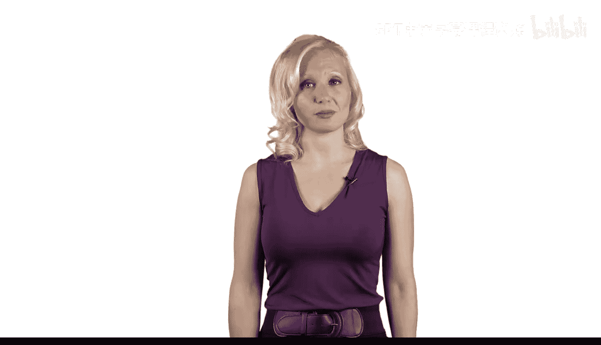
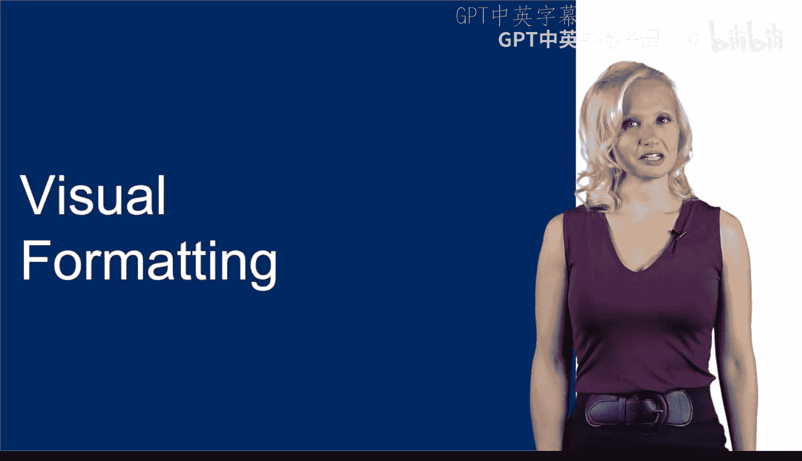
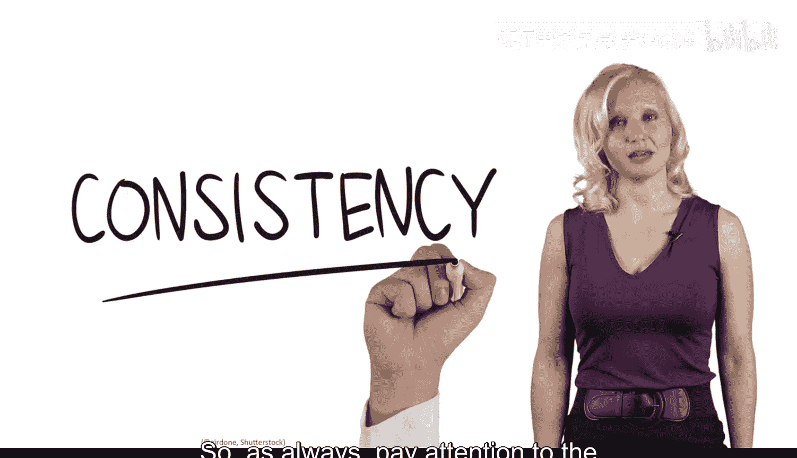
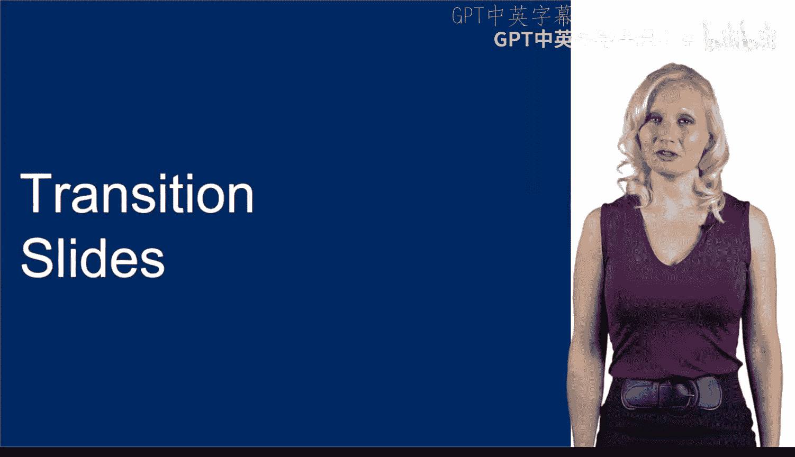
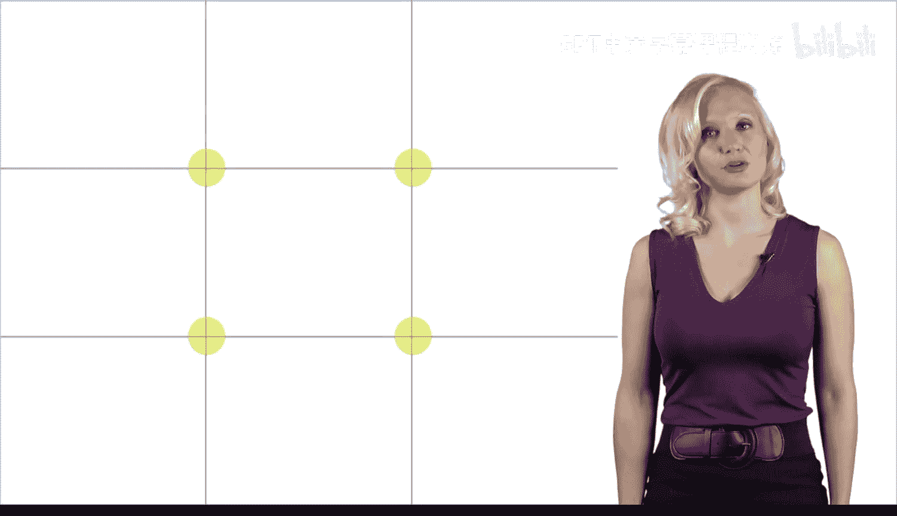
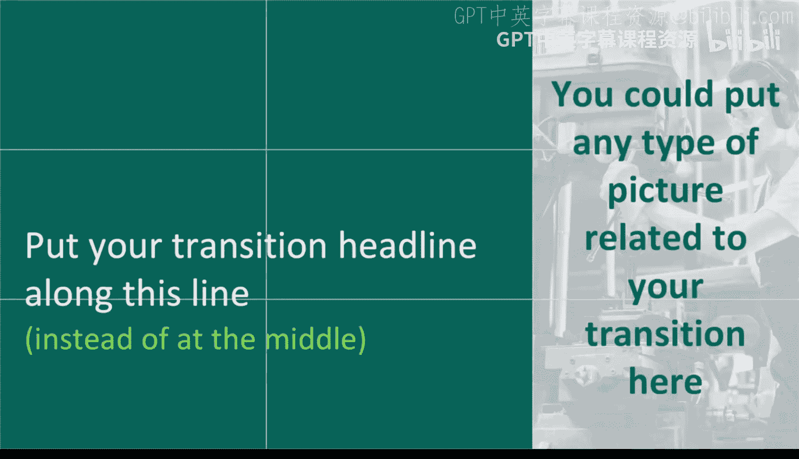
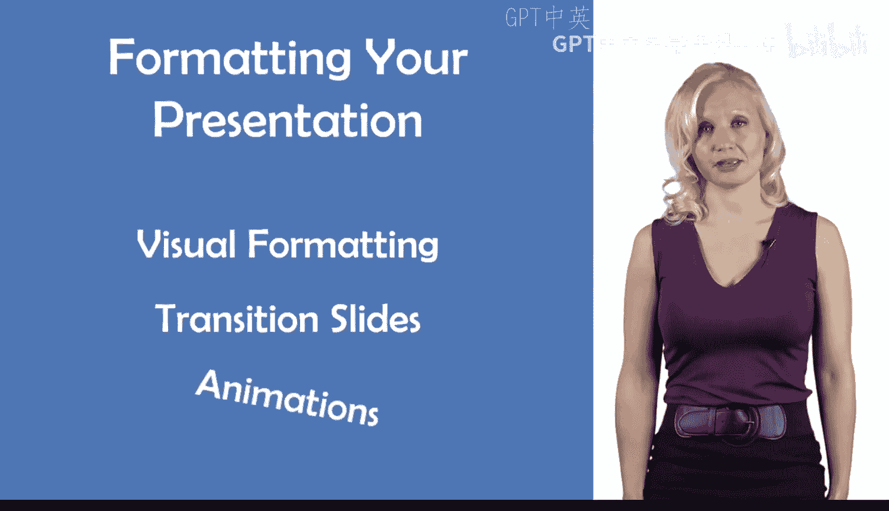
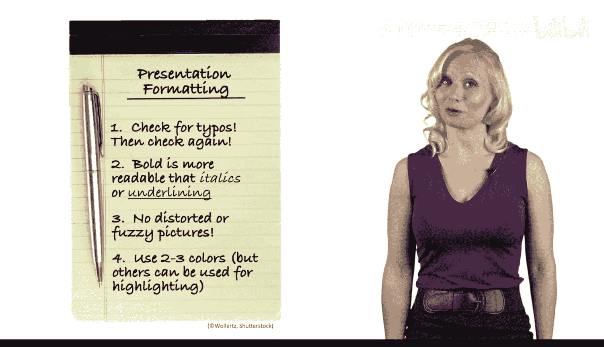

# 商业分析：5.2：通过演示文稿格式化传达数据故事 📊

在本节课中，我们将学习如何格式化整个演示文稿，为其中的图表和幻灯片提供统一的背景与衔接。我们将探讨视觉格式化、过渡、动画以及一些通用的最佳实践。

之前我们讨论了如何格式化单个图表和幻灯片。本节中，我们来看看如何格式化整个演示文稿，它为那些图表和幻灯片提供了背景和粘合剂。我们将讨论视觉格式化、过渡、动画和一些通用的最佳实践。

## 视觉格式化 🎨

让我们从视觉格式化开始。

与我们的故事叙述主题一致，我们希望演示文稿感觉像一个连贯的故事。为了感觉连贯，它看起来也需要是连贯的。

这意味着你应该力求在整个演示文稿中使用一致的格式，包括从幻灯片背景到字体再到整体配色方案的所有内容。除非你为了戏剧性效果而特意使用不同的演示风格。

确实，有时过于一致会有点无聊。如果你想活跃你的演示文稿，可以尝试一些方法，例如为演示文稿的主要观点使用一种背景或字体，为过渡幻灯片或总结幻灯片使用另一种背景颜色或字体。只需确保你是有节制、有目的地使用不同的格式，而不是因为尝试不同的 PowerPoint 选项很有趣。

同时，请记住，一些商业文化并不接受新类型的演示文稿，并且不会看好戏剧性的过渡或标题幻灯片。因此，一如既往地，要注意你所在的文化环境，并确保在你理想的演示愿景与利益相关者的期望之间取得平衡。

## 过渡幻灯片 🔄

现在，让我们转向过渡幻灯片这个话题。有一个所谓的“10分钟规则”，不幸的是，我们 Coursera 讲师经常打破这个规则。

该规则指出，人们通常只能在大约10分钟内保持对学习体验的集中投入。之后，他们就会开始走神。如果这个规则成立，那么在你的演示文稿中构建我称之为“软休息”的环节是个好主意。

在这些软休息期间，你要么总结刚刚讲过的内容，为观众提供视觉上吸引人的东西，要么转换话题，让观众准备好进入不同的方向。

过渡幻灯片对于这些软休息很有用。关键是要确保过渡是平滑的，而不是破坏性的。对于正式的演示，不要使用那些花哨的幻灯片切换动画。它们可能有趣一秒钟，但之后就会显得业余或分散注意力。只需使用默认的幻灯片切换效果。

至于用什么幻灯片作为过渡幻灯片，你有很多选择。如果你在进行更正式的演示，可以使用你的议程幻灯片作为过渡幻灯片。如果你有更多的灵活性，可以使用你故事介绍中的一张图片，或者对该图片进行轻微修改，以对应你即将进行的过渡。

由于通常建议尽量使过渡幻灯片在视觉上引人注目，以帮助唤醒观众，你可以尝试将“三分法则”应用于你的过渡幻灯片。

三分法则指出，如果你将一张幻灯片垂直和水平各分成三个相等的部分，人们会持续地看向这些线条的交点，而不是屏幕的中心。

随之而来的设计原则是，为了使你的图像或可视化尽可能引人注目，你应该尝试将对象沿着线条本身放置，或者将所有视觉对象放在其中一个三分之一的分区内。因此，如果你可以选择在希望视觉上令人兴奋的过渡幻灯片上放置图片或重要文本的位置，你可能想尝试使用三分法则来设计你的幻灯片，而不是将对象放回屏幕中央。

以下是一个不遵守三分法则的图片示例，以及一个经过调整以遵守三分法则的相同图片示例。这里还有一个如何设计一个遵守三分法则的过渡幻灯片的示例。

我不建议你将三分法则应用于你的数据幻灯片。那些幻灯片应该将数据内容放在最前面和中心位置，屏幕上不应有任何其他会分散观众注意力的东西。但由于过渡幻灯片旨在给观众一点视觉和精神上的休息，它们可以被设计成具有更整体的吸引力，三分法则对此会有所帮助。

## 动画效果 ✨

我们一直在讨论过渡幻灯片。我真希望现在能有一个好的过渡幻灯片，因为我即将转换到讨论动画的话题。

演示软件包如今提供了各种有趣的花哨功能，允许你以多种创造性的方式控制幻灯片上元素的出现、消失和移动。这些动画在适当的情况下可能很强大，我确实建议你使用其中的一些。

特别是，按照你谈论的顺序让项目出现，可以成为控制观众注意力的一种非常有效的方式，并有助于你在演示中保持动感和势头。

此外，通过控制其出现方式来引起对项目的注意，看起来比仅仅添加一个箭头或像这样的标注框要精致得多。

只需确保当你使用动画时，你心中有一个明确的目的，并且不要使用任何过于花哨或分散注意力的效果。淡入和淡出动画通常非常好。在适当的情况下，允许文字移动的运动路径也不错。

效果不佳的是棋盘格或旋转效果。并且，无论你做什么，请不要使用 Keynote 软件中那个让东西看起来像着火了一样的功能。

## 额外提示与总结 ✅

我将以一些关于演示文稿格式化的额外技巧来结束本视频，希望你会发现它们有用。

没有什么比演示文稿中的拼写错误更能损害你的可信度了。在向观众展示之前，至少进行三次拼写检查和视觉检查，以查找拼写错误。

当你想强调一个词时，**加粗**通常比下划线或使用*斜体*更有效且更易读。

始终确保你的图片和图形是高分辨率的。任何内容都不应该模糊或失真。

为基本的演示文稿使用相同的2到3种颜色。其他颜色只应在特意用于突出显示某张特定幻灯片上的内容时使用。

至此，你几乎准备好进行演示了，只剩下几个视频了。

在本节课中，我们一起学习了如何通过统一的视觉格式化、有效的过渡幻灯片、有目的的动画应用以及遵循一些关键的最佳实践，来构建一个连贯、专业且引人入胜的数据故事演示文稿。记住，格式化的目标是服务于故事的清晰传达，而非炫技。