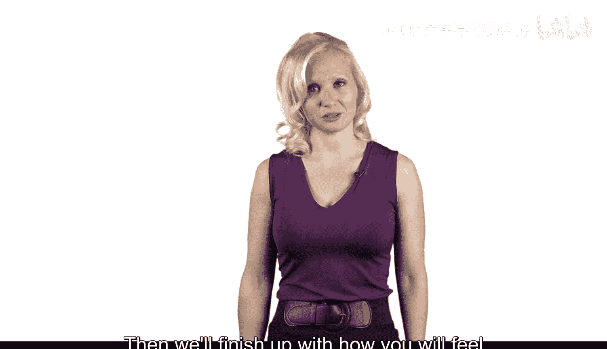
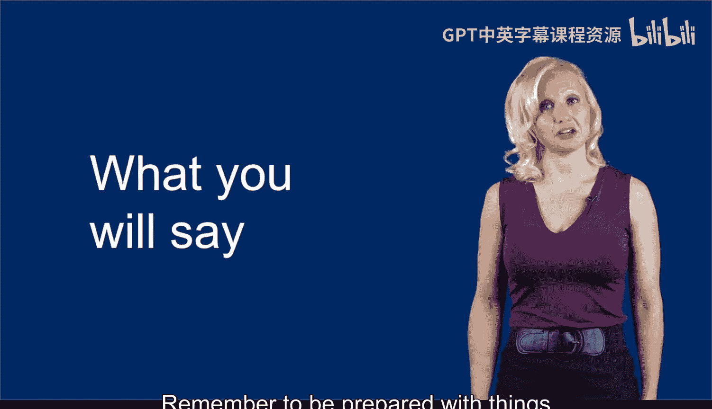
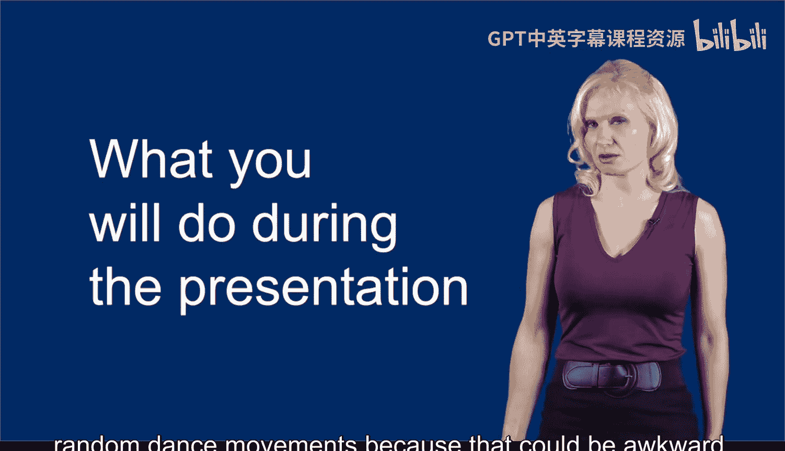
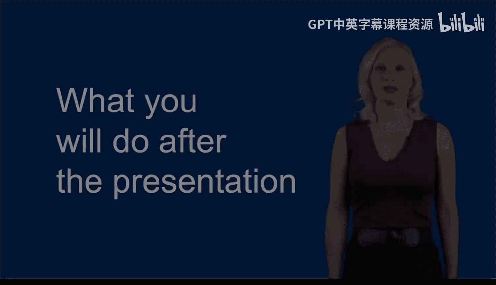
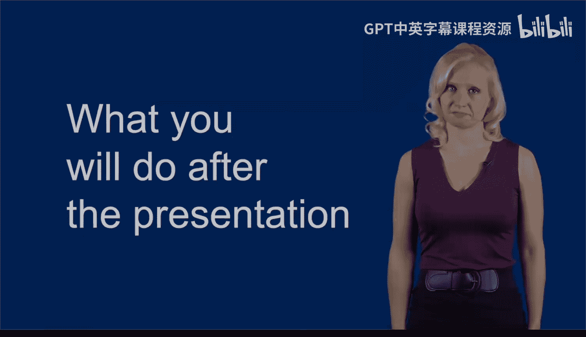

# 杜克大学《Excel 到 MySQL：商业分析（5课全）｜Excel to MySQL： Analytic Techniques for Business》中英 p129 54_05_03_呈现您的数据故事.zh_en -BV1mS421X7yw_p129-

。The day has finally arrived。After all your hard work over months or maybe even years。

 you finally have the opportunity to tell people what you found。

The catch is that now you actually have to get up in front of people and persuade them to do what you say。

 Yaikes， that's really scary。Actually， that's exciting because I know you're going to do a great job。

In this lesson， we're going to go over some things that will make you just as confident that you are going to do a great job as well。

 We'll focus on what you will say， how you will say it， what you will do during the presentation。

 as well as what you will do before and after the presentation。

Then we'll finish up with how you will feel when you are giving the presentation。

Let's start with what you will say。The best way to engage your audience is to actually interact with them。

Now if you're going to be presenting the high level company executives。

 you might not have a choice but to interact with them because they might be asking you questions two minutes into your presentation。

But in case they don't naturally ask questions， plan on at least two to three points in your presentation where you ask for audience participation。

For example， you could ask people to make a guess about a number relevant to your presentation。

 something like， how many books do you think we sell a month？

Or you could ask them raise their hand if they believe something。

How many of you think we are one of the top five producers of computer parts in the state of Wisconsin？

Remember to be prepared with things that will get your audience participating。

Another type of thing you will say often is transition sentences。

 When the flow in your presentation breaks， your audience loses attention and starts going on mental strolls that have nothing to do with what you are saying。

How do you hold your audience's attention， you use verbal transitions。

Verbal transitions are the words you say to connect the content of one slide to another。

 They basically act as the glue in your story。I've included a link to the website that gives great advice about verbal transitions。

 bookmark that website for yourself and practice your verbal slide transitions like crazy when you're getting ready for a presentation。

😊，Here's something you shouldn't say during a presentation。Anything that sounds jargony。

People who are about to make million dollar decisions are not going to be patient if they don't understand what you are telling them。

 So don't assume that your audience has any specific prior knowledge and only use language that everybody in the general audience would understand。

We've talked about the things you will say。 Now let's talk about how you will say them。

Your voice will be a tool that can either keep your audience incredibly engaged。

 or if you aren't careful， send them to sleep。Obviously。

 you want to use your voice in the first way and not the second。To do this。

 make a conscious effort to convey your enthusiasm and energy for what you've done in your voice。

Also， make sure to vary your voice。 Sometimes you might want to speak slowly so that you can emphasize something。

Other times， you might want to speak more quickly so that you can convey how incredibly excited you are about this extremely impactful recommendation you're about to make。

Also， make sure to vary the tone in your voice so that sometimes you use a higher tone。

 which is often more approachable。And other times， you use a lower tone。

 which tunes people into the fact that you are saying something very important they really need to pay attention to。

Now that you know what to say and how to say it， let's talk about what you will do before the presentation。

I bet you know what I'm going to say， practice， practice， practice， and then practice some more。

One practice technique that can be particularly effective is to practice just one small piece of your presentation over and over again until you are completely comfortable with it。

 then move to practicing another small piece and keep doing that until you cover the entire presentation。

This focus practice technique is nice because it breaks things down into divide size manageable pieces。

 so you don't feel so overwhelmed by having to remember everything at once。

Since we know you will take my advice and practice before the presentation。

 let's move on to talking about how you will put that practice during the presentation。

One thing you will do is make sure you are conscious of your body posture。

I've included a great resource， along with this video that goes over important aspects of your posture that can affect how your audience responds to you。

 So I will let you read about the details of body posture there。 I will just summarize by saying。

 try to remain physically open by keeping your arms away from the front of your body。

 so don't cross your arms。 directly face your audience。 and， of course， smile。😊。

As you've probably heard before， make sure you look at different people in the room so that you don't exclude anyone and don't look down or read your slides。

 Try to be natural in your movements to the best of your ability and don't feel too constrained。

 unless you have a tendency to randomly break out into random dance movements。

 because that could be awkward。 I don't know any who does that。

 especially in publicly available videos in Coursera， do you。

Okay， let's assume you've given a killer presentation。 You're done， right？Not quite。

What do you do after the presentation， you ask for feedback from your colleagues and your peers。

 because giving presentations is hard and it's even harder to objectively measure how well you did。

In the end， the success of your presentation is determined how your audience reacts。

 So the only way to improve is to hear from audience members what they thought。

We'll practice the critical skills of both giving feedback and receiving feedback in the final assessment for this course。

Finally， let's finish up with how you will feel。The answer for most of us will be very， very nervous。

Public speaking is nerve wracking for many people， so much so that psychologists use it in experiments as a way to actively stress people out。

Winston Churchill was reported to have had terrible speaking anxiety， as was Warren Buffett。

 but they are both great proof that speech or performance anxiety can be overcome。 So practice。

 practice， practice。 Confidence is the best antidote to anxiety。

