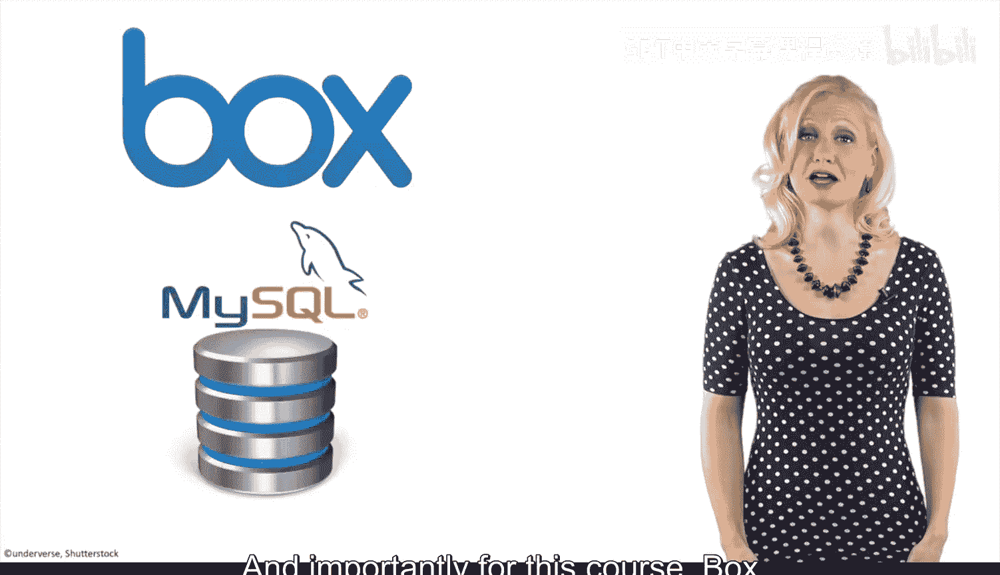
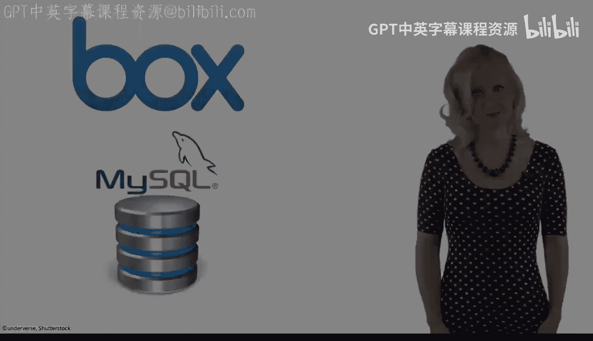
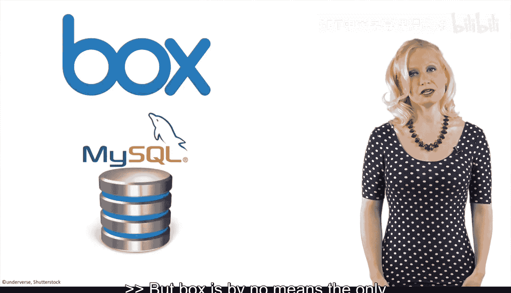
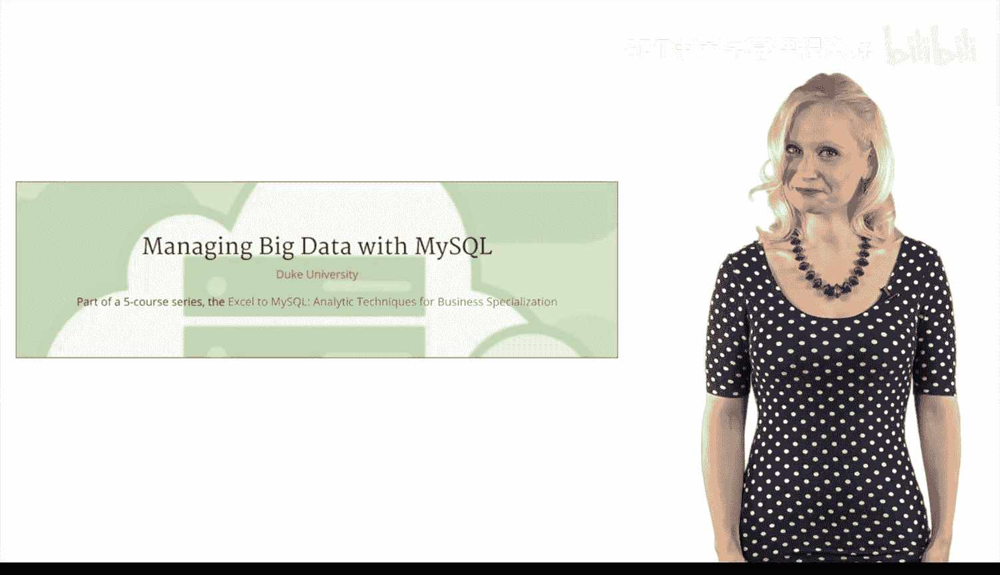

# 杜克大学《Excel 到 MySQL：商业分析（5课全）｜Excel to MySQL： Analytic Techniques for Business》中英 p132 03_01_03_本课程学习内容概述.zh_en -BV1mS421X7yw_p132-

SQL SQL， Cil， SQL SequL SQL。我我。Clearly， nobody seems to agree how to pronounce the acronym for the database language you were going to learn in this course。

 The most common pronunciations are either S Q L or SQL。

 But there is truly no agreement about which pronunciation is more accepted。

A blogger named Patrick Gilespie amusingly emailed a man named Don Chamberlain to ask about the official pronunciation of the language's name。

Don Chamberlain co authored SQL or SQL with Raymond Boyce at IBM in the 1970s。

 so if anybody should know what the language is called， it's Don。Don responded with， hi， Pat。

 since the language was originally named Sequel， many people continued to pronounce the name that way after it was shortened to SQL。

Both pronunciations are widely used and recognized， as for wishes more official。

 I guess the authority would be the ISO standard， which is spelled and presumably pronounced SQL Thanks for your interest。

 Don Chamberlain。So even the co author of the language can't say with confidence how the name of the language is pronounced。

The best he can say is that it's presumably pronounced。

 not definitely pronounced or even usually pronounced SQL。To make things more confusing。

 some of the most popular database systems in the world。

 such as Oracle say explicitly in their documentation that the language is pronounced SQL。 Others。

 such as my S Q L， say explicitly that their name is my S Q L。

 So I wasn't exaggerating when I said there is no agreement about how to pronounce the name of the language。

 That means you can use whichever pronunciation you like better。 Personal。

 I like using both pronunciations。 Sometimes even in the same sense。😊。

I will go back and forth between the two pronunciations throughout the course。

So why should we care about SQL or SQL？Companies have to keep track of a lot of data。

 and the only practical way to do that is to store the data in some type of database。

 If you are becoming a data analyst for the business world。

 somehow you are going to have to figure out how to get data out of these databases in order to do any kind of analysis。

 This course is designed to help you learn how to do that。In many technology driven companies。

 the only way to retrieve data from a database is to write your own SQL queries。

 which are structured lines of computer code that extract data。

And other larger and more traditional companies。 there are people in the company who could extract the data for you。

 but you have to put in a formal request for them to write and execute a query。

 and it could take days or weeks for them to fulfill your request。

 especially if many other people are asking for queries， too。 For this reason。

 companies are very eager to hire analysts who can not only analyze data。

 but who know how to get the data in the first place。As some evidence of this。

 academic researchers in the Terraadata University network were in a study to determine the state of business intelligence and analytics。

 They asked over 400 recruiters from technical companies to answer the question。

 When I recruit for business intelligence， business analyst roles。

 It is important that the students have the following coursework or knowledge。

 Then the recruiters had to rank a bunch of possible responses。

 The number two answer companies gave was SQL and query skills。

 The number  three answer companies gave was basic analytics。Therefore， according to this survey。

 the ability to pull data out of a database is even more important than analytical skills for getting a business analyst job。

We are dedicating an entire course in the specialization to helping you acquire this ability。

By the way， if you're curious about what the number one response companies gave in the survey was。

 it was very interestingly， communication skills， that's why we dedicated coursese three of the specialization to data visualization and communication。

I mentioned earlier that SQL is the language used to retrieve data from specific types of databases called relationlational databases relationlational databases are the gold standard for databases that store highly organized and structured business data。

Almost every single company in the world has at least one relational database。

 There are also new classes of databases specifically designed for data that are collected in extremely fast rate。

 such as GPS or biosensor data， or unstructured data that does not fit well into highly prescribed formats。

 such as tweets or texts。However， although these databases are certainly likely to gain popularity in the future。

 right now， they only represent a very small fraction of the database market。

As you can see from this graph produced by the International Data Corporation。

 a global market intelligenceligence firm， annual sales from the current database market are over $40 billion and are expected to top $50 billion in the next few years。

The green in the bars on this chart illustrates that almost all of these billions of dollars are spent on relational database technologies。

 Therefore， although there are definitely exciting things to learn and know about other databases。

 we chose to focus on how to manage big corporate data using relational databases in this specialization。

😊，The second part of the title of this course refers to my SQL。

 which is a particular brand or platform of relational database。

There are many relational database platforms， including Oracle， Microsoft， SQL Server， DB2， SQW。

 Microsoft Access， and Postgres SQL。We chose to focus on my SQL to help explain why I'd like to introduce you to Ryan Lucy。

 Se software engineer at Box。Hi， my name is Ryan Lucki and I work at Box as a senior software engineer on our Caching infrastructure team。

 which is closely related to our database engineering team。

Box is an online file sharing and collaboration service for businesses。

 Box lets multiple people across the company or across the world work on documents at the same time and store them in a safe place that is accessible to anyone。

😊，A good reason to highlight box in this course is that B's entire interface is based on relational database concepts。

 Every time you store a new document in a folder in your box account。

 It's like a new row and a table。😊，Every time you add a new collaborator to a document。

 it's like adding a new relationship between tables， So in Ryan's words。

 really then what box is is a very pretty interface to get to all of the underlying database operations。

This means that people who work at Box have a really deep understanding of what relational databases do because their entire product is based on making sure the relational database works quickly and perfectly。

And importantly， for this course， B uses mySQL as its primary database。

 here is Ryan's explanation for their choice。

Choosing a relational database is a difficult task。

 there are a lot of relational databases and non-relational databases to choose from。

 and one reason we chose MySQL was it's reliable， it's mature， it's open source and well understood。

 there's a lot of industry and a community around MySQL， there are conferences around MySQL。

And a lot of tools for it。And it also meets our relational needs。

 so it's able to do what we need it to do to store data for millions of users and billions of pieces of content。

But B is by no means the only well known company to use MySQL。

 Here are some other companies that rely heavily on my SQL databases。

So Facebook uses MySqL， YouTube within Google， Yelp uses MySqL Dropbox， Gitthub。

 which stores a lot of developer files and projects， LinkedIn， Etsy， online store。Sendgrid， Twitter。

Booking。com Square。Pinterest， Yahoo and lots of others。

Those are a lot of big name companies， given that My SQL is open source， free for anybody to use。

 well understood and used by so many companies you might want to work for。

 we thought it was an important database with which to give you some experience。

Each database system does use its own slightly different version of SQL language。

 so you will have to be prepared to look for the differences if you start working with another type of database。

 But don't worry， the languages are very similar。 Writing SQL queries is kind of like driving a car。

 Every time you use a different car， you might have to spend some time looking for where the buttons and adjustment knobs are。

 But if you know how to drive one car， you know how to drive all of them。

 As long as they have the same transmission type that is。

Same thing with different relational database systems。

 Once you know how to use SQL to interact with one database。

 you know how to use SQL to interact with all relational databases。

 you are going to get a sense of how small or large the differences in SQL languages are in this course。

 because we decide to give you access to another type of relational database in addition to a MysQL database。

The second relational database is a Terraada database。

 we chose Terra data because it is the leader in what is called data warehousing。

A data warehouse is a copy of historical and current company data that is structured explicitly for querying and analytical reporting。

Data warehouses are commonly used for things like company dashboards that allow executives to make decisions based on real time data and graphs that show how those data relate to trends from the past。

Well known companies which store petabytes of data andteradata databases include Walmart， Sam's Club。

 Verizon， AT&T， Bank of America and Apple。Having experience with both a MySQL database and a Terada database will give you confidence that you can navigate different database systems and will provide you with a strong competitive edge in the data analytics marketplace。

Here is what we will cover in the next few weeks by the end of this course。

 you will be able to describe the structure of relational databases。

 interpret and create entity relationship diagrams and relational schemas that describe the contents of specific databases。

 write queries that retrieve and sort data that meet specific criteria and retrieve such data from MySQL andada databases that contain over 1 million rows of data。

Execute practices that limit the impact of your queries and other coworkers。

 summarizemar rows of data using aggregate functions and segment aggregations according to specified variables。

 combine and manipulate data from multiple tables across a database。

 Re records and compute calculations that are dependent on dynamic data features and translate data analysis questions into SQL queries。

 Not long from now， you will have a highly coveted skill set that will make you very attractive to data analyst recruiters。

 You will also have a powerful set of tools to help you provide real tangible value to your business。

 I'm very excited to learn about all the doors that will open for you as you embrace this important feature of the datadven business world。

😊，It's going to be a fun ride。

