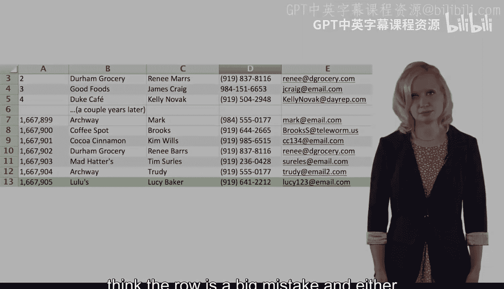
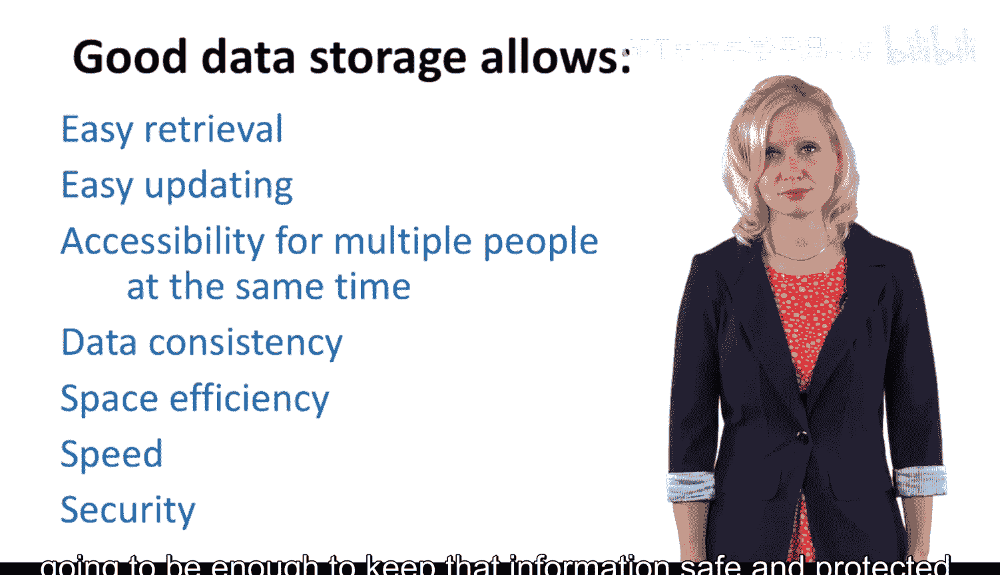

# 杜克大学《Excel 到 MySQL：商业分析（5课全）｜Excel to MySQL： Analytic Techniques for Business》中英 p133 04_02_01_海量数据与多用户并发访问带来的挑战.zh_en -BV1mS421X7yw_p133-

。Why do we need databases in all this complicated database query language。

 Why can't businesses keep things simple and just store things in spreadsheets。

 It seems like that would make things a lot easier in everyone。Well。

 let's examine that premise that keeping company data and spreadsheets would make things easier on everyone。

ItMa you were working for Daniel Egar as he starts up Egar's Rose Coffee。

 the business you described in coursese one of this specialization。

 business metrics for data driven companies。Your first week of business。

 Daniel personally handled orders with some great companies that you dutifully kept track of in the spreadsheet。

You entereded all the information that it seemed important to track and things look good。Now。

 fast forward a couple of years。 Egar's first coffee is done extraordinarily well。

 and Daniel has become coffee king of North Carolina。😊。

There are huge numbers of orders coming in every day。

 and now many people are entering those orders into the spreadsheet you made the first week。

 and many people are keeping track of and modifying the orders as customers called ask questions。

Actually， I just said that very calmly， but the truth is what I just said puts a misleadingly positive outlook on what's probably happening in the ordering Department of Egggars Rose Coffee。

What's really happening is that multiple people are trying to enter those orders into a spreadsheet。

 but that doesn't always happen because now Egggar's roast coffee has over 1 million orders。

 So the one spreadsheet you made when the company started has been broken into six separate spreadsheets so that Excel doesn't crash every time you try to enter an order。

Breaking the spreadsheet into 6 has helped prevent Excel from crashing。

 But now every time a customer calls to ask a question about an order or an invoice。

 it takes a couple of minutes before an employee can find the correct spreadsheet that has the order。

 especially because each spreadsheet is still very large。 So it takes Excel a while to open each one。

The more annoying part is that multiple people are trying to use the spreadsheet at the same time。

 so when a customer calls with question， you have to wait until somebody else finishes with a spreadsheet before you can open it yourself。

As a consequence， you all start coming up with elaborate pys to keep the spreadsheet open on your computer so that you are the one who has it loaded when a customer calls。

Fortunately， everybody at Egars Rose Coffee realizes that it's bad business practice to have employees get kicked off the ordering spreadsheets when they need them。

😊，So the company agrees to move their spreadsheets to an online service that lets multiple people edit a spreadsheet at the same time。

Cool。But now， new problems are arising。 First of all， the spreadsheets are still pretty big。

 so they still take a while to open and search。Second。

 sometimes multiple people end up interacting with a spreadsheet at the same time。

 and they end up writing over each other's entries。Third。

 there are starting to be a lot of inconsistencies in the data。

 which are hard to catch if you don't have multiple spreadsheets open at once。

 and only a few people have computers that are powerful enough to open multiple spreadsheets of that size at once anyway。

As some examples of these inconsistencies， here are some excerpts from the master spreadsheets。

Is the customer Archways contact Trudy or Mark。And if it's Truy。

 which email address is in the spreadsheet is her true email。

Our Trudy's email address is different because someone entered the second one by mistake。

 or because Trudy has actually changed her email。One of the reasons you might worry that Trudy's second email was a mistake is because lots of mistakes have been occurring recently。

 Every time a returning customer makes an order， an Egar's coffee employee has to type in all that information about the returning customer again。

 even though it's already been entered in the spreadsheet multiple times。

 Since the employees are doing their best to keep the customer happy。

 they end up entering the information really quickly。 And as a side effect。

 are more likely to make a mistake。Other issues that have gotten annoying are that when a mistake is made in one place in the spreadsheet。

 it often means an employee has to change multiple fields in the spreadsheet to correct the mistake。

So when it turned out that Lina wasn't actually the Egggar's roast coffee employee to make this sale。

 somebody had to update this column that had Lena's name。

 but that person also had to update these columns with Lina's contact information and sale number。

It would have saved a lot of time if that were automatic。

There were formulas in these columns at one point that made updating automatic。

 But now there are so many different spreadsheets and mistakes in the spreadsheets that the formulas often output the wrong thing。

 So nobody trusts them。And the problems don't stop there。

Sometimes it would be useful to keep some information in a row， but delete other information here。

 for example， Lulus decided to cancel their order， So you delete the order information in an effort to make sure the formulas that tally up your sum of the sales are correct。

But you would still like to keep Lulu's contact information in the company's records so that you can try to woove them back to place an order in the future。

The problem is that if you have a row with a lot of empty data。

 an employee looking over the spreadsheet， trying to reconcile records for an audit might think the row is a big mistake and either get worried or erase it altogether。

Speaking of audits， the company ended up switching invoice system somewhere along the way。

 and some orders are being made on the old invoice system。

 while others are being made with the new system。The employee who is responsible for reconciling the company's records needs to separate the sales made on the two systems。

 but it's difficult to do so because yet another separate analysis spreadsheet is used for the analysis。

 and it's hard to keep that analysis spreadsheet up to date when there are new orders being added all the time。

Further， Egggar's Rose coffee would like to start collecting more information about its customers to improve marketing efforts。

 However， the number of columns that need to be added each spreadsheet to accomplish these marketing analyses would more than triple the size of the spreadsheets。

 That would make the spreadsheets even slower than they are now。So as you can see。

 starting by entering Egggars Rose coffee records into a spreadsheet was easy and made a lot of sense。

 but as the company grew， spreadsheets became increasingly inefficient and inaccurate。At this point。

 keeping the company's data and spreadsheets would really hinder the company。

 If Egar's roast coffee ever get to the point in the future where they are making millions of sales per year。

 the spreadsheet system will become a huge bottleneck in the company's ability to maintain customer service。

 keep track of its finances and make business decisions。For Egarers Rose coffee to stay competitive。

 they need a data storage solution that makes their information easily retrievable。

 easy to update and accessible and modifiable by multiple people at the same time。In addition。

 especially because so many people will be accessing the data。

 there needs to be a way to make sure the data are consistent across all the stored records and that data aren't being deleted or lost inadvertently。

The storage method also needs to be space efficient。

 so the data aren't being repeated and taking up extra space。Of course。

 the storage needs to be fast as well。 Data need to be entered， searched and retrieved quickly。

Finally， another thing we didn't talk about yet is that the company's data also needs to be very secure when you are rest storing financial information。

 adding a password to a spreadsheet is not going to be enough to keep that information safe and protected。

That long list of problems that arise when a lot of people are using a lot of data are the exact problems databases are meant to solve。

Watch the next video to find out how relational databases in particular managed to do that。

