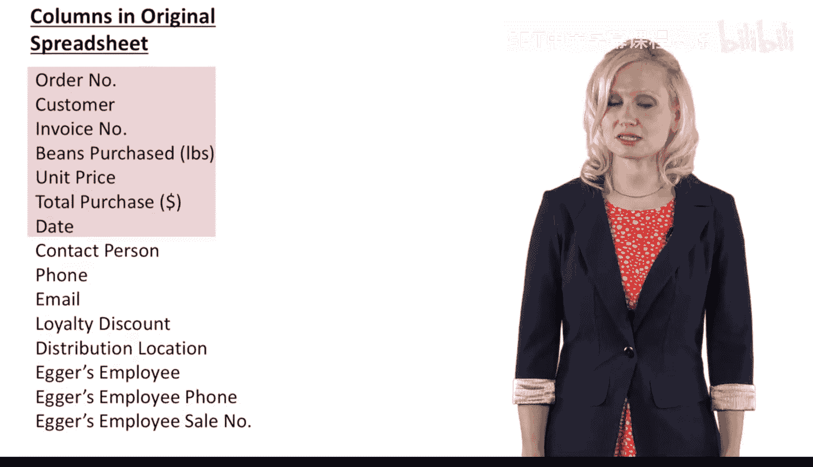
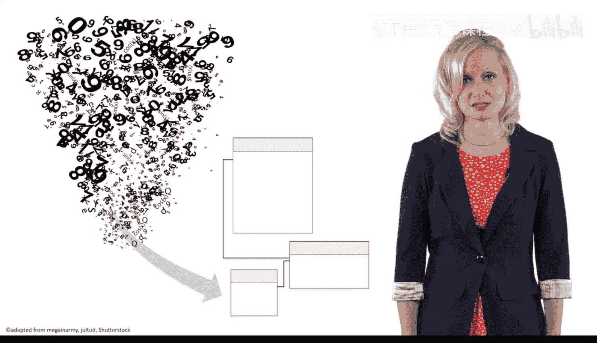

# 杜克大学《Excel 到 MySQL：商业分析（5课全）｜Excel to MySQL： Analytic Techniques for Business》中英 p134 05_02_02_关系型数据库如何解决这些问题.zh_en -BV1mS421X7yw_p134-

。How would you design a data storage system that wasn't a single spreadsheet？Well。

 if you have to read and write a lot of data really quickly。

 you want the reading and writing process to be as efficient as possible。

 You also want the data to take up as little space as possible。In this course。

 we are focusing on how a certain type of database， relational databases like MySQL， Terraadata。

 and others achieve the goals of writing and retrieving lots of data quickly。

The fundamental concept behind relational databases is that they break up data sets into individual pieces or subset of data。

Each subset of the data will have a theme that logically binds the data records in that subset together。

When you ask to retrieve information， the database only interacts with the subsets of data it needs to provide the information you ask for。

 rather than interacting with the entire data set at the same time。

This general strategy ensures that the data require as little space as possible to store。

As we will see in a second， it also provides mechanism for retrieving the information we ask for very quickly。

Let me tell you a little bit more what I meant when I said relational databases break data sets up into individual pieces or subsets of data。

It turns out that each subset of data is kept in its own table。

 so basically what relational databases do is organize data sets into smaller tables that each have their own unified theme。

If you think through what it would be like to keep all of the company's data in multiple spreadsheets。

 it becomes clear that linking together spreadsheets would be a huge time consuming problem if you didn't think about how you would combine and relay the spreadsheets ahead of time。

A similar concept holds in relational databases。 A critical piece of database design is making sure each individual table with its own unified theme contains a column with unique values that allows you to link that table to other tables。

Let's get a sense of what this might look like by taking a first pass at how we could design a strategy for putting the Eggers Rose coffee spreadsheet into a relational database。

It seems like we have a bunch of themes in our large spreadsheet。Company contact information。

 loyalty program information， distribution center information。 Egggars roast Coffee。

 employee information， and， of course， order information。

So in order to put our large spreadsheet into a relational database。

 we could break the large spreadsheet down into separate tables that each have one of these themes。

One table contains just the company contact information。

 one table contains information about the loyalty program。

One table contains information about distribution centers。

 One table contains information about Egar's Rose coffee employees who take the orders。

 and one table contains the order information。We would leave out any of the calculated fields to save space because they could be calculated whenever we need them。

If we set up our data this way， you can see that each one of our smaller tables would have to have a column that would link it to the order table in some way。

Those linking columns are indicated here in red。Let's consider some of the benefits of breaking our spreadsheet down into theme tables。

With this new organization， if we needed to change information about an employee。

 we would only have to change at once in the employee table。

 rather than having to search and replace the value in the entire column of over a million rows every time we wanted to make a change。

We can also add distribution centers to our database without having to add mostly blank rows to the main table。

 and we can easily add new information about those distribution centers to the data。

 like their addresses without having to take up much disk storage space。In addition。

 it's clear how you could keep information about a store contact。

 even if the store never ended up going through with the sales process。Further。

 we have saved lots of space by not having to repeat all the information in the company contact loyaltyty program distribution Center and Eggs Rose CoffEmploys table and every single row of the orders table。

As you can see， organizing the data set in this way solves a lot of the problems we talked about in the last video。

In addition， organizing the data set into smaller theme tables makes relational databases very powerful in another way。

 but this consequence is also probably not very intuitive。Here's a summary。

Computers don't yet run on magic， although admittedly， it often seems like they do。

In order to have a computer program do something like link up tables for you。

 you have to have a way of telling the computer how it should do that。

You have to be able to program in the appropriate rules and operations that will lead to the outcomes you want。

It turns out that thinking of data as groups of related items that can interact allows programmers to take advantage of a mathematical theory called set theory and a kind of algebra called relationlational algebra to write an elegant and complete programming language for retrieving information。

Since the theme of set theory will occur again in the course。

 I'd like to take a moment to give you an intuition for how set theory forms the basis of relational databases。

 even if we don't go over any of the math。Mathematical set theory defines a set as a collection of unique objects that have something in common or that follow a common rule。

A set can be a collection of anything， really， as long as the things in the set clearly have common features。

If we think of each of our database tables as collection of columns and collections of rows。

 treating a table as two intersecting collections or sets seems like a reasonable thing to do。

Relational algebra tells you how you can manipulate sets， in other words。

 do things like subtract one from another， add them together， and find where they overlap。

So if each table is a set of columns and rows， we can use relational algebra to write a computer program to tell the computer how to select subset of data for us and how to combine sets of data across tables。

The words we use in our commands to the database will reflect this relational algebra。

Now here's the really cool part。Set theory is a form of logic。

 It said that set theory was founded by the single paper in 1874。

 So it's been studied for a really long time and is really well understood at this point。Therefore。

 we know how to write algorithms that come up with a mathematically optimal way to manipulate subset。

By basing our databases on set theory， we can take advantage of these algorithms。

 What this means is that relational databases based on set theory。

 as long as they are set up correctly， can pull together the subsets of data we ask for really。

 really quickly in a mathematically optimal way。 even if those data sets reside in multiple tables。

That's why relational databases are still some of the fastest databases out there when manipulating and recombining stored tabular data。

If at some point in your career， you become interested in optimizing the speed in which the database you are working with outputs information。

 you will start working with these algorithms directly。

There is a command that asks the database to tell you how it would implement a hypothetical query。

 and you can use the information to write an alternative version of the command that can be run faster。

Even if you don't focus on set theory algorithms much in the way you end up interacting with your company's database。

 the database will be configured to abide by many as many of the requirements of set theory as possible so that the algorithms can be taken advantage of。

It will be useful to you to know what those requirements are。First of all。

 single tables should represent the smallest logical parts of a data set。Next。

 each column in a table must represent a unique category of information。

Each row in a table must represent a unique instance of the information as well。

Another important requirement is that the order of columns or rows in a table can't matter。

This will allow the database to pull them together in whatever order of fashion it determines will be the fastest。

Relational databases have some additional advantages beyond their principal method for outputting subsets of information we care about。

To start， relational database systems have built in some features that help maintain data integrity。

For example， when you set up a relational database。

 you define exactly what type of data go into each column and that database can prevent you from putting another type of data in there。

That means you wouldn't be able to write a number by accident when you were supposed to enter a word。

You can also define whether or not a column will allow no values。Further。

 relational databases allow you to specify who has permission to access certain parts of the database and exactly in what ways。

Overall， what this means is that as long as we can figure out how to put the data we care about into collections of tables。

 relational databases provide a very powerful way to store and retrieve our data in an extremely safe and reliable fashion。

😊，They pretty much solve all the problems spreadsheets don。That's why。

 as we heard Ryan tell us at the beginning of the course。

 almost every company uses a relational database for some part of the data in their company。

They are mathematically elegant， and they work really well for data that fit into columns and rows。

That's also why it will benefit you so much as a data analyst to learn how to interact with these types of databases。

