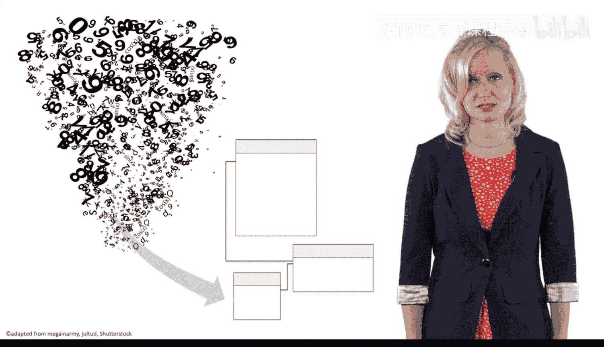

# Excel 到 MySQL：商业分析：05_02_02：关系型数据库如何解决这些问题 📊

在本节课中，我们将学习关系型数据库如何通过其独特的设计来解决大型电子表格所面临的数据存储、检索和效率问题。我们将探讨其核心概念、设计原则以及背后的数学理论。

---

上一节我们讨论了大型电子表格在处理海量数据时的局限性。本节中，我们来看看关系型数据库如何通过不同的数据组织方式来高效地解决这些问题。

如何设计一个非单一电子表格的数据存储系统？如果需要快速读写大量数据，读写过程必须尽可能高效，同时数据占用的空间也应尽可能小。在本课程中，我们专注于一类特定的数据库——如 MySQL、Teradata 等关系型数据库——如何实现快速写入和检索大量数据的目标。

关系型数据库背后的核心理念是将数据集分解为独立的片段或数据子集。每个数据子集都有一个主题，该主题在逻辑上将子集中的数据记录绑定在一起。当请求检索信息时，数据库只与提供所需信息相关的数据子集交互，而不是同时与整个数据集交互。这种通用策略确保了数据存储所需的空间尽可能小。我们稍后会看到，它也提供了快速检索所需信息的机制。

让我进一步解释一下“关系型数据库将数据集分解为独立片段或数据子集”的含义。实际上，每个数据子集都保存在其自己的表中。因此，关系型数据库基本上是将数据集组织成更小的表，每个表都有自己统一的主题。如果思考一下将公司所有数据保存在多个电子表格中的情况，就会明白，如果不事先考虑如何组合和关联这些电子表格，将它们链接在一起将是一个非常耗时的问题。关系型数据库中也存在类似的概念。数据库设计的一个关键部分是确保每个具有统一主题的独立表都包含一个具有唯一值的列，该列允许你将此表链接到其他表。

让我们通过初步设计一个将 Eggers Rose 咖啡电子表格放入关系型数据库的策略，来感受一下这可能是什么样子。我们的大型电子表格中似乎有一系列主题：公司联系信息、忠诚度计划信息、配送中心信息、Eggars Roast Coffee 员工信息，当然还有订单信息。因此，为了将我们的大型电子表格放入关系型数据库，我们可以将其分解为独立的表，每个表对应其中一个主题。

以下是可能的表结构设计：
*   一个表仅包含公司联系信息。
*   一个表包含忠诚度计划信息。
*   一个表包含配送中心信息。
*   一个表包含接收订单的 Eggars Roast Coffee 员工信息。
*   一个表包含订单信息。

为了节省空间，我们会省略所有计算字段，因为可以在需要时随时计算它们。如果以这种方式设置数据，你可以看到每个较小的表都必须有一个列，以某种方式将其链接到订单表。这些链接列在此处以红色标出。

让我们考虑一下将电子表格分解为主题表的一些好处。在这种新的组织方式下，如果需要更改员工信息，我们只需在员工表中更改一次，而不必每次想要更改时都在超过一百万行的整个列中搜索并替换值。我们还可以向数据库添加配送中心，而无需在主表中添加大部分为空白的新行，并且可以轻松地向这些配送中心添加新信息（如地址），而无需占用太多磁盘存储空间。此外，即使商店从未完成销售流程，我们也能清楚地知道如何保留商店联系人的信息。更重要的是，我们节省了大量空间，因为不必在订单表的每一行中重复公司联系、忠诚度计划、配送中心和员工表中的所有信息。

正如你所见，以这种方式组织数据集解决了许多我们在上一个视频中讨论的问题。此外，将数据集组织成更小的主题表还以另一种方式使关系型数据库非常强大，但这种结果可能也不太直观。以下是总结。

计算机尚未依靠魔法运行，尽管不可否认，它们常常看起来像是如此。为了让计算机程序执行诸如为你链接表格之类的操作，你必须有一种方法来告诉计算机它应该如何做。你必须能够编写适当的规则和操作，以产生你想要的结果。事实证明，将数据视为可以交互的相关项目组，使程序员能够利用一种称为**集合论**的数学理论和一种称为**关系代数**的代数，来编写一种优雅且完整的检索信息编程语言。

由于集合论的主题将在课程中再次出现，我想花点时间让你直观地了解集合论如何构成关系型数据库的基础，即使我们不涉及任何数学细节。数学集合论将集合定义为具有共同点或遵循共同规则的唯一对象的集合。集合可以是任何事物的集合，只要集合中的事物具有共同特征。如果我们将每个数据库表视为列和行的集合，那么将表视为两个相交的集合或集似乎是合理的。关系代数告诉你如何操作集合，换句话说，就是执行诸如从一个集合中减去另一个、将它们相加以及找到它们重叠部分等操作。因此，如果每个表都是列和行的集合，我们可以使用关系代数编写计算机程序，告诉计算机如何为我们选择数据子集，以及如何跨表组合数据集。我们向数据库发出的命令中的词语将反映这种关系代数。

现在，真正酷的部分来了。集合论是逻辑的一种形式。据说集合论由 1874 年的一篇论文创立，因此它已经被研究了很长时间，目前已被充分理解。因此，我们知道如何编写算法，以数学上最优的方式来操作子集。通过将我们的数据库建立在集合论之上，我们可以利用这些算法。这意味着，基于集合论的关系型数据库，只要设置正确，就能以数学上最优的方式，非常、非常快速地提取我们请求的数据子集，即使这些数据集驻留在多个表中。这就是为什么在操作和重组存储的表格数据时，关系型数据库仍然是速度最快的数据库之一。如果在职业生涯的某个阶段，你开始对优化所使用数据库输出信息的速度感兴趣，你将开始直接使用这些算法。有一个命令可以要求数据库告诉你它将如何执行一个假设查询，你可以利用这些信息编写一个可以运行更快的命令替代版本。

即使在你最终与公司数据库交互的方式中不太关注集合论算法，数据库也会被配置为尽可能遵守集合论的许多要求，以便能够利用这些算法。了解这些要求对你将是有用的。

以下是关系型数据库设计的一些核心要求：
*   首先，单个表应代表数据集的最小逻辑部分。
*   其次，表中的每一列必须代表一个唯一的信息类别。
*   第三，表中的每一行也必须代表信息的一个唯一实例。
*   另一个重要要求是，表中列或行的顺序不能影响操作。这将允许数据库以它确定的最快顺序和方式提取它们。

除了输出我们关心的信息子集的主要方法外，关系型数据库还有一些额外的优势。首先，关系型数据库系统内置了一些有助于维护数据完整性的功能。例如，当你设置关系型数据库时，你可以精确定义每列应放入的数据类型，数据库可以防止你将其他类型的数据放入其中。这意味着当你本应输入一个单词时，你不会意外地写入一个数字。你还可以定义列是否允许空值。此外，关系型数据库允许你指定谁有权访问数据库的某些部分以及具体的访问方式。

总的来说，这意味着只要我们能够弄清楚如何将我们关心的数据放入表的集合中，关系型数据库就提供了一种非常强大的方式，以极其安全和可靠的方式存储和检索我们的数据。😊，它们几乎解决了所有电子表格无法解决的问题。这就是为什么，正如我们在课程开始时听到 Ryan 告诉我们的那样，几乎每家公司都在其公司的某些数据部分使用关系型数据库。它们在数学上很优雅，并且非常适用于适合放入列和行的数据。这也是为什么作为数据分析师，学习如何与这类数据库交互将使你受益匪浅。

---

本节课中我们一起学习了关系型数据库的核心设计思想。我们了解到，它通过将数据分解为具有统一主题的独立表来解决大型电子表格的问题，从而提高了存储效率、数据完整性和检索速度。其背后的集合论和关系代数基础确保了数据操作在数学上的最优性。我们还探讨了关系型数据库设计的关键要求及其在安全性和权限控制方面的额外优势。掌握这些概念是有效使用和分析存储在关系型数据库中数据的重要基础。