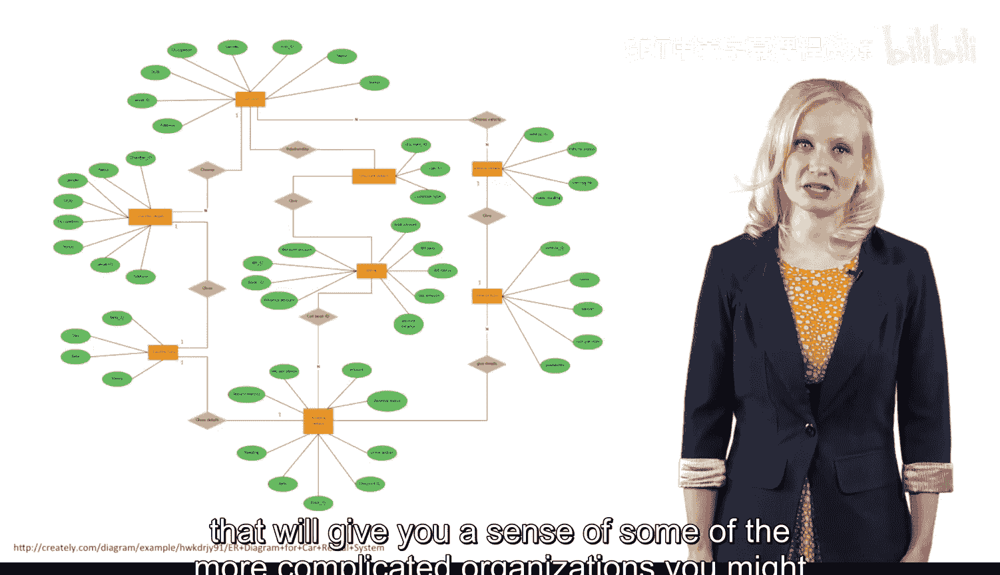

# 杜克大学《Excel 到 MySQL：商业分析（5课全）｜Excel to MySQL： Analytic Techniques for Business》中英 p136 07_02_02_实体关系图工作原理详解.zh_en -BV1mS421X7yw_p136-

In this video， we are going to go over the basic building blocks of a relational database and learn how to make entity relationship diagrams。

Remember I said that databases are collections of tables that each have their own unified theme。

Another thing I mentioned， but that we will really emphasize more strongly over the next few videos is that these tables are linked by one or more columns with the same values。

 These columns allow you to connect rows in different tables。As an example。

 we can see here that the customer contact column of the orders table and the contact ID column of the customer contact table are populated by the same types of values When there is a value of C ID1 in a row of the customer contact column of the orders table。

 we can find all the information about that customer contact by looking up C ID1 in the contact ID column of the customer contact table。

Figuring out exactly what information you want to collect and exactly how you can organize information to link tables can be tricky。

 so database architects often draw diagrams called entity relationship diagrams or ER diagrams to communicate the structure of the database they intend to implement to the rest of their team before they actually make the database。

This is what an ER diagram might look like。The person who made this one color coat it there so that it kind of looks like a bunch of flowers。

 at least to my eye。Normally， they look like a collection of ovals， rectangles。

 and diamonds connected by lines。Clearly， ER diagrams are not fine art。

What ER diagrams are supposed to represent are the conceptual relationships in your data。

 what is related to what and how。You will see that even if you never design a database in your life。

Being able to read these diagrams can be very helpful for writing tricky queries。 In addition。

 looking at lots of V diagrams to get a sense of how different data and databases can be organized will help you build an intuition for the types of data relationships you will work with in your own databases。

😊，Let's dive in and learn what the pieces of these diagrams mean。

The boxes in an ERR diagram are called entities。They represent categories of data your database will keep track of。

Each box is one category， eventually each entity will probably become a table when the database is made。

The ovals in an E R diagram are called attributes。 These represent aspects of each category or entity that will be recorded。

Attributes will likely become the columns in the table that will be built around that entity。

Each attribute in the NR diagram has to be connected to at least one entity further。

 according to the rules of set theory， each attribute must be unique for the entity。

 so you shouldn't， in theory， at least have two college start dates in your student entity。

 for example。Let's step away from ER diagrams for a moment to discuss more terminology。

Each time you collect data relevant to an entity， those data are collectively called an entity instance。

 You can think of entity instances as the rows in a data table。

The most important attribute of the entity is the attribute that has a unique value for each entity instance。

 formally， they are called unique attributes， informally。

 they are also sometimes called unique keys or unique identifiers。

Unique attributes or keys or identifiers in T form would be a column that has a different unique value for every single row。

They are like the ID columns we saw earlier that allow us to link tables together。

Every entity must have at least one attribute that serves as a unique key or identifier。

With that vocabulary under a belt， we can now return back to our diagrams。

You indicate unique attributes in an entity by underlining their title in the oval。In our diagram。

 student ID is the unique attribute for student， and college name is the unique attribute for college。

This means that every student will have their own unique student ID。

 and every college will have its own unique name。If there are multiple attributes underlined in an entity。

 any one of them could potentially be used as a unique key or identifier to link the table with other tables when the database is implemented。

Every entity or category has to be related to at least one other entity in the database。

 You use a diamond in lines to represent and describe these relationships。

The word on the diamond spells out the nature of the relationship and the diagram shown here。

Students attend college。Now here's where things get really important for an analyst who will be querying a database to retrieve information。

Each relationship between entities and an theR diagram shows how many instances of one entity are associated with how many instances of another entity。

If you think back to when we are asking questions about the Egggars Rose coffee spreadsheet。

 many of our questions about whether a data entry was correct or an error could have been answered if we knew the nature of the relationships between the columns。

 For example， does each company have one contact person or canop be multiple contact people。

 Turns out that there can be many， by the way。Is each order supplied from exactly one distribution center。

 or can it be multiple distribution centers？How many addresses can be associated with a given eggs roast coffeeoff employee？

These limitations and the relationships between two entities。

 which once the entities have been made into tables。

 also ends up meaning the relationships between the values and the columns that link the two tables together are called cardinality constraintss。

 and they are indicated by the little symbols next to the entity rectangles in our ER diagram。

There are a couple of different formats of VR diagrams， but in the format we are using this course。

 the symbol closest to the rectangle represents the maximum number of instances of the entity that can be associated with another entity。

And the symbol farthest away from the rectangle represents the minimum number of instances of that entity that can be associated with another entity。

To understand the relationships between entities and ER diagrams that have this format。

 always start from one entity， follow the connecting line。

 and then interpret the symbols closest to the second entity。

So if we start with college in our diagram here， we can see that each college is attended by students。

These symbols here are the ones closest to students。

 so they are the ones we will use to interpret the relationship in this direction。

If the symbol next to an entity is a straight line， that means one。

If the symbol looks like a bird's foot， that means more than one。

Remember that the symbol farthest away from the second entity indicates the minimum while the symbol closest to the second entity equals the maximum。

So the way we would read this diagram is that each college。Must be attended by at least one student。

 but can be attended by many students。The way we would read the relationship in the opposite direction is that each student。

Attends a minimum of one。But no more than one college。

Sometimes ER diagrams provide more specific cardinality constraints than just one in many when they do。

 those constraints are indicated by specific numbers and parentheses。

There are two important things to know about the notation for specific cardinality constraints。First。

 the numbers and parentheses take precedence over the bar symbol in the minimum constraint， second。

 and pay attention to this one because it is potentially confusing。

The numbers in the parentheses are always written with the minimum number on the left and the maximum number on the right。

In order to try to be consistent with written languages that always write from left to right。

Importantly， the numbers are always written in this left to right direction。

 even if the numbers and parentheses refer to a relationship that is depicted from the right to left direction。

 I know that's a little strange， but let me show you what I mean。

If we read this E R diagram in this direction， which is from right to left。

 despite the fact that there is a bar symbol that usually equals1。

 and despite the fact that the numbers and parentheses are written so that the minimum numbers on the left and the maximum number on the right。

 we interpret the diagram to mean that each college must be attended by a minimum of 1000 students and a maximum of 10000 students。

One symbol to know about is the M， which I've also sometimes seen as an N。 It means infinite。

If the 10，000 was replaced by an M or an N， that would mean that the college could be attended by an infinite number of students。

Another symbol to know about is the circle。 The circle means optional。

So if we read this ER diagram in the left or right direction。

 we would learn that each student could attend as many as two colleges。

But doesn't have to attend any。By the way， as a small detail， for this interpretation to make sense。

 there would have to be some other attributes in the database not pictured here that could be used to explain why the student was relevant to the database。

 even if he or she wasn't attending a college。 For example， perhaps they transferred her job do。

So now you understand how to read the most fundamental parts of anyR diagram。In the next video。

 we'll talk through some ER diagrams that will give you a sense of some of the more complicated organizations you might see and databases you work with in real life。

