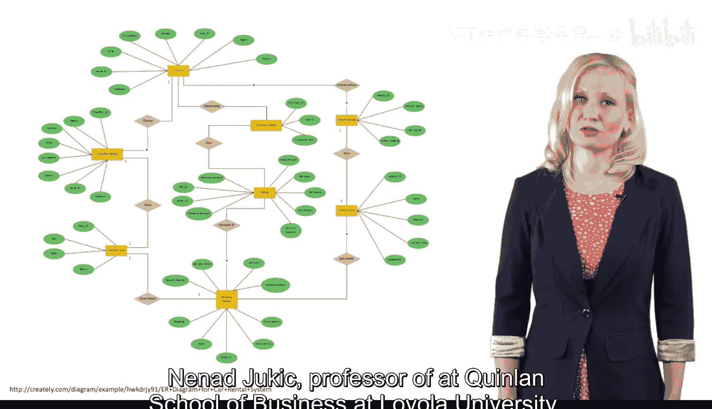

# 杜克大学《Excel 到 MySQL：商业分析（5课全）｜Excel to MySQL： Analytic Techniques for Business》中英 p137 08_02_03_通过实体关系图解析数据库结构.zh_en -BV1mS421X7yw_p137-

。In this video， we are going to examine examples of VR diagrams that will give you a sense of some of the more complicated organizations you could encounter in the databases you work with。

Let's jump in and start with this one。In this example， classroom is our entity。

Classroom ID is an underlined attribute in parentheses and has two attributes of its own attached to it。

 What does that mean？If you examine the details of the diagram。

 you'll see that the two attributes attached to Class ID are building in room number。

Since they are not underlined， neither one of those attributes will have unique values in the database。

However， the fact that Class ID is underlined in parentheses indicates that if you combine the values of building and room number together。

 you will get a unique identifier or key that will be different for every row in the table or more formally for every entity instance。

The diagram tells us this in two ways。 First， classroom ID is in parentheses。

 which means it is a composite attribute。Composite attributes are measurements or descriptions that have important meaning。

 but that can be created by combining other attributes being tracked and saved， so to save space。

 composite attributes are usually not made into their own columns in a database。

Since Class ID is connected to building and room number。

 we know that they must be the attributes you would put together to make Class ID。

The fact that classroom ID is underlined， as well as in parentheses。

 tells us that this composite attribute is critical for identifying each unique classroom。

The practical implications of this are that if the classroom entity was made into a table and you tried to combine or join another table with it。

 your join would only work if you use both the building and room number attributes to make a unique key identifier using one attribute alone wouldn't work。

 And if it did work because the database wasn't configured properly。

 you wouldn't get the right answer。Let's look at another one。

This one has some similarities to the one we just saw， but has an important difference。

In this example， building is now an entity， and it has a unique attribute that can be used as unique key。

That unique key would be building I D。 However， building is related to apartment。

 which is depicted with a double rectangle and whose unique key would be well， less clear。

Apartment number is underlined with a dash line， and I haven't told you what that or the double rectangle in double diamond mean yet。

Apartment is an example of what is called a weak entity with a partial key。

The double rectangle indicates that it is a weak entity。

 The dashed line underneath apartment number means that the apartment number in the database on its own will not identify an apartment。

 In other words， there are multiple apartment number fours in the database。 Thus。

 apartment number can at best be a partial key。Nonetheless。

 a partial key can become unique within its own weak entity， if and only if。

It is connected to the unique key of the entity it is connected to with a double diamond。

So in this case， the apartment number will be unique if it is combined with building I D。

 Since building is the entity apartment is connected to with a double diamond。 In other words。

 there is only one instance of each apartment number in each building。

Note that combining apartment number with just any attribute in building， like number of floors。

 you would not create a unique identifier， you would have to combine it specifically with building ID since that's the unique attribute。

You would need to make sure you understood this if you are going to extract data to analyze information about the apartments。

 such as if you wanted to examine electricity usage in individual units， for example。Okay。

 let's look at one slightly more complicated example。

 St it in a bit and see if you can make a guess about what's going on。In general。

 you can see that students are taking a bunch of classes。

 but student names can't be connected directly with class levels or ID in this database。

 despite the fact that both student and class have a unique attribute。Apparently。

 the only way they can be connected is if you combine them via the semester the class was taken。

What that means is that students can take the same class multiple times。

 probably because they may have to take the class again if they fail or do very poorly the first or second time。

If you wanted to analyze data about students and class， you would have to combine not two tables。

 but three tables to get the data you want。Further， since completion is a weak entity。

 when you actually wrote the queries， you would have to make sure you specify both the partial key and the unique keys when you try to join the tables。

This is a good example of how in real life， the data we try to put into a table format can be complicated。

 and if you don't have a map with your database to help you figure out what is going on。

 it can take quite a while to figure out how to combine the different parts of the database together to correctly give you the information you want。

Sometimes you might have to put four or five tables together in one query。

 and each of those tables might have to be linked with the other tables in a different way。

This is why I want to make sure you understand ER diagrams first， like I said before。

 reading the ER diagrams with many different databases will give you an idea of what types of relationships you are likely to see in your databases in real life and itll give you experience with some of the strange situations that could cause problems in your data analysis。

This will be a particularly useful experience to have when working with databases that have not been cleaned before they have been given to you。

 such as those you might encounter in middle sized or small companies。

You'll also see strange database relationships arise in big companies when the databases you were working with were not originally designed for the current data that are being collected or analyzed。

The second reason I want to make sure you understand ER diagrams is so that if you do find yourself running into difficulty。

 getting the information you want out of a relational database。

 you will be able to ask your database administrator for the ER diagram of the database to help you figure it out。

For many people， and I hope for you， seeing the database represented in this very visual way in front of your eyes can be the best way to translate a map of the database into your own head。

 which in turn will help you construct queries that work and that accurately reflect the what you want them to。

I have included some ER diagrams with the course materials that were donated by Nana Juicch。

 professor at Quinland School of Business at Loyola University of Chicago from his own textbook。

 you were not required to complete them， but I highly recommend that you do。

I wanted to make sure that you at least have the opportunity to work through these exercises because in the end。

 you will be a much more powerful SQL user if you have studied a lot of ERR diagrams and are confident you understand the concepts they represent。

