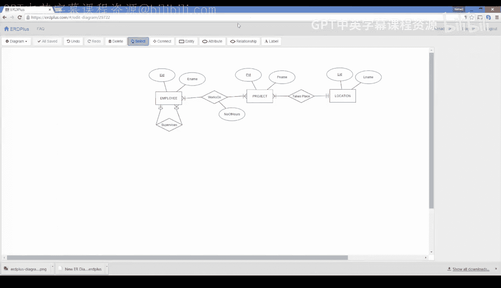

# 杜克大学《Excel 到 MySQL：商业分析（5课全）｜Excel to MySQL： Analytic Techniques for Business》中英 p139 10_02_01_使用ERDplus创建实体关系图.zh_en -BV1mS421X7yw_p139-

Now that you know how ER diagrams and relational schemas work。

 Nad Juicch is going to show us how to use his tool ERD+ to make your own diagrams and schemas。

 the tool can be found at ERD+。com。When you go to the website。

 you'll see a place where you can sign up for a free account so that you can save and revise your work。

 Once you make an account， you'll see this home screen where all the diagrams you have made are listed。

If you make a new diagram or open up an old one， the program brings you to this workspace or diagram surface to orient you。

 all the buttons that allow you to add new parts to the diagram are up here at the top of the screen。

All of the menu items that let you name or define parts of a diagram are over here to the right side of the screen。

Once you have a diagram that you are happy with， remember this diagram button all the way over here to the upper left。

It will let you export the diagram as an image so that you can save it for reference later。

I think you will find the tool to be very intuitive， I'll let Na dad take it from here。Hello。

 my name is Nna Dch。 I'm a professor of information System at Queensland School of Business at Loyola University of Chicago。

I'm excited that you're about to use e r d plus this is an excellent tool for people who are trying to learn about databases such as yourself。

😊，hope you enjoyed the tool and good luck with your course。😊。

This video demonstrates how to use ERD+ to create an ERR diagram。

Once you' are logged into your account， go to the diagram section。

Click on the new and choose Er diagram option。Click on the name of the new ERR diagram to enter the drawing surface。

Let's create a small ER diagram。We will click on the entity icon and place the entity anywhere in the rank surface。

 We will name this first entity location。We will add two attributes to this entity， location ID。

 and location name。We will declare location I to be unique。Now， let's add another entity。

We'll name this entity。Project。We'll add attributes。Project I D and project name。

Project I D is unique。We'll add one more entity。We'll name this one employee。

Employee has employee ID， which is unique and employee name。

Now we can create some relationships between these entities to create a relationship。

 we have to click on the connect icon， then click on one entity in this case project and drag to another one in this case location。

We just created a relationship between project and location。

 We will call this relationship takes place。Now we will declare cardinality constraint for this relationship。

Each project。Takes place at exactly one location。Whereas each location。

Has at least one project taking place at it， but can have many。

Now let's create a relationship between employee and project again， we'll click on Connect。

 click onEmploy and drag over to project。We will name this relationship works on。

Each employee works on at least one project， but can work on many。 Each project has at least。

One employee working on it， but can have many。Works on is a many too many relationship。

 Many too many relationships can have attributes。To demonstrate。

 we will create an attribute for this relationship works on。

We will create an attribute and name it number of hours。

Signifying that it keeps track of number of hours that each employee works on each project。

This concludes a small demo of how to create an ERR diagram using ERD+。

