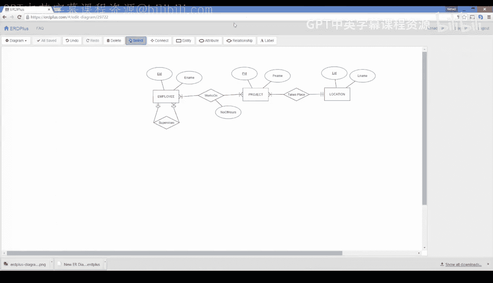

# 数据库设计：第10章：使用ERDplus创建实体关系图 🛠️

在本节课中，我们将学习如何使用一个名为ERDplus的在线工具来创建实体关系图。实体关系图是数据库设计中的核心工具，它能帮助我们直观地规划数据表及其关联。通过本教程，你将掌握从注册账号到绘制完整ER图的基本流程。

## 概述

我们已经了解了实体关系图和关系模式的工作原理。接下来，Nad Juicch将向我们展示如何使用他的工具ERD+来创建我们自己的图表和模式。这个工具可以在ERD+.com找到。

## 访问与注册

当你访问该网站时，会看到一个可以注册免费账户的地方，以便保存和修改你的工作。

注册账户后，你将看到这个主屏幕，上面列出了你制作的所有图表。

## 工作区介绍

如果你创建一个新图表或打开一个旧图表，程序会将你带到这个工作区或图表绘制界面。

所有允许你向图表添加新组件的按钮都位于屏幕顶部。

所有让你命名或定义图表组件的菜单项都位于屏幕右侧。

## 导出图表

当你对图表感到满意后，请记住屏幕左上角的这个图表按钮。

它可以让你将图表导出为图像，以便日后保存以供参考。

你会发现这个工具非常直观。现在，让Na dad来接手介绍。

## 工具介绍

你好，我叫Nna Dch。我是芝加哥洛约拉大学昆士兰商学院的信息系统教授。

我很高兴你即将使用ERD+，对于像你这样正在学习数据库的人来说，这是一个极好的工具。

希望你喜欢这个工具，并祝你的课程顺利。

## 创建ER图演示

这个视频演示了如何使用ERD+来创建一个ER图。

登录你的账户后，进入图表部分。

点击“新建”并选择“ER图”选项。

点击新ER图的名称以进入绘图界面。

让我们创建一个简单的ER图。

## 创建实体

我们将点击实体图标，并将实体放置在绘图界面的任意位置。

我们将第一个实体命名为 **location**。

我们将为这个实体添加两个属性：**location ID** 和 **location name**。

我们将声明 **location ID** 是唯一的。

现在，让我们添加另一个实体。

我们将这个实体命名为 **Project**。

我们添加属性：**Project ID** 和 **project name**。

**Project ID** 是唯一的。

我们再添加一个实体。

将其命名为 **employee**。

Employee 有 **employee ID**（唯一）和 **employee name**。

## 创建关系

现在我们可以在这些实体之间创建一些关系。

要创建关系，我们必须点击连接图标，然后点击一个实体（本例中是 project），并拖动到另一个实体（本例中是 location）。

我们刚刚在 project 和 location 之间创建了一个关系。

我们将这个关系命名为 **takes place**。

## 定义基数约束

现在，我们将为这个关系声明基数约束。

每个项目 **takes place** 恰好在一个地点。

而每个地点 **has** 至少一个项目在此进行，但可以有很多。

现在，让我们在 employee 和 project 之间再创建一个关系。

再次点击“连接”，点击 Employee 并拖动到 Project。

我们将这个关系命名为 **works on**。

每个员工 **works on** 至少一个项目，但可以参与多个。

每个项目 **has** 至少一名员工为其工作，但可以有很多。

**works on** 是一个多对多关系。

## 为关系添加属性

多对多关系可以拥有属性。

为了演示，我们将为这个 **works on** 关系创建一个属性。

我们将创建一个属性，并将其命名为 **number of hours**。

这表示它记录了每个员工在每个项目上工作的小时数。

## 总结

本节课中，我们一起学习了如何使用ERD+工具来创建实体关系图。我们从注册账户、熟悉工作界面开始，逐步完成了创建实体、定义属性、建立关系以及设置基数约束的完整流程。记住，多对多关系可以拥有自己的属性，这在设计复杂数据库时非常有用。掌握这个工具将帮助你更高效地进行数据库的可视化设计。