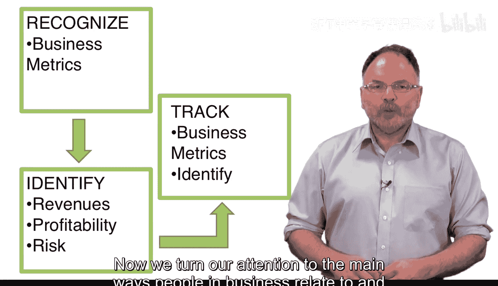
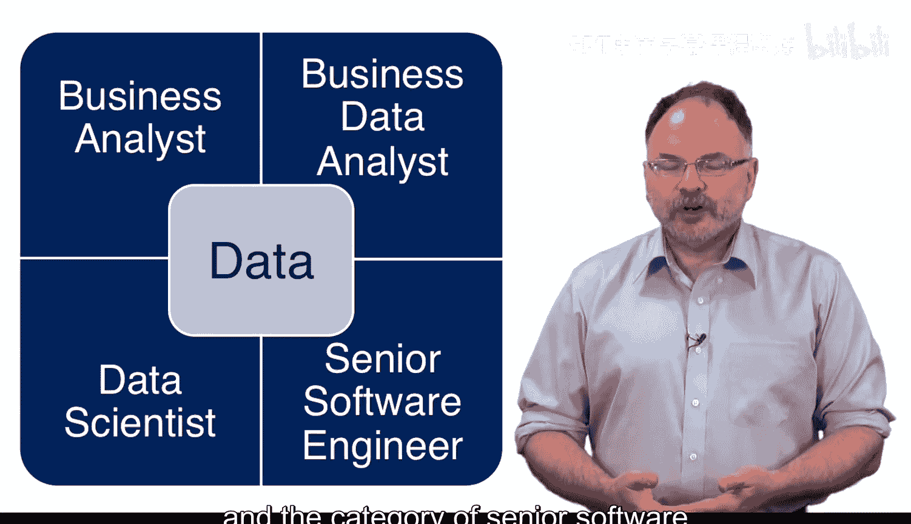
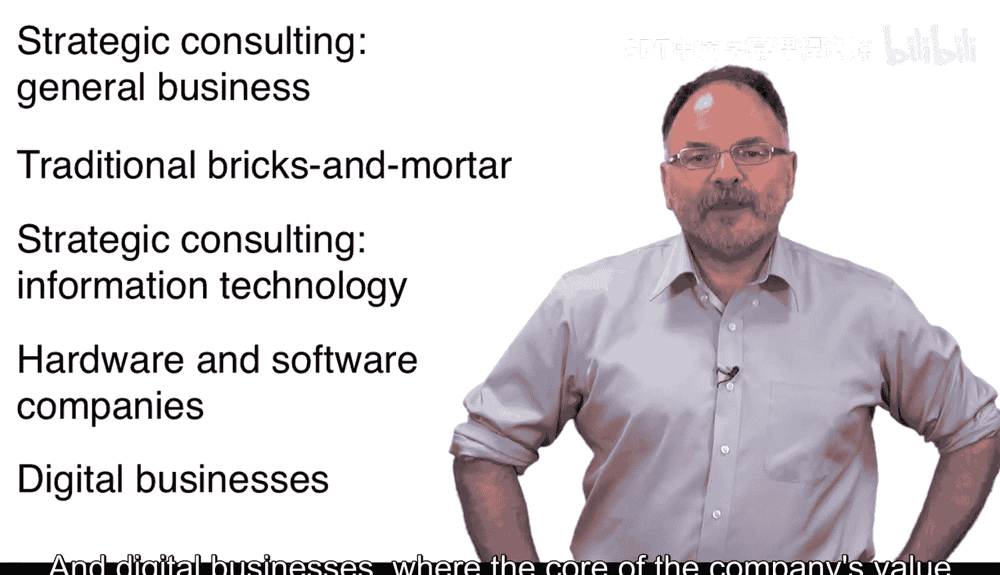

# 杜克大学《Excel 到 MySQL：商业分析（5课全）｜Excel to MySQL： Analytic Techniques for Business》中英 p14 14_03_01_角色与企业在大数据背景下的关联.zh_en -BV1mS421X7yw_p14-

You should now have a good idea how to recognize important business metrics。

 You've learned how to identify and apply some of the most widely used metrics in analysis of revenues。

 profitability and risk。 You also know why it's especially valuable to track dynamic business metrics and how to identify those。

Now， we turn our attention to the main ways people in business relate to and work with their company's data。

We've come up with a simplified framework。That classifies four main types of rules。

 which we've listed under four different job titles。Business analyst， business data analyst。

Data scientist。And the category of senior software engineer or technical project manager。

Let me start by explaining how this specialization relates to these roles。It's simple。

Anyone who successfully completes this specialization。

Will be well prepared for an entry level position as a business analyst or business data analyst。

The data scientist's position requires additional skills and work experience。

But if you aspire to be a data scientist in the future。

You'll come away from this specialization with a clear understanding of what steps you will need to take to get there。

With the exception of a small number of people who come to industry directly with PhDs in statistics or computer science and related fields。

Most working data scientists are people who started as business data analysts just a few years earlier and learned all the additional skills they needed while they were on the job。

There are also a number of excellent master's programs in the US that can prepare you for a data scientist career。

On the other hand， the senior software engineer project manager career path is quite distinct from the business analytics data scientistient career path。

With quite different training and requirements。We explain why that is and discuss best practices for how business analysts。

 business data analysts， data scientists and software engineers cooprate and collaborate to achieve amazing results in the best companies。

After examining different types of work。That relate to data will consider what role data plays in the success of various types of companies。

We've classified companies into five types。Based on their fundamental relationship to big data。

Strategic consulting firms with a general business focus。

Traditional bricks and mortar companies in all industries。

Strategic consulting firms with an information technology or systems integration focus。

Companies selling hardware and software or software as a service for gathering， storing。

 analyzing and using big data。And digital businesses。

 where the core of the company's value creation involves real time analysis of data。

Within the large bricks and mortar category。Some companies have fully embraced the opportunities created by what I call big data culture。

In the。Grocery sector in the US， for example， we have Costco that。

Gives an excellent example of best practices for use of data analytics。Companies like Food Lionion。

That are lagging behind。And companies like A&P that don't seem to know how to begin， and in fact。

 A&P is now bankrupt。So identifying where your company。

Lies on the spectrum of embracing best practices for data analytics is obviously very important and will offer some methods and tools for you to be able to do that。

We've also included a number of short interviews so you can hear directly about their experiences from people who are currently thriving in data analytic careers。

But who play many different roles。In different types of companies。

