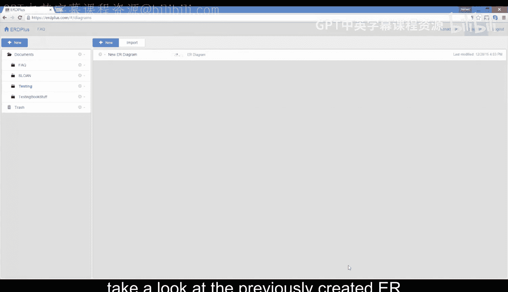
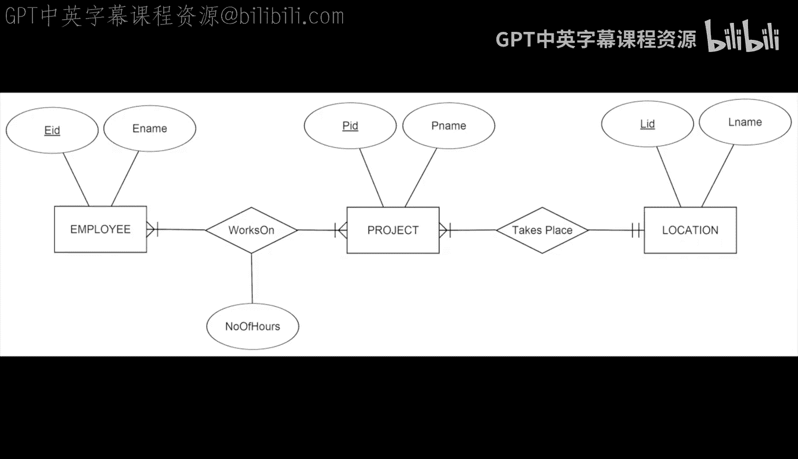
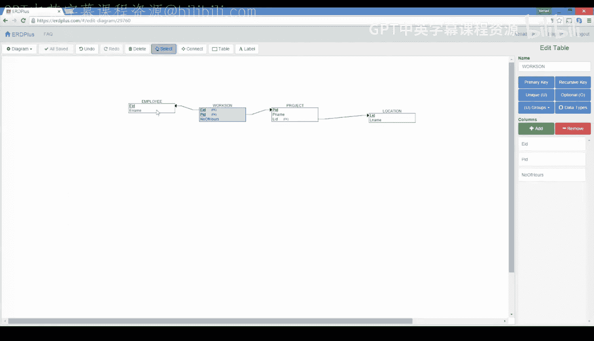
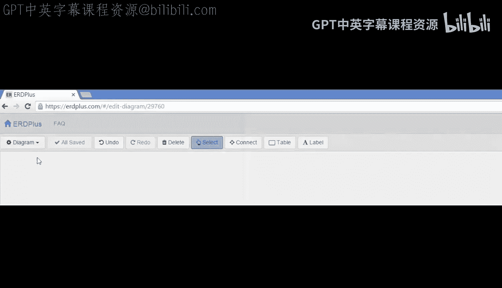
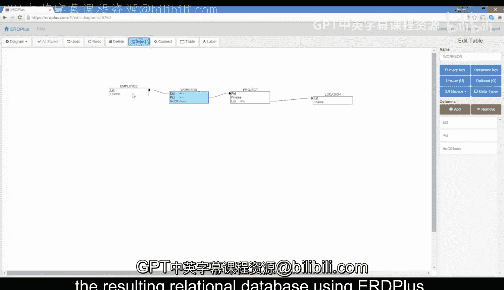

# 杜克大学《Excel 到 MySQL：商业分析（5课全）｜Excel to MySQL： Analytic Techniques for Business》中英 p140 11_02_01_使用ERDplus构建关系模式.zh_en -BV1mS421X7yw_p140-

。In this video， Nd Juch will show you how to use his tool ERD+ to make a relational schema。

 If you need a reminder about how the general structure of the ERD+ website is organized。

 please refer to the last video that has a demonstration about how to use ERD+ to make ER diagrams and now here's Nad。

This video demonstrates how to use ERD+ to create a relational schema。

Once you are logged into your ED+ account， go to the Di section。

Before we demonstrate how to create a sample relational schema， first。

 let's take a look at a previously created ER diagram that we will use as a basis for the sample relational schema。

Keep this EI diagram in mind as we now go and create a relational schema。

Click on new select relationlational schema， click on the name of the new relational schema。

 and now you are in a drawing surface for creating relational schemas。

We start by creating the first table。This table is named location。First column of this table is L ID。

The next column is L name。We will declare primary key of this table by clicking on the primary key button。

 and we will choose L I D as the primary key。The next table is called project。

Let's start creating columns， PID。Pete name。Table project will also have a foreign key L I D。

 referencing the primary key L I D of the location table to create a foreign key， click on connect。

Click on the table that provides the foreign key。 hold the left。

 click down and drag to the table that gets the foreign key。 This creates a foreign key。Now。

 let's create。A primary key of the project table by clicking on the primary key button and choosing P I D。

In E R D plus， you can change the order of columns easily。Let's move the LID column，1 spot up。Now。

 let's move the LID column one spot down。The next table we will create is the table employee。

The columns are EI。And a name。Primary key is the EID column。

The final table of this relational schema is a bridge table works on resulting of the many too many relationship between employee and project entities。

Click on the table。Name it works on。And now we have to add two foreign keys to this table。

 one coming from the table employee and one coming from the table project。Click on connect， and。

Create two foreign keys。In addition， this table has another column。Number of hours。

This column indicates how many hours each employee worked on each project。

We will now declare the primary key of this table。 The primary key is a composite key composed of E I D and P I D。

Our sample relational scheme is now created。 It is also already saved in the diagram section of your ED plus account。

In addition， by clicking on the diagram and clicking on。Export diagram file。

 You can save the same diagram onto your computer。 Also。

 you can save the image of the diagram by clicking on export image。

Saving the image allows you later to copy and paste it into。PowerPoint。

 word or any other application。

This concludes。The small demonstration of how to create sample relational schema and the resulting relational database using E R D plus。

