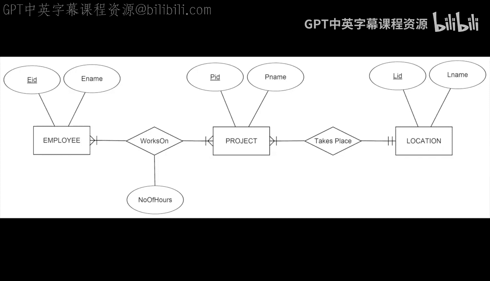
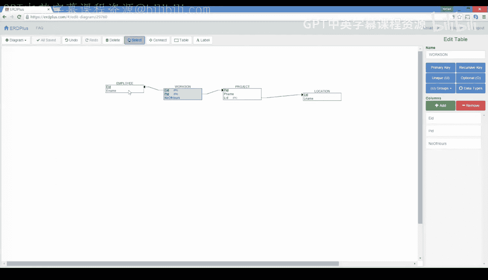
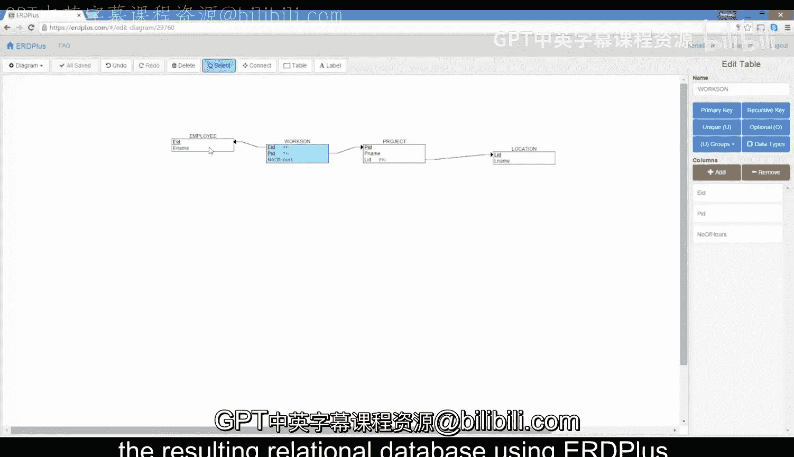

# Excel 到 MySQL：商业分析：5.2：使用 ERDplus 构建关系模式 📊

在本节课中，我们将学习如何使用 ERDplus 工具，从一个实体关系图（ERD）出发，构建出对应的关系模式。关系模式是设计数据库表结构的基础，清晰地定义了表、列、主键和外键。

上一节我们介绍了如何使用 ERDplus 绘制实体关系图。本节中，我们来看看如何将 ERD 转换为具体的关系模式。

## 准备工作

在开始构建关系模式之前，我们需要一个已完成的实体关系图作为基础。请记住以下示例 ERD 的结构，它包含地点、项目、员工实体，以及员工与项目之间的“工作于”多对多关系。

## 创建新的关系模式

登录您的 ERDplus 账户后，进入图表（Diagram）区域。

以下是创建新关系模式的步骤：

1.  点击“新建”（New）。
2.  选择“关系模式”（Relational Schema）。
3.  点击新关系模式的名称，进入绘图界面。

## 构建数据表

现在，我们开始根据 ERD 创建对应的数据表。

### 创建地点表

我们首先创建名为 `location` 的表。

以下是 `location` 表的列定义：

*   **L_ID**：地点ID。
*   **L_name**：地点名称。

点击“主键”（Primary Key）按钮，选择 **L_ID** 作为该表的主键。

### 创建项目表

接下来，创建名为 `project` 的表。

以下是 `project` 表的列定义：

*   **P_ID**：项目ID。
*   **P_name**：项目名称。
*   **L_ID**：外键，引用 `location` 表的主键 `L_ID`。

要创建外键，请点击“连接”（Connect）按钮，然后从提供外键的表（`location`）按住鼠标左键，拖拽到接收外键的表（`project`）。这将自动创建外键列。

然后，点击“主键”按钮，选择 **P_ID** 作为该表的主键。

在 ERDplus 中，您可以轻松调整列的顺序。尝试将 `L_ID` 列上移或下移一个位置。

### 创建员工表

现在，创建名为 `employee` 的表。

以下是 `employee` 表的列定义：

*   **E_ID**：员工ID。
*   **E_name**：员工姓名。

点击“主键”按钮，选择 **E_ID** 作为该表的主键。

### 创建桥接表

最后，我们需要创建一个桥接表 `works_on`，它源于员工和项目实体之间的多对多关系。

点击“表”（Table）工具，将其命名为 `works_on`。

此表需要添加两个外键：

1.  来自 `employee` 表的 `E_ID`。
2.  来自 `project` 表的 `P_ID`。

使用“连接”工具，分别从 `employee` 表和 `project` 表拖拽到 `works_on` 表，创建这两个外键。

此外，该表还有另一列：

*   **number_of_hours**：表示每位员工在每个项目上工作的小时数。

现在声明此表的主键。主键是一个由 **E_ID** 和 **P_ID** 组成的复合主键。

## 完成与导出

至此，我们的示例关系模式已经创建完成，它会自动保存在您 ERDplus 账户的图表区域。

您可以通过以下方式导出您的工作：

*   **导出图表文件**：点击图表，选择“导出图表文件”，可将图表保存到电脑。
*   **导出图像**：点击“导出图像”，保存为图片格式。这便于您日后将图表复制粘贴到 PowerPoint、Word 或其他应用程序中使用。

本节课中，我们一起学习了如何使用 ERDplus 工具，从一个实体关系图逐步构建出完整的关系模式。我们实践了创建数据表、定义主键与外键、建立表间关联以及导出成果的完整流程。掌握这一技能，能为后续在 MySQL 等数据库中实际创建表结构打下坚实基础。

