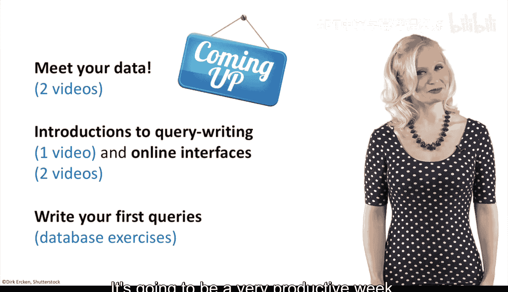

# 杜克大学《Excel 到 MySQL：商业分析（5课全）｜Excel to MySQL： Analytic Techniques for Business》中英 p142 13_03_01_第二周课程导论.zh_en -BV1mS421X7yw_p142-

。Last week we learned how databases were organized and practiced how to make and interpret ER diagrams and relational schemas in order to figure out how the data you went to analyze are stored in the database。

This week， we are going to start writing SQL queries。

One of the first things you're going to learn is how to write queries that are considerate to your coworkers。

 we are going to write queries that analyze two sets of data from two real companies。

One data set donated from a local startup in Durham， North Carolina called Dogogniian。

 has tables with over 1 million rows。 The other data set donated from a national US Department Stor chain called Dillers has tables with over 100 million rows。

 An important thing to keep in mind when working of data of this size is that the queries you write will affect the speed at which other people in the company can retrieve data。

This means that the opportunities you have to query a company's raw data from its database are accompanied by a responsibility to write queries that impact others as little as possible。

To give you practice with what this responsibility feels like。

 the queries you will write in this course， like those you will write in a company。

 will affect other people's database experience。 We have built the MySQL database infrastructure for this course to provide database access to groups of about 150 students each。

When you write a query that is extremely resource intensive。

 it can slow down or even crash database access for everyone else in your group of 150 or so students。

 and if it does crash， don't worry， of course we'll restart it for you。

We've purposely designed the course this way to give you an opportunity in a safe environment to learn the consequences of writing intensive queries。

 we hope this will help motivate you to adopt practices that prevent you from writing these types of queries in the future when you are working with databases in your own companies。

😊，Another important thing youre going to learn in the first MysQL lesson is how to use SQL queries to verify and describe all the contents in a database Two common ways you can accidentally write queries that take a very long time to run are by asking a database to return all the data in a really。

 really large table， even though you don't need all the data in that table。

 or by asking a database to combine tables whose output has many more rows than you expect due to many to many relationships in your columns or duplicate values in your rows。

Therefore， one of the best ways to prevent yourself from writing queries that are unnecessarily taxing is to know your data in detail。

If you know which tables are large and you know what to expect when you combine information from different tables。

 you will be less likely to unintentionally write queries that make the database work really hard for no useful reason。

To prepare you to write these types of queries， the next two videos will tell you all about the data sets we will be working with。

The following videos will show you how to interact with those dataset sets to the user interfaces we set up for the course。

 Then you will spend the rest of the week using these interfaces to practice queries。

 By the end of the week， you will be able to learn about and describe all the contents of a database and will be able to export data from specific tables in a socially responsible way。

 It's going to be a very productive week。 So I hope you are ready to learn。

 Watch the next two videos about your datasets to get started。😊。

