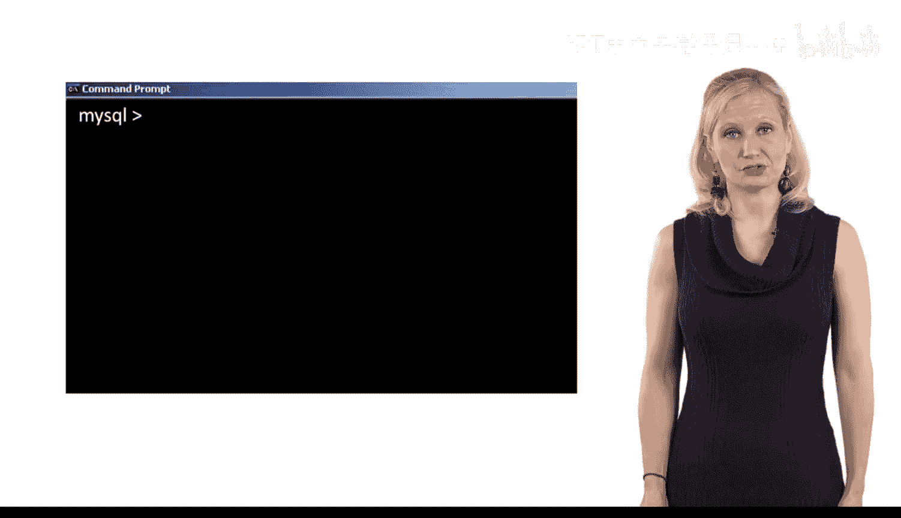
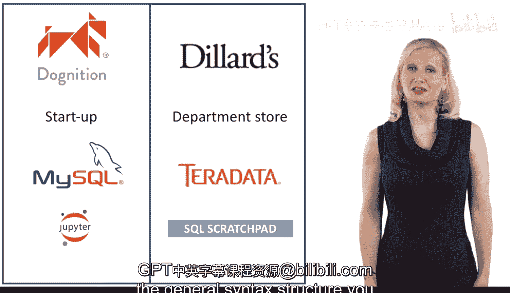

# 杜克大学《Excel 到 MySQL：商业分析（5课全）｜Excel to MySQL： Analytic Techniques for Business》中英 p144 15_03_01_查询语法入门.zh_en -BV1mS421X7yw_p144-

。Some of you taking this course may have never programmed or seen a command line before。

Others of you may have programmed quite a bit， but are used to programming languages where you have to tell a program exactly how to arrive at the outcome you want。

In both of these cases， SQL or structured query language will be a little different than what you are used to。

 so this video is going to orient you to the general structure of how you write an SQL query。

SQL has commands for many different aspects of creating and manipulating a database。

 but since you will rarely be given permission to change store data as a data analyst。

 we will exclusively cover DQL or data query language， part of SQL。

This is the part of the language that allows you to retrieve data from the database in whatever format you want。

Every time you want to retrieve data from a database。

 you will need to write some lines of SQL code that describe the data you desire。

 These lines of code are collectively called a query。

You will have to enter these queries of code into some kind of interface that allows you to communicate with the database。

 These interfaces are often called front end of the database。

 front end interfaces or user interfaces。Front end interfaces vary wildly from company to company and platform to platform。

 Some interfaces give you lots of options will have icons and organizations that are similar to what you are used to when you are using the operating system on your desktop。

Others are nothing more than a black window containing a blinking cursor。

Be prepared to get comfortable with any of these types of interfaces。

 because you never know what you're going to get and what you're going to have to use in your own company。

Despite the fact that interfaces differ， they all have some kind of command line or command window。

 this is where you will actually write SQL queries。

The data retrieve when queries are executed will usually be either provided immediately underneath the command or may appear in a separate part of the screen or a separate window of the interface。

 In most cases， you will have to write some extra commands or at least press some extra buttons in order to turn the data retrieve into text files or formats that can be read into outside programs outside the database。

The queries you write must all conform to SQL syntax。 All queries start with a verb， select。

The word select is followed by clauses that identify the data and database you want to work with。

 and that provide some more details about exactly what data you want and what format you want them in。

You provide these details using six main SQL keywords in a certain order。

 The keywords in their order are select from where group having an order。

Only the first two keywords are required， the rest are optional and only use when you need them。

You usually end your query with a semicolon。 Semicoons aren't always necessary。

 but since they are sometimes required， it's good to get in the habit of always ending your queries with a semicolon。

One thing you might be able to infer from these keywords is that there is nothing in an SQL query that tells a database how to implement a query。

 rather，queries let you describe the data you want。

 and then it's up to the database management system to plan。

 optimize and carry out the physical operations necessary to produce the result of the query。

This property of queries reflects a fundamental characteristic of how relational databases are organized and used。

When you fill out the general keyword structure of a query。

 it will sound a little like you are speaking an abbreviated form of English。

 select the data you want from the database and tables you want where the following conditions are met。

 grouped by this field， having this property， and then order by this field or list。Further。

 similar to writing in English， you can write your entire query on one line and the database management system will still execute it。

In addition， SQL keywords are not case sensitive， so you could even write them all in lowercase so that your query ends up looking a lot like a sentence。

That said， in most SQL interfaces， extra white spaces are usually ignored unless they're within a string of text and case and quotation marks。

 so that's a little different than how we perceive spaces in written English。In addition。

 queries can get pretty complicated and long， so you will often want to save them and have them reviewed by other people。

 thus to make them easier to review， I recommend not writing queries like a single sentence。 Instead。

 write your keywords and capital letters and put each keyword with the clause that follows it on a separate line。

Some front end interfaces will color code keywords for you， but since interfaces vary。

 you can't rely on that to make your queries readable as a consequence。

 writing your queries in multiple lines is good practice and consider it to your coworkers who will review your code。

SQL has other keywords， in addition to the six I already told you about。

 many of these keywords are reserved for functions。

 which are self contained scripts built into the language that execute specific computations for you。

Some examples of functions are sum or count。Functions can be incorporated into your queries and when they are。

 for the same readability reasons I gave you before。

 it's a good idea to write them in uppercase letters as well。

There are some parts of a query that should not always be written uppercase letters， though。

 in particular， table names and column names。Some databases are sensitive to the case of the column in the table names。

 so it's a good habit to write the names exactly as they are stored in the database。

Whenever you need to provide details about how to distinguish ambiguous names in a query。

 you can usually use a period。The period will go between the database and table names or the table and column names to tell the database exactly which table or column you want。

One more things you should know about SQL query syntax is that SQL treats data entries of zero differently and data entries of no value。

If a zero is entered in the database， the database treats the zero as a true measurement rather than a lack of data。

To indicate the data is completely missing， you need to enter the word no。

When data are imported into a database， missing values will usually be turned into null entries rather than zeros。

The general practice I've given you so far of what SQL syntax looks like is the same across relational database systems。

 However， each database system does have its own nuanced differences in specific aspects of the syntax。

 Once you learn SQL in one system， it doesn't take long to learn the syntax in another system。

 The differences will be very small。 That said， expect to be looking up in double checking syntax often。

 Even the best programmers often have to look up how a function works。

 especially when they are working with a new type of database。In this course。

 we are giving you the opportunity to practice writing queries in two different database management systems with two different front end interfaces using two different data sets。

Both of the data sets we will be using have over a million rows of data。

The first data we will be working with is from a startup company called Dognition。

 If you haven't already， you can watch the Meet your Dog mission data video that describes what this very interesting company does and the business problem they would like help solving。

The Dition data is stored in a MySQL database， and we will be interacting with it through a front end interface called Jupiter。

The second data set we'll be working with is from a much larger company called Dillards。

Dillard is a department store chain in the United States。

 and you can watch the Meet Your Dillardge data set video to learn more about the data they donated as well。

The Dillard data set has over 100 million rows， so it will give us a great opportunity to see what it is like to work with data of that very large size。

The Dillards data is stored in a Terraada database。

 and we will be interacting with it through a front and interface called Terraadata Viewpoint Sctpad。

The next two videos will show you how to access both the Jupiter and the scratch point interfaces。

 You will be using these interfaces for the rest of the course to practice putting the general syntax structure you learned about in this video into action。

