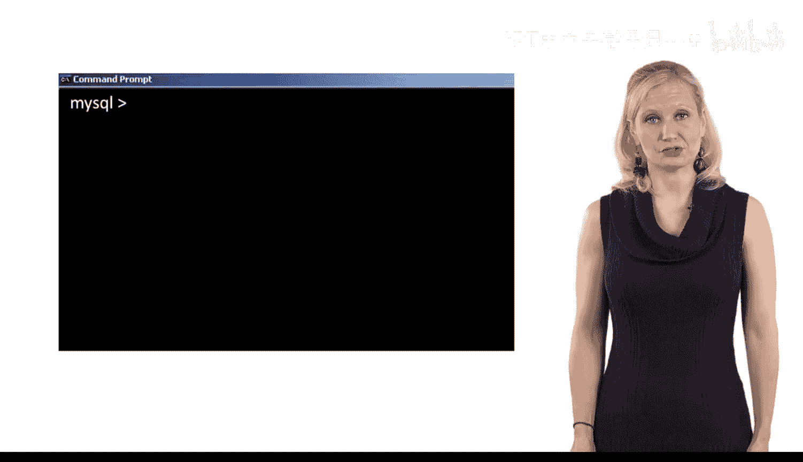
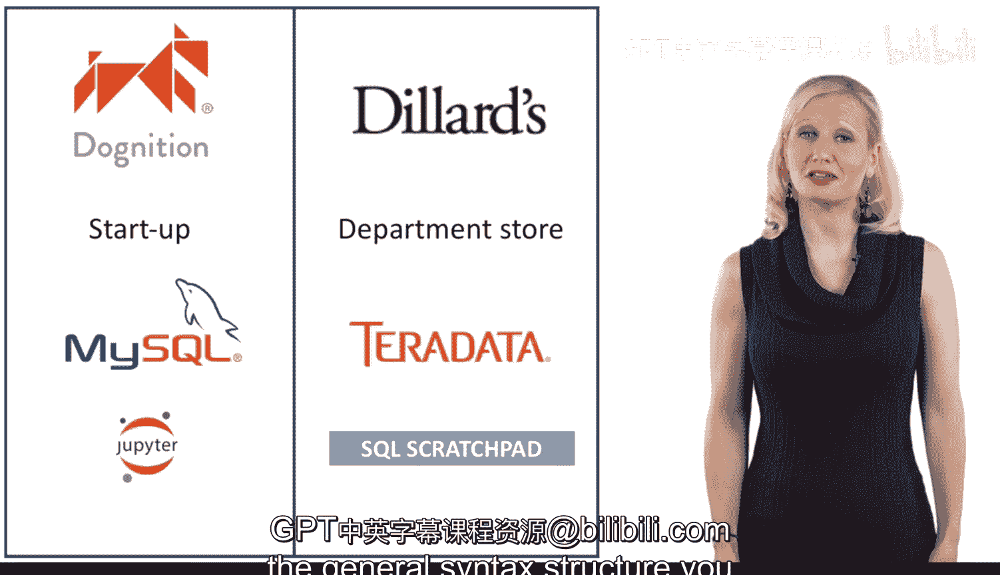

# Excel 到 MySQL：商业分析：1.3：SQL 查询语法入门 🗂️

在本节课中，我们将要学习 SQL（结构化查询语言）的基本语法结构。无论你是否有编程经验，SQL 的声明式特性都与你可能接触过的其他语言有所不同。我们将重点介绍如何编写一个标准的查询来从数据库中检索数据。

---

有些学习本课程的人可能从未编程或见过命令行界面。另一些人可能编程经验丰富，但习惯于那些需要精确指定如何达成目标的编程语言。在这两种情况下，SQL（结构化查询语言）都会与你习惯的方式有所不同。因此，本视频将引导你了解编写 SQL 查询的一般结构。

SQL 包含用于创建和操作数据库的多种命令。但由于作为数据分析师，你很少会被授予更改存储数据的权限，我们将专门介绍 SQL 中的 DQL（数据查询语言）部分。这部分语言允许你以任意格式从数据库中检索数据。

每次你想从数据库检索数据时，都需要编写几行 SQL 代码来描述你所需的数据。这些代码行统称为一个**查询**。你需要将这些查询代码输入到某种能与数据库通信的界面中。这些界面通常被称为数据库的**前端界面**或**用户界面**。

前端界面因公司和平台的不同而有巨大差异。有些界面提供许多选项，其图标和组织方式类似于你在桌面操作系统中所习惯的。另一些则可能只是一个包含闪烁光标的黑色窗口。你需要准备好适应任何类型的界面，因为你永远不知道在实际工作中会遇到并使用什么。

尽管界面各不相同，但它们都有某种**命令行**或**命令窗口**。这就是你实际编写 SQL 查询的地方。查询执行后检索到的数据通常会立即显示在命令下方，也可能出现在屏幕的单独部分或界面的单独窗口中。在大多数情况下，你需要编写额外的命令或至少按一些额外的按钮，才能将检索到的数据转换为文本文件或能在数据库外部程序中读取的格式。

---

## 查询的基本结构

你编写的查询必须全部符合 SQL 语法。所有查询都以一个动词 **SELECT** 开始。

`SELECT` 这个词后面跟着一些子句，用于标识你要处理的数据和数据库，并提供关于你具体需要什么数据以及需要什么格式的更多细节。

你使用六个主要的 SQL 关键字，并按特定顺序来提供这些细节。这些关键字及其顺序是：**SELECT**、**FROM**、**WHERE**、**GROUP BY**、**HAVING**、**ORDER BY**。

只有前两个关键字是必需的，其余的都是可选的，仅在需要时使用。

你通常用一个分号结束查询。分号并非总是必需，但由于有时是必需的，养成始终以分号结束查询的习惯是好的。

从这些关键字中你可能推断出，SQL 查询中没有任何内容告诉数据库如何执行查询。相反，查询让你描述你想要的数据，然后由**数据库管理系统**来规划、优化并执行产生查询结果所需的物理操作。查询的这一特性反映了关系数据库组织和使用方式的一个基本特征。

---

## 编写风格与可读性

当你填写查询的一般关键字结构时，听起来有点像在说一种简略的英语：从你想要的数据库和表中选择你想要的数据，其中满足以下条件，按此字段分组，具有此属性，然后按此字段或列表排序。

此外，类似于用英语写作，你可以将整个查询写在一行上，数据库管理系统仍然会执行它。另外，SQL 关键字不区分大小写，因此你甚至可以用小写字母书写它们，使你的查询看起来很像一个句子。

也就是说，在大多数 SQL 界面中，除非在文本字符串内，否则额外的空白通常会被忽略，大小写和引号的处理也与我们感知书面英语中的空格有所不同。此外，查询可能会变得相当复杂和冗长，因此你经常需要保存它们并让其他人审阅。因此，为了使它们更易于审阅，我建议不要像写单个句子那样编写查询。相反，将你的关键字用大写字母书写，并将每个关键字及其后面的子句放在单独的行上。

一些前端界面会为关键字着色，但由于界面各不相同，你不能依赖这一点来使你的查询可读。因此，将查询写在多行上是良好的实践，也是为你审阅代码的同事考虑。

---

## 函数与命名规范

SQL 除了我已经告诉你的六个关键字外，还有其他关键字。其中许多关键字是为**函数**保留的，这些函数是内置于语言中的自包含脚本，用于为你执行特定的计算。函数的一些例子是 `SUM` 或 `COUNT`。

函数可以合并到你的查询中。出于我之前提到的相同可读性原因，将它们也用大写字母书写是个好主意。

然而，查询的某些部分不应总是用大写字母书写，特别是**表名**和**列名**。有些数据库对列名和表名的大小写敏感，因此按照它们在数据库中存储的确切形式书写名称是一个好习惯。

每当需要在查询中提供如何区分模糊名称的细节时，通常可以使用句点。句点将放在数据库名和表名之间，或表名和列名之间，以确切地告诉数据库你想要哪个表或列。

---

## 零值与空值

关于 SQL 查询语法，你还应该知道的一点是，SQL 对待零值数据条目和空值数据条目的方式不同。如果数据库中输入了零，数据库会将零视为一个真实的测量值，而不是数据的缺失。为了表示数据完全缺失，你需要输入 `NULL`。当数据导入数据库时，缺失值通常会被转换为 `NULL` 条目，而不是零。

---

## 实践环境与数据

到目前为止，我向你介绍的 SQL 语法的一般实践在所有关系数据库系统中都是相同的。然而，每个数据库系统在语法的具体方面确实有其细微的差异。一旦你在一个系统中学会了 SQL，学习另一个系统中的语法并不需要很长时间，差异会非常小。尽管如此，请准备好经常查阅和双重检查语法。即使是最好的程序员也经常需要查阅函数的工作原理，尤其是在处理新型数据库时。

在本课程中，我们将为你提供机会，在两个不同的数据库管理系统、使用两个不同的前端界面和两个不同的数据集来练习编写查询。

我们将使用的两个数据集都有超过一百万行数据。

我们将要处理的第一个数据来自一家名为 **Dognition** 的初创公司。如果你还没有看过，可以观看“认识你的 Dognition 数据”视频，了解这家非常有趣的公司做什么以及他们希望帮助解决的业务问题。Dognition 数据存储在 **MySQL** 数据库中，我们将通过一个名为 **Jupyter** 的前端界面与之交互。

我们将要处理的第二个数据集来自一家规模大得多的公司，名为 **Dillard‘s**。Dillard‘s 是美国的一家百货连锁店，你也可以观看“认识你的 Dillard’s 数据集”视频以了解更多关于他们捐赠的数据。Dillard‘s 数据集有超过 1 亿行，这将为我们提供一个绝佳的机会，体验处理如此大规模数据的感觉。Dillard’s 数据存储在 **Teradata** 数据库中，我们将通过一个名为 **Teradata Viewpoint SQL Assistant** 的前端界面与之交互。

接下来的两个视频将向你展示如何访问 Jupyter 和 SQL Assistant 界面。在本课程的其余部分，你将使用这些界面来练习将本视频中学到的一般语法结构付诸实践。

---

本节课中我们一起学习了 SQL 查询的基本语法结构，包括必需和可选的关键字顺序、编写风格的最佳实践、函数的使用、命名规范、零值与空值的区别，以及我们将要用于练习的两个不同数据库环境。掌握这些基础是有效进行数据检索和分析的第一步。