# 杜克大学《Excel 到 MySQL：商业分析（5课全）｜Excel to MySQL： Analytic Techniques for Business》中英 p145 16_03_02_Jupyter Notebook使用指南.zh_en -BV1mS421X7yw_p145-

Hi， guys。 In the last video， you got an introduction about how to write SQL queries And the next two videos。

 I'm going to give you a tour of Jupiter。😊，Jupiter is the front end interface we are using this course to interact with our Dogniition dataset。

 which is kept in a my S Q L database。 I told you that there are many different types of front end interfaces you might encounter in your career。

 Despite all these options。 Jupiter is really unique。 It was written explicitly for collaboration。

 which also happens to make it very useful for education。😊。

What Jupiter does is it allows me a way to write in text an explanation for every query that you try and help you understand the logic behind each query。

 And then you can read that text at your own pace and try at different parts of the query right in the same place and look at the examples at the same time。

 So I think you'll find us a very useful way to get comfortable with S QL syntax。 Of course。

 when you're in a company， you're not going to be able to have me there。

 And you won't be able to have my examples right next to you。

 or at least not in the exact same places as you're writing at queries。

 So what I suggest you do is you use these Jupiter MysQL exercises to get really comfortable with the syntax。

 Then once you're ready to be independent at the end of a week。

 Then you move to theterraadata exercises。😊，The Terraadata interface that we're using this course is very similar to what you would use in a company。

 and in fact， you might end up using the exact same interface in some companies。

 but it does require you to be independent。 You'll have to write your queries from scratch and you won't have examples there。

 So again， what I suggest you do is start with My SQL and the Jupiter interface then move to Terraadata when you're ready to try things on your own。

I'll show you in a later video how to use the Terraadata interface。

 but in the next two videos we're going to focus on Jupiter， and in this video in particular。

 we're going to focus on how to work with a notebook within Jupiter。So to get started。

 what I want you to do is I want you to click on one of the links in the course website that goes directly to a notebook。

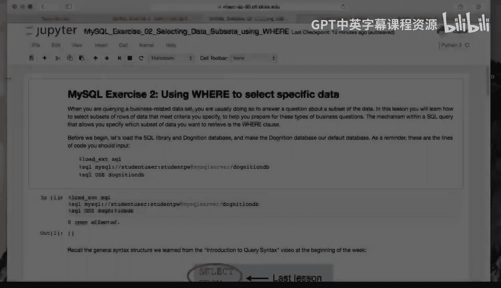

So when you go to one of those links， it's going to bring you to a page。That looks like this。

When you go to this page， go ahead and press Open Tool。And when you press that。

 it's going to bring up something that looks like this。 Now。

 each one of these lessons is contained in what we call a notebook。

 and you can see immediately that the notebooks has quite a lot of text。 And if I scroll down。

You'll see there are also lots of these places for you to write code。Here's another one。

So the way to use these notebooks or to go through these lessons is to read the text and then follow the instructions and the questions about what to write in these areas where you can write code。

Now to give you just to let you know， each one of these areas is called a cell in Jupiter and I tell you that because I'm going to show you in a little bit what you can do with some of these menu options and one of the menu options is called cell so that this menu option is for each one of these areas where you write code。

So to give you an idea of what it will look like when you actually use one of these code cells。

What you're going to do is you're going to write your query and you're going to enter it'll look like this and to the left you're going to see these the word in with some open brackets。

 this is what it looks like before you run your query when you're ready to run your query you're going to press this button up here which is the arrow and you'll see when you hover over it says runse。

When I press this， you're going to see an asterisk or a little star that appears in between these these parentheses。

 the star is present and there as long as the query is running。

 so if you're running a really long query that takes the database a long time to do that star will be there until the output is ready。

This particular query is going to happen pretty quickly， so when I run this。

 you're going to see the star quickly and then right underneath it you're going to see the output so let's see what that looks like。

 you see the star and now the output。Now' when you run a query that has a lot of output。

 I want to show you a couple of different things， this particular query outputted over 16，000 rows。

 however， we've implemented some safeguards in these Jupiter interfaces so that you are less likely to crash the system。

I told you earlier that we have specifically designed the course so that you are each in groups of about 150 students。

 we want you to practice thinking about your colleagues and so when you write queries that take a really long time or that take a lot of resources。

 it impacts your colleagues in this course too when you run release on long queries or when you take a lot of resources。

 it will affect everyone else in your group of 150。

It is possible to crash the system for your group of 150。

 but we are giving you some safeguards to at least make that less likely。

 So one of the things we've done here is that even though the output has over 16000 rows。

 if you scroll down all the way to the bottom of this output。

 you'll see that it says truncated to display limit of 1000 we've set this up explicitly so that you only get1000 rows at a time in your output。

 Now I'm wanted to show you one more thing， if you had lots of different columns in your output。

 you would also see a bar down here， a scroll bar down here that lets you scroll left and right。

 I know when I was first working with Jupiter， it took me a while to find that scroll bar so make sure you remember that for the future。

But otherwise， this is what a output look like， and you can see that it says in up here and out down here。

 so this is always where the output is。A lot of the queries that we run in these exercises are going to output tables that have a lot of rows in them and because there are that many rows。

 it takes a lot of juice for Jupiter and the system to keep those tables around so if you don't need the output if you're not going to learn from it or if you're not going to compare it to other things you're doing。

 it's a good idea to delete that output so that Jupiter doesn't have to keep it online to do that。

Click on your output， go up to the cell menu that I pointed out before。

 go to current output and click on Clear。And you can see that now the output from this code cell is no longer there。

But I did want to show you one more thing in the cell menu that you might be useful to you。

 let's go ahead and run the query again。And now click on the output and now when you go to first let me point out to you so you can see that we can scroll through the output like I showed you before。

 but now go to cell。Go on current output and click on toggle scrolling。

You can see now the output no longer has a scroll bar and it has the entire list。

 so if you prefer that option， if you prefer seeing your output that way， you are welcome to do so。

 but we've made the default to have scrolling because it takes less space。

The next thing I want to show you is what to do if you start a query that takes a lot of time to run and you decide you don't want to run it anymore。

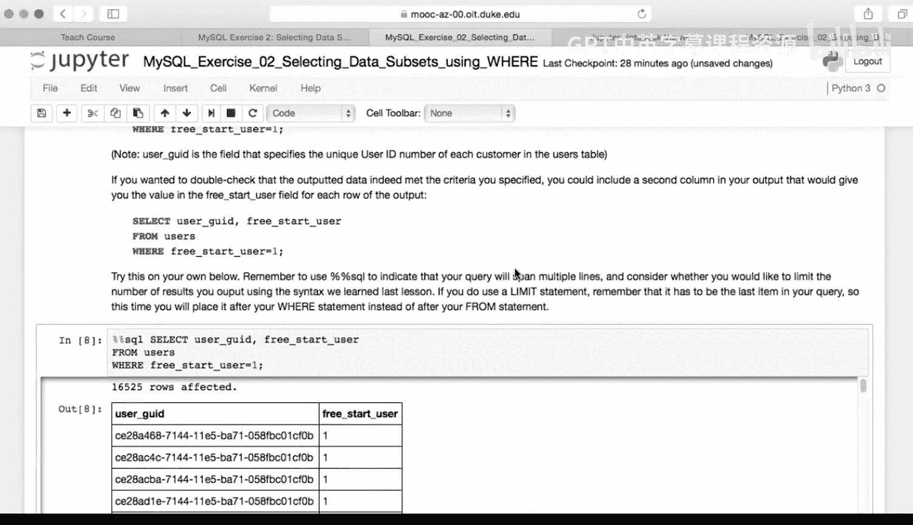

To do that， you can go up to this button。You hover over， it'll say interrupt kernel。

 This is the button。 This is basically a stop button。

 And so if you are running a query and it seems to be going forever and you decide you know what。

 I really don't need to know the answer to this。 and you're worried about say perhaps crashing the system for the rest of your group go ahead and click on the query running and press stop And you saw it said interrupt kernel。

 So the other way you could do that is you could go to this kernel drop down and you could click on interrupt。

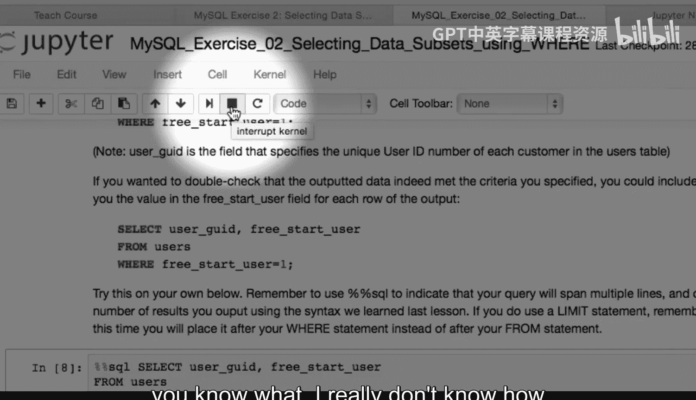

When you do stop a query， it can sometimes take a little while to stop。

 so you do have to be a little patient， it will then output an error message or tell you that the kernel was interrupted and then you can start all over again and either clear your output or add a new cell。

So speaking of a new cell。You've pretty much seen everything you have to know to be able to use these notebooks。

 but they actually have a lot more capability than what I just showed you。

And there's no way for us to configure these notebooks so that it's impossible for you to edit them so that's a plus in that it will show you how you can use this as ways to take notes and as ways to share things with each other。

 but it also means it's possible for you to edit these notebooks even what it might not be to your benefit to do so so let me show you the good parts first imagine that you wanted to take some notes about this query。

Each one of these areas that has code in it is called a cell， but so are these areas that have text。

 so if I click on this text you can see there's kind of a box here that surrounds the text。

So this is actually a cell as well， and any cell that has text in it is written in what's called markdown language。

 so it's a very simple language that is used in all lot of different programs。

 especially on the web to format text。So what you can do is you can actually。Include your own cell。

 you can insert a cell yourself that has notes in it， so if you go to insert。

 you can say insert cell above or below we say insert cell above you'll see that it put in this cell for you Now you do have to tell it what kind of input you want to put into that cell So if I'm clicking on the cell and now I go up here and I see that it says code What that means is that this cell like this one I click on this you'll see it still says code is configured to be able to actually write and execute。

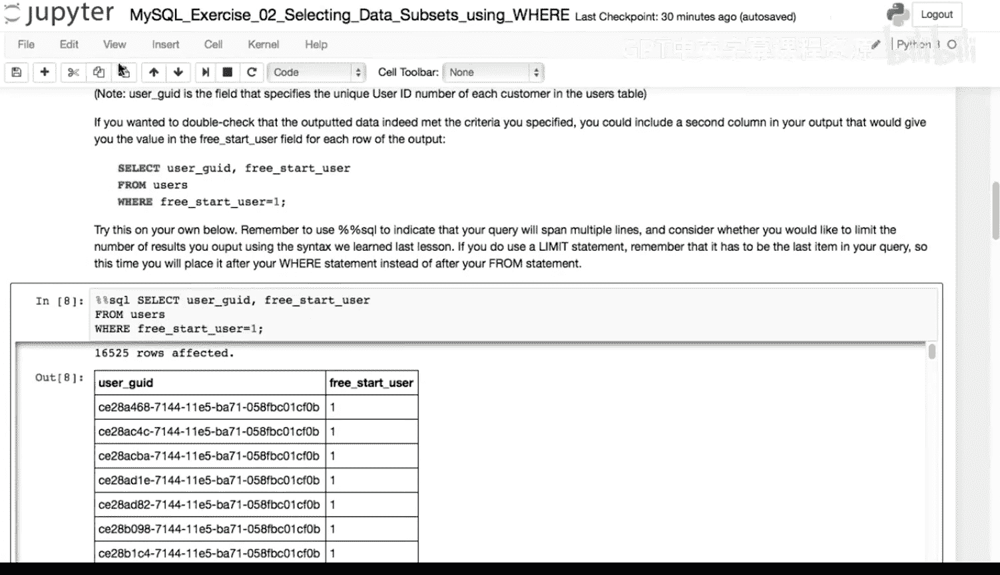

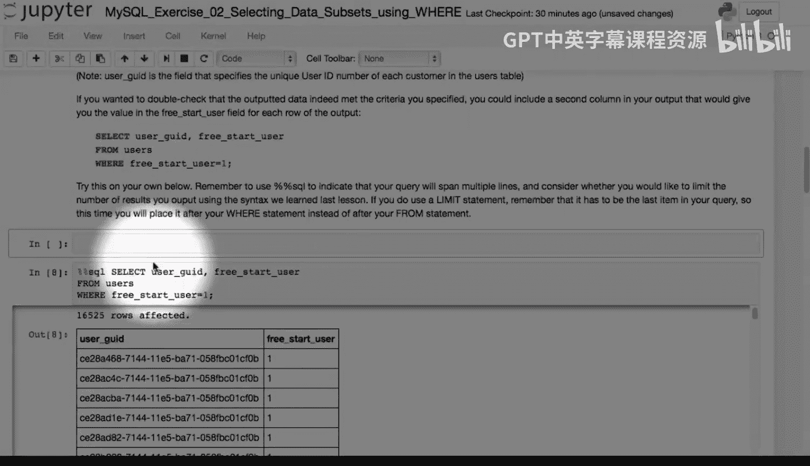

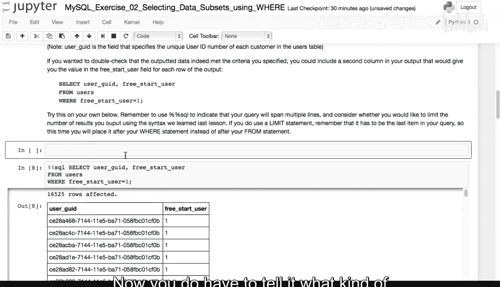

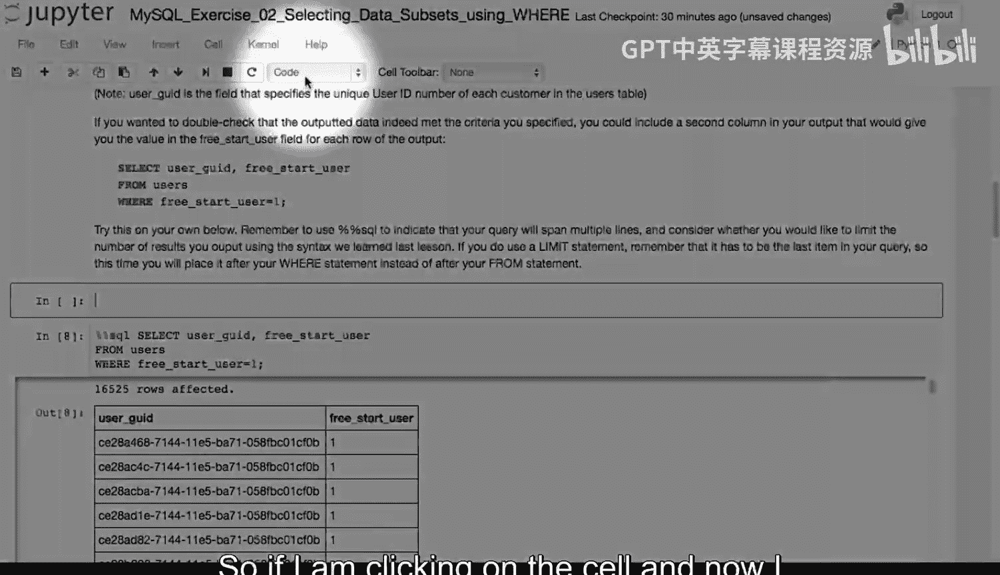

Querries。This cell， on the other hand， when I click on it， you see it says markdown。

 So if I wanted to put my own notes into this cell， I would need to go up to this menu。

And press Markdown， and now I can type in whatever text I want。And I will have this for later。

You do want you don't have to run it， but if you want to make it look formatted just like you do up appear here。

 then you actually will run the cell so I'm clicking on the cell and I'm pressing run again and now you can see that it's formatted the same way this is。

So there are a lot of tricks you can do to format your markdown cells I'll show you in a little bit where you can go to find out more about that because it's not a major part of this course。

 I don't want to go over the details， but I am going to show you resources where you can find all the information you need to know about how to use Markdown if you decide you want to。

So once you've made cells， you can move them around。

 you can either use these buttons here to move a cell up。

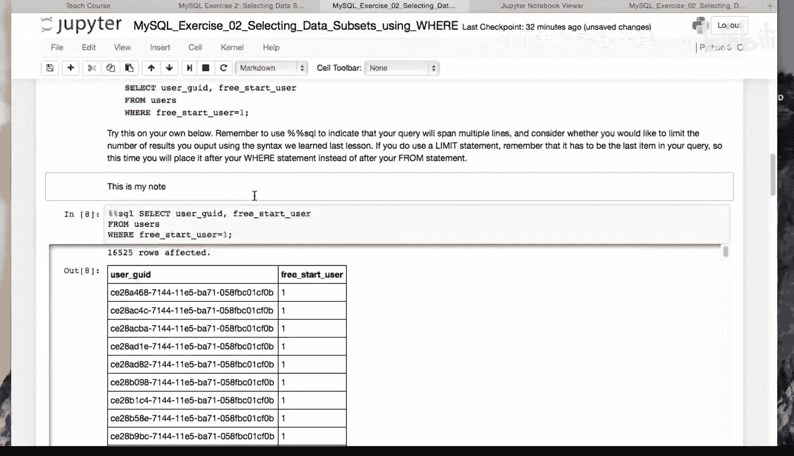

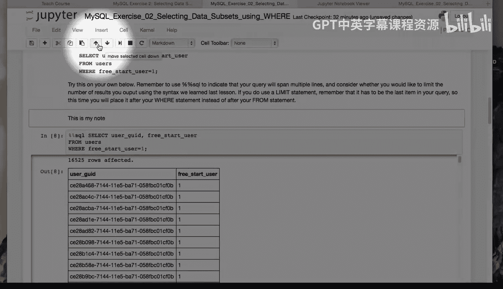

We're down。Or you can use this drop down menu and you can say I'm going to cut a cell。

And then you can go to someplace else in your notebook。And paste it there。

 so you can say paste cell above below paste in place all of these options。

 Feel free to play around with them。 And this will give you a nice way to be able to take notes that you can save for later。

 Now the downside of this， of course， is that even if you don't want to take notes。

 it's very easy to mess around with these text cells I made for you by accident。

 So if you're clicking around and you double click on one of these text cells。

 That's how you start editing one of these markdown cells。

 you'll see it suddenly starts to look like this。 It'll look a little weird。

 this is the text written in markdown language。 And so if this happens to you， don't worry。

 don't panic， all you need to do is press the run button and then I'll go back again to looking like normal。

 So just to show you that one more time。 if by accident。

 you click on one of the text cells and you double click。

This gives you an opportunity to edit the text cell， so if you don't want to do that。

 press the run button again and it will look like it did when you first received the notebook。

As you are interacting with the notebook， Jupiter will automatically be saving changes。

But you can also save them yourself， so if you go to file and you go to save and checkpoint that will。

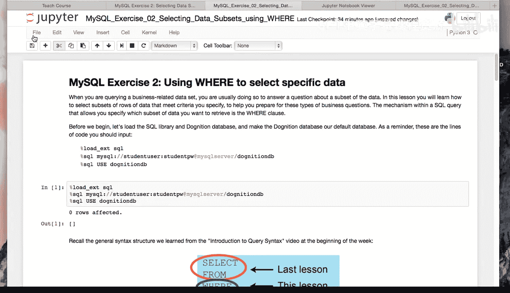

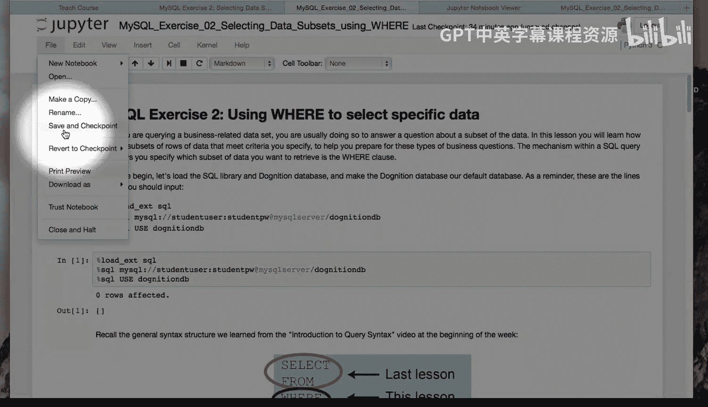

Save the workbook as you made it and it will also make what is called a checkpoint Now checkpoints are a specific point in time and what Jupyter does is it saves exactly how the notebook looks at that time What that allows you to do is if you start playing around and then mess things up or don't like what you've done you can go up to file。

And you can go to revert to checkpoint and it will give you a list of the different checkpoints you've made and you can choose any one of them。

To go back to where you were before and it will give you this option so you can choose to either revert or not as it tells you if you do revert。

 it can't be undone， so make sure if you do go back to a checkpoint you know you want to do so so we'll press cancel。

Now before I show you what the next set of things about Jupiter。

 there's a very important aspect of this interface that you should know about and that is the help。

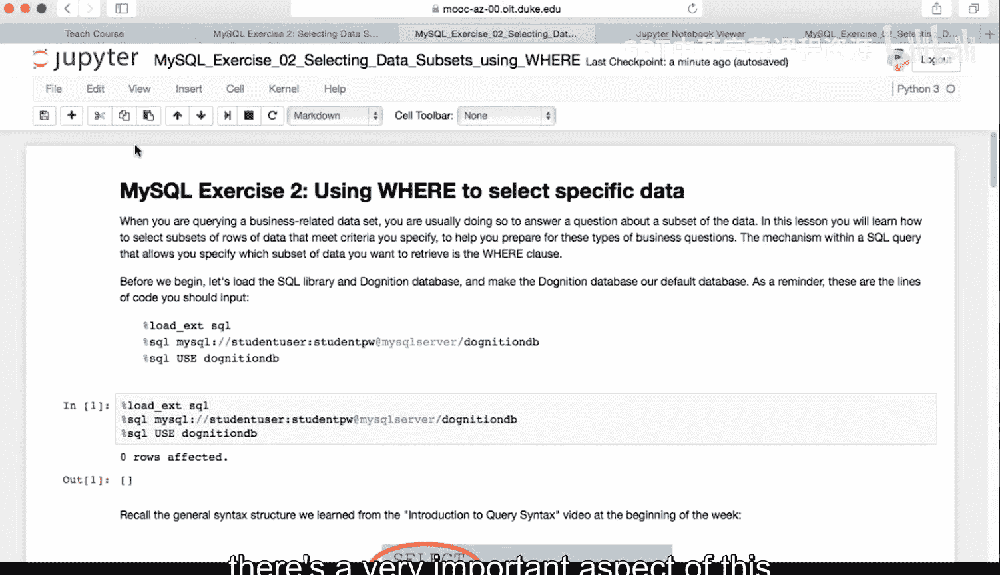

Jupiter has a great help resource two different things that you should focus on in particular。

 but feel free to look around any of these things Actually there are three things you should know first of all。

 there's an interface tour that I think you'll find very useful so I suggest you take a look at that。

 but you can also look at either this notebook help or this markdown documentation both of which are very。

 very useful so if we click on say markdown help。😊。

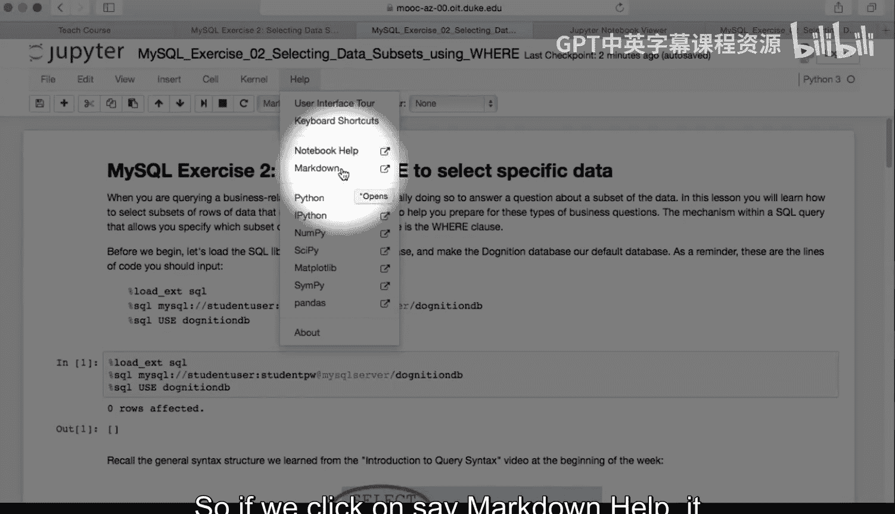

It will bring you to this web page where it gives you all kinds of instructions about how to use Markdown。

 so this is where you should go if you want to start playing around with how you edit yourselves。

Another thing that's very useful。Is the notebook help？

And this gives you all kinds of sections that tell you all about how to run code， the basics。

 really if you have any questions， this is where you should go。

 this is the best place to find out any of your answers。

The last thing I want to show you before we go to our home menu is how to save your notebooks or print or export them so that you can look at them in another way or so that you can share them with each other and to do that go to fileile and click there are a couple different options for you so you can either download your notebook as an iPython notebook and I'll show you later how you can upload these into your home directory This provides a way for you you guys in the course to interact with each other and just share queries with each other and share what you're learning so that you can actually you can write your own text like here and show each other what queries are having and then you can help each other out。

Another thing you can do is you can save your notebook as a PDF so one way to do that is to go to the download part of the menu and click on PDF via latex。

 but this is actually not my favorite way to do it because sometimes the latex formatting is very spread out and can take a lot of pages so my preferred way to do it is to go to print preview which will give you something that looks like this and this will be much more compact and will give you fewer pages in your printout so once you get this you can go to file and print and this next screen will look different on everybody's computer because everyone will have a different configuration and you might have a Mac or PC and so this will look a little different but there should always be some option to be able to print to a PDF so that will let you save a file for later so that you can look at your queries or your notes or we let you print them out so that you can look at them while you are studying。

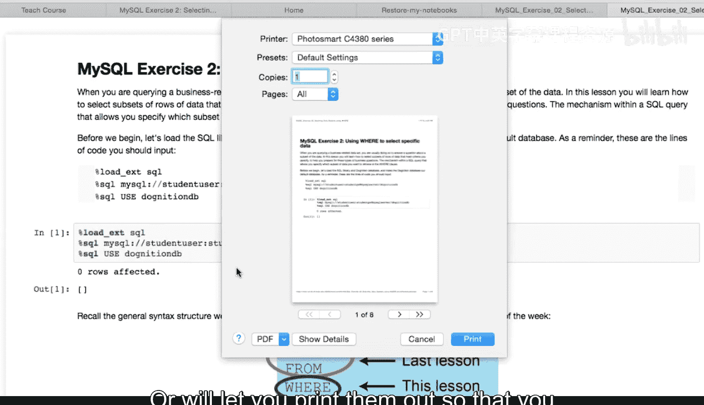

Nice work。 You now know how to use a Jupiter notebook In the next video。

 I'm going to show you how you can use the home page of your Jupiter account to make new notebooks。

 rename notebooks and share notebooks with one another。 I'll see you in the next video。

