# 杜克大学《Excel 到 MySQL：商业分析（5课全）｜Excel to MySQL： Analytic Techniques for Business》中英 p146 17_03_03_个人Jupyter账户操作教程.zh_en -BV1mS421X7yw_p146-

。Hey， guys， welcome back In this video， we're going to go over how to use the homep page for Jupiter account to make new notebooks。

 rename them， reorganize them and share them with one another。 To get started。

 I want you to go back to exactly where we left off after the last video。😊。

So if we go back to our notebook here。This is the interface for our exercisese2 notebook。

 but if you want to go back to your home directory where all the notebooks are held。

 click on the Jupiter icon right here。When I click this， it brings me to this page。

 which is my home directory and you'll see all of the notebooks for the course are listed here。

 all 12 of them， and there's also an option here， a notebook called Restore my notebook which I'll explain in a little bit。

So in this interface， if you click on the box next to one of these notebooks。

 you'll see that you have a couple of different options， you can duplicate it。

 you can shut it down and you can also get rid of it if you wanted to， which I don't suggest doing。

 but you could if you wanted to。

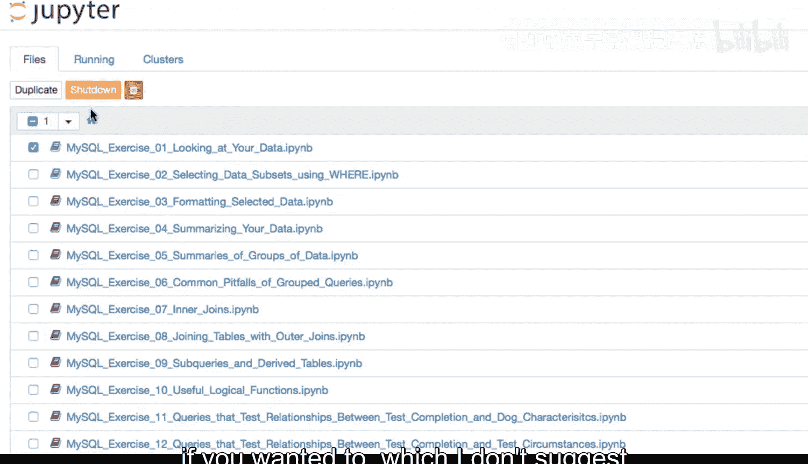

So if you press duplicate。

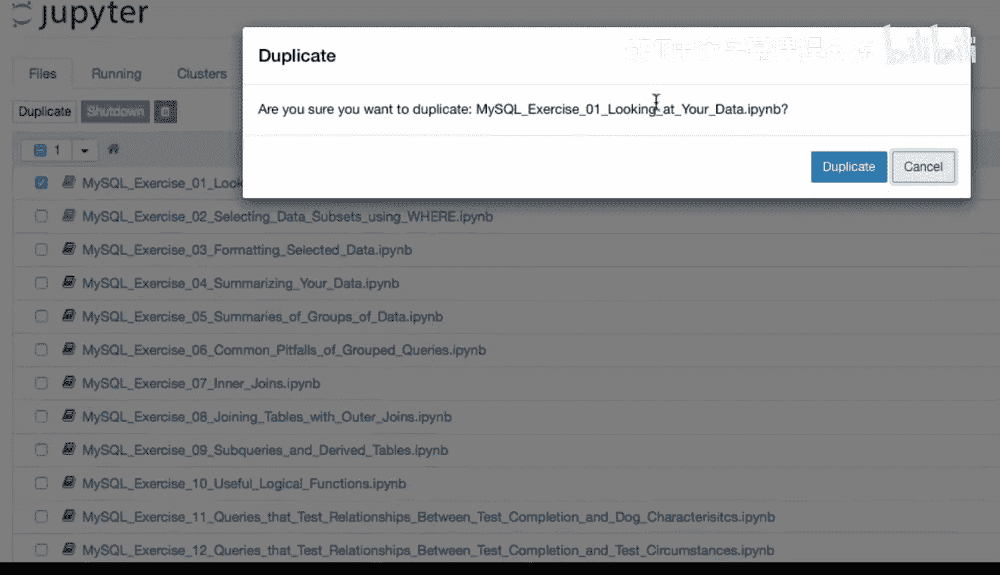

It'll ask you if you really want to do that。And you'll see that it made a copy here。

Then you could get rid of that copy。

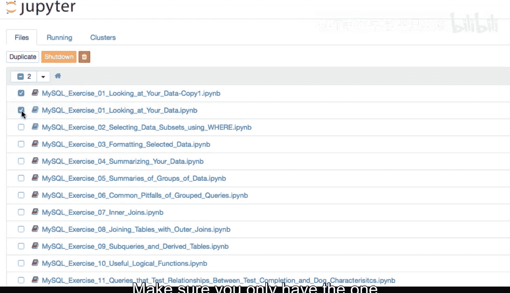

Make sure you only have the one you actually want to get rid of here。And then naked could press。

This littleum。

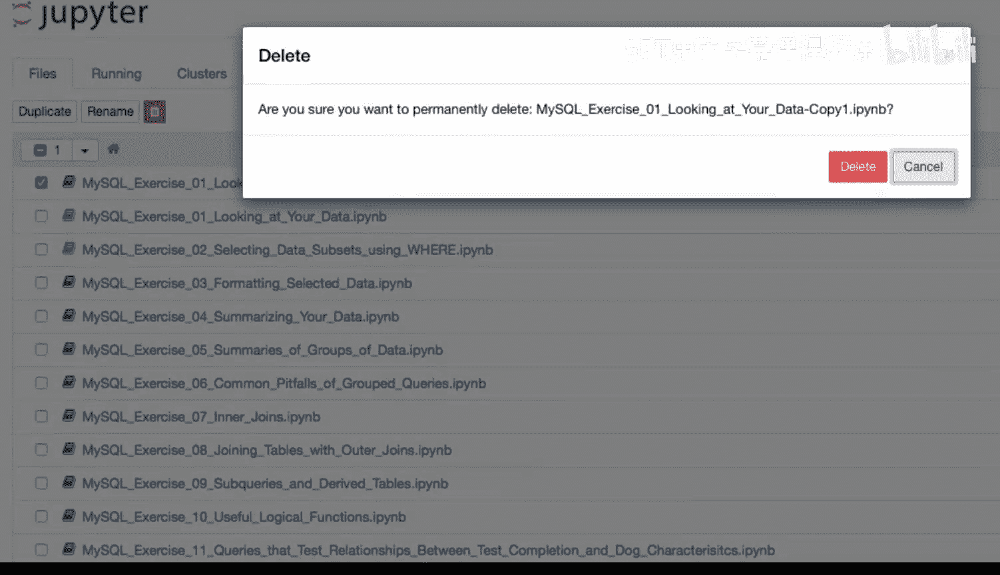

This button here and press delete。Now you'll see that these two notebooks and this notebook are green or have a green note next to them and also have the word running next to them。

If you click on this runningning tab， it will list for you all of the notebooks that you currently have open。

 so I opened some of these notebooks before I started giving you this demo and so all of them are currently open。

It's a good idea for you and for the rest of your group of about 150 students and also for our resources here at Duke for you to shut down your notebooks when you're not using them it will save everything you've done so even if you don't clear the output it'll save the output and if you've cleared the output it it will still save the queries you wrote and save any of the cells you wrote so all you're doing when you're pressing shutdown is helping to preserve resources you're not going to lose any of the work。

So we'd really appreciate it if when you're not using your notebooks。

 you shut them down in between so the easiest way to do that is to go to this running tab and press。

Shut down， but I'll show you， you can also do it on the files tab。 So if I wanted to close this one。

 I can click。This this check mark box， and I can say shut down here as well。

And now you can see it's no longer running。

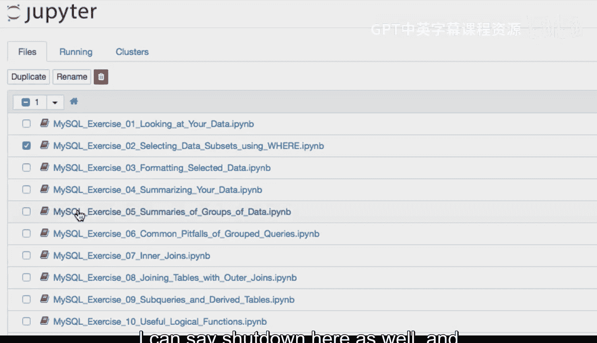

Another part of the screen that you might find useful is over here and thats you can actually create your own notebooks so if you wanted to take some notes you wanted to try some new things and you want to do it in a completely separate notebooks notebook then the ones we've provided you could go over to here to New and you could either create a text file if you wanted to keep Note that way or you can create your own notebook if you are going to create a new notebook choose the Python3 option。

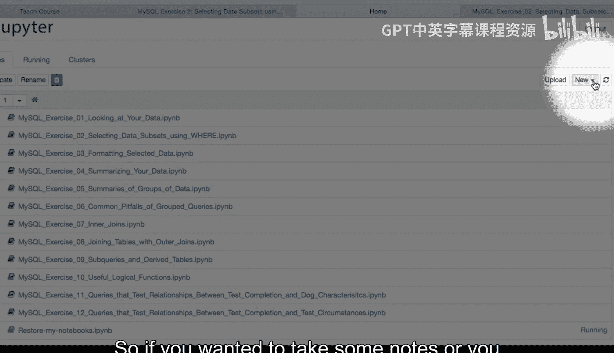

So let's go ahead and create a new one。

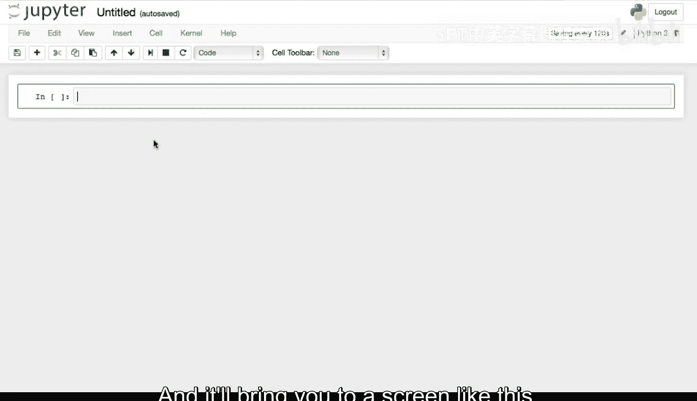

And it'll bring you to a screen like this， you can change the title up here。

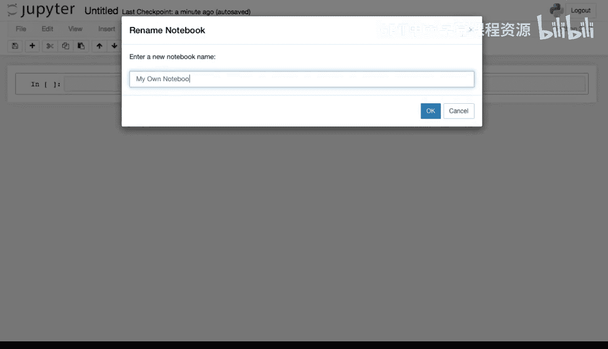

And you can add new cells as。As you like， and again。

 you would want to change this to markdown or code as you see appropriate。

Let's go back to our home screen。And let's go ahead and close down this new notebook we just ran。

Or we just made。Yeah。The other thing I'd like to show you is this button here。

 which is the upload button。 So this is how you guys can share your Jupyy notebooks with each other。

 So if you click on upload。

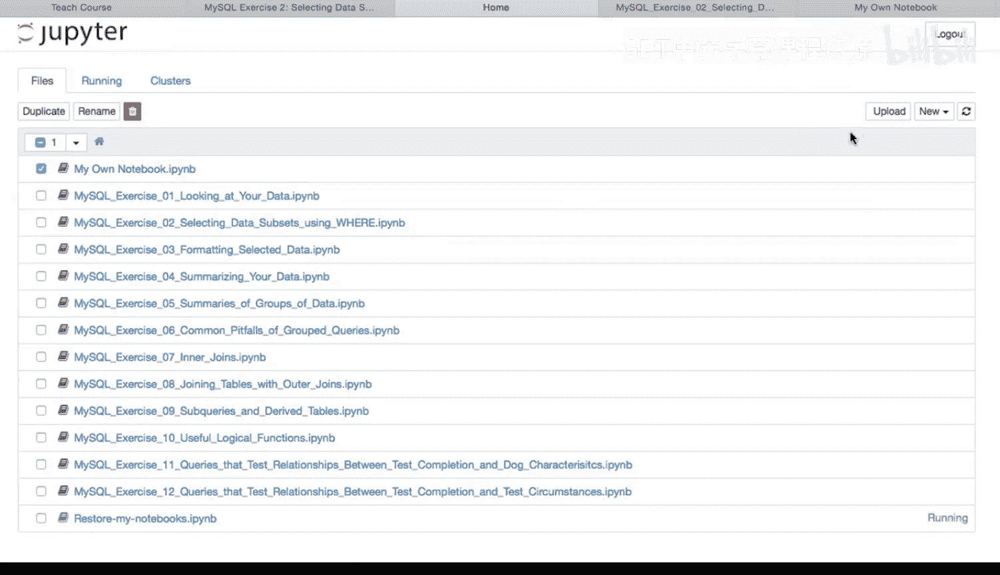

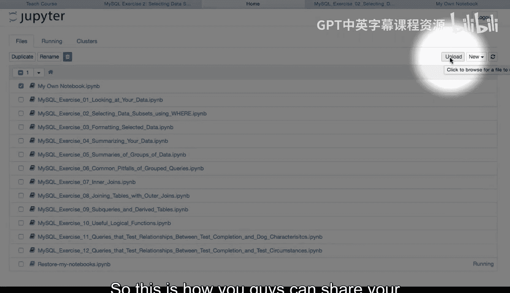

It will give you a navigation screen and you can navigate to wherever you've saved notebooks and once you find one you can press choose and it will bring it right into your home screen here so this that will provide a great way for you guys to work together。

The last thing I want to show you is this restorestore my notebooks notebook。

 We've provided this because if you start playing around too much with your notebooks。

 it is possible that you can get yourself into a situation where you've just added so many different things or you've or somehow you've gotten into a place where your queries won't stop running and everything seems to be crashing。

 you can restore all of your notebooks again， as if you are just starting for the first time。

 However， if you do that， it will restore all of your notebooks， not just one of them。

 So if you click on restore my notebook。It's actually going to bring you to a new notebook and you'll see the instructions here。

What you're going to do is if you want to use this， you're going to run this line of code here。

 so you would run this cell and then you would run it by pressing this button。

 but as it says here if you want to do this， if you want to save any of your work from the previous notebooks you were using。

 you have to rename the notebooks， otherwise they're going to get overwritten。

 so make sure you know how to do that。You can do that using the Rename button here。

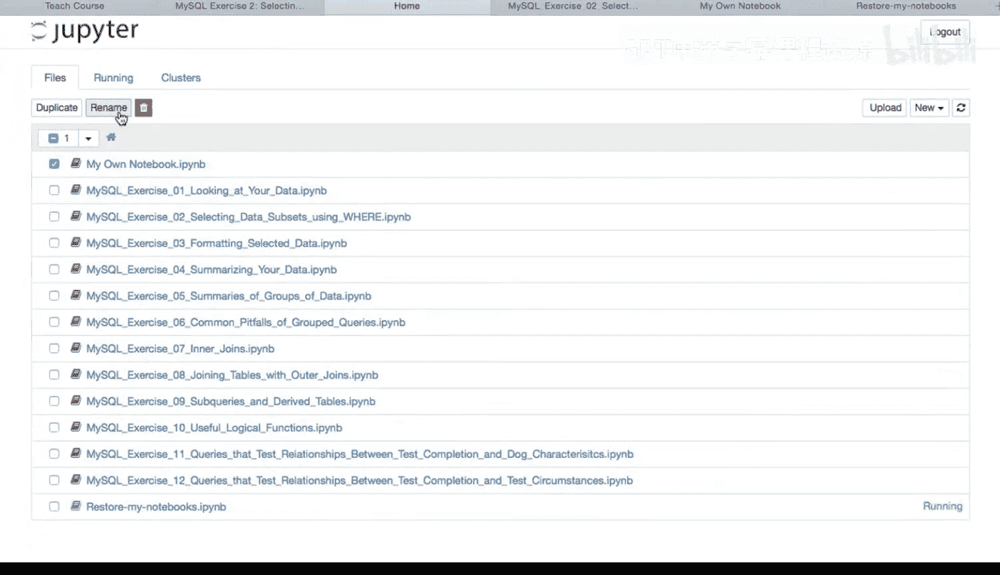

And it would look like that。Another thing that might be useful to you if you do start making a lot of your own notebooks is that you can make folders within your home directory here this functionality is a little bit cumbersome if you're not used to coding。

 but I'll show you just in case it would be useful to you so if you go to new you can click on folder。

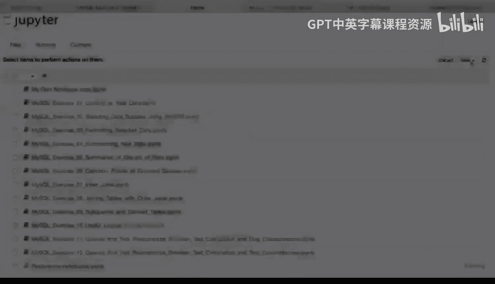

And it'll make a folder here， you can then click to the left， click on rename。

 call it something different。

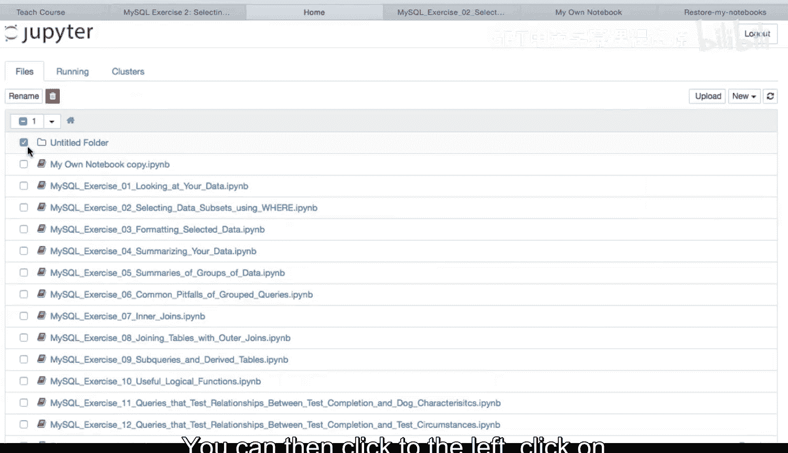

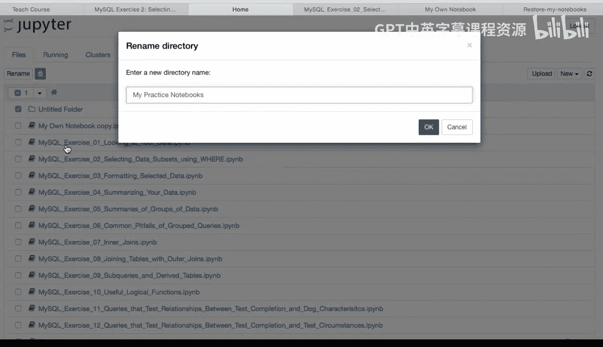

But then if you wanted to put any of these notebooks into a folder， it's a little bit cumbersome。

Click on Rename my goal is going to be to put this notebook into my practice notebooks。

Click on Rename。And now what you have to do is you have to type in the name of the folder before the name of。

 of your notebook。 So my。Practice， notebook bookss， and then put a back slash。Press OK。

 you'll see that my new notebook is no longer there， if I press on this folder。

 there's my new notebook。To get back to the home screen。

 press this little house button and that brings you back to your home screen。

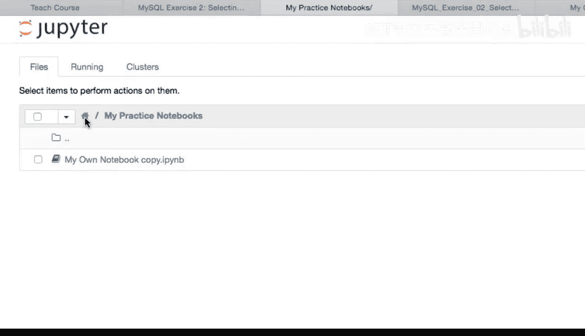

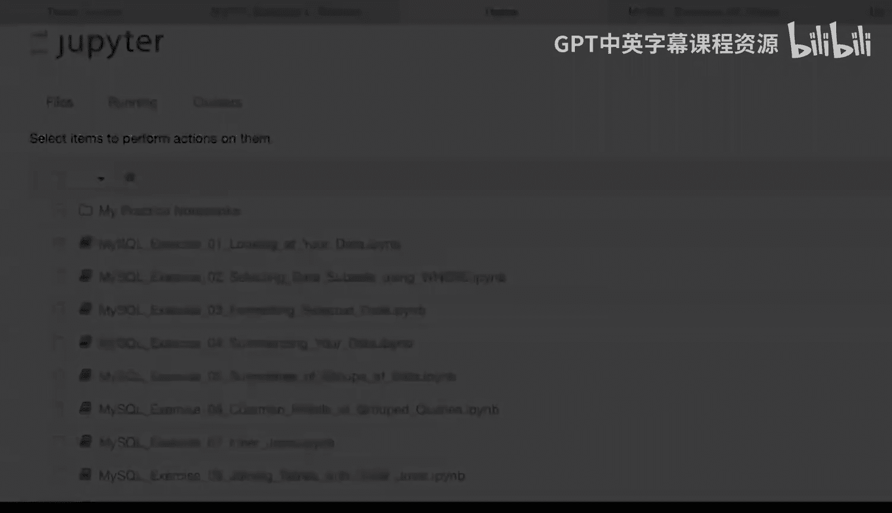

The last thing you need to know is if you do decide to rename these original notebooks that we've provided for you with the course。

 you will not be able to access them directly from the link in the Coursera courseurse website you'll have to go so there are two different types of links in the Coursera website。

 there's a link that allows you to go to a specific lesson or a specific notebook and there's also a link that lets you go to your homepage。

The link that goes to a specific lesson will no longer work if you change the name of that lesson。

 but you can still go to the link that goes to your homepage。

 so make sure you remember that if you do decide to rename these lessons for some reason。

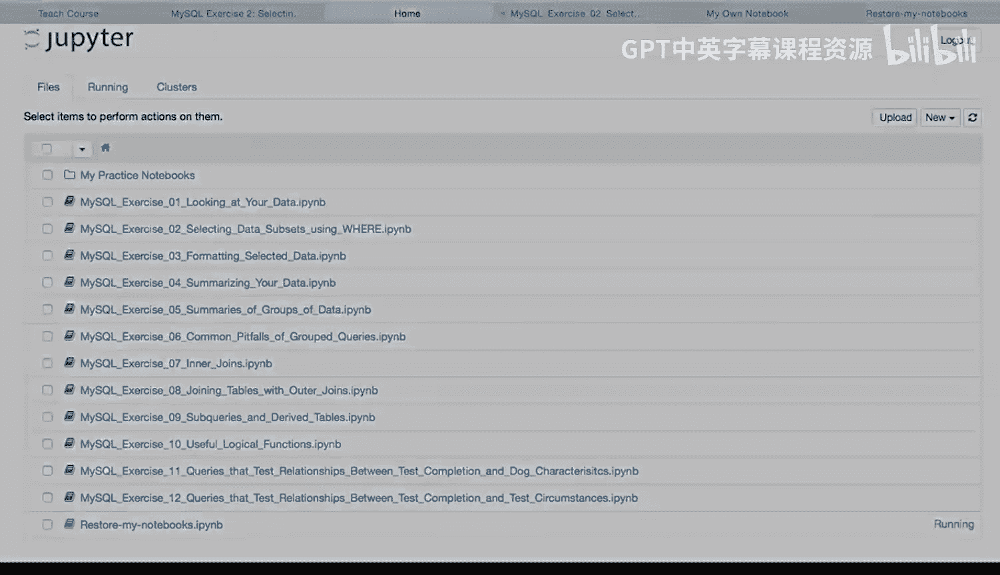

Well done。 You now know everything you need to know about how to use Jupiter for this course。

 The next step is to go to the course materials and click on the link to my SQl Ex1。

 looking at your data。I'll see you in the next video when you're ready to learn how to use Terraadata。

 Good luck， and have fun。😊。