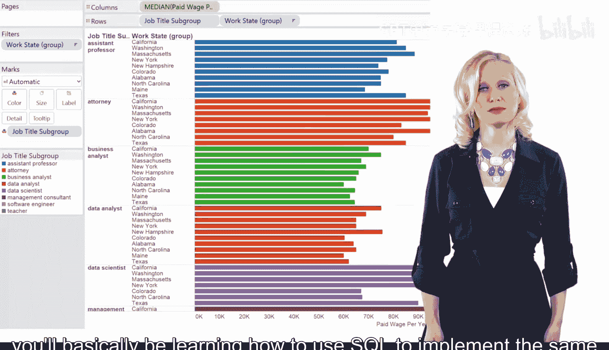

# 杜克大学《Excel 到 MySQL：商业分析（5课全）｜Excel to MySQL： Analytic Techniques for Business》中英 p148 19_04_01_欢迎进入第三周学习.zh_en -BV1mS421X7yw_p148-

Yeah。Last week， you gained a significant advantage over analysts who don't know how to interact with databases。

 you gained the ability to locate and describe all the data in a database and how to export the data for analysis。

This week， we are going to take your skills to the next level。

 You are going to learn how to summarize values across entire columns and break those summaries up。

 according to values and columns。 You are also going to learn how to combine information from multiple tables。

😊，What you learned to do this week will form the foundation of everything you do as a data analyst。

 because these are the query tools that will allow you to manipulate your data into whatever categories or segments you are interested in。

For those of you who took the Tableau course prior to this。

 you will basically be learning how to use SQL to implement the same calculations you implement when you drag variables onto the columns in bro south of Tableau。

There are many ways to summarize data。 Some of the most common methods are to count the number of observations。

 add together all the values in a set of rows， take the average of all the values in a set of rows。

 or report the maximum value of a set of rows。Each of these summary methods aggregate your data in some fashion。

 and parallel with that， the terms count， sum， average and max are all called aggregation functions in SQL。

Aggregation functions themselves are very intuitive to understand。

 because we are used to making those types of calculations。

This week you will practice one of the slightly more challenging use cases of aggregation functions。

 which is when you have to combine columns that have to be aggregated in different ways。

One of the reasons this use case can be challenging is because you have to remember to use the appropriate aggregation function for every column you want to include in your output。

For example， imagine that you run a specialty camera store and you are interested in how many sales each of your employees make and how satisfied customers are with each of your employees' service。

The data you have to address these questions when the appropriate tables are combined has one column for employee name。

 one column for every sale made， and one column for the satisfaction reading customers gave at the end of every sale an employee made。

To aggregate the data in these columns according to employee。

 you have to separate all the rows associated with the given employee and then summarize the values in each of the other columns in some fashion。

To do that in an SQO query， you have to tell the database exactly what columns of data you are interested in from exactly what table or tables using the select and from clauses you learned last week。

Then， in addition， you have to tell the database how to break up the rows by employee using a group by statement。

The important thing to remember is that you have to explicitly tell the database how to summarize the rows of each of the columns separately。

 and you have to use the correct aggregation function for each column here， for example。

 we want to count or sum all the values in the sales column for each employee。

 but we want to average all the values in the customer rating column。

We have to enter those functions separately and in the appropriate place。

Remember that doing an analysis using SQL or Tableau for that matter is a little different than doing analyses in Excel because all of your SQL results are exported as a table。

 not a worksheet， and therefore they have to fit into a table format。Practically。

 that means every row in your table has to use the same aggregation level。

 it's not always intuitive how to do that， especially when you want to divide your results up according to different groups。

To get a feeling for this， imagine you are still interested in your employee's sale numbers and customer satisfaction readings。

 but now you also want to know if and how the gender of your employees relates to those performance measures。

Your data have the same columns as before， but now also have a gender column。

When you group your rows by employee number， you can still count the number of entries in the sales column and average the customer ratings and the ratings column。

But what would you do to summarize the gender information in the gender column so that there is only one gender value per employee？

There is no appropriate aggregation function for this， given that female and male are words。

 not numbers。Any query that tries to use an aggregation function other than count on this column would crash in most database systems。

 but the count function won't help you address your question because you don't want to count of the number of rows。

 you want to know whether the employee was male or female。

You'll know some of the ways you can redesign your queries to handle these types of situations by the end of this week。

 and we'll learn a couple more strategies next week as well。

I'll warn you that especially if you are used to analyzing all your data in Excel。

 it can take a little while to get used to the strategies you have to use I'll also mention that MySQL handles these mismatched aggregation levels a little differently than other database systems。

 a phenomenon that comes with its own set of issues that you will learn more about in this week's MySQL Dition exercises。

Right after you learn how to break your data summarize up into groups。

 the next important thing you will learn this week is how to combine tables。

Combining tables is the essence of what makes relational databases useful。

 And once you know how to do it， it unlocks all kinds of analysis possibilities。

 I'm very excited to help you take your SQL skills to the next level。 Enjoy the exercises。

 and I'll check in with you with some extra advice after you've had a chance to practice writing aggregation functions。

 Then you'll see me again later in the week when I give you a little more background about how joints work。

😊。

