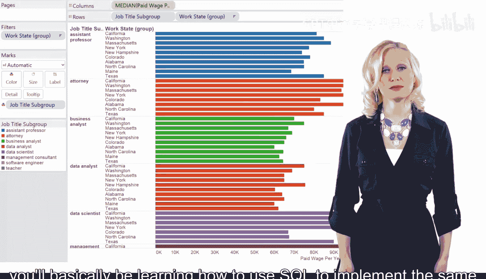

# Excel 到 MySQL：商业分析：3：欢迎进入第三周学习 📊

## 概述

在本节课中，我们将要学习 SQL 的核心技能：数据聚合与多表连接。你将掌握如何对整列数据进行汇总，并按特定条件分组，以及如何从多个表中组合信息。这些技能是数据分析师工作的基石。

## 上周回顾与本周展望

上一周我们介绍了如何定位、描述数据库中的数据，以及如何导出数据进行分析。这使你比那些不懂如何与数据库交互的分析师拥有了显著优势。

本节中我们来看看如何将你的技能提升到新的水平。你将学习如何汇总整列数据，并根据列中的值对这些汇总结果进行分组。你还将学习如何从多个表中组合信息。

本周所学的内容将构成你作为数据分析师所做一切工作的基础。这些查询工具将使你能够将数据操作成你感兴趣的任何类别或细分市场。

对于那些在此之前学习过 Tableau 课程的同学，你将基本上学习如何使用 SQL 来实现与在 Tableau 中将变量拖放到列或行上相同的计算。

## 数据汇总方法

有多种方法可以汇总数据。以下是一些最常见的方法：

*   **计数**：统计一组行中的观测值数量。
*   **求和**：将一组行中的所有值相加。
*   **平均值**：计算一组行中所有值的平均值。
*   **最大值**：报告一组行中的最大值。

这些汇总方法都以某种方式聚合你的数据。相应地，术语 `COUNT`、`SUM`、`AVG` 和 `MAX` 在 SQL 中都被称为**聚合函数**。

聚合函数本身非常直观易懂，因为我们习惯于进行这类计算。

## 聚合函数的挑战性用例

本周你将练习聚合函数一个稍具挑战性的用例，即当你必须组合需要以不同方式进行聚合的列时。

这个用例具有挑战性的原因之一是你必须记住为你想要包含在输出中的每一列使用适当的聚合函数。

例如，假设你经营一家专业相机店，你感兴趣的是每位员工完成了多少销售额，以及顾客对每位员工服务的满意度如何。

当组合适当的表格后，用于解决这些问题的数据包含以下列：员工姓名、每笔销售额、以及顾客在员工完成每笔销售后给出的满意度评分。

要按员工汇总这些列中的数据，你必须分离出与给定员工相关的所有行，然后以某种方式汇总其他各列中的值。

## 在 SQL 查询中实现分组聚合

要在 SQL 查询中实现这一点，你必须使用上周学到的 `SELECT` 和 `FROM` 子句，明确告诉数据库你感兴趣的是来自哪个（些）表的哪些数据列。

此外，你还必须使用 `GROUP BY` 语句告诉数据库如何按员工对行进行分组。

需要记住的重要一点是，你必须明确告诉数据库如何分别汇总每一列的行，并且必须为每一列使用正确的聚合函数。例如，我们想要统计或汇总每位员工在销售额列中的所有值，但我们想要平均顾客评分列中的所有值。

我们必须分别并在适当的位置输入这些函数。

## SQL 分析与 Excel 分析的差异

请记住，使用 SQL（或 Tableau）进行分析与在 Excel 中进行分析有些不同，因为你的所有 SQL 结果都是作为表格导出的，而不是工作表，因此它们必须符合表格格式。

实际上，这意味着你表格中的每一行都必须使用相同的聚合级别。如何做到这一点并不总是直观的，尤其是当你想根据不同的组来划分结果时。

为了感受这一点，假设你仍然对员工的销售数量和顾客满意度评分感兴趣，但现在你还想知道员工的性别是否以及如何与这些绩效指标相关。

你的数据拥有与之前相同的列，但现在还多了一个性别列。

当你按员工编号对行进行分组时，你仍然可以统计销售额列中的条目数量，并平均评分列中的顾客评分。

但是，你会如何汇总性别列中的性别信息，以便每位员工只有一个性别值呢？

## 处理非数值数据的聚合挑战

鉴于“女性”和“男性”是词语而非数字，没有合适的聚合函数来处理这种情况。在大多数数据库系统中，任何试图在此列上使用除 `COUNT` 之外的聚合函数的查询都会崩溃。但 `COUNT` 函数对你解决问题没有帮助，因为你不想统计行数，而是想知道员工是男性还是女性。

到本周末，你将了解一些可以重新设计查询以处理此类情况的方法，下周我们还将学习更多策略。

## 关于 MySQL 的特殊说明

我需要提醒你，特别是如果你习惯于在 Excel 中分析所有数据，可能需要一些时间来适应你必须使用的策略。我还要提到，MySQL 处理这些不匹配聚合级别的方式与其他数据库系统略有不同，这种现象会带来一系列问题，你将在本周的 MySQL 专项练习中了解更多。

## 本周另一项核心技能：合并表格

在你学会如何将数据汇总分组之后，本周要学习的下一个重要内容是如何合并表格。

合并表格是关系型数据库之所以有用的精髓所在。一旦你知道如何操作，它将解锁各种分析可能性。

我非常高兴能帮助你将 SQL 技能提升到新的水平。享受练习吧，在你练习编写聚合函数之后，我会与你联系并提供一些额外建议。然后在本周晚些时候，当我为你提供更多关于连接如何工作的背景知识时，我们会再次见面。

## 总结

本节课中我们一起学习了 SQL 数据聚合的核心概念，包括 `COUNT`、`SUM`、`AVG`、`MAX` 等聚合函数，以及如何使用 `GROUP BY` 进行分组。我们还探讨了当需要组合以不同方式聚合的列，或处理非数值数据（如性别）时所面临的挑战。最后，我们预告了本周另一项关键技能——多表连接，并指出了 MySQL 在处理聚合时的一些特性。掌握这些技能将为后续复杂的数据分析打下坚实基础。