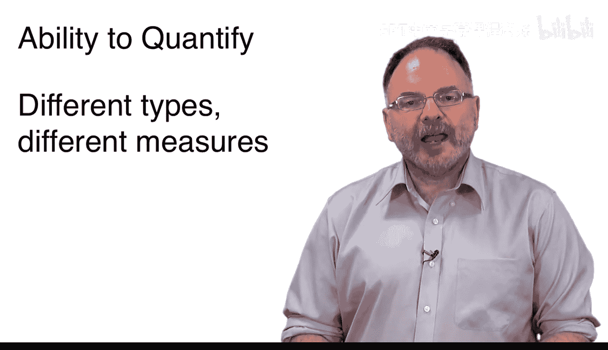

# 杜克大学《Excel 到 MySQL：商业分析（5课全）｜Excel to MySQL： Analytic Techniques for Business》中英 p15 15_03_02_业务分析师.zh_en -BV1mS421X7yw_p15-

After I read through about 50 recent help wanted ads for business analyst positions。

It became clear that the business analyst title is used as a label for a very wide range of jobs。

 with quite different expectations for what the person who fills the job will be doing。

I focus here on the requirements all of these jobs have in common。

The core skills that people hiring business analysts will expect to find in all successful candidates。

I've broken these skills down into seven areas。First。

Ability to identify the most important and relevant business metrics for a specific business。

This is local knowledge of the industry sector where a particular company is active。So far。

 we've mostly discussed horizontal business metrics， common to many industries。

Such as the Enterprise sales funnelnel。But many metrics become relevant within specific vertical markets or industry sectors。

Every industry has its own specialized metrics as well as more general ones。

 and the specialized ones have their own concepts and vocabulary。In this course。

 we cover industry specific metrics for several major vertical markets。

 including real estate and financial services。Bear in mind that preparation for business analyst jobs in other vertical markets will require you to do some additional industry specific research into what are that sector's characteristic metrics。

Its most important measures of success， efficiency and risk。Second。

Ability to apply appropriate models to analyze those metrics。

The models a business analyst is expected to know can be run in Excel。

This course will cover the most important general models used across multiple industries。

It might be worth pausing for a moment to clarify what we mean by a model。

Models are ways we represent a real world situation in simplified mathematical form。For example。

In a model of a bank's overall credit card default risk。

The full range of how credit card users interact with their cards。From always paying in full on time。

To sometimes missing a minimum payment。To getting way behind。

 but planning on catching up to deliberately running up debt and walking away。It's too complicated。

So a model could classify them into just two categories。In default and not in default。

We would then use historical patterns to forecast how many customers would move from one category to the other over the next month。

This would be a binary classification model for default risk。

Models are useful because they are simpler and smaller than the messy reality they represent。

And they do， they're representing。Using math formulas， which makes it easy to change the model。

 use it for forecasting the future， etc。Models for this course can all be set up and executed in Excel。

In Co  two， we will discuss the most important models for business analytics in depth。Third。

 ability to quantify the effectiveness of models used。

Different types of models rely on different measures for how well they are performing。

And we will study standard performance measures for all the most commonly used types of models。

For example， we suggested above that a binary classification model could be used for forecasting future default rates。

But there are many different ways to do a binary classification。

And choosing the best one available to us。Given the data we have and other constraints。

Requires having an agreed upon way to compare the performance of all binary classification models against each other。

As we'll see later， there is a universal measure to compare any two binary classifications。

The area under the ROC curve， much more detail about that later in course two。Fourth。

Ability to listen。To interview customers。Internal or external。To define project requirements。

Most of a business analysts work product takes the form of various reports。

 A report can be a customer requirements document。Translating what the customer says they want。

Into the product features and exact services。That the company can deliver。Or。A report。

Can be intended for internal use。The client is a marketing vice president or a sales team。

An effective report。Operationalizes a problem。It makes clear what specific steps need to be taken。

By whom in what order in order to solve the problem。These steps can then be measured and tracked。

We will give further examples later in this course。5th。Basic Excel skills。

 including the ability to identify patterns and trends in business data。Make forecasts。

Organize financial information。And display conclusions in charts and graphs。

And more intermediate Excel skills， such as the ability to import and manage large data sets。

Develop and test different models and run optimizations using solver。

These topics are covered in depth， in course， too。6th。Presentation skills。Effective。Meaning clear。

 concise， and persuasive， verbal and written communication using PowerPoint。

This topic is covered in depth in Co 3。7eventh。The ability to use data visualizations to make your conclusions and recommendations intuitive to a non technical audience。

In this specialization， we will teach use of one of the most widely used data visualization tools in business Tableau。

Again， this topic is covered in depth in Co  three。

